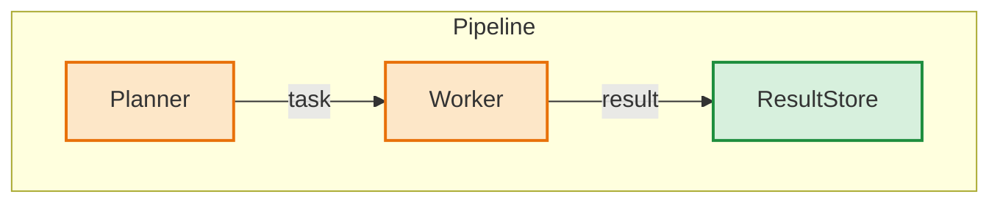

# Review a pull request as a whole

Follow the shared review standard in [review-pr](../SKILL.md). This mode answers the
questions a senior reviewer asks after reading the entire change: does it fit
the repository, is there a smaller shape, and what does it break outside the
diff. It reads beyond the diff and reports design findings. With `--comment`,
it maintains one overview comment and may create one new top-level comment
with follow-up findings. Otherwise it is read-only.

Run it at the exact head named by the caller. Review agent-generated pull
requests; they are the population where structural findings concentrate.

## Load the context

1. Read the pull-request title, body, issue comments, inline comments, and
   submitted reviews. Note every claim the body makes (verified, calibrated,
   network-denied, exercised end to end) and every principle it states.
2. Confirm the checked-out commit and the pull request's current head both
   match the requested head. If either differs, report the stale review and
   post nothing.
3. Fetch all issue comments with pagination. The overview to update is the
   earliest comment authored by `loom-oa-dev[bot]` with a well-formed
   `<!-- marin-holistic-review:<sha> -->` marker containing 40 hex characters.
   Ignore markers from other authors and follow-up comments. If older runs
   left duplicate overviews, read them too; the most recently updated
   overview supplies the previous findings and last reviewed sha. A rebase
   or force-push does not change which comment to edit. When the last
   reviewed sha still names a commit on the PR branch, diff it against the
   head. Stop without posting or editing when that delta is under 100 changed
   lines, touches only fixtures, generated files, or documentation, or
   consists only of commits whose subject starts with `Deslop`. If the sha
   is unavailable or no longer on the branch, do a full review and replace
   the same overview. With no overview, perform a first review. On re-review,
   carry earlier finding numbers forward, mark each resolved, open, or
   changed, and assign new numbers above the largest previously used number.
4. Read root `AGENTS.md`, every `AGENTS.md` that scopes a changed path, and
   `TESTING.md` when tests change.
5. Read the complete diff, then the unchanged code it depends on: base classes
   of every new dataclass or config instance, the callers of every changed
   signature, the module each new helper could have reused, and every test
   marked `docker`, `slow`, `integration`, `cluster`, or `manual` that the
   diff adds or edits.
6. Learn the system as it is before the change, for the walkthrough. Read
   the base version of each important changed file
   (`git show <merge-base>:<path>`), the callers of each changed interface
   (`git grep -n <symbol> <merge-base>`), and the recent history of the
   touched paths (`git log --oneline -15 <merge-base> -- <path>`). Read each
   issue and pull request that the body or the commits link.
7. List open pull requests that touch the same paths. `gh pr list --search`
   matches titles and bodies only, so list the open PRs with their files and
   filter on paths:
   `gh pr list --state open --limit 100 --json number,title,files`, then keep
   PRs whose `files[].path` intersects the changed paths.

## Answer the questions

Answer each question for the whole change. A finding must name a file and
line, the concrete consequence, and the concrete replacement. Omit anything
without a named replacement.

1. **Fit.** For each new helper, type, flag, module, or dependency, name the
   existing repository concept that could carry it. Search `lib/*/src`, the
   nearest `AGENTS.md`, and sibling modules. Cite the existing `def` or class
   by path. Respect dependency direction: `iris`/`haliax` to
   `levanter`/`zephyr` to `marin`.
2. **Better abstraction.** Name one construct that deletes surface the PR
   added and cite the lines it deletes. The recurring shapes are an enum plus
   a wrapper that re-derives what the type already decides, an always-truthy
   wrapper around an optional value, a nested conditional that a lookup table
   replaces, an alias or re-export, a helper duplicated with one branch
   changed, boolean dispatch where separate classes fit, a compatibility shim
   where the callers are all in-repo, and parameters threaded through layers
   that only forward them.
3. **Consequences outside the diff.** For every new config or dataclass
   instance, read the base defaults and ask whether a critical parameter
   (memory, timeout, user, network, version, region) is satisfied by a silent
   default whose assumption this instance violates. For every status, error,
   or result mapping, enumerate the source states and check that no failure
   is encoded as a legitimate value (zero reward, empty result, `None`, a
   default) that a caller cannot distinguish from a real outcome. For every
   new environment read, check whether planning or dry-run paths reach it.
4. **Hidden tests.** For every test under a skipped marker, decide whether it
   would pass. Read its parametrization, fixtures, and the code it calls.
   `uv run pytest --collect-only -q <path>` catches collection errors; the
   rest is reasoning. Report tests that raise before asserting. Run a changed
   test file when it needs no cluster, container, or credential; a run that
   disproves a suspected finding removes it from the packet.
5. **Claims versus evidence.** For each claim and principle noted from the
   body, cite the code, test, or artifact that proves it, or state that
   nothing does. Flag identity or version bumps that rest on unproven claims
   and code that contradicts a principle the body states.
6. **Related pull requests.** Check whether each open PR touching the same
   paths deletes, duplicates, or depends on this change. Report only a
   conflict, dependency, or overlap that requires action. Recommend folding
   when one deletes what the other adds, and name the merge order. Omit
   independent PRs and notes that either merge order works.
7. **Test value.** Apply the TESTING.md gate to every added or changed test:
   "this test fails when ___ behavior is wrong". List tests to drop with the
   reason: projection of a fixture, guard mirroring, prose assertion, private
   state, or implementation copied into the expectation. Name redundant
   matrices that one parametrized test replaces.
8. **Scope.** Separate what the title promises from what the diff does. Flag
   evidence files nothing reads, scripts inside library packages, one-shot
   machinery in reusable code, and unrelated changes riding along.

Validate every finding against the code. Do not report style preferences,
speculative failures, or pre-existing problems the PR did not touch. A finding
that a hunk-scoped reviewer or the lint catalog would report belongs to them;
report it here only when the whole-change view changes its conclusion.

## Review overview

Write a walkthrough followed by the findings. A reader should understand the
problem, the important before/after behavior, and the review decision without
opening the diff. Without `--comment`, return the overview. With it, follow
Posting below.

Choose the layout by how much explanation the change needs. The examples
below show a short form and a full form; combine or omit sections as needed.
The review questions apply to both.

### Short form

For a self-contained change, a short opening and one or two explanatory
paragraphs are usually enough. Explain the goal, the important before/after
behavior, and the evidence or limits. Add detail, a diagram, or a snippet
when a decision needs it. Avoid inventories of callers, test cases, or
mechanical edits; leave supporting detail for the findings.

This example uses illustrative names. Replace them and its evidence with
facts from the change being reviewed:

```markdown
🤖 Holistic review of <sha>.

This change validates job settings before reserving a worker, so invalid
jobs fail without holding resources. One retry path still needs the same
check.

Previously, submission allocated a worker before validating the job. The
shared validation function now runs before allocation and is also used by
the command-line preview. The new test covers invalid submissions; retries
remain untested.

**Findings**

- **1. Should fix:** `src/jobs.py:80` `retry_job` still reserves a worker
  before checking the settings, so an invalid retry holds that worker until
  it times out. Call the shared validation function before `reserve_worker`
  and cover invalid retries in the submission regression test.

<!-- marin-holistic-review:<sha> -->
```

With no findings, write `No findings.` and omit the Findings label. On a
re-review, add a short resolved-items line below the findings when needed,
such as `Earlier findings: 2 resolved; retries now validate before allocation.`

### Full form

For a change spanning subsystems, interfaces, or protocols, the walkthrough
can use this outline after the opening verdict:

```markdown
**System**

<Component diagram showing the system after the change.>

**Why**

<The problem and its trigger. Link the issue, incident, or evidence.>

**Before**

<The prior entry points, data flow, and behavior that the change replaces.>

**Design**

<The important interfaces and decisions, with focused snippets where useful.>

**Evidence and limits**

<What supports the change, what remains unverified, and limits that affect
the review or merge decision.>

**Findings**

<Numbered findings, as in the short form.>
```

Use only the sections that help the reader. Short sections can use a bold
run-in label such as `**Before.** Previously, ...`. Markdown headings are
appropriate when a long section needs navigation. Avoid a heading for every
paragraph and empty severity/category sections.

### Diagrams and snippets

Use real code names in diagrams. This example shows the notation; replace its
components and edges with those of the system being reviewed:



Unstyled boxes existed before; `changed` and `added` mark affected components.
Keep each diagram to about ten boxes, at most three side by side. Use
`flowchart TB`, subgraphs, nodes, edges, and `classDef` lines; quote labels
containing punctuation. An architecture change may also need the old
connections for comparison. A simple change may need no diagram.

Use 3–12-line code or diff snippets when the exact code helps assess a
decision or finding. Put the path in the first line. Show each piece once;
otherwise link to the code. Large changes may need several snippets.

### Findings and evidence

Lead with what the diff does, the verdict, and what needs attention. Flag a
title/body mismatch when it affects the review. State the evidence once,
distinguishing local results from claims in the PR body. Avoid repeating the
PR description or adding process status such as "no review threads yet".

Each finding gives the consequence, evidence, and concrete action. Label it
`Blocker`, `Should fix`, `Drop test`, or `Related PR`, as appropriate. Keep
related-PR notes to required actions and merge order. Use bullets with explicit
finding numbers so Markdown cannot renumber gaps left by resolved items.

Most findings fit in one paragraph. Use another paragraph or a snippet when
the evidence needs it. Avoid nested Why/Effect/Callers/Fix outlines within
each finding. Summarize test evidence once; list individual cases only when
they establish a finding.

On re-review, preserve finding numbers, mark changed items, and keep open
findings in the list. Summarize resolved numbers with a short reason below
it, including when all findings are resolved. Do not repeat open findings in
a separate carried-items section.

Number all items, including tests to drop and related PRs, so every item
carries one category in the telemetry event. A blocker makes the change
wrong or unsafe as merged: a hidden test that raises, a resource default
that fails the workload, a failure encoded as a result, a principle the body
states and the code violates, a security boundary the code crosses, or an
open PR stacked on this one that deletes what it adds. A later PR that
supersedes this one is a related-PR note with a merge order; it is never a
blocker. Everything else is should-fix.

Tag each item with its category in the telemetry event below: `fit`,
`abstraction`, `consequence`, `hidden-test`, `evidence`, `related-pr`,
`slop-test`, or `scope`.

## Telemetry

Emit one best-effort stats event before returning, including clean runs.
Never retry or surface a telemetry failure. Run from the repository root:

```bash
cat <<'EOF' | uv run infra/codehealth/log_stats.py
{
  "tool": "review-pr-holistic",
  "invocation": {
    "trigger": "local",
    "agent_cli": "claude",
    "pr_number": <PR>,
    "agent_exit_code": 0,
    "timed_out": false
  },
  "findings": [
    ["<file>", <line>, "<category>", 1.0, "<first 200 chars of the item>"]
  ]
}
EOF
```

## Posting

With `--comment`, refresh the paginated issue comments and re-read the PR
head immediately before writing. If the head no longer matches the requested
head, write nothing and report the stale review; the launcher cannot cancel
a Loom session already running. If a bot-authored overview marker already
names this head or a later commit on the branch, write nothing.
Keep the stale-head and small-delta gates from Load the context.

### Create or edit the overview

- If none exists, create it with `gh pr comment <PR> --body-file <file>`.
- Otherwise replace the original overview by its exact issue-comment
  ID, including its walkthrough, current findings, and head marker:
  `gh api --method PATCH repos/marin-community/marin/issues/comments/<id> -F body=@<file>`.
  Do not use `--edit-last`: the bot also posts deslop replies and follow-ups.
  If the edit fails, report the failure; do not create a duplicate as a
  fallback. Leave historical duplicate comments alone and use the original
  overview for future updates.

### Optional new comment with follow-up findings

After editing the overview on a re-review, you may create **one new top-level
PR comment** for new or materially changed actionable findings, including
follow-up lint findings. This is a separate comment from the overview. Use
`gh pr comment <PR> --body-file <file>` and this format:

```markdown
🤖 Follow-up findings for <sha>. [Updated overview](<overview-url>).

- **6. Should fix:** `<file>:<line>` <consequence>. <replacement>.

<!-- marin-holistic-followup:<sha> -->
```

Reuse the overview's finding numbers. Include only the new or changed
findings; omit the walkthrough, unchanged open findings, and resolved-item
status. If there are no new or changed actionable findings, edit only the
overview and create no new comment.

Before creating this comment, recheck the PR head and skip it if a comment
by `loom-oa-dev[bot]` already has that head's follow-up marker. Use the
follow-up marker only on this new comment; the overview keeps its overview
marker. Do not post inline review comments.

## Deslop follow-through

A deslop session launched from a posted packet on an `agent-generated` pull
request may apply only these items: tests to drop, aliases and re-exports,
duplicated helpers, nested conditionals replaced by lookups, stale docstrings
and comments, and checked-in evidence nothing reads. It then runs the
`simplify-code` skill over the branch diff. It never applies a blocker or any item
that changes behavior; those stay with the author.

The session verifies the head repository is this repository, applies the
items, runs `./infra/pre-commit.py --changed-files --fix` and the narrow
affected tests, and pushes one commit whose subject starts with `Deslop` and
names the reviewed sha. It replies once with `🤖`, lists what it removed, and
ends the reply with `<!-- marin-deslop:<sha> -->`. If any test fails it pushes
nothing and posts the findings instead. One deslop commit per reviewed head;
a head whose last commit is itself a deslop commit is never deslopped again.
On a pull request without `agent-generated`, the session posts committable
suggestions and pushes nothing.
