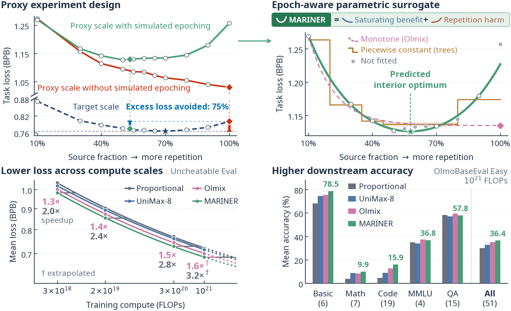

# MARINER

[](https://arxiv.org/abs/XXXX.XXXXX)

<!--marin-intro-start-->

This repository contains the code for **[MARINER](https://arxiv.org/abs/XXXX.XXXXX)**, a parametric surrogate for data mixing that models each data bucket's saturating benefit and growing repetition harm as functions of its epochs. MARINER is fitted to the losses of a swarm of small proxy runs and proposes a mixture for a larger target run. The repository is a fork of [Marin](https://github.com/marin-community/marin) whose only addition is the `lib/mariner` package, which needs numpy, scipy, pandas, scikit-learn and pyarrow, and no accelerator libraries. Redrawing the paper's figures also needs matplotlib and LightGBM.
<!--marin-intro-end-->



On three 39-bucket swarms, MARINER predicts mixture performance more accurately than Olmix's log-linear regression and RegMix's boosted trees. Its proposed mixtures measure within 0.005 BPB of its predictions and outperform those of more flexible baselines, without the hand-tuned epoch caps or KL penalties commonly used to regularize mixtures. At $10^{21}$ FLOPs with epochs preserved, we estimate from fitted scaling curves that MARINER's mixtures require 69–83% less final-training compute than proportional mixing to reach the same loss, and 26–38% less than Olmix (the paper's Figure 9). They also raise mean downstream accuracy at that scale from proportional mixing's 30.1% to 36.4% (Table 2).

The runs and fits behind the paper are in the [mariner-data](https://huggingface.co/datasets/marin-community/mariner-data) dataset. The final checkpoints of the three swarms' runs are in the model repositories [mariner-swarm-qwen3-360m-1p6b](https://huggingface.co/Calvin-Xu/mariner-swarm-qwen3-360m-1p6b), [mariner-swarm-llama-160m-1p2b](https://huggingface.co/Calvin-Xu/mariner-swarm-llama-160m-1p2b), and [mariner-swarm-llama-200m-6b](https://huggingface.co/Calvin-Xu/mariner-swarm-llama-200m-6b), one folder per run, named by the run's `run_label` in the dataset.

For more details, see our paper: [*MARINER: Measuring and Modeling Repetition Harm for Multi-Epoch Data Mixing*](https://arxiv.org/abs/XXXX.XXXXX)

<!--marin-first-steps-start-->
## Installation

```bash
python3.12 -m venv .venv
source .venv/bin/activate
pip install -c https://raw.githubusercontent.com/Calvin-Xu/mariner/v0.1.0/lib/mariner/constraints.txt \
  "marin-mariner[download,olmix,figures] @ git+https://github.com/Calvin-Xu/mariner@v0.1.0#subdirectory=lib/mariner"
```

The constraints file pins the library versions with which we checked the reproductions below. These versions need Python 3.12: the pinned pandas 2.2.2 has no wheels for later Python versions, and the package needs Python 3.12 or later. The `download` extra fetches the dataset from the Hugging Face Hub, the `olmix` extra installs cvxpy and its solvers for the Olmix baseline, and the `figures` extra installs matplotlib and LightGBM 4.7.0 for the figure redraws. Inside a clone of this repository (`git clone https://github.com/Calvin-Xu/mariner`), `uv run --package marin-mariner --extra download --extra olmix --extra figures mariner ...` runs the command in the workspace environment.

<!--marin-first-steps-end-->

## Reproducing the paper's mixtures

```bash
mariner download --out mariner-data
mariner self-test --data mariner-data
```

The dataset holds three swarms over the same 39 data buckets: `qwen3_360m_1p6b`, the main swarm of 360M-parameter Qwen3 models trained on 1.6B tokens, and `llama_160m_1p2b` and `llama_200m_6b`. Each swarm has 238 sampled mixtures, 39 single-bucket removals, three or four baselines, and ten repeats of the proportional mixture. The self-test refits MARINER to the main swarm for both objectives of the paper, Uncheatable Eval (`uncheatable`) and the OlmoBaseEval Easy mean (`obe_easy`). It checks that the fit's predictions at the swarm's runs and at the held-out runs match the released predictions within 1e-6 BPB, and that the proposed mixtures give every bucket the same weight on Marin's 1/2048 grid as the two MARINER mixtures we trained. It then re-derives the two matched Olmix mixtures of the paper (epoch cap 4, KL penalty 0.05 for Uncheatable Eval and 0.005 for OlmoBaseEval Easy) from the released Olmix laws. It prints one `PASS` or `FAIL` line for each of these eight checks. The run takes about 2 minutes. `--refit-olmix` refits the Olmix laws instead of reading the released ones, which takes about 10 more. The refit fits each task's law from 48 starts of a local optimizer, on a loss with many local optima, so its result depends on floating-point details. On macOS arm64 with numpy and scipy on Accelerate (macOS 14 or later), where the released laws were fitted, it reproduces them to 1e-9. On Linux aarch64 with OpenBLAS it reached other laws of nearly equal loss, whose proposals put 41 and 95 of the 2,048 blocks in other buckets than the trained Olmix mixtures. The released laws reproduced the paper's Olmix mixtures on both platforms.

The individual steps are also commands:

```bash
mariner fit --data mariner-data --swarm qwen3_360m_1p6b --objective obe_easy --out fit.json
mariner optimize --fit fit.json --data mariner-data --swarm qwen3_360m_1p6b --out mixture.csv
mariner evaluate --fit fit.json --data mariner-data
```

These commands re-derive the MARINER mixture that we trained for OlmoBaseEval Easy. `mixture.csv` gives each bucket's proposed weight on the 1/2048 grid of Marin's data loader (`runtime_weight`) and the number of times the target run repeats the bucket at that weight (`materialized_epochs`). `evaluate` scores a fit of the main swarm on the held-out runs that the paper's held-out analysis uses: the regret and rank of the mixture with the lowest prediction, the RMSE, and the Spearman correlation.

## Reproducing the figures

```bash
mariner figures --data mariner-data --out figures
mariner figures --data mariner-data --out figures --only fig:b6
```

`mariner figures` redraws the paper's 27 figures, 17 from the main text and 10 from the appendix, and writes one PDF per figure to `--out`. All 27 take about 15 seconds; `--only` takes one or more labels from the table below (`--only fig:b5 fig:b6`). Figures 1 to 17 are in the paper's main text and 18 to 27 in its appendix, and each PDF is named after the paper's figure file. Each redraw plots the same data, fitted curves and comparisons as the paper's figure, every panel included, in a plain layout. The paper's figures render their text with LaTeX and arrange their panels by hand, so the redraws differ from them only in style. A redraw reads only the dataset configurations (groups of tables) that the dataset's `figures_tables.csv` lists for its figure. Fits that the dataset does not hold, such as those of Figure 1's surrogate panel, are computed with this package. [`lib/mariner/paper_figures/`](lib/mariner/paper_figures/) holds the redraws of this release's dataset revision.

| Figure | Content | `--only` | Redraw |
| --- | --- | --- | --- |
| 1 | Repetition-aware data mixing with MARINER | `fig:pipeline` | [`f1_pipeline.pdf`](lib/mariner/paper_figures/f1_pipeline.pdf) |
| 2 | Simulated epoching and mixture selection | `fig:epoch-matching` | [`epoch_matching_tpp10.pdf`](lib/mariner/paper_figures/epoch_matching_tpp10.pdf) |
| 3 | Optimal epochs across matched-compute proxies | `fig:b5` | [`b5_matched_compute_scaling.pdf`](lib/mariner/paper_figures/b5_matched_compute_scaling.pdf) |
| 4 | Interior optima of the StarCoder sweeps | `fig:b6` | [`b6_olmix_capacity_failure.pdf`](lib/mariner/paper_figures/b6_olmix_capacity_failure.pdf) |
| 5 | MARINER's benefit and harm terms | `fig:mariner-terms` | [`m_mariner_terms.pdf`](lib/mariner/paper_figures/m_mariner_terms.pdf) |
| 6 | Selection regret against swarm size | `fig:r6` | [`r6_learning_curve_per_fold_ratio.pdf`](lib/mariner/paper_figures/r6_learning_curve_per_fold_ratio.pdf) |
| 7 | Predicted and measured loss of each proposal | `fig:proposal-predictions` | [`r_proposal_predictions.pdf`](lib/mariner/paper_figures/r_proposal_predictions.pdf) |
| 8 | Downstream accuracy against loss | `fig:accuracy` | [`r_accuracy_vs_bpb.pdf`](lib/mariner/paper_figures/r_accuracy_vs_bpb.pdf) |
| 9 | Loss across compute scales | `fig:r1` | [`r1_scaling_curves.pdf`](lib/mariner/paper_figures/r1_scaling_curves.pdf) |
| 10 | Loss on the optimized and the other objective | `fig:off-objective` | [`r_on_off_objective.pdf`](lib/mariner/paper_figures/r_on_off_objective.pdf) |
| 11 | Component losses under each objective | `fig:component-tradeoffs` | [`r8_component_tradeoffs_4panel.pdf`](lib/mariner/paper_figures/r8_component_tradeoffs_4panel.pdf) |
| 12 | Epoch caps against the optimal epochs of two bucket–task pairs | `fig:domain-repetition` | [`figure4_cap_policy.pdf`](lib/mariner/paper_figures/figure4_cap_policy.pdf) |
| 13 | Each bucket's epochs in the proposed mixtures | `fig:mixture-epochs` | [`r_mixture_epochs.pdf`](lib/mariner/paper_figures/r_mixture_epochs.pdf) |
| 14 | Mixture transfer across proxy settings | `fig:r3` | [`r3_transfer_main.pdf`](lib/mariner/paper_figures/r3_transfer_main.pdf) |
| 15 | Prediction accuracy against signal-to-noise ratio | `fig:r7` | [`r7_r2_vs_snr.pdf`](lib/mariner/paper_figures/r7_r2_vs_snr.pdf) |
| 16 | Predictions on the 30 lowest-loss held-out mixtures | `fig:analysis-floor` | [`r_analysis_frontier.pdf`](lib/mariner/paper_figures/r_analysis_frontier.pdf) |
| 17 | Prediction residuals against distance from the swarm | `fig:analysis-extrapolation` | [`r_extrapolation_residuals.pdf`](lib/mariner/paper_figures/r_extrapolation_residuals.pdf) |
| 18 | Selection regret of MARINER's ablations | `fig:a-learning-ablations` | [`a_learning_curve_ablations.pdf`](lib/mariner/paper_figures/a_learning_curve_ablations.pdf) |
| 19 | Selection regret and rank correlation of the baselines | `fig:a-learning-baselines` | [`a_learning_curve_baselines.pdf`](lib/mariner/paper_figures/a_learning_curve_baselines.pdf) |
| 20 | Loss between MARINER's and each baseline's proposal | `fig:a-comparator-paths` | [`a_comparator_paths_full.pdf`](lib/mariner/paper_figures/a_comparator_paths_full.pdf) |
| 21 | Loss minimum by degree of downsampling | `fig:b5a` | [`b5_downsampling_fixed_budget.pdf`](lib/mariner/paper_figures/b5_downsampling_fixed_budget.pdf) |
| 22 | Loss minimum by token budget | `fig:a-downsampling` | [`a_replay_burden_ladder.pdf`](lib/mariner/paper_figures/a_replay_burden_ladder.pdf) |
| 23 | Task losses after removing one bucket | `fig:a-deletion` | [`a_deletion_matrix_full.pdf`](lib/mariner/paper_figures/a_deletion_matrix_full.pdf) |
| 24 | The swarm's sampled epochs and the proposals' epochs | `fig:a-support` | [`a_swarm_support.pdf`](lib/mariner/paper_figures/a_swarm_support.pdf) |
| 25 | Two-phase gains in the Nemotron-CC/StarCoder sweeps | `fig:a-curricula-sweeps` | [`a_curricula_sweeps.pdf`](lib/mariner/paper_figures/a_curricula_sweeps.pdf) |
| 26 | Losses after an abrupt or smoothed switch | `fig:a-switch-smoothing` | [`a_switch_smoothing.pdf`](lib/mariner/paper_figures/a_switch_smoothing.pdf) |
| 27 | StarCoder's share per block under the smoothed schedules | `fig:a-ramp-schedules` | [`a_ramp_schedules.pdf`](lib/mariner/paper_figures/a_ramp_schedules.pdf) |

## Reproducing the main table

```bash
mariner tables --data mariner-data
```

`mariner tables` prints the paper's Table 2: the Uncheatable Eval and OlmoBaseEval Easy BPB of each mixture at the four compute scales, and the mean downstream accuracy at $10^{21}$ FLOPs.

## Fitting your own swarm

MARINER reads three tables:

- **Partition** (`partition.csv`): one row per bucket, with `bucket_id` and `pool_tokens`, the number of tokens in the bucket's pool. With `--target-budget`, the target run's token budget, MARINER computes each bucket's epochs per unit weight as the budget divided by the pool size; without it, the table must give them in a column `epochs_per_unit_weight`.
- **Tasks** (`tasks.csv`): one row per evaluation task, with `task_id`, `objective` and `aggregate_weight`. An objective is the weighted sum of its tasks' BPB.
- **Runs** (`runs.csv`): one row per proxy run, with `observation_id`, `run_label`, `design_kind`, `fit_inclusion` (True or False), the mixture weights `w__<bucket_id>` (summing to one), the pool fractions `pf__<bucket_id>` defined below, and the measured `bpb__<task_id>`.

The fit rows (`fit_inclusion` true) must include one run of the proportional mixture labeled `baseline_proportional`. It trains in every cross-validation fold and is never scored. The table must also hold at least two repeats of the proportional mixture with `design_kind` `repeat` and `fit_inclusion` false; their mean and standard deviation set each task's anchor and noise margin. With `--data`, the Uncheatable Eval anchors of the main swarm also include the proportional run at the swarm's scale from the dataset's ladder table, as in the paper, so a fit of the swarm's own CSV for that objective differs from the released fit.

The proxies must repeat each bucket as often as the target run would. A proxy with token budget D_r samples, from each pool of P_i tokens, a slice of P_i D_r / D_tgt tokens, so that weight w_i repeats bucket i w_i D_tgt / P_i times, as a target run with budget D_tgt would. In Marin, `LmDataConfig`'s `target_budget` and `experiment_budget` do this. A run's pool fraction is the share of that slice it samples: 1 under simulated epoching, and 0.5 for a run that repeats the bucket twice as often. The commands below use the paper's target budget, D_tgt = 6,325,183,647,689 tokens; replace it with your target run's.

```bash
mariner fit --runs runs.csv --partition partition.csv --tasks tasks.csv --target-budget 6325183647689 \
  --objective my_objective --out fit.json
mariner optimize --fit fit.json --runs runs.csv --partition partition.csv --tasks tasks.csv \
  --target-budget 6325183647689 --out mixture.csv
mariner cross-validate --runs runs.csv --partition partition.csv --tasks tasks.csv \
  --target-budget 6325183647689 --objective my_objective --out cv.csv
```

`optimize` searches the whole simplex. `--cap` bounds each bucket's epochs from above and `--kl` adds Olmix's KL penalty toward the proportional mixture; the paper's MARINER proposals use neither. `cross-validate` refits the objective on each of the paper's five folds, so it takes about five times as long as `fit`. It writes each run's out-of-fold prediction and prints the metrics of `evaluate` for the swarm's runs.

## Designing a swarm

```bash
mariner design --partition partition.csv --target-budget 6325183647689 --candidates 238 --seed 0 \
  --repeats 10 --unimax-budget-fraction 0.8 --out design.csv
```

The design holds three baselines (the proportional mixture, UniMax with a one-epoch cap at the given fraction of the target budget, and uniform weights), 238 candidates from a scrambled Sobol sequence mapped to the simplex (weights below 2e-4 set to zero, and candidates within total variation 0.001 of a baseline, a removal or an earlier candidate rejected), one removal per bucket (the proportional mixture without that bucket), and ten repeats of the proportional mixture. Each run's data seed counts up from `--seed`. After training, add each run's `observation_id` (a unique run name) and `bpb__<task_id>` columns to `design.csv` to obtain the runs table, `runs.csv` above.

Our swarms differed in two steps that the package leaves out, because each was first trained as two-phase schedules (the paper's appendix on models and training configurations explains why). We chose our 238 designs from 2,048 two-phase Sobol candidates to be D-optimal for DS-RE-CEQ, an earlier surrogate fitted to the MMLU 5-shot BPB of two baseline runs, and each design's one-phase mixture is the average 0.8 w(0) + 0.2 w(1) of its two phases. We have not compared the D-optimal step with plain Sobol designs. Our UniMax baseline used 0.8 of the target budget, the share of the first phase.

## The package

| Module | Contents |
| --- | --- |
| `mariner.model` | Exposures, the benefit and harm response functions, and fitted models with their predictions |
| `mariner.fit` | Per-task fits: floors, nonnegative ridge regression, the shape and ridge grid, the floor-multiplier search, and mixture-blocked folds |
| `mariner.optimize` | The objective's minimization over the simplex and the rounding to the 1/2048 grid |
| `mariner.evaluate` | The paper's five-fold cross-validation and held-out selection metrics |
| `mariner.olmix` | The Olmix baseline: log-linear laws, the KL-regularized proposer, and rounding that keeps each bucket under its cap |
| `mariner.design` | Swarm design |
| `mariner.data` | Reading mariner-data and one's own tables |
| `mariner.figures` | The redraws of the paper's figures, one module per group of figures |
| `mariner.tables` | The paper's Table 2 |
| `mariner.cli` | The `mariner` command |

Parameter names follow the paper's symbols: `rho` (benefit rate), `kappa` (Weibull power), `tau` (harm threshold), `gamma` (ridge weight), `nu` (floor multiplier) and `phi` (floor).

The `mariner` command runs with one thread in each BLAS and OpenMP thread pool of NumPy, SciPy and scikit-learn. A fit consists of many small solves, for which more threads only add contention: in a Linux container with 16 cores, the self-test at the default thread counts had finished 8 of its 58 task fits after almost two hours, and with one thread it finishes in under two minutes. Code that calls the package's functions directly should limit the pools in the same way, for example with `threadpoolctl.threadpool_limits(1)`.

The tests run with:

```bash
uv run --package marin-mariner --extra olmix --extra figures --group test pytest lib/mariner/tests
uv run --package marin-mariner --extra olmix --extra figures --group test pytest lib/mariner/tests \
  -m data_integration -n auto --mariner-data mariner-data --session-timeout=3600
```

The second command compares refits of all three swarms and of the Olmix laws with the released tables (the Olmix refits run only on macOS arm64 with numpy and scipy on Accelerate and skip elsewhere), and draws each figure from only the configurations that `figures_tables.csv` lists for it, checking each against a number or claim that the paper states. It takes about 10 minutes.

## Research code

The code that ran the paper's experiments is on Marin's branch [`calvin/swarm-olmo3-regmix-test`](https://github.com/marin-community/marin/tree/TAG) at tag `TAG`: the swarm and ladder launchers, the 39-bucket partition and Stack-Edu preparation, the OlmoBaseEval Easy evaluator, and the research versions of the baselines (RegMix, splines, and others). It runs on Marin's earlier experiment executor, which `main` no longer has.

## Citation

If you use this code in your research, please cite:

```bibtex
@article{xu2026mariner,
  title={MARINER: Measuring and Modeling Repetition Harm for Multi-Epoch Data Mixing},
  author={Xu, Pinlin and Kotha, Suhas and Wen, Kaiyue and Held, William and Liang, Percy},
  journal={arXiv preprint arXiv:XXXX.XXXXX},
  year={2026}
}
```

## License

This code is released under the Apache 2.0 License, as Marin is.
