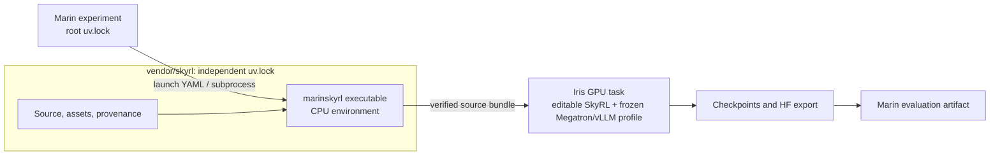

# Maintain the vendored SkyRL runtime

`scripts/skyrl_migration.py` prepares a pruned source candidate at `vendor/skyrl`,
builds a `marinskyrl` wheel, and prepares open work for transfer from
`marin-community/MarinSkyRL`. Vendoring changes source ownership. Marin invokes
the nested `marinskyrl` executable in a child process. SkyRL may depend on
Marin libraries inside its independently locked environment; Marin must not
import SkyRL or Harbor into its own environment. Editable installations are
supported inside that nested environment. SkyRL remains outside Marin's
workspace and root dependency resolution.

Marin's launcher uses this nested project. It passes the launch document to
`uv run --isolated --project vendor/skyrl --frozen --no-group dev marinskyrl`
after clearing the parent's Python environment selection. The CPU launcher
verifies source and asset hashes, then bundles the project and its lock for
Iris. Workers install that source in editable mode with the frozen
Megatron/vLLM profile. No task clones the SkyRL fork.



`SkyRLRuntime.source_digest` contains the SHA-256 of the vendored provenance document.
The document binds the captured fork commit, migration patches, independent
lock, and source file hashes. Use a fresh artifact version when it changes.
The nested project currently selects published or Git-pinned Marin
packages; local editable Marin packages are not wired into its bundle.

The migration tool rebuilds source candidates and prepares active work. It
does not edit Marin's integration, publish a wheel, enable migrated nightlies,
or archive the fork. Those are reviewed changes or final cutover operations.

The checked-in `vendor/skyrl` tree is the script's patched baseline output, including
its license and per-file source provenance. The generated
[`snapshot-report.md`](https://github.com/marin-community/marin/blob/main/config/skyrl-migration/snapshot-report.md) records
open-work transplant decisions; it does not merge those PRs into the baseline.
The `skyrl-wheel` CI lane checks source and patch hashes, the independent
lock's freshness, and the built wheel's runtime assets:

```bash
uv run --no-project python -m scripts.skyrl_migration check-vendor
```

This lane builds without installing SkyRL into Marin. GPU runtime acceptance
remains a separate operation.

## Snapshot and dry run

Run from the Marin repository root. Requirements: Python 3.12, `uv`, `git`, `rg`,
and authenticated `gh` with read access to the source repository. Local candidate
commits use the configured Git identity. Choose a task-owned output directory
with enough room for Git objects and the staged source; reuse it across commands.
Neither `plan` nor `stage` installs SkyRL dependencies or executes its code.

```bash
uv run --no-project python -m scripts.skyrl_migration plan \
  --output /path/to/migration/snapshot
uv run --no-project python -m scripts.skyrl_migration stage \
  --snapshot /path/to/migration/snapshot \
  --output /path/to/migration/candidate
uv run --no-project python -m scripts.skyrl_migration build-wheel \
  --candidate /path/to/migration/candidate
```

`plan` captures an exact source commit, every currently open PR, and currently
open issues updated within the last ten days, measured in UTC at invocation.
`--days` changes the issue window; it never filters out older open PRs. All API
lists are paginated. The snapshot includes discussion, reviews, Git objects,
and full binary/rename-capable patches. It leaves GitHub unchanged.

[`config/skyrl-migration.toml`](https://github.com/marin-community/marin/blob/main/config/skyrl-migration.toml) marks the
supported entrypoints, tests, dynamic registrations, and non-Python assets.
The planner follows nested, relative, and literal dynamic Python imports and
package initializers. It also roots direct imports from Marin callers and files
in the launcher's runtime-bundle manifest. `selection.json` records a reason
for every retained file, every discarded file, unresolved dynamic imports, and
missing local imports. Whole files are the unit of pruning; unreachable
functions inside retained files are not removed.

The manifest also names migration patches under `config/skyrl-migration/`.
`plan` captures their bytes and hashes. `stage` applies those captured patches
to the selected source, records them in packaged provenance, and hashes the
result before trying open PRs. Patch failures stop staging. Runtime fixes are
therefore reproducible on later snapshots and remain distinct from the source
commit. Publication requires the merged cutover to contain the same patches.

The manifest drops `skyrl-tx`, old documentation and integrations, and files
outside the supported closure. Namespace packages are supported. Shell path
references, Hydra dispatch, arbitrary plugins, environment-driven imports,
and external services still require runtime checks. Keep a missing asset with
its caller or failed acceptance gate as evidence, then rerun into new output
directories. Existing output directories are never overwritten.

`stage` writes these outputs:

- `tree/vendor/skyrl`: selected source, executable modes, safe source symlinks,
  license, and packaged `_vendor_provenance.json`.
- `report.json` and `report.md`: PR dependency edges and transplant outcomes.
- `pr-<N>-retained.patch`: the candidate portion of each attempted PR. Original
  complete patches and review history remain in the snapshot.
- Local branches `skyrl-migration/pr-<N>` inside `tree/.git`, based on the
  staged parent for stacked PRs. The checked-out `main` branch remains the
  baseline candidate.

`ready` means Git applied the PR delta; it does not mean tests passed. A PR
that touches discarded paths receives a partial candidate and `needs-decision`.
Its children remain blocked. Conflicts, entirely excluded PRs, already applied
changes, and unknown parent branches are separate outcomes. Resolve these
decisions in the manifest or a reviewed cutover patch. Never silently discard
the excluded portion of active work.

`build-wheel` runs the existing package's build backend and audits packaged
runtime files against their source hashes. It writes `wheel.json` with SHA-256
and ZIP members, plus `binary-consumer/pyproject.toml`, which references the
local wheel file. That consumer is an isolated project and has no connection
to Marin's root lock. It carries the source's uv overrides and frozen base
dependency constraints for Linux x86_64. Wheel metadata alone does not carry
these policies. `runtime-dependencies/` preserves the source's dependency
manifest and lock for the independently installed GPU profiles; it contains
no SkyRL implementation. The command does not resolve the consumer or install
its dependencies. Wheel deployment requires an immutable artifact URL and a
unique release version. An editable deployment instead ships the exact source
and runtime assets in the Iris bundle. Both use independently frozen launcher
and GPU environments. A successful wheel build is not runtime acceptance.

The wheel path is retained for package acceptance and inference smoke tests.
The production launcher uses the source bundle described above. Check wheel
dependency resolution without installing the result:

```bash
uv lock --project /path/to/migration/candidate/binary-consumer
```

This writes only the consumer's lock. An unavailable required Marin package
wheel must be published or resolved through an explicit dependency change
before cutover; do not relax constraints merely to make staging pass.

## Math500 acceptance

Run Math500 as held-out evaluation. First check every reference against the
installed wheel's AIME verifier in strict boxed mode: a boxed normalized reference must pass and an
empty response must fail. Record all 500 outcomes, including exceptions. Keep
the dataset revision, wheel SHA-256, dependency lock, model revision, and module
origins with the results. Run the same failing cases against the unpruned
source at the captured commit before attributing failures to pruning.

Install the binary in a separate environment. For the CPU verifier gate:

```bash
candidate=/absolute/path/to/migration/candidate
UV_PROJECT_ENVIRONMENT="$candidate/runtime-env" uv sync --frozen \
  --project "$candidate/runtime-dependencies" --no-install-project --no-group dev
uv pip install --python "$candidate/runtime-env/bin/python" --no-deps \
  "$candidate/wheels/"*.whl
uv pip check --python "$candidate/runtime-env/bin/python"
```

For GPU evaluation, install the same dependency project with
`--extra megatron --extra vllm --extra telemetry`, then install the wheel with
`--no-deps`. The generated `run.sh` applies the CUDA environment and linker
setup used by `vendor/skyrl/cloud/iris/bootstrap_runtime.sh`. Its packaged
environment activation command is:

```bash
"$candidate/runtime-env/bin/python" -m marinskyrl.environment_contract \
  write-frozen-cuda-runtime "$candidate/cuda-runtime.sh"
source "$candidate/cuda-runtime.sh"
```

Use the generated `run.sh` for the complete GPU setup, including native-library
links. Never install the dependency project's root package or add the source
tree to `PYTHONPATH` during candidate acceptance.

Use `skyrl_train.entrypoints.main_generate` with one inference engine on one
H100, a pinned small Qwen model, deterministic sampling, and a bounded timeout.
Select `environment.task_sessions.aime.strict_box_verify=true` explicitly:
the default Minerva protocol requires an `Answer:` prefix, while the model's
Math500 answers use boxes. This uses SkyRL's existing boxed grader unchanged.
Start with 32 fixed Math500 rows, then evaluate all 500. Require every selected
row to be attempted and scored, finite metrics, complete scoring coverage, and
at least one correct model-generated answer.
Save completions and compare scores with the same model, tokenizer, data,
sampling, and dependency versions on the unpruned source. A small model's raw
accuracy is diagnostic; choose any regression threshold from that comparison.

The two-GPU allocation first runs the retained Megatron GPU tests: two AdamW update-parity
cases and a CP2 transformer policy forward/backward and PPO optimizer step.
All three must pass; a skipped test fails the smoke. The test model is pinned
to the same Qwen snapshot used for Math500. Test helpers are bundled separately;
all runtime implementation comes from the installed wheel.
The CP2 test needs both GPUs. Generation runs afterward on one GPU in that
same allocation.

This tests the wheel's Megatron workers, optimizer updates, and generation and
scoring runtime. It does not validate Marin's launcher or checkpoint handoffs.
Use the artifact smoke below for that boundary. Keep the existing CatCount,
OPD, and Grug/Megatron gates as complementary tests.

The captured source has a `gcsfs`/`fsspec` requirement conflict and eleven
Math500 references that its AIME verifier cannot score. The migration patch
aligns `gcsfs` with the pinned filesystem stack, preserves matrix row
separators, fixes shorthand fraction normalization, and routes composite
answers through the existing symbolic grader. The standalone dependency check
and all 500 paired verifier controls pass with that patch.

Prepare the repeatable smoke bundle using the full test split exported as a
JSON array from `HuggingFaceH4/MATH-500` at revision
`6e4ed1a2a79af7d8630a6b768ec859cb5af4d3be`:

```bash
uv run --no-project python -m scripts.skyrl_migration prepare-math500 \
  --candidate "$candidate" --dataset /path/to/math500.json \
  --output /path/to/math500-smoke
"$candidate/runtime-env/bin/python" /path/to/math500-smoke/run.py controls \
  --output /path/to/math500-controls.json
```

The bundle contains the wheel, dependency descriptors, data, a pinned model
identity, and the worker harness from `config/skyrl-migration/smoke/`. Use an
existing Marin environment with Iris installed. Initialize the bundle as its
own Git repository so Iris ships only that directory. Choose a fresh job name
for each submission; run 32 rows first, then repeat with 500:

```bash
marin_root=/absolute/path/to/marin
smoke_bundle=/absolute/path/to/math500-smoke
smoke_job_name=skyrl-math500-YYYYMMDD-01
smoke_rows=32
cd "$smoke_bundle"
git init --initial-branch=main
git add .
git commit -m 'Prepare pinned SkyRL wheel smoke'
UV_PROJECT_ENVIRONMENT="$marin_root/.venv" uv run --no-sync --project "$marin_root" \
  iris --config "$marin_root/lib/iris/config/marin.yaml" job run \
  --target-cluster cw-rno2a --job-name "$smoke_job_name" \
  --gpu H100x2 --enable-extra-resources --cpu 16 --memory 128GB --disk 150GB \
  --timeout 2400 --max-retries 0 --no-sync --no-wait \
  --task-image ghcr.io/marin-community/iris-task@sha256:13519c59442bd70ed5ec2902869f15094992d6849d7e34e353f1338dec7ff5f8 \
  -- bash run.sh "$smoke_rows"
```

The worker installs the standalone Megatron/vLLM profile and wheel, verifies
installed packages against the frozen lock, runs the Megatron tests, and runs
the packaged evaluation entrypoint. It leaves bounded receipts,
configuration, completions, and metrics under `$IRIS_OUTPUT_DIR`.

Megatron's profile has explicit source overrides of Bridge's package metadata.
The frozen-lock check honors that policy and verifies registry versions and
direct wheel or Git origins. The independent `uv pip check` report is preserved
in `dependency-check.json`; its five Bridge metadata discrepancies are not
reported as clean. Runtime acceptance requires the real Megatron tests and
Math500 generation/scoring to pass in that full profile. Preserve the output
bundle: `receipt.json` identifies the wheel, source, lock, model, and dataset;
`megatron.xml` and `metrics.json` record the GPU gate outcomes.

## Train, resume, and evaluate through Marin

The artifact smoke uses Qwen2.5-0.5B-Instruct, procedural CatCount training
data, and two colocated H100s on `cw-rno2a`. It performs two Megatron steps,
saves a distributed checkpoint, exports HF weights, then submits a fresh
training job against that checkpoint root with a four-step limit. Its final
artifact evaluates the resumed HF policy on the existing 128-row GSM8K smoke
preset in Marin's separate serving environment.

```bash
uv run python -m experiments.post_training.skyrl_port_smoke \
  --version 2026.10.19.10306 --stage evaluate
uv run python -m experiments.post_training.skyrl_port_smoke \
  --version 2026.10.19.10306 --stage evaluate --run
```

Choose a new immutable version for each runtime change or independent rerun.
Require successful training and export jobs, evidence that the fresh job
loads step two and advances to step four, a complete final export, and a
successful evaluation artifact. This is a plumbing smoke, not a learning
quality gate. A coordinator's running state or first loss does not satisfy it.

## Remaining gates before archival

The generated candidate deliberately reports `production_ready: false`;
staging alone cannot certify the runtime or reconcile active work. The port
includes the nested launcher, hash-verified source bundle, and removal of the
old external updater pin. Complete these gates before archiving the fork:

1. Adapt `run_cat_count_h100.sh`: it currently clones Marin and rewrites its
   fork branch pin. Run the exact candidate Marin revision and nested runtime.
   Move the CPU launcher tests, CPU CatCount, OPD sync, Grug/Megatron including
   CP2/parity, and GPU CatCount lanes into Marin CI. Preserve metric gates,
   failure artifacts, resource cleanup, and manual/weekly boundaries. Add a
   representative task rollout plus checkpoint export/resume gate for the
   retained surface. Compare with the existing green pin before pruning is
   accepted; candidate dependencies may differ from that pin.
2. Remove dead entrypoint registry entries such as `mini_swe`, update the
   stale `fully_async` validation in Marin, and validate supported task curation
   callers through the pruned runtime. Update `infra/grafana/src/nightly_config.py`,
   workflow links, [RL launching](../references/rl-launching.md), the external
   dependency documentation, and fork policy. Retire the old repository's WIF
   bindings deliberately after its jobs are disabled; read `infra/pulumi.md`
   before modifying IAM or Pulumi configuration.

Run CPU and GPU acceptance with the exact nested runtime, each independently
resolved lock, and the same Marin revision. The dry run does not launch GPU
jobs or contact object storage. Preserve native wheel release assets hosted by
the old repository; archiving and deleting a repository are different actions.

## Publish active work

Freeze fork merges and rerun the snapshot at final cutover. The publication
commands validate current fork main and every open PR head/base against the
snapshot. They require a merged Marin cutover PR whose packaged provenance
matches the source revision. Preview without `--execute`:

```bash
uv run --no-project python -m scripts.skyrl_migration transfer-issues \
  --candidate /path/to/migration/candidate
uv run --no-project python -m scripts.skyrl_migration publish-prs \
  --candidate /path/to/migration/candidate
```

To publish, add `--execute --cutover-pr <merged-Marin-PR-number>`. Publication
needs GitHub write access to both repositories and permission to transfer
issues. The tool does not request or change access. Keep the complete snapshot
and publication state until the cutover is verified.

Issues use GitHub's transfer API, preserving the issue node identity and
discussion while assigning a Marin issue number. Missing labels are created
through the transfer API. The body retains attribution and changes bare `#N`
and `GH-N` references to absolute fork URLs. Historical comments remain
unchanged; inspect their relative references, assignees, and milestones after
transfer. A retry finds the destination by node identity even if the first
process died after GitHub transferred it.

PR publication pushes only `ready` candidates and creates draft PRs with
`agent-generated`, source links, source head identity, and the original author.
It preserves parent branches for stacks; incomplete PRs stay in
`publication-blockers.json`. Original review threads stay in the fork and in
the snapshot. Bare references in PR bodies are also expanded to fork URLs.
Destination markers recover a lost create response. Existing branches are
never force-pushed; mismatching trees, markers, or edited destination heads
stop publication. Publication state is saved after each successful item, so
previous successes survive a later failure.

## Archive after reconciliation

Archival is a final manual operation. Before running it:

- Confirm the cutover is merged and all supported CPU/GPU lanes pass at the
  recorded Marin revision using the nested runtime and independent locks.
- Compare current fork main, all PR heads/bases, and newly active issues with
  the final snapshot. Transfer new work and reconcile every conflict, excluded
  hunk, missing parent, and old-to-new URL mapping.
- Check transferred labels, assignees, milestones, cross-references, and the
  destination PR stack. Keep historical review links and the Git snapshot.
- Disable the old nightlies and dependency refreshes, update documentation
  and dashboard pointers, and verify required release URLs still work.

Then archive the repository, preserving its source history and releases:

```bash
gh repo archive marin-community/MarinSkyRL --yes
```
