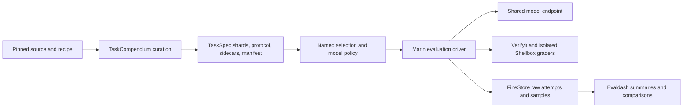

# Evaluation overview

Marin separates evaluation data, execution and score computation. A curated eval
is an immutable TaskSpec population with a protocol and execution sidecars. The
launcher chooses corpora and serving hardware. The standard driver records raw
attempts. Evaldash reduces those observations into dashboard measurements.

## Curation

Experiments own dataset pins, protocol variants, population declarations and
artifact graphs. TaskCompendium compiles prompts and private grader inputs, then
publishes complete evaluation populations. Shot counts and raw/chat transports
are separate corpus variants. Evaluation tags keep these sources out of default
training curation.

A completion manifest commits the TaskSpec shards, operation sidecars and protocol
hash. Source order and duplicate positions survive publication. Catalog and grader
changes alter corpus identities, which participate in launcher cache identity.
See [evaluation tasks](../references/evaluation-tasks.md).

## Execution

The shared CLI and checkpoint menus bind curation graphs before starting inference.
The model and tokenizer have recorded revisions. The launcher selects the intended
raw or chat corpus variant, and the driver applies protocol cohorts, context and
output budgets. Trials expand after source-row selection.

RolloutEngine performs one attempt through a chat, completion or likelihood
transport. Verifyit supplies shared grading; executable graders run through
Shellbox bubblewrap. Judge identities and connections are explicit, and credentials
stay outside persisted run metadata. An inference interruption cancels the active
evaluator before resuming the same archive.

Each attempt has a start and a finish. Terminal grades, including zeros, survive
resume. A verifier failure can reuse the completed model response; model transport
failures require another request. FineStore retains selection decisions, attempts,
samples, rollouts and raw evidence. The driver computes no benchmark summaries.

## Score computation

Evaldash imports each raw store from a single committed snapshot. It chooses the
latest finished attempt per dataset, source row and trial, so retries do not inflate
scores or sample counts. Unfinished attempts and infrastructure failures contribute
to missing coverage rather than incorrect answers.

Policy answer-equivalence runs also use these coverage counts at finalization.
They fail with `artifact_failed` when fewer than 90% of selected trials have valid
scores. The judge is served and recorded under its own model identity.

Protocols declare mean, weighted mean, classification or perplexity reductions.
Grouped observations use the same reduction. MMLU subjects share a benchmark name
and combine by item count, while subject summaries remain available. Dataset
identities and summary revisions distinguish dashboard protocols, including changes
to prompts or graders. PostgreSQL ingest also checks the raw store version, so a
resume can refresh scores without changing the producer record.

Producer `record.json` files retain execution identity and status. Derived summaries
live in Evaldash's catalog. Checkpoint report artifacts link the same records and
archives. Historical Evalchemy scores remain eligible alongside curated scores without
rerunning models. Comparison uses canonical metric names and statistical kinds;
recorded shot counts must agree when both are known. Missing historical corpus
identities do not exclude scores. Two runs with recorded, differing corpus identities
remain separate. Stored scores, uncertainty, coverage and cohort provenance are
preserved. Reproduction uses the recorded historical checkout and cohort.

## Other evaluation paths

Levanter's in-loop training evaluation remains independent. Harbor continues to run
agentic benchmarks through its own runtime, using the shared inference lifecycle
and record catalog. See [Harbor integration](../harbor-integration.md).

Start with [running evaluations](../tutorials/run-lm-evals.md) for commands and
[task rollouts](../references/task-rollouts.md) for single-task execution.
