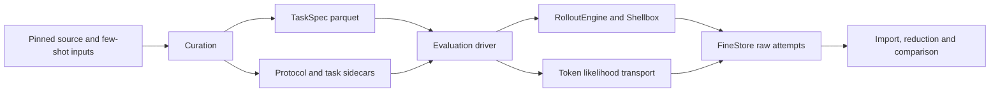

# Evaluation tasks

Evaluation datasets use the task catalog and canonical `TaskSpec` format. Each
published corpus also carries the protocol and per-task execution inputs needed
to reproduce the benchmark. The standard evaluation driver writes individual
attempts to FineStore. Consumers, including Evaldash's raw importer, own reductions.



## Curate a corpus

Evaluation declarations live under
`experiments/post_training/task_curation/datasets/evalchemy/` and appear in
`all_sources()` with type `eval` and source tags. Default training curation
excludes them; name evaluation sources explicitly.

```bash
uv run --package marin-core --group test python \
  -m experiments.post_training.task_curation.driver \
  --mode quick --source evalchemy-math500 --source evalchemy-piqa \
  --cache-dir ~/.cache/marin/eval-curation \
  --output-root scratch/eval-curation --max-workers 2 --run
```

For evaluations, QUICK publishes the complete declared population. It omits RL
admission and review, and refuses rejected or rewritten rows. Use a new output
root for a new publication. The command reports each corpus root, also recorded
in `campaign.json`. Local roots in this example are
`scratch/eval-curation/evalchemy-math500` and `scratch/eval-curation/evalchemy-piqa`.
The usual `--input-file` and `--input` options support exact local source and
few-shot fixtures; their byte hashes enter the artifact identity.

| File | Contract |
| --- | --- |
| `normalize/*.parquet` | Canonical tasks in the existing `task_json` conversion column |
| `evaluation/*.parquet` | `EvaluationItem` keyed by task ID and original conversion position |
| `protocol.json` | Sampling, trials, metrics, primary metric, reducer and context policy |
| `manifest.json` | Source conversion provenance and row accounting |
| `evaluation_manifest.json` | Final publication marker binding protocol, provenance, population and shard hashes |

`evaluation_cases(root)` verifies these bindings and streams joined tasks.
`evaluation_items(root)` scans sidecars without decoding large TaskSpecs.
Duplicates at different source positions remain distinct. Selection and
repetitions happen during execution, after publication.

## Run evaluations

Create a JSON `EvaluationRunConfig`. Record the actual served model, tokenizer,
revisions, context window and serving configuration. For example:

```json
{
  "model": {
    "name": "Qwen/Qwen3-8B",
    "revision": "b968826d9c46dd6066d109eabc6255188de91218",
    "tokenizer": "Qwen/Qwen3-8B",
    "tokenizer_revision": "b968826d9c46dd6066d109eabc6255188de91218",
    "context_window": 32768,
    "serving": {"backend": "vllm", "version": "0.25.1", "hardware": "H100x1"}
  },
  "max_tokens": 4096,
  "concurrency": 4,
  "source_limit": 8,
  "seed": null,
  "limits": {
    "max_turns": 1, "max_total_tokens": null,
    "model_turn_timeout": 600, "tool_turn_timeout": 60,
    "total_turn_timeout": 600, "attempt_timeout": 660,
    "verifier_timeout": 180, "cleanup_timeout": 15
  }
}
```

`max_tokens` is an explicit run ceiling, further bounded by the source protocol.
The effective context window is the smaller of the served model's window and
any protocol cap. MMLU-Pro retains its maintained 65,536-token cap; the NUPA5K
panel retains its 73,664-token cap.
`seed: null` preserves source seeds; a supplied seed uses base-plus-trial.
The source row limit precedes trial expansion. AIME's ten trials therefore remain
ten trials for each selected source row.

Sampling preserves omitted source options. In particular, `top_p: null` leaves
the request field absent so the served model's generation configuration applies;
it does not mean `top_p: 1`. Empty source stops add no stop strings. Record the
served generation defaults alongside its revision. The old CLI could strip source
temperature and seed when applying empty global overrides. This driver honors
the dataset protocol; compare old runs with explicit matching controls.

```bash
OPENAI_API_KEY=unused uv run --package marin-core --group test python \
  -m experiments.evaluation.task_driver \
  --local \
  --dataset scratch/eval-curation/evalchemy-math500 \
  --dataset scratch/eval-curation/evalchemy-piqa \
  --config run-config.json --endpoint-file endpoint.txt \
  --output scratch/eval-run
```

Without `--local`, the driver submits a disposable Iris CPU worker to
`cw-us-east-02a` and waits for completion. Use shared object-storage roots for
both corpora and results:

```bash
OPENAI_API_KEY=unused uv run --package marin-core python \
  -m experiments.evaluation.task_driver \
  --cluster cw-us-east-02a \
  --dataset s3://marin-us-east-02a/YOUR_CORPUS_ROOT \
  --config run-config.json --endpoint-file endpoint.txt \
  --output s3://marin-us-east-02a/YOUR_RUN_ROOT
```

The worker requests 4 CPUs, 32 GiB of memory, 64 GiB of disk and a 36-hour
lifetime. `--cpu`, `--memory`, `--disk` and `--timeout` override these resources;
`--job-name` names the job and `--no-wait` returns after submission. Choose a
cluster in the same region as the corpora, output and inference endpoint. The
endpoint must already serve the model recorded in the run configuration.

`endpoint.txt` contains the OpenAI-compatible base URL. Use the credential
environment variable appropriate to that endpoint; `--api-key-env` changes its
name. Judge tasks additionally accept `--judge-endpoint` and
`--judge-api-key-env` and require a `judge` object in the run configuration:

```json
{
  "judge": {
    "deployment": "evaluation-judge-prod",
    "models": {"gpt-4o-mini": "provider-snapshot-revision"},
    "default_model": null
  }
}
```

Use a stable deployment label and map each requested model alias to its immutable
deployment revision. Source model aliases take precedence. For sources without a
judge model, including OlympiadBench, set `default_model` and include that alias
in `models`. The driver checks selected judged tasks before submitting them and
does not read `VERIFYIT_JUDGE_MODEL` as a fallback. Changing the judge identity
requires a new run; resume rejects it. The mapping records the operator's pin;
it cannot verify a provider's deployment independently. Judge responses retain
their reported model identity. Keep endpoint URLs and credentials in the
connection arguments, outside this secret-free run descriptor.

Code and canonical instruction graders use Shellbox's `LocalMachineFactory`
(bubblewrap) by default, with network access denied. The driver selects the Iris
`CONTAINER_PROFILE_PRIVILEGED` CPU worker required to create bubblewrap's
namespaces. Each Shellbox guest gets a private filesystem, read-only runtime
mounts and explicit environment variables. Solver and judge connections stay in
the coordinator's mounted secret files and do not enter grader machines or the
run descriptor. Iris supplies the coordinator's storage credentials separately.

An explicit `verifier_machine` or `task_machine` in the run configuration can
set machine deadlines, network policy and user. Local machines require
`cpus`, `memory_mb` and `storage_mb` to be null and `gpus` to be zero. Use the
CLI worker flags for resource allocations. The default verifier startup
deadline is 600 seconds; cleanup uses `limits.cleanup_timeout`. The CLI supports
the local Shellbox backend; other backends supply factories through the library
`run_evaluation` API. `--local` requires a host that supports bubblewrap
namespaces. There is no unsandboxed execution fallback.

Package locks, private tests and pinned NLP assets come from the published
task's grader environment. The environment builder includes Verifyit's base
dependencies in each lock and its artifact identity.
Local shared runtime caches use
`~/.cache/marin/task-runtime`; mounted workers use `/cache/task-curation`.

Python code grading prepares the private test program before executing the
candidate. Shellbox owns execution and termination; no copied Python execution
sandbox or monkeypatch guard remains. A completion receipt distinguishes finishing
the tests from exiting the process early. Candidate timeout scores zero;
preparation and machine failures remain infrastructure errors. The 3-second
budget (10 seconds for CruxEval) includes Python startup and compilation. Iris
worker limits replace the old executor's per-process memory limit and are shared
across concurrent attempts. These are versioned protocol changes. The current code
environments require CPython and NumPy; selecting Shellbox does not automatically
select its Shellsim backend.

Chat, raw-text completion and likelihood operations remain distinct. Chat keeps
the source conversation without an added submission instruction. Raw completions
use the completion endpoint. Likelihood requests preserve tokenizer boundaries,
choice-specific contexts, truncation evidence, token log probabilities and
normalization choices; they never become generated letter answers.

MRCR uses official o200k bins and interleaved source ranks, then checks the served
model's window. GraphWalks retains its gold-dependent output allowance. Exclusions
and uninspected rows after the cap are recorded, and prompts are never silently
truncated. MMLU-Pro chooses among declared few-shot variants with the pinned
tokenizer.

Output budgeting differs from the legacy runner. The legacy path could derive
one benchmark-wide output limit from a stored longest-prompt length. This driver
uses the explicit run ceiling and protocol cap, then reserves space using each
prompt's served token count. These recorded budgets permit reproducible runs,
but do not establish equivalence with legacy runs that used derived limits.

## Raw results and resume

The archive contains `samples`, `rollouts_v1`, `evaluation_attempts` and
`evaluation_selection` tables, plus the `evaluation/run.json` descriptor and
per-attempt evidence blobs. The descriptor records the driver revision, model,
run configuration and complete corpus/protocol snapshots.

Each physical attempt has a start and terminal row. Its sample, terminal state
and raw evidence commit together. Grader details retain all metrics, extraction
filters, instruction weights, flags and reduction inputs. Provider or verifier
failures have no synthetic zero score. Malformed responses and partial likelihood
results remain available for diagnosis.

Repeat the same command to resume. The driver rejects a changed model, corpus,
protocol or selection, skips completed logical attempts and retries failed ones
with the same seed and a new physical retry index. Consumers must select the
latest terminal physical attempt per dataset snapshot, source row and trial;
otherwise resumed attempts would be counted twice.
Concurrency remains part of the run identity because server batching can affect
generation, even with a fixed seed and temperature zero.

This path emits no headline summary or legacy `record.json`. Evaldash's existing
legacy-run discovery does not yet import these archives. Its raw importer must
use the descriptor, selection ledger and latest-attempt rule, then apply the
dataset reducer to raw observations.

## Add a dataset

`EvalDataSet` binds a `CurationRecipe`, `EvaluationProtocol` and item builder.
Simple math datasets reuse `math_dataset`; harness tasks use native prompt
templates and explicit scoring policies. New source algorithms belong in
TaskCompendium importers or VerifyIT adapters; artifact graphs stay in
`experiments/`.

Pin source revisions and assets, retain the original population and source order,
and version changes to prompts or grading. Compare the actual old and new
implementations on matching pinned inputs and the same recorded responses.
Keep pipeline tests for publication integrity, input identity, population joins,
selection, transport failures and resume. Input fixtures may exercise these
boundaries; stored expected prompts and grades are not the equivalence gate.

## Validate ingestion

The [96-declaration acceptance record](https://github.com/marin-community/marin/pull/10757#issuecomment-6483684301)
records the migration's manual old/new comparisons, reproduction commands,
source pins, row identities, coverage and limits. Its scripts and raw captures
remain session artifacts.

For each dataset and protocol variant, run a matching subset of real pinned
source rows through the old evaluator and the new curation/driver pipeline.
Read the new results from FineStore and compare actual requests, references,
same-response grades, metrics and trial seeds. Use full inputs when the old
reader cannot subsample, recording the selected original row identities.

Keep this one-time acceptance run's commands, source pins and hashes, row
identities, raw responses, results and intentional protocol differences in the
task artifact. Expected-output snapshots are not required in CI. Routine tests
protect publication integrity, identity, joins, transport failures and resume.

Compare independently generated answers separately, using the same served
model/tokenizer revision, context, generation options and output cap. Record
strict request differences as well as any interpretation of omitted defaults.
Identical shared-response grades establish grading equivalence; they do not
establish independently generated output identity. State live coverage limits
for context windows and external judges in the acceptance record.
