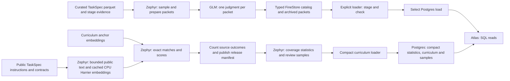

# RL Data Atlas

[RL Data Atlas](https://applets.marina.oa.dev/a/fb11c931-5861-4878-8bb5-a964d652b45f/)
reads a Postgres copy of the published [curation catalog](task-curation.md#run-catalog).
This reference is synced to preview revision 31 (2026-11-18), including the
stage-0 license gate; the
admission rules are in [Current admission policy](task-curation.md#current-admission-policy).
Every source passes the [stage-0 license gate](task-curation.md#stage-0-binding-license-gate)
before ingestion; banned sources never appear in admitted counts.
Curation owns source declarations, admission decisions, executed controls and
sampled GLM judgments. Atlas displays those records and their task packets.

The checked-in app also reads immutable curriculum-matching releases. The
curriculum pane shows task coverage by subject, group, capability and source.
Its loader and selected release are independent of the sampled grading catalog.

Oracle filtering covers every oracle-bearing task in SAMPLE and FULL. Workspace
graders also require a non-passing NoP control for every candidate task. A sampled
control pass rate never exempts unsampled tasks. The Result thresholds below grade
content reviews of the retained output.
Curation supplies the tasks and evidence; the grade does not change admission.



## Private data tier

Every source carries a typed `DataRestriction` on its declaration — `open` or
`private_always` — set explicitly in the source's code definition
(`SourceInfo.data_restriction`); there are no string flags or per-request switches.
The tier is orthogonal to the license gate, TRAIN/EVAL use and catalog status: an
open source can be license-restricted and a private source can be Available.

A `private_always` source's content never leaves its private store, whatever else
changes. The served catalog keeps counts, statuses, hashes and receipts for it, and
replaces every content-bearing value — task text, prompts, answers, resources,
curriculum samples and previews, review excerpts and reviewer explanations, the
review rubric, rollout traces, difficulty reasons and audit notes — with the visible
marker text `Private data: content is not displayed.` The loader also never copies a
private source's task packets into the served database, so the marker response is
served from absence. New human audit samples for a private source are refused (HTTP
403), because auditing would quote its content to reviewers; legacy audit rows serve
redacted text.

Enforcement is fail closed and centralized:

- **Serving.** `server/restrictions.py` resolves each source's effective tier — a
  versioned override registry (`server/restriction_registry.py`, user rulings with an
  issue link) wins over the stored declaration tag, a malformed stored tag counts as
  private, and a declaration that predates the tier reads as open. Every content
  surface (evidence packets, assessment report, source evidence, catalog table,
  status page, archive collections and artifacts, curriculum tasks and task detail,
  audit tasks, difficulty summaries and coverage) applies the projection; the
  registry version participates in the served-cache key so an override takes effect
  immediately. The shared `declaration_restriction` helper is the single place that
  decides, and pages or new views must call it rather than re-deriving privacy.
- **Publication.** The shared publish helpers
  (`calibforge_publish.publish`, `raw_source_publish.publish_raw_source`,
  `native_quick.publish_quick`, `remediation_publish.publish_plan`, the curriculum
  release builder) take the source's typed tier and refuse a `private_always`
  payload at the helper, not per caller: a private source is never uploaded,
  re-archived or written into a release.
- **Derived artifacts.** Any artifact derived from a private source inherits the
  restriction: derived source populations keep it through the oracle-release and
  selection bindings, training-selection summaries record the strongest tier of
  their sources, and curriculum loaders refuse a release that contains a private
  source or whose stored tag was flipped or dropped relative to the authoritative
  tier. A downgrade or a missing tag on a derived artifact is refused, never
  silently accepted.
- **Training selection.** A private source may be selected for private training
  only; its selection artifacts carry `private_always` in their summaries and stay
  in the private artifact store.

Tests build a synthetic `private_always` fixture with unique canary strings in every
content field and sweep the loader, the API surfaces, the curriculum load, the
publish helpers and captured logs end to end, asserting the canary appears nowhere;
tamper tests refuse flipped and dropped tags on derived artifacts
(`infra/marina/tests/test_private_tier.py`,
`apps/rl_data_catalog/tests/test_private_tier_guards.py`).

## Reading grades

FULL campaigns grade automatically; SAMPLE opts in with `--assess`.
The default sample covers 100 retained tasks and up to 20 excluded rows.
"Admitted" in the catalog means a task retained in the final TaskSpec parquet
after curation. Excluded rows are sampled separately to inspect filtering decisions.
Admitted opinions, excluded diagnostics and executed grader controls remain
separate. Grading does not change admission. Input populations may overlap.

Result is computed from conclusive reviewed tasks in each cohort. A task has
issues when its judgment is Some issues or Bad:

- Good: at least 90% clean (no more than 10% with issues).
- Bad: at least 50% with issues.
- Some issues: more than 10% and fewer than 50% with issues.
- Unknown: no conclusive reviewed tasks. Missing observations remain coverage diagnostics.

Exactly 10% issues is Good; exactly 50% is Bad. Store the reviewed and issue
counts, issue rate, issue evidence and repair recommendation. Unavailable and
uncertain judgments remain explicit coverage diagnostics. Mechanical exclusions
and zero retained tasks do not invent quality observations. QC never rejects
sources or tasks, and a BAD Result does not block admission by itself: a source
with a documented weakness can be admitted as-is. These opinions describe the
inspected sample.

Large packets retain the task and answer contract, with bounded previews of long
text, collections and stage audits. Previews record original sizes and selected
indices or text prefixes and suffixes; full evidence remains in curation outputs.
The model names any missing fact that prevents a judgment. Omitted private fixture
text alone does not force Unknown.

Every stored judgment carries typed defects from the shared `Defect` enum —
`missing_context`, `ambiguity`, `wrong_reference`, `answer_leakage`,
`malformed` and `rubric_mismatch` — beside its verdict, confidence and
reference status. The assessment page shows one chip per recorded defect with
its count and rate within the cohort's reviewed tasks, and filters the stored
reviews by verdict, confidence, reference status and defect. A signed-in
Marina user can also run a manual audit there: it draws a reproducible seeded
sample of one source's stored reviews (random, or stratified across verdict
and defect-set strata), records one judgment per task — agree or disagree,
with a corrected verdict and defects from the reviewer's own enums — and
reports reviewer-versus-human agreement with 95% Wilson intervals. Audit
judgments are advisory evidence; nothing in the audit changes an admission or
a quality label.

Assessment keys use ordinary artifact dependencies and explicit versions.
Changing only the rubric or grading model reuses curation. A failed new key has
no current grade; archived evidence remains available. Every source has a registered converter and enters through QUICK, SAMPLE or FULL.
QUICK records conversion without review. Source details show the latest curation outcome; the
assessment page shows the curation associated with its selected grade.

## Getting started page

**Getting started** (`guide.html`) gives each Atlas workflow one diagram:
ingestion, repair of Excluded items, task replacement, drift analysis,
deprecation, banning/unbanning, overlap resolution, enrichment, quality review
and publication. Each stage links to its normative procedure and the code that
checks its evidence. Each flow links to the glossary. The full stage map,
per-reason repair paths, version re-entry rules and required drift identity live
in [Atlas workflows](task-curation.md#atlas-workflows).

Source status and attribute state are separate. The guide names only states that
exist in code. It identifies the required drift scheduler and repair-union checks
as implementation gaps. Keep policy text in the guide and this reference;
main-table cells, tooltips and Evidence cards show state, counts, reasons and
receipt links. Guide counts come from the selected `/sources` snapshot. Edit the
normative reference first, then the guide, and follow the release procedure.

### Publication lifecycle

Publication consumes an admitted source version and its pinned attribute records.
It produces a checked serving load and app revision with provenance; it does not
change the source's status. Ingestion, Repair or drift analysis can start this side
flow when they produce a new version. The order is catalog load → projection
refresh → audit gate → private preview → production under explicit release authority.
A failed gate stops publication and preserves the previous selection.

1. Stage the intended catalog load, verify every staged table and its source pins,
   then select the checked load explicitly. Preserve earlier loads and their archived
   task-review packets: the task contract, reviewer input/output and provenance.
2. Rebuild serving projections from that load and the intended measurement and
   curriculum pins. A source-code release alone does not refresh these inputs.
3. Pass the declaration audit, input/count reconciliation, ban propagation and
   public-route redaction, privacy checks, API checks and light/dark browser checks.
   Redaction of banned content is a required preview-builder gate; it must be
   verified separately from private-tier redaction.
4. Publish the checked private preview package and verify its immutable hosted
   revision against the preflight baseline. Keep production at the revision specified
   by the coordinator’s recorded release hold.
5. Production is a separate authorized release of a checked cut. Preview success
   alone does not authorize it. Record the final app ID, revision and receipts.

There is no publication lifecycle-status enum. The actual
[`ReleaseReceipt`](https://github.com/marin-community/marin/blob/main/infra/marina/apps/rl_data_catalog/release_receipts.py)
uses `phase` literals `preflight`, `hosted`, `postpublish`, a `passed` boolean and
the active or failing `gate`. Catalog snapshot ID, Postgres load ID, selected
pointer, package hash and numeric app revision name different objects. Keep all
of them in the publication evidence. Drift in any projection input invalidates
that projection's currency and starts this flow again.

Use the [staged loader](#updating-atlas) and the
[release procedure](https://github.com/marin-community/marin/blob/main/infra/marina/apps/rl_data_catalog/RELEASE.md)
for commands and release gates. The existing implementation is in
[load.py](https://github.com/marin-community/marin/blob/main/infra/marina/apps/rl_data_catalog/load.py),
[prepare_preview.py](https://github.com/marin-community/marin/blob/main/infra/marina/apps/rl_data_catalog/prepare_preview.py)
and [release_check.py](https://github.com/marin-community/marin/blob/main/infra/marina/apps/rl_data_catalog/release_check.py).

## Browsing sources

**By source** shows post-filtration Examples only where current-pin evidence establishes
the count. A complete private output with zero retained tasks and explicit Excluded
status displays **EXCLUDED** and Examples **0**; it does not claim admission.
A no-oracle source displays its static-retained count: retained after dedup and
lexical decontamination, minus typed static blockers (agentic-only blockers count
only for agentic TaskSpecs). Oracle sources without a current-pin admission
receipt display **IN PROGRESS**, retain their current admission status in the
tooltip and Evidence, and leave Examples Pending. A pre-filtration converted count,
content review or backend fit never supplies an admitted count. The Filtration
ledger links the canonical filter, private output and validation receipts with
their SHA-256 hashes and records exclusions by typed reason. The table also lists training/evaluation use,
Quality, Result, lexical contamination, backend evidence and leading
curriculum area. Quality is the evidence-derived oversight level, computed by
the curation pipeline from the current-pin QA evidence — a current-pin FULL
binding shows FULL, a current-pin SAMPLE receipt shows SAMPLE unless its
complete-population panel covers every retained task, which also shows FULL,
and conversion-only sources show QUICK — and the levels define required
content-review scope: QUICK converts
without content review, SAMPLE requires at least 95% conclusive reviews of its fixed selected sample,
and FULL requires a review of the whole retained population. An explicitly accepted
whole-source waiver also displays FULL when its pinned evidence accounts for every
unreviewed task and reason; strict coverage remains false. Execution qualification is recorded separately. Result uses the
inclusive issue-rate boundaries above.

The loader records required and conclusive reviewed counts plus strict coverage
completeness. SAMPLE permits at most 5% missing observations (at most 5 of 100);
unavailable and uncertain rows count as missing, and issue rates use reviewed
rows. The seed and panel stay fixed: no replacement or resampling. Missing task
IDs, reasons, bounded attempts and hashed deployment/batch evidence remain in the
receipts. A qualifying SAMPLE displays SAMPLE with a final Result and measured
counts such as “99 reviewed, 1 unavailable”, plus any uncertain count; strict
coverage remains false when observations are unavailable. Above 5%, SAMPLE remains provisional until repaired.

FULL finality is unchanged: an incomplete required whole-source review stays
provisional unless a verified `accepted_incomplete` whole-source waiver accounts
for its unreviewed tasks and exact reasons. `accepted_incomplete` applies only to
FULL. Completed reviews from earlier FULL campaigns are grandfathered: they
count as FULL reviews for exactly the matching tasks, recorded with the original
reviewer identity and a grandfathering marker, never relabeled as
current-reviewer output; old invalid or truncated rows still need review. The
Quality label alone never makes Result provisional. These
counts follow the selected Result's review panel, not the execution campaign's
processing mode or the source's entire population when only a sample is required.

A FULL or SAMPLE quality chip opens that source's per-task review list, with
paging and filters by verdict, confidence, reference status and defect. A review
row opens the raw reviewer input, output and provenance behind the stored
judgment. Reviews joined from original reviewer batches keep archived lineage:
the original reviewer identity appears as archived evidence, never as
current-pin QA, and ambiguous or missing mappings stay explicitly not mapped
with reasons. The QC defect types page defines the six typed defect categories
and links each to its reviews.

The default view hides QUICK, BAD, Excluded and Pending entries and folds measured duplicate/subset groups. Source cells contain only the source name and optional fold toggle. Origin/build information, dataset links and qualified overlap notes belong in Evidence/detail views.
Expand a group to inspect matching members, or enable **Show QUICK-quality,
BAD-result, Pending and Excluded sources**. Search and filters apply before grouping; a hidden canonical
member cannot reappear through a group. Search names, datasets or tags, select a
column heading to sort, and export filtered rows as CSV. Filters and sorting stay
in the URL. The header counts tasks throughout: population, admission (TRAIN plus
EVAL), pending oracle filtration, exclusions and QUICK/SAMPLE/FULL quality
populations, alongside catalog freshness. Releases with zero retained tasks count
their canonical filtration receipt's original excluded input; other releases count
the current deduplicated population. Counts are source-specific task instances:
the same contract in two sources can count twice. **Shown** counts displayed tasks.
Hidden excluded-status, pending-status, QUICK-quality/BAD-result, filtered and
folded-duplicate tasks partition the rest without overlap, with their admitted
subsets. **Show everything** clears
filters, includes QUICK-quality/BAD-result sources and expands every group.
**All Difficulty** is the default; selecting a model orders sources by that model's
solve rate, highest first. Returning to All restores source-name order. Source evidence pages include exact release
pins, deduplication ledgers, lexical measurements, QC and archived assessment packets.
The page shows the core source evidence first. Each auxiliary ledger loads
separately with an 8-second limit and shows its own error if it does not answer,
so one slow ledger cannot hold the page. The Atlas has no Archive page; archived
review data stays available through the source Evidence pages and the API.

**Use** comes from the registered converter's explicit TRAIN or EVAL policy. A
benchmark tag describes a source and never overrides TRAIN. Historical declarations
without recorded Use display Unknown.

**Contamination** is computed from each source's lexical-decontamination record:

- **NO ISSUES**: zero overlap measured for the current input pin or certified by
  a validated current retained-release receipt.
- **REMEDIATED**: TRAIN overlap was excluded in a new pinned private TaskCompendium
  release, with a validated remediation receipt matching the current dataset pin.
- **MEASURED, EVAL**: declared EVAL overlap is retained by policy; the overlapping
  count remains visible.
- **REMEDIATION REQUIRED**: TRAIN overlap lacks verified remediation for the current
  private pin. This state violates the ingestion requirement.
- **NOT MEASURED**: no applicable current-pin record exists; cleanliness is unknown.

Counts describe the measured input before duplicate and lexical exclusions. They do
not describe residual overlap in the retained release or semantic decontamination.
The source table legend and Getting started guide define the same five states.
The compact **Backends ›** link opens a source's backend evidence page, with
agent and grader fit, task counts, blockers, validation errors and survey provenance.
The display projects incomplete support and environment-kind mismatches to Unsupported;
`role_absent` displays N/A (no role). Missing role evidence is Unsupported with
an explicit not-measured blocker.
The evidence table scrolls horizontally on small screens.
Grading shows the required SHARED or SEPARATE boundary from the complete census;
a declaration mismatch uses a warning variant and remains explicit in Evidence.
N/A requires an applicable measured absence; missing evidence remains unmeasured.
Enum chips have no subtitle text. Issue rate and Overlap have numeric columns; a
Result from incomplete content review carries a provisional variant within its
chip unless an explicit whole-source waiver finalizes it. Review progress and lower bounds appear only on the source Evidence page.

Backend fit preserves the survey's Supported, Partial and Unsupported states.
Partial names its conditional capabilities. Partial on a production backend can
satisfy the backend admission gate; other admission checks still apply.
Missing measurements, validation failures and
incompatible environment kinds keep their typed reasons. N/A is reserved for
absent roles. Affected-task counts are exact per role; roles can overlap, so those
counts are not a unique task union.

**Daytona safety**, shown in the Backends tooltip and evidence page, measures the actor only: SAFE requires at most ten snapshot
identities and no refused actor requirements. Sources without an actor show N/A;
grandfathered blends still using the legacy internal format show a dash. Retained
TaskCompendium releases use their new actor measurements. A verified byte-identical
subset may retain an admitted original's qualification through its recorded
remediation lineage; changed task bytes require new qualification. Package-lock
graders run on LOCAL with separate compatibility evidence. A source without a measured actor verdict cannot enter
new ingestion. The backend map records each role's demands and blockers. It includes the actor verdict, unique-snapshot count against the cap, failed requirements, measurement provenance and the operations link; Daytona has no separate main-table column.

**Grader** is derived from each population's final TaskSpecs by the late-stage
ingestion census, never from declarations: `LLM judge`, `Exact match`, `Math
verify`, `Unit tests`, `Script`, `Reward model`, `None`, or `Mixed` when one
source combines types. A source whose census has not been bound shows Pending.
The source Evidence page carries the per-value task-count breakdown, and for
judge-graded sources the judge profile: rubric kind (reference, checklist or
labels), reference versus no-reference, and the exact-gate setting. The derived
contract fields (`agentic`, turn shape, reply-only delivery, workspace-graded)
follow the same census and replace hand-written shape tags; a declared shape tag
that contradicts the derived shape fails ingestion, so the two can never
disagree in the catalog.

**Oversight level** is likewise derived, never hand-declared: the curation
pipeline reads the current-pin QA evidence and attaches the strongest level it
supports (FULL binding, SAMPLE receipt, conversion-only QUICK). The source
Evidence page shows exactly one level, identical to the main table's Quality
column, with its basis and a pointer to the receipt it rests on. The earlier
recipe-QA prose (campaign, recipe revision, verification text, reviewed and
admitted counts) survives on the Evidence page in a separate **Historical
recipe QA notes** card that cannot assert a level.

Examples is the admitted count after filtration; there is no separate oracle
column. For a source with oracles it requires completed full-population oracle
filtration, plus nop negative controls on workspace-graded tasks, after
within-source duplicates and TRAIN lexical overlap have been removed. For a
source without oracles it is the retained count minus tasks with typed static
blockers; no per-task executability proof is required. Total Atlas admission
includes TRAIN and EVAL tasks, with EVAL excluded from TRAIN selection. Only
Available sources contribute admitted tasks; Pending, Excluded and Deprecated
sources contribute zero. A new Available admission needs an explicit Use and its
lexical clearance (`require_available_lexical_clearance`): TRAIN needs the
decontaminated private-release receipt at its pin, and EVAL needs the measured
benchmark receipt at its pin. EVAL sources are never lexically remediated. Without
a current-pin admission receipt, Examples remains pending. Totals report known
admitted tasks alongside tasks pending oracle filtration or other admission proof. Evidence and
curriculum coverage separately show the retained converted population; content QA
Results and sampled controls do not certify execution or admission. Source details include the raw converted count,
duplicates dropped, and the exclusion manifest.
Every entry has a registered conversion pipeline; there is no inventory-only
path that substitutes a declared count for conversion.

Catalog publication requires a current-pin license receipt for every non-banned
source. `Available` sources must also pass population admission checks. Licensed
`Excluded` entries (including the folded former `Not selectable` state) can retain
incomplete population evidence as unavailable metadata; publishing that metadata
confers no admission. Every Excluded entry carries at least one typed exclusion
reason with evidence; see
[source status and exclusion taxonomy](task-curation.md#source-status-and-exclusion-taxonomy).

**Not assessed** means there is no current sampled assessment; **Unknown** is a
completed assessment without enough conclusive judgments. Curation never re-grades
independent QC; source details present the release's reported verdict, method,
reviewed count and pinned manifest beside the sampled quality. The manifest
retains the full historical record; it does not substitute for current filtration
and admission evidence. Open a source for
pipeline details and links to its original dataset, assessment and curriculum
coverage. The leading curriculum domain links directly to that source's coverage
within the domain. Current-source coverage requires the same dataset pin and pipeline
as the selected curriculum release; older releases remain selectable as historical
evidence after filtration changes the current input. Columns size to their contents, and enum chips stay on one line
without subtitles.
On small screens, scroll the table horizontally to reach every column; its header
and body scroll together without widening the page.

## Updating Atlas

Use the app's canonical [release procedure](https://github.com/marin-community/marin/blob/atlas-env-audit/infra/marina/apps/rl_data_catalog/RELEASE.md)
and `release_check` entry point for preview package validation, browser gates and
post-release preservation checks. Catalog loading remains a separate operation.
Never delete a published artifact or catalog row: removal is a versioned admission
change, earlier loads stay selectable, and every historical artifact remains intact.

Before selecting a new catalog load:

1. Validate every source's typed upstream origin, build path and generated title.
   Resolve historical IDs through the permanent source alias table. Preserve
   assessment keys, packet URIs and artifact identities when loading canonical IDs.
2. Verify `current_release.repo`, `revision` and `url` identify the exact consumed
   pin. QA/repair releases must be private open-athena TaskCompendium datasets;
   decontamination remediation must configure the new version as the pipeline input. Its URL must match the repository and revision. Keep `url` as upstream
   provenance.
3. Check task-derived SHARED/SEPARATE grading evidence and actor-only Daytona
   measurements. Every UNSAFE reason needs details and affected actor-task counts;
   retain independent grader compatibility evidence. Grandfathered blends keep
   their explicit dash exemption. Task curation owns the fixed list of Daytona-exempt blends and
   records the exemption reason in `SourceDeclaration.daytona_exemption`; the packaged Atlas
   renderer reads that reason without owning source-specific policy.
4. Recompute Result from reviewed issue counts using the inclusive 10% and 50%
   boundaries. Retain issues and repair recommendations separately from exclusions.
5. Check Evalchemy benchmarks retain evaluation/heldout use. Run conversion in
   QUICK, SAMPLE or FULL; changed behavior requires SAMPLE/FULL QA and new pins.
6. Keep unmeasured sources pending. N/A requires measured zero actor slots,
   snapshots and refusals with a count basis; null is reserved for grandfathered
   blends. Preserve the selected legacy SQL load until all new declarations have
   evidence-backed census records.
7. Retain lexical decontamination receipts and original artifacts. Stage and
   validate the complete load before selecting it.

### Deployment checklist

1. Use Marin latest and inspect the current Atlas package version and selected catalog.
   Record the package version, selected catalog snapshot, source commit and survey
   artifact URIs in the deployment's issue or PR.
2. Survey the production backends at Marin latest for their current capabilities
   with the [survey procedure](#backend-survey), and publish the matrix beside the deployment record.
   Execute this survey at each deployment; do not reuse an older deployment's matrix.
   The source map must census every current pinned source's complete converted
   population; sources without converted inputs are listed `unassessed` with
   their reason and never as fit.
   For storage-enforcing LOCAL workers, run the survey on the actual PRIVILEGED
   worker with `--local-disk-root /cache/shellbox-disks`. Require its ext4 loop,
   OverlayFS, ENOSPC and cleanup probe to pass. Retain the overflow/neighbor and
   post-teardown loop/mount evidence; a workstation survey cannot qualify the host.
3. Require `sandbox-image-workdir` in the direct Kubernetes backend descriptor
   before submitting any prepared-image Iris task, even without declared disk.
   Older controllers hide `/app` and must be rejected before submission.
   Keep Iris sandbox storage admission disabled until a real
   `CONTAINER_PROFILE_SANDBOX` overflow succeeds on the pinned CPU pool. Record
   the node's CoreWeave-provided `runsc.toml` `overlay2` setting beside the raw
   kubelet eviction status; a restricted-profile overflow is insufficient.
   Check one sandbox container and one replica per task, exact-byte storage
   quantities, no writable hostPath, and CPU/memory pod limits. Confirm an
   own-limit eviction is `FAILED / RESOURCE_LIMIT_DISK`, rather than memory OOM
   or node pressure. Only then enable Harbor storage admission and advertise
   `sandbox-storage-limit` as an explicit backend fact. The current controller
   advertises no such capability, and Harbor `iris-sandbox` rejects declared disk.
   Controller deployment/restart requires separate user authorization. Service
   groups and model relays remain unsupported on this environment.
4. Verify every source has a complete, exact-pin `within_source_dedup` receipt and
   Evidence and curriculum retained counts equal its `unique_count`, including QUICK
   sources. Examples requires the separate post-oracle admission proof. Check raw and
   duplicate counts against the drop manifest, then verify version-bound lexical evidence.
   New or changed admissions require a private TaskCompendium clean/remediated
   receipt after [lexical decontamination](task-curation.md#lexical-decontamination-before-publication);
   preserve grandfathered selection until explicitly approved.
5. Validate and release the app against the inspected package version, then load
   the catalog with that survey's `--backend-map` artifact and the selected
   snapshot's `--source-identities` artifact. Fingerprint changed sources and
   resolve or acknowledge their shortlisted source-overlap flags before admission.
6. Check `/backends`, `/source-duplicates`, `/sources`, an assessment and its evidence. Confirm the
   selected snapshot and survey revision agree with the deployment record.

### Preview packaging before the shared runtime is updated

The preview can carry the exact canonical catalog models in its own package.
This avoids a shared Marina deployment while the integration branch is under
review. The staging command copies the alias table and model definitions from the
specified checkout, relocates their imports into the app namespace, and records
source and packaged SHA-256 values in `dist/bundled-model-provenance.json`.
It writes a new directory and fixes its manifest to the preview UUID.

From the clean integrated build checkout:

```bash
uv run python infra/marina/apps/rl_data_catalog/prepare_preview.py \
  --checkout "$PWD" --output /tmp/atlas-preview-package
uv run marina validate /tmp/atlas-preview-package
uv run marina apps versions c9742a15-fb46-4d56-bc88-aa916351ebd3 --json
uv run marina release /tmp/atlas-preview-package --allow-dirty --base-version CURRENT_VERSION --json
```

Use a fresh output directory for each build. Replace `CURRENT_VERSION` with the
versions response's top-level `current_version`.

The loader selects preview display policy only for UUID
`c9742a15-fb46-4d56-bc88-aa916351ebd3`. A source awaiting an exact-input SAMPLE
Result displays QUICK with “SAMPLE review in progress” in its details and Quality
tooltip. The evidence-derived oversight level and its receipt remain unchanged by
this display policy, and absent
Results, issue rates and coverage remain unmeasured. Available sources displayed
as SAMPLE or FULL still require a computed Result. Catalog publication and production
imports retain this Result gate. Preview imports may omit the Result while a
source displays QUICK; all admission and grading-census checks remain enforced.
Display policy is part of the load identity, so a
preview import cannot make a later strict import skip validation.
Matching computed aggregate and independent sample-panel counts display SAMPLE
without changing execution oversight. The same pure projection runs during
loading and API reads, so a code upgrade keeps an existing selected catalog
readable even if a later strict reload is rejected.

Before validation and release, optional frozen partial-review observations can
replace `dist/measurements/content-progress.json`. Its JSON object contains
`as_of` and a `sources` list. Each row contains `source_id`, `dataset_id`,
`dataset_revision`, `retained_count`, `valid_reviews_lower_bound` and `evidence_uri`.
The renderer requires an exact current ID, pin and unique-count match. Progress
never determines FULL or Result.

Pass `--oracle-inventory /path/to/current-310-oracle-inventory-ledger-v2.json`
to `prepare_preview.py` to package an immutable full-population ledger produced
from task curation's typed `SampleInventory` receipts. The preparer validates each
receipt against its `ActorCensusInput`, checks population totals, canonicalizes
source aliases and records input/output byte hashes. It emits
`dist/measurements/oracle-inventory.json` with a `sources` list
of frozen population observations: `source_id`, the complete `ActorCensusInput`
object as `input`, `oracle_tasks`, `execution_qualification` and `evidence_url`.
The renderer requires the entire actor input, current dataset pin, converter
version and retained count to match. A measured zero establishes no shipped
oracle solutions; it does not establish calibration, execution or admission.
Missing and stale rows leave oracle filtering pending. An exact current-pin
full-population oracle-filter receipt is recorded separately from this census.
Sources with oracles keep their admitted counts pending until that receipt exists.
The filtration ledger records typed static blockers against the current population.
Under the pinned no-oracle policy ruling, no-oracle Examples are the current retained
population minus unique typed static blockers. EVAL tasks enter total Atlas
admission as evaluation data and remain excluded from TRAIN selection. EVAL
overlap is lexically measured without remediation. The Evidence page records the policy and audit
URI/SHA pairs. Count observations bind the full current actor-census input and Use;
missing or stale static evidence remains unmeasured. Overlapping blocker reasons
never count a task twice. This count policy does not change training selection.
Backend requirement fit alone does not establish execution.

After the package release, load the complete catalog with the
[catalog loader](#updating-atlas), using the explicit preview app ID above.
Use the [curriculum loader](#curriculum-coverage) to select the verified live-source
`release.json` and `coverage.json`. Preserve the existing retained 59-source load
as the previous selectable release. On a new app, load that retained pair before
the live-source pair. Older pre-remediation and archived all-source artifacts
remain immutable historical evidence in the SHA-bound provenance receipt; they
are not additional selectable releases. Keep exact input URIs and hashes in the
deployment record.

Production remains on hold. Before a production release, the shared runtime must
carry these canonical modules natively; this preview staging command always targets
the separate preview app.

### Backend survey

The enum in `shellbox.requirements` classifies TaskCompendium environments,
resources, runtime shapes, machine sources and commands, plus Harbor environment
fields. Schema tests fail when a field is added without classification. Backend
selection stays deployment metadata. The survey calls production factory checks
over generated specs, then validates each converted task's combined agent and
grader machine demands through rolloutengine's machine mapping. Capabilities the
offline survey cannot observe — memory, CPU and disk enforcement, disk quotas,
network deny, and file mode and mtime restoration — grade as `verify`, never
partial or unsupported: a live probe on the real backend resolves each cell, and
admission gates wait on that live evidence instead of blocking. `unsupported` is
reserved for a capability the backend's code demonstrably lacks. `partial` means
the backend runs the population with a named capability only partly met (for
example `non_root_user`); admission treats it as runnable (`RUNNABLE_FIT` is
`supported` and `partial`), and Backends shows it as its own state with the
capability and per-role counts. A role with a complete matched delivery
contract (`absent_contract_tasks == 0`) does not need its `docker_build`
resolved. A source that is
already Available stays Available with a backend-verification-pending marker
while its probe runs; a new admission waits for the result. Each backend carries a
deployment class: production backends count toward admission, and
development-only backends such as local `docker-gvisor` are shown with their own
style and never count.

Prepare `survey-inputs.json` with `inputs` entries containing `source_id`, local
Parquet `paths`, JSON spec `column` and `expected_tasks`. A `runtime_column`
entry reads the published machine allocations from a second Parquet column and
surveys each row as `{"task": …, "runtime": …}`; converted-spec shards store
`task_spec` and `runtime` side by side, while published TaskCompendium
`tasks.parquet` files embed both in `lowered_task_spec`. Use complete converted
populations, not sampled assessment packets. Each entry must match the selected
catalog's pinned source revision. On a worker near the shards' storage region,
stage remote inputs and rewrite their manifest paths with:

```bash
uv run python -m experiments.post_training.task_curation.stage_survey_manifest \
  --manifest survey-inputs.json --stage-dir survey-shards \
  --output staged-survey-inputs.json
```

The survey streams staged rows and records input SHA-256s. Sources without
converted inputs remain `unassessed`, and the manifest must declare a
`unassessed_reasons` entry for each of them individually — a shared blanket
reason cannot hide an accidentally omitted input, and an entry naming a source
that has inputs is rejected.

Set `runtime_defaults.agent` and `runtime_defaults.grader` to the deployment's
explicit machine settings: `network`, `cpus`, `memory_mb`, `storage_mb`, `gpus`,
`user`, `startup_timeout` and `cleanup_timeout`. Use JSON null for unset limits.
Published task values override this profile. The artifact records the profile;
it never infers missing resource or network policy from backend choice.

```bash
uv run --prerelease allow --with-editable './lib/shellbox[daytona,qemu,shellsim,iris]' python -m \
  experiments.post_training.task_curation.backend_capabilities \
  --catalog-root s3://marin-us-east-02a/marin/rl-data/catalog/production \
  --manifest staged-survey-inputs.json --output backend-map.json
```

On a worker workspace without git metadata, pass the code revision explicitly
with `--revision`. Pass `--local-disk-root` to verify a LOCAL disk pool on a
privileged Linux worker: the local checker is constructed with that pool and
the artifact records the verified pool root from the checker itself, so a
manifest can never claim a pool the checkers do not use. Without a verified
pool the LOCAL storage cell stays unsupported with its deployment condition;
never widen it by hand. Full
population surveys of every current pinned source (millions of tasks) shard the
manifest by source, stage each shard beside its storage region, and run one
survey process per shard concurrently on a CPU worker at production priority.
Combine the shard artifacts with the tracked merge, which rejects shards that
disagree on the matrix, runtime profile, deployment limits, schema, revision or
verified disk pool, rejects a source measured twice, and drops shard-level
unassessed placeholders:

```bash
uv run --prerelease allow --with-editable './lib/shellbox[daytona,qemu,shellsim,iris]' python -m \
  experiments.post_training.task_curation.backend_capabilities \
  --merge partials/shard-01.json partials/shard-02.json \
  --catalog-root s3://marin-us-east-02a/marin/rl-data/catalog/production \
  --snapshot-id <selected snapshot> --output backend-map.json
```

The merged artifact must then cover the selected snapshot's complete source
set; the loader re-checks that coverage and the grading evidence at import.

Add `--local-disk-root /cache/shellbox-disks` only on a worker configured for
[LOCAL disk enforcement](task-curation.md#full-population-oracle-filter).
The survey constructs the same verified `LocalDiskPool` used by factory admission.
Without it, LOCAL storage stays unsupported. A successful check records conditional
support tied to that worker configuration; use the same `disk_root` in Harbor's
environment kwargs when executing the surveyed tasks.

The versioned artifact contains every backend/requirement cell, evidence and
conditions, per-role requirement counts and resource ranges, and per-backend task
outcomes. `supported` means the declared feature passes its check; `partial`
records an implementation or deployment condition; `unsupported` records a
rejection or missing implementation. These are execution-contract checks, not
provider capacity or verifier-liveness measurements. Docker storage quotas depend
on its storage driver. Iris storage enforcement remains unqualified and is not advertised. It requires
one sandbox per task on a direct Kubernetes controller and the SANDBOX overflow
evidence described in the deployment checklist. Shared-worker LOCAL has no disk quota.
QEMU OCI inputs need configured assets and caches. Uploaded mtimes and non-root users have separate cells.

This offline survey makes no provider calls and creates no machines or snapshots.
Record measured account limits separately in `deployment_limits`, keyed by backend,
with `max_concurrent_sandboxes`, `snapshot_cap`, `observed_at` and `evidence`.
Unmeasured limits stay null. The ten-snapshot source budget differs from an
account's snapshot quota. Live Daytona observations use only the RL organization
and existing snapshots. Any agent may remove a snapshot only when provider
last-use is older than one hour and the active run's snapshot reference registry
has `queued_reference_inventory_complete=true` with no reference to that
snapshot from any live or queued run. An unavailable or incomplete registry
blocks cleanup.

`/backends` serves the selected matrix, revision, profile and limit observations.
Each `/sources` row includes `backend_capabilities`: census basis, input digests,
role demands, resource ranges, supported/partial/unsupported task counts and
blockers. Fit is role-aware: a role is measured only where it is a candidate.
A role whose environment resolves to a kind the backend cannot host (a
HostImage grader environment on an image-only backend) is `not_applicable`
there, with the exclusion counted in `not_applicable`; a role the population
does not declare (a grader-only source has no actor) is `role_absent`. Neither
is a failure, and neither contributes blockers. Genuine demand failures stay
typed on candidate backends. A task's outcome on a backend is the worst
applicable-role outcome; with no applicable roles it is `not_applicable`, and
a task that declares no roles is `role_absent`. `role_backend_assignments`
records the Daytona deployment: the actor uses Daytona and a package-lock
grader uses LOCAL. Read the assigned backend's `roles` counts for each role.
Daytona safety counts only actor snapshots and actor refusals; a reply-only
task has no Daytona actor and is N/A. LOCAL grader quota or feature failures
remain visible independently. Backend names are never distribution features.
The map carries the catalog's `grading_environment` census unchanged; its
required/declared boundary counts and mismatch reasons come from converted-row
evidence. The loader rejects a map carrying different grading evidence.
Frozen-population grading receipts bind that evidence to the current actor census
input, including the dataset pin, converter and TaskSpec digest. The receipt's
per-task Parquet records retain mismatches, unavailable graders and validation
failures with their reasons. A changed source binding clears stale grading
evidence before catalog export. See the
[grading census procedure](task-curation.md#curation-modes-and-oversight-levels).
Admission uses the grading evidence carried by each declaration. The actor input
must match the configured dataset pin and converter version; every retained task
must have a grading assessment, and the retained population must be nonempty.
The `No executable grader is declared` assessment reason blocks admission. Other unavailable
boundary assessments remain visible without being relabeled as missing graders.
Native Harbor packages must pass package validation during import and grading
census. QUICK conversion can run before admission evidence exists. Publication,
metadata refresh and Atlas loading reject SAMPLE/FULL entries without a computed
content Result before changing the selected snapshot. The requirement follows
declared status for declared oversight: only Available rows need it, and
Excluded and Not selectable entries remain unavailable and preserve their
recorded quality fields, including a missing Result. A campaign that reviewed
its sources in SAMPLE or FULL mode with passed or validated controls owes each
reviewed source a computed Result even when the source ends Excluded or Not
selectable; a failed campaign that reviewed must still not move the selected
pointer.

The offline `daytona_census` command measures registered converters' TaskSpec
outputs before admission gates and records admission rejections separately.
An all-rejected population retains its measured execution cost and a BAD
curation result. A converter emitting no TaskSpecs is an ingestion failure.
The loader checks schema, snapshot and source coverage and stages the matrix and
source maps under the catalog load ID before its conditional atomic selection.
Changing a survey refreshes an otherwise unchanged catalog. A failed import
preserves the selected map.

Source code lives in `infra/marina/apps/rl_data_catalog/`. Its migration
creates the SQL tables; it does not read object storage or run curation.
Publish code when the schema or UI changes, then load data explicitly:

```bash
uv run marina validate infra/marina/apps/rl_data_catalog
uv run marina release-status infra/marina/apps/rl_data_catalog --json
uv run marina apps versions fb11c931-5861-4878-8bb5-a964d652b45f --json
uv run marina release infra/marina/apps/rl_data_catalog --base-version CURRENT_VERSION

uv run python infra/marina/apps/rl_data_catalog/load.py \
  --app-id fb11c931-5861-4878-8bb5-a964d652b45f --backend-map backend-map.json \
  --source-identities source-identities-reviewed.json \
  --full-content-reviews full-content-results.json
```

`--full-content-reviews` stages verified whole-source FULL review bindings (the
derived registry's `full_content_results.json` payload, keyed by source ID). For
each bound source without a catalog assessment, the loader reads the pinned
consolidated `records.parquet` and receipt, reconciles the rows against the
bound Result, and stages every review as a browseable assessment item with its
typed defects, confidence and reference status. Unknown enum values, changed
receipt bytes, population mismatches and Result disagreement fail the load
loudly before selection; nothing is mapped to free text. Rows carry no task
packets — their evidence is the recorded review itself, which `/evidence`
serves without a packet document.

`applet.toml` declares the existing app's UUID. Any authenticated internal
Marina user can release an update. By default, source must be a clean
checkout at the current remote main. A Marina image deployment does not publish Atlas. A
default release records its source commit and subtree hash in the immutable package;
`release-status` reports whether that tree matches this checkout.

Atlas cuts from an integration branch, so its releases pass
`--release-branch <integration-branch>`: the guard verifies a clean checkout whose
commit the remote branch already contains (its tip or any merged commit) and the
release records the branch beside the source commit. `--allow-dirty` releases
branch or uncommitted source without verified Git provenance and must not be used
for Atlas releases; `release-status` then reports `unrecorded` from a clean checkout.

The loader defaults to the published catalog in CoreWeave's `us-east-02a` bucket at
`s3://marin-us-east-02a/marin/rl-data/catalog/production`.
Use `--catalog-root` to explicitly select another catalog, such as a local preview.
The default keeps production updates independent of an operator's local curation cache.

Production FULL campaigns add `--publish-catalog
s3://marin-us-east-02a/marin/rl-data/catalog/production` to the
[campaign command](task-curation.md#run-a-campaign) with assessment enabled.
`--cache-dir` selects local execution and a local artifact root, so production
publication rejects it. Production uses the shared artifact cache under
`--artifact-root` (default `s3://marin-us-east-02a/marin`) and `--review-cache`
(default `<artifact-root>/rl-data/review-cache`) for model requests. Reuse the existing cache locations, pinned
inputs, recipe versions, rubric and model revisions to reuse completed work.
Assessment can use cached results; enabling it does not force regrading.
A new report directory does not invalidate the caches. Switching a local or GCP
artifact root to S3 does not move its cached work. Verify retained artifacts and
model-request caches are available before running a campaign from the new root.
The publication destination is independent: a GCP campaign can keep its existing
`--artifact-root` and `--review-cache` while publishing to the S3 catalog. Run
beside those caches. The default S3 artifact root will not reuse work present
only at a different GCP root.
Run history, assessments and evidence accumulate in the shared catalog.
Without this option, SAMPLE/FULL publish beside their report. QUICK does not publish
a grading snapshot. Adding a dataset declaration alone does not execute its pipeline.

Publication updates selected sources and preserves all other production entries,
including their pinned declarations. Use `--source` to grade only new or changed
sources; the other sources' assessments carry forward without executing their
pipelines. Metadata changes can use `catalog_snapshot.refresh_catalog` with a new snapshot
ID and matching pinned declarations. It preserves assessments and historical
snapshots while explicitly retiring the supplied source IDs. A changed input or
pipeline pin requires a conversion campaign. Removing pipeline-less declarations
from code also prevents them from being carried into new campaign snapshots.
Older attempts are ignored per
source, so an out-of-order campaign can still publish its other sources. Failed
attempts under a changed assessment key clear the old grade; exact-key retries
can reuse completed evidence. The key includes rubric, model and pipeline identity.

After the campaign publishes, run the loader above to refresh Postgres. The shared
catalog updates during production runs; Atlas refresh remains an explicit operation
and can be retried without inference or a Marina restart. Curriculum publication
and import are separate; grading a new source does not generate its heatmap coverage.

Coordinate the code release and data load: the new API returns 503 until a
catalog has been selected. The loader reads through `CurationCatalog`, sends byte-bounded
SQL batches, checks sample and packet coverage, then selects the load with one
conditional UPDATE. An unchanged snapshot skips loading. If the catalog or serving
selection changes during an import, that import fails and can be retried. Cleanup
after successful selection removes only older loads observed before staging; it
preserves imports that started later. Schema changes may require downtime. FineStore's snapshot reader caches
requested Parquet byte ranges under a shared memory budget. The loader needs no
separate metadata cache and keeps evidence packet reads batched. A bounded import
can run from a workstation; prefer the catalog's storage region for large transfers.

The production catalog was seeded from the relocated October 12 snapshot. Its initial
manifest retains immutable shards in
`s3://marin-us-east-02a/marin/rl-data/migrations/2026-10-15/`.
That verified archive remains part of production storage and must be retained.
Schemas were copied into the production root so writers can extend the catalog.
New writes use that root. The legacy catalog remains historical evidence.
This catalog bootstrap preserves published grades and evidence; it does not
relocate the original GCP execution artifacts or model-request cache.

Packets are stored separately as JSON text, preserving escaped null characters.
Inventory queries scan structured metadata and verdict rows. Atlas performs no
cloud reads, background refresh or inference. Request/response traces remain
archival references in the assessment record.

For a local preview, start disposable Marina and Postgres, then run the same
loader against a local curation cache using the printed app ID and origin:

```bash
uv run marina release infra/marina/apps/rl_data_catalog --local --json
uv run python infra/marina/apps/rl_data_catalog/load.py \
  --catalog-root ~/.cache/marin/rl-curation/campaigns/catalog \
  --app-id PRINTED_ID --url PRINTED_ORIGIN --backend-map local-backend-map.json \
  --source-identities local-source-identities-reviewed.json
```

Inspect the inventory, an assessment and its task evidence. Stop the local stack
with Ctrl-C when finished; its database is disposable.

### Source identity and overlap review

`source_duplicates fingerprint` reads complete converted TaskSpec populations
before admission using the [backend survey's manifest shape](#backend-survey),
plus an `input_uris` list aligned with each entry's local `paths`. Upload those
complete TaskSpec files first; fingerprints retain their durable S3 URIs and
verified local-file digests.
It records seed-0 samples of at most
20 normalized tasks, instruction MinHash sketches, reference/test hashes,
upstream dataset revisions, identifier/URL hashes and within-source duplicate
counts. Pin each source's fingerprint artifact URI, its SHA-256 and task-input digest
in a staged raw copy of `experiments/post_training/task_curation/source_fingerprint_index.json`.
That Git path holds a registry reference. Use the
[registry update command](task-curation.md#updating-pinned-registry-receipts)
to archive the complete updated index, verify readback and replace its reference;
do not insert fingerprint entries into the reference object.
The task-input digest binds the consumed dataset revision, pipeline, converter
revision and the actor census's `task_specs_sha256` for that population.
Catalog titles, counts and assessment
evidence can change while reusing an unchanged population's fingerprint.

The `Atlas source overlap` workflow detects added or changed declarations and
requires their fingerprints. Every changed source needs a current fingerprint in
the same landing. A re-pin — including a card-only license move that leaves task
content unchanged — must refresh the source's fingerprint in the same landing,
with a full-input continuity proof binding the new pin to the consumed inputs.
Generated CI input surveys are staged in private
object storage under the run/attempt prefix; the code bundle carries only their
SHA-256 manifest. The worker downloads and verifies those bytes before scanning,
keeping input data outside Iris's workspace-bundle size limit.
It ranks candidates mechanically and measures the top three per changed source on
CPUs co-located with the TaskSpec inputs. Task IDs never select a partner or
establish duplication. For each direction, the scan samples up to 4,096 task
occurrences with seed 0, looks up their complete normalized instruction hashes
in the other source's full population, then searches remaining queries with
128-permutation character-5-gram MinHash and 32 LSH bands. Long whole wrapper
lines shared by at least 90% of a source panel are removed before near matching.
For numeric, math, boxed-math and GPQA/MCQ grading contracts, the v4 matcher also removes
the anchored AIME/GPQA prompt templates and normalizes math delimiters and token
spacing. Literal syntax in other tasks is preserved. GPQA matching compares the full question and
all four choice texts independently of their letter order; reference agreement
compares the selected choice text. Different MMLU subjects cannot match through
shared answer letters. When exactly one copy omits an Asymptote diagram, a
`statement` receipt requires identical remaining problem text (at least 80
characters), matching reference-answer hashes and matching assistant-prefill
and tool-state hashes.
Two supplied diagrams cannot match through this statement-only path. Integer
answers compare across numeric and boxed-math graders, including leading zeros.
The content cache version is `complete-context-v2`; older prepared caches are
regenerated from their SHA-bound raw inputs before these comparisons.
Complete conversation context is retained. Assistant prefills and tool state
must agree before near matching can count a pair. Retrieved candidates are scored with word-trigram Jaccard; a score of at least
0.90 counts as a near duplicate. The partner ID, score, reference-hash agreement
and test-hash agreement are retained as evidence. Reference-only matches, such
as the same A–D answer letters in different MMLU subjects, do not count.

Every review carries both directional fractions and 95% Wilson intervals, plus
full-population exact-instruction match counts. Census panels have point
intervals. Duplicate requires at least 98% overlap in both directions, using
the larger of each direction's interval lower bound and exact census fraction.
Partial overlap requires a lower bound of at least 1% in either direction.
Remaining pairs are distinct at that reporting threshold. The scalar partial
overlap fraction is the smaller positive directional estimate; the two
explicit directions remain authoritative for asymmetric subsets. Atlas folds a source
only when its directly measured containment in the canonical is at least 95%,
using the larger of the directional nearest-neighbor estimate and exact census
fraction. Every folded member must have that measurement against the canonical;
partial edges and unmeasured pairs cannot chain groups together. A one-way
superset is canonical; mutual duplicates prefer larger retained task counts,
then FULL, SAMPLE, QUICK, then source ID. Other measured non-distinct pairs
remain directional overlap notes with links. The API recomputes display groups
from the selected SQL load; `/source-duplicates` also retains the archived groups
under `stored_groups`. LSH is
approximate, and the intervals describe sampling uncertainty, not retrieval
recall. The labels use deterministic measurements; no model can downgrade them.

```bash
uv run --all-packages python -m experiments.post_training.task_curation.source_duplicates fingerprint \
  --manifest identity-inputs.json --output source-identities.json
uv run --all-packages python -m experiments.post_training.task_curation.source_duplicates scan \
  --fingerprints source-identities.json --changed-sources changed-sources.json \
  --manifest identity-inputs.json --top-k 3 --labels labelled-pairs.json \
  --acknowledgements experiments/post_training/task_curation/source_duplicate_acknowledgements.json \
  --require-acknowledged --output source-identities-reviewed.json
```

Omit `--manifest` when fingerprints pin complete durable S3 TaskSpec inputs.
The pinned `source_population_locators.json` registry resolves historical opaque
input names by file SHA-256 without changing their fingerprint or acknowledgement
identities. It also selects SHA-verified regional content caches prepared next to
their raw data. Unknown or out-of-region inputs fail preflight. CI selects pairs
first, downloads only their population caches, and loads two populations at a time.
The scan verifies each input SHA-256 and population count before matching.
It reads hashes first to resolve exact matches or disjoint task states, then
loads normalized task text for the remaining comparisons.
`source_duplicates scan --shingle-cache-bytes` bounds the candidate-shingle cache
per population, with a 512 MiB default. CI allocates 4 GiB per population within
its existing 64G memory request.
CI uses `cw-us-east-08a`, 16 CPUs, 64 GB RAM and a three-day Iris timeout.
The hosted GitHub job can wait six hours; its expiry leaves the Iris job running
under its own deadline.
Measured receipts are written to `.receipts.jsonl` and `.receipts.neighbors/`.
Non-distinct flags require resolution or an acknowledgement keyed by the exact
measurement digest in `source_duplicate_acknowledgements.json`. The digest includes a hash of every sampled neighbor and excludes output URIs,
example truncation and shortlist scores, so CI and survey reruns agree. Old approvals
remain attached to their old request; new content measurements need new approvals.
A pair's outcome is set by its first complete sealed receipt: a re-drive must
reproduce those receipt bytes exactly, and later attempts stay provenance instead
of replacing the sealed outcome.
Groups choose a stable canonical member for default collapsing; every source
and assessment remains available. The flags are advisory.

Verify the workflow run for the PR's current head before reporting overlap CI
as passed. A run waiting on workflow concurrency may not yet have a registered
`overlap` check, so the PR's check rollup can omit it. Use `headRefOid` from the
first command as `HEAD_SHA`. Select the newest `pull_request` run for that
commit and use its `databaseId` as `RUN_ID`:

```bash
gh pr view PR_NUMBER --json headRefOid
gh run list --workflow atlas-source-duplicates.yaml \
  --event pull_request --commit HEAD_SHA --limit 1 \
  --json databaseId,headSha,status,conclusion,url
gh run watch RUN_ID --exit-status
```

Recheck the PR head after the run finishes. If it has advanced, repeat the
commands for the new commit.

For a versioned survey rerun, use `source_neighbor_survey --survey URI
--survey-sha256 SHA --output-root NEW_URI --allocated-cpus 16`. It retains every old pair, widens
with full fingerprint hash evidence and a 256-task-per-source LSH discovery
panel, then measures each selected pair against complete populations. It writes
`source-identities-content-nn-v4.json`, `label-diff.json`, `fold-diff.json`, `openqa-integrity.json`
and `result.json`. Complete per-sample neighbors live under `neighbors/`; the
survey includes bounded examples and their receipt URIs. The diff preserves
old labels, request digests and acknowledgements. Full exact-question reference
checks for the OpenQA pairs are checkpointed under `integrity/` as soon as they
complete. Cross-source agreement cannot exclude an answer defect shared by
both sources. Use a fresh output root; old evidence is never overwritten.

For a focused audit, repeat `--source SOURCE_ID` for each source to compare.
This measures every pair within that set, including pairs absent from the old
shortlist, and retains every other review unchanged with its original method
version and request-bound acknowledgement. `result.json` lists the remeasured sources and
separates measured pair counts from the total retained reviews. `fold-diff.json`
compares the old and new measurements under the 95% directed folding rule above;
it does not compare against obsolete stored groups. Focused audits do not emit
a reusable full-survey shortlist.

During direction measurement, exact instruction hashes and disjoint conversation
states are checked before loading text. A run without a frozen shortlist scans
full text for discovery, including on resume. Pass `--pair-shortlist URI
--pair-shortlist-sha256 SHA` to reuse a discovery checkpoint. Its survey SHA,
population digests, discovery method and prior-pair coverage must match. Full
survey runs write `pair-shortlist.json` before measurement and include its URI
and SHA-256 in `result.json`. The checkpoint stores only source-pair keys; replay
rebuilds scores and prior orientations from the pinned survey. It can be reused
with a different measurement sample size. Verified population-cache staging
still occurs.

Remaining directions share an atomic normalization cache per source and a
512 MiB default LRU payload budget for target word shingles. Set
`--shingle-cache-bytes` to raise that per-worker budget for dense populations;
`1073741824` requests 1 GiB. Eviction recomputes the same shingles. Target populations are sharded across `--workers` CPU processes.
Pass `--reuse-neighbor-root <prior-output-root>` with a fresh output prefix to
reuse complete direction receipts under their input-bound keys after checking
the full neighbor digest. Old outputs remain immutable.

The staged loader selects fingerprints, pair reviews and groups atomically with
the catalog and backend map. Pass the scan's reviewed output to the loader's
`--source-identities` option. `/sources` returns a compact fingerprint summary
and group membership; `/source-fingerprint?source_id=...` returns its bounded
sample, and `/source-duplicates` returns review provenance, opinions and groups.

The display folds B under A only when measured B→A containment is at least 95%.
The larger retained source is canonical; equal sizes prefer FULL over SAMPLE over
QUICK, then source ID. Every folded member has a direct qualifying measurement
against its canonical source. Partial overlaps remain visible as directional
notes with evidence links, and never chain into a folded group. These display
groups do not authorize cross-source task deletion.

## Curriculum coverage

**By curriculum** opens a heatmap of all curriculum domains and their topics.
Choose a domain from the picker or open an area to see its topics and skills.
Breadcrumbs return to parent areas or all domains. Search names and descriptions
across the curriculum, and filter counts by source or training/evaluation use.
The URL preserves the selected area, release and filters. The coverage-population
picker shows the selected live-source release and the previous retained 59-source
release. Older pre-remediation and archived all-source artifacts remain historical
evidence through their SHA-bound provenance receipts. Select a count to read sampled
examples, then open an example for its public instruction preview, embedding
text, cosine similarity to curriculum anchors and alternative matches.
Long instruction previews record the original character count and truncation.
Every node, including empty capabilities and Other/unlisted (subject only), opens
its exact count and complete per-source breakdown alongside sampled task evidence.
The task list is a bounded review sample, not the complete instance index.
Other/unlisted means “matched this subject but no specific capability”. Search-hidden
children have a separate show-all control. Parent counts equal their children,
including zeros, plus the subject-only remainder. Sort sibling areas by name or
count. Two archived taxonomy group wrappers repeat their subject names; their
display labels use “Capability groups for …” while archived taxonomy IDs remain
unchanged.

Drag source-table header edges to resize columns, or focus a separator and use
arrow keys (Shift for larger steps), Home or End. Widths persist per viewer when
local storage is available. **Reset column widths** restores automatic sizing.

Displayed cosine scores are similarities; distance is `1 - similarity`.
New exports use maximum distances of 0.70 for both subjects and capabilities,
giving approximate nearest-node coverage of all 4,206,876 tasks in the audited
population. Stored primary matches and their scores remain unchanged. Historical
exports retain their own cutoffs, including the original 0.45/0.25 distances
(minimum similarities 0.55/0.75).

`CONFIDENCE_LEVELS` in `taskcompendium.pipeline.curriculum.coverage` defines five
display filters. The [confidence experiment](https://github.com/marin-community/marin/issues/11490)
records the full distributions and immutable export evidence.

| Level | Minimum subject similarity | Minimum capability similarity | Audited capability placement |
| --- | ---: | ---: | ---: |
| All (nearest), default | 0.30 | 0.30 | 100.000% |
| Broad | 0.55 | 0.60 | 57.445% |
| Moderate | 0.55 | 0.65 | 30.011% |
| Strict | 0.55 | 0.70 | 7.407% |
| Original (#10157) | 0.55 | 0.75 | 0.569% |

At each level, tasks below the subject cutoff are **Unplaced**; tasks that pass
only the subject cutoff contribute to **Other/unlisted (subject only)**. The
1,438,600 tasks outside the original subject cutoff receive approximate labels
under All (nearest) and remain Unplaced at the four stricter levels. Insufficient
context and skipped embeddings retain their separate outcomes.

Level names describe similarity filters, not calibrated probabilities. Direct
public prompt text can include unrelated examples or conversation history, while
capability anchors describe specific operations. Approximate assignment can pick
the wrong capability. Better task descriptions and embeddings remain follow-up
work; alternative subject and capability matches are available in task details.

Counts shade each area on a logarithmic scale; zeros stay visible to expose gaps.
Domain counts include tasks that match the subject but fall outside the
capability cutoff. Topic and skill counts require a capability match. Each subject
shows an **Other/unlisted** row for subject-only matches and a separate count for
children hidden by search, so its count equals the sum of these rows and its
displayed children.
These are population counts. Each node contributes up to ten sampled tasks per
level; its example list can also include overlapping source and descendant samples. Opening an
area loads its sampled examples below the map, pooled across sources with a
Source field on each example and an optional source filter; selecting a source is
never required to see examples;
**Read sampled examples** jumps to that list. Empty areas explain when no
examples are available.

Heatmap counts and outcome totals describe every task
instance in the exported population. A Zephyr pass computes these counts by
source and curriculum node, including hierarchy rollups. Postgres sums these
small statistics for dataset and train/eval filters. Overview requests do
not scan task or match tables.

Examples combine two independent deterministic samples: up to 100 tasks per
source and 10 per curriculum node at each confidence level, including subjects,
groups and capabilities.
The combined sample removes repeated source/task identities. The task list
and details show this bounded review sample; their size does not change the
full-population counts. Curriculum entries, statistics and samples form the
compact serving dataset. The complete task and embedding outputs stay in
object storage.

Coverage manifests record their export `version`, `confidence_levels` in display order and
`confidence_paths` pointing to Parquet rows with `source_id`, `metric`,
`subject_id`, `node_id`, and `instances`, an integer vector whose elements follow
`confidence_levels`.
Missing sparse rows mean a zero vector. Samples are the deduplicated union of
independent node samples at every level; their complete `TaskAlignment` records
retain membership and capability scores and the original instruction preview.
The confidence export also provides a versioned `confidence.json` sidecar bound
to the release and coverage URIs and SHA-256 hashes, with pre-aggregated all/train/eval
vectors and per-source vectors. Atlas can load all five counts together and
select a vector element and filter cached scored examples in the browser.
Changing Confidence requires no embedding, ranking, or server-side scoring.

Converted populations contain successfully converted TaskSpecs before admission.
They retain training/evaluation intent. Selecting a source shows its full
conversion ledger in **About counts and matching** when available. All Atlas entries have conversion evidence from QUICK, SAMPLE or FULL. Entries
without a registered converter are retired from the served catalog; their prior
snapshots, packets and underlying artifacts remain archived.

Run the embedding graph through `--embed coverage`. The `publication` stage
counts assignment outcomes by source, reconciles complete converted populations
against source manifests, and writes `release.json` referencing the assignment Parquet. The subsequent `coverage` stage writes aggregated
statistics, bounded example Parquet and `coverage.json` without rerunning
embeddings or matching. Re-running from a completed campaign's `corpus.json`
merges the current dataset declarations over the recorded inventory, so added
sources or count and independent-QC edits reach the release without re-curation.
Load both manifests:

```bash
uv run python -m infra.marina.apps.rl_data_catalog.load_curriculum \
  --release IMMUTABLE_RELEASE_ROOT/release.json \
  --coverage IMMUTABLE_COVERAGE_ROOT/coverage.json \
  --app-id APP_ID --url MARINA_ORIGIN
```

The loader reads statistics and sampled task files. It checks sample lineage,
training/evaluation use, curriculum references and sample counts. It reconciles
statistics against complete-population totals in the task release manifest before atomically selecting
the release. Byte-bounded SQL requests keep import work proportional to the
compact export. Failed loads preserve the selected release; the current and
previous releases are retained. Run one curriculum loader per app at a time.
APIs read Postgres without cloud scans.

The loader rejects admission-retired sources before any SQL or current-release
selection, including historical source aliases and inventory-only rows. Archived
coverage artifacts and previously stored releases remain available as historical
evidence. An archived all-source cut is distinct from a newer selected catalog:
prepare a separate release and coverage pair with consistent source lineage for
that selection instead of relabelling the archived manifests or changing their pins.

`experiments.post_training.task_curation.curriculum_projection` produces this
separate pair from existing scored assignments. Its immutable inputs manifest
binds the archived release, coverage and verification receipt, the exact current
declarations, registered converter Use bindings and retirement ledger, and any
replacement public-input manifests.
It requires the live source set to equal the archived set minus retired sources.
Registered converter Use is authoritative; a benchmark marker does not override
an explicit TRAIN Use. QC metadata updates are recorded separately from
task-producing inputs. Changed pins require a complete public-input comparison.
Stable task IDs must match exactly. Changed IDs require a unique injective match
of every current public input, with matching content hashes, source, population
and Use. A reduced population records the omitted archived task IDs explicitly;
its archived source must have uniform readiness, otherwise fresh alignment is
required. Equal-size populations still require a complete bijection.
Repeated public inputs also require unique pinned upstream dataset/revision/row
identities, verified against both complete frozen TaskSpec streams. Remaining
ambiguity or changed public inputs cannot reuse scores. The projection records
old/new task IDs and TaskSpec hashes in an immutable mapping; TaskSpec, count and
QA receipts keep their own input bindings.

The CPU pass filters full assignment files, verifies every retained value after
readback, and rebuilds statistics and deterministic review samples for the selected
population. Statistics for unchanged populations must equal the archived statistics.
Reduced populations must have their current denominator and componentwise subset bounds. This
replenishes area samples whose old candidates came from retired sources. It does
not compute vectors or matching scores and never overwrites archived artifacts.
Run it in the data's region with a new artifact prefix:

```bash
uv run python -m experiments.post_training.task_curation.curriculum_projection \
  --inputs IMMUTABLE_PROJECTION_INPUTS_JSON --inputs-sha256 INPUTS_SHA256 \
  --artifact-root REGIONAL_NEW_ARTIFACT_PREFIX --workers 2 --worker-memory 64g
```

The dry run prints the identity-bound output path. Add `--run` inside a CPU Iris
job with an explicit co-located `--target-cluster`, production priority and
`--timeout 259200`. The output contains `release.json`, `coverage.json` and
`projection-receipt.json`; pass the two manifests to the maintained loader above
after validating them against the selected catalog. Keep the original manifests
for historical reads.

A metadata-only TRAIN-to-EVAL correction requires `--role-projection RECEIPT_URI
RECEIPT_SHA256`. Set `--release` and `--coverage` to the receipt's exact corrected
manifest URIs. The loader verifies the receipt and referenced artifact hashes,
recomputes release identities, and requires each correction to match the current
catalog's exact dataset pin and EVAL policy. Only the listed source roles and
release identities may change; paths, counts and frozen data remain identical.
Ordinary imports still require matching sample roles. Corrected task details show
the effective Use alongside the historical `recorded_intended_use`, and the
curriculum page links to the correction receipt.

Start the local stack as shown in [Updating Atlas](#updating-atlas), then use the
same curriculum-loader command with its printed ID and origin. Stop the stack
with Ctrl-C when finished.

## Difficulty

Difficulty records a solver's pass fraction on a frozen sample of up to 100
retained tasks per source, including evaluation sources. It never excludes a
task or changes Quality, Result, admission, or intended use. The table shows
four bars in this order: Small, Large, Hosted, Snowball v0.1. Select a Difficulty
model to sort by its solve rate. Hover or focus a row for its solve count,
denominator, Wilson 95% confidence interval, model revision, protocol and
pre-oracle-filter status. A Difficulty cell in the main table opens that
measurement's attempts browser directly. Source details show the same bars; Evidence includes
sample and attempt receipts and historical observations. The attempts browser
lists a measurement's recorded attempt records with paging and opens each
rollout: its transcript and tool calls, model input, verifier output, and hashed
Filer links to the raw attempt receipt and rollout archive. Missing results have
an explicit reason and no solve rate.
Full credit (`reward == 1`) counts as solved. A scored partial-credit answer
counts in the denominator without counting as solved. A missing or failed
grader remains unscored until it can be re-driven.
`finestore.rl.difficulty.measurement_from_attempts` owns this counting rule,
rejects duplicate scored attempts, and computes the Wilson interval. Protocol
validation is bound to the immutable entry in `PROTOCOLS`; adding a protocol
does not change the settings accepted for earlier observations.

`atlas-difficulty-v3` uses Qwen3-Coder-30B-A3B-Instruct with thinking off,
Qwen3.5-122B-A10B with thinking on, production hosted GLM-5.3 with low reasoning
effort, and Marin-Snowball-67B-A2B-v0.1. Every run records checkpoint, tokenizer
revision and chat-template digest. Snowball v0.1 is pinned to
`adc0078a19a4383bc998fcdb43867b3360baf5f3`; its tokenizer and template come
from that same repository revision. Its established serving recipe uses
expert parallelism, tensor parallelism 1 and data parallelism 8 on H100s,
with the Hermes tool parser. Atlas uses temperature 0.7, overriding the earlier
sampling re-evaluation's 0.6.

Each model request has a 65,536-token context budget, at most 49,152 input and
16,384 output tokens. These are per-request limits, including requests within
an agent's tool loop. Sampling uses temperature 0.7, top-p 0.95, top-k 20, min-p 0,
repetition penalty 1, and presence/frequency penalties 0. A served context that
cannot fit these budgets requires an explicit recorded deviation. Hosted
services that omit a sampling parameter must record that omission. LLM graders
also use temperature 0.7 through the production host judge service.

The sample receipt binds the exact dataset release, converter, population
digest, drop-manifest digest, selection seed, selected IDs and task digests.
The standard SAMPLE QC seed-zero panels can be reused after their population
and byte digests have been checked. For the 42 oracle-bearing sources whose
filter has not run (630,595 retained tasks in the November 13 inventory),
samples carry `pre_oracle_filter=true` and
`resample_after_oracle_filter=true`. Draw a new seeded sample from the new
retained population when filtering completes; preserve the earlier receipt and
observations. A changed release pin or converter makes its prior results
historical automatically.

For a post-filter sample, pass `--oracle-filters <bindings.json>` to
`experiments.post_training.task_curation.difficulty_samples`. Each source-keyed
binding contains `population_count`, `task_specs_sha256`, and `receipt`
(`uri` and `sha256`) for its completed `OracleFilterReceipt`. The sampler checks
the binding against the retained census and checks each selected task and
runtime against passing filter evidence. It stores that receipt, clears the
pre-filter flags and leaves the source out of the resampling queue. Oracle
presence alone does not indicate whether filtering is complete.

Run tasks through production Harbor trials in their declared environments and
grade each with its own grader. Select Daytona only for measured SAFE sources;
use LOCAL/Iris otherwise. Dockerfile-only Daytona tasks are measured with
declarative provisioning (`--daytona-provisioning declarative`): the campaign
builds each task's original image or Dockerfile at sandbox creation instead of
naming pre-created RL-account snapshots, and it runs on the Daytona EVAL
account, which permits declarative builds. Hosted difficulty traffic admits at most four actor
requests and one judge request per campaign, with admission and peak counts in
the trusted host logs. Admission waits while its caller remains connected;
ordinary queueing does not consume a task attempt. Retry 429 and transient 5xx replies with jittered backoff,
preserving each upstream reply and wait. Exhausted provider admission stays
pending without a solver grade or infrastructure-attempt count. Keep provider waits separate from task attempts and
preserve infrastructure-failed attempts for re-driving. Those attempts never
enter the scored denominator. A completed measurement requires every sampled
task to have a score and an archived attempt receipt. Pending observations do
not acquire a solve-rate bar. Use Iris H100 serving in `cw-rno2a`, with explicit
target placement and compilation and CUDA graphs enabled. Record GPU-hours per
model and input/output tokens; jobs have a three-day limit.

Use the [difficulty reconciler](task-curation.md#reconcile-difficulty-coverage)
for current coverage, typed gaps, GPU-hour reports and bounded scheduling:

```bash
uv run python -m experiments.post_training.task_curation.difficulty status --since 24h
uv run python -m experiments.post_training.task_curation.difficulty plan
uv run python -m experiments.post_training.task_curation.difficulty reconcile --gpu-hour-budget 800 --once
```

The append-only ledger is authoritative. Legacy per-run catalogs remain
historical evidence. The controller owns its child jobs and the fleet watchdog
owns lifecycle alerts.

Choose `small`, `large`, `hosted` or `snowball`. Local model serving requests
2, 8 and 8 H100s for Small, Large and Snowball respectively; Hosted uses
Together (`zai-org/GLM-5.3`, the same model and sampling settings), recorded as
provider `together` in the solver identity and every receipt. Every prepared task preserves the original runtime packet.
TaskSpec trial archives include `network-policy.json`, bound to that packet's
hash, with declared and effective actor and grader policies recorded separately.
The Iris parent allows network access; each LOCAL role enforces its source policy.
SAFE tasks remain explicitly unmeasured until their Daytona factory and snapshot
qualification are available. Missing original environment artifacts and
unqualified judge routes also retain explicit reasons.
If a native service lacks a pinned prepared image, Harbor records a
`missing_environment_artifact:prepared_image` pending reason before execution.
The campaign continues to other tasks without assigning a solver grade or
counting an infrastructure attempt for that missing image.
A source blocked entirely by missing images is `not_measured`; diagnostic
messages remain separate from its stable missing-artifact reason.

GLM judges use the same production host service at temperature 0.7. The host
records requested and effective parameters while preserving each source's
TaskSpec, rubric and grading token limits. A blank declared judge model uses the explicitly recorded
GLM host default; a different named model requires its own qualified route.
Only Chat Completions judge APIs are qualified; Responses judges retain an
explicit `production_judge_api_not_qualified:responses` reason before candidate
execution. Sources without judges omit judge-window traffic and temperature
metadata, judge-service probes and judge-credential lookup. Candidate and judge
limits are recorded from the same configurations that the worker enforces.
Each source's attempt receipt links separate candidate and judge traffic
archives and token counts. Final judge traffic, including replies that outlive
an infrastructure-failed task, is sealed under `trials/judge/`.

Inspect the batch's `serving.json`, `prepared.json`, immutable trial receipts and
completion evidence. Each infrastructure retry has a fresh trial directory.
The reconciler selects missing tasks from the ledger, preserves original task
and runtime bytes, and records a typed unscored row for protocol budget failures,
including requests with zero input and output tokens. A reference-parse math
verifier deadline blocks after three consecutive failures; candidate-parse and
comparison deadlines remain unscored evidence. Neither condition supplies a
solver zero. Keep all earlier run prefixes immutable.

### Frozen task-contract vintages

A difficulty sample receipt binds each task to `canonical_sha256` of its
parsed TaskSpec serialization. That serialization has changed twice (the
late-joining execution-requirement fields, then the 2026-11-17 serializer that
omits absent fields), so receipts frozen on either side live in different
digest spaces. `difficulty_contracts` names both recorded vintages explicitly:
`2026-11-13-null-defaults` (absent `execution_requirements` serialized as an
explicit null; no other late-joining field existed) and
`2026-11-17-absent-omitted` (the current serializer). The sample freeze pins
the current vintage explicitly, and preparation resolves each receipt's
vintage by matching before comparing — so both the original 2026.11.13.8
queue and the resampled 2026.11.17.5 queue prepare correctly, and a task
whose bytes changed after its freeze fails with the precise diff under every
recorded vintage.

Historical token and GPU figures describe available source windows; interrupted
windows can be absent. The reconciler reports the cost basis with the ledger
totals and preserves candidate and judge traffic archives.

Historical `difficulty_measurements` remain in FineStore catalogs and campaign
archives. The legacy Atlas projection loader can still load those archives:

```bash
uv run python -m infra.marina.apps.rl_data_catalog.load_difficulty \
  --catalog-root <catalog-or-campaign-root> \
  --applet-id <atlas-applet-id> --receipt <new-load-receipt.json>
```

The loader is idempotent for identical records and rejects an existing ID with
different evidence. It leaves the source catalog selection unchanged and keeps
historical difficulty records across catalog refreshes. Publication of a UI
or schema change alone does not establish a measured difficulty.

## Historical reviews

Historical reviews and raw artifacts remain in their original Postgres tables.
They do not affect current grades. Atlas retains an archive reader; the previous
manual review, source-verification and difficulty workflows are removed.


Before deploying a source release, retain its task-derived grading-environment
census beside the backend capability evidence. Check that no admitted task has
`grading_environment_mismatch`; repair and qualify a new dataset version before
loading a source whose workspace grader requires SHARED execution.

Check that every retained agentic task declares CPU, memory, disk, agent timeout
and verifier timeout, backed by its full-population resource-calibration receipt.
Non-agentic tasks need no resource spec or calibration.
Declared limits must match the production Harbor trial exactly; calibration-only
solutions cannot serve as admission evidence. Publish the calibrated TaskSpecs
and receipt together in a new private, pinned TaskCompendium release. A uniform
source shape requires every task to have passed at that shape.

## Within-source deduplication before deployment

Every source declaration must contain a complete `within_source_dedup` receipt for the configured
dataset pin and converter version, including QUICK sources. The receipt records raw converted
TaskSpecs, unique contracts, duplicates dropped, and the duplicate-to-kept manifest.
Source details and curriculum coverage retain this converted-population count;
Examples requires completed post-oracle admission evidence. Details also retain
the raw count, duplicate count and exclusion manifest URI, with a Filer link
beside S3 URIs.

Ingest in this order: conversion → exact within-source deduplication → lexical decontamination →
resource calibration (agentic tasks only) and full-population oracle filtering → SAMPLE/FULL QA. Keep the lowest task
ID for each exact full contract. Different graders or private references remain distinct tasks.
Record duplicate exclusions as `DUPLICATE_WITHIN_SOURCE`, separately from QC.

Before a TRAIN remediation release, union duplicate and lexical exclusions and qualify the retained
population. Eval/benchmark sources strictly drop duplicates while recording lexical matches without
lexical exclusions. Publish one new private `open-athena` TaskCompendium version per source only after the
release has been authorized. Preserve the previous artifacts and receipts.

### Refreshing displayed measurements without replacing the catalog

The [release procedure](https://github.com/marin-community/marin/blob/atlas-env-audit/infra/marina/apps/rl_data_catalog/RELEASE.md#intended-measurement-refreshes)
provides pinned overlap-survey, derived Grader-profile and confidence-export load
commands. Overlap refreshes bind to the frozen fingerprint inputs and preserve
legacy survey/review bytes for retained revisions. Grader profiles bind the full
current TaskSpec census identity; changed inputs remain Pending. The table uses
one enum chip, including Mixed, and Evidence contains its task-count breakdown,
judge rubric/reference profile and actual census receipt.

Curriculum Confidence selects exported similarity thresholds, with All (nearest)
as the default. Counts, Unplaced/outcome partitions, Other/unlisted and stored
sample examples change together in the browser. Subject and capability thresholds
are cosine similarities; the historical 0.45/0.25 distances correspond to
0.55/0.75 similarities. Source is an optional filter, not a prerequisite for
seeing pooled examples. Every example identifies its source. Exact population
and per-source counts remain distinct from the stored sample list.
