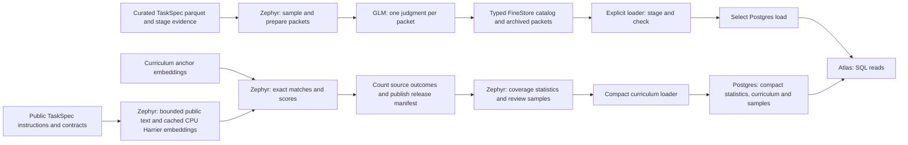

# RL Data Atlas

[RL Data Atlas](https://applets.marina.oa.dev/a/fb11c931-5861-4878-8bb5-a964d652b45f/)
reads a Postgres copy of the published [curation catalog](task-curation.md#run-catalog).
Curation owns source declarations, admission decisions, executed controls and
sampled GLM judgments. Atlas displays those records and their task packets.

The checked-in app also reads immutable curriculum-matching releases. The
curriculum pane shows task coverage by subject, group, capability and source.
Its loader and selected release are independent of the sampled grading catalog.

The 95% control pass threshold permits curation to skip validation of unsampled
tasks. Below that threshold, curation validates each task and retains individual
passes. The 80% Good threshold below grades a sample of the retained output.
Curation supplies the tasks and evidence; the grade does not change admission.



## Reading grades

FULL campaigns grade automatically; SAMPLE opts in with `--assess`.
The default sample covers 100 retained tasks and up to 20 excluded rows.
"Admitted" in the catalog means a task retained in the final TaskSpec parquet
after curation. Excluded rows are sampled separately to inspect filtering decisions.
Admitted opinions, excluded diagnostics and executed grader controls remain
separate. Grading does not change admission. Input populations may overlap.

SQL computes each cohort's verdict counts and label over the entire selected sample:

- Good: at least 80% have usable task evidence and a Good judgment.
- Bad: more than 20% have usable task evidence and a Bad judgment.
- Unknown: neither threshold is met and fewer than 80% have conclusive judgments.
- Some issues: the remaining samples.

A completed or gated pipeline that processes inputs and retains zero tasks is Bad.
An incomplete pipeline without retained tasks remains Unknown. Missing packets
and unavailable judgments count against coverage; they are never dropped from
the denominator. Atlas displays the Good fraction and the reason for the label.
These opinions describe the inspected sample, not an estimate of the whole source.

Large packets retain the task and answer contract, with bounded previews of long
text, collections and stage audits. Previews record original sizes and selected
indices or text prefixes and suffixes; full evidence remains in curation outputs.
The model names any missing fact that prevents a judgment. Omitted private fixture
text alone does not force Unknown.

Assessment keys use ordinary artifact dependencies and explicit versions.
Changing only the rubric or grading model reuses curation. A failed new key has
no current grade; archived evidence remains available. Inventory-only sources
carry a skip reason. Source details show the latest curation outcome; the
assessment page shows the curation associated with its selected grade.

## Browsing sources

**By source** lists individual sources with their catalog, converted example
count, training/evaluation use, current sampled quality and the curriculum domain
with the most mapped examples. Search names, datasets or tags; filter by catalog,
use or quality; select a column heading to sort. Filters and sorting are included in the URL. CSV export
includes the filtered rows in the displayed order.

Example counts describe successfully converted tasks before curation admission.
A dash means no processed examples from that source are in the currently
published curriculum release.
**Not assessed** means there is no current sampled assessment; **Unknown** is a
completed assessment without enough conclusive judgments. Open a source for
pipeline details and links to its original dataset, assessment and curriculum
coverage. The leading curriculum domain links directly to that source's coverage
within the domain. On small screens, the table keeps name, count and quality
visible; source details contain the remaining fields.

## Updating Atlas

Source code lives in `infra/marina/applets/rl_data_catalog/`. Its migration
creates the SQL tables; it does not read object storage or run curation.
Publish code when the schema or UI changes, then load data explicitly:

```bash
uv run marina validate infra/marina/applets/rl_data_catalog
uv run marina release-status infra/marina/applets/rl_data_catalog --json
uv run marina applets versions fb11c931-5861-4878-8bb5-a964d652b45f --json
uv run marina release infra/marina/applets/rl_data_catalog --base-version CURRENT_VERSION

uv run python infra/marina/applets/rl_data_catalog/load.py \
  --applet-id fb11c931-5861-4878-8bb5-a964d652b45f
```

`applet.toml` declares the existing applet's UUID. Any authenticated internal
Marina user can release an update. By default, source must be a clean
checkout at the current remote main. A Marina image deployment does not publish Atlas. A
default release records its source commit and subtree hash in the immutable package;
`release-status` reports whether that tree matches this checkout.
Use `--allow-dirty` to explicitly release branch or uncommitted source without
verified Git provenance; `release-status` then reports `unrecorded` from a clean checkout.

The loader defaults to the published catalog in CoreWeave's `us-east-02a` bucket at
`s3://marin-us-east-02a/marin/rl-data/catalog/production`.
Use `--catalog-root` to explicitly select another catalog, such as a local preview.
The default keeps production updates independent of an operator's local curation cache.

Production FULL campaigns add `--publish-catalog
s3://marin-us-east-02a/marin/rl-data/catalog/production` to the
[campaign command](task-curation.md#run-a-campaign) with assessment enabled.
`--cache-dir` selects local execution and a local artifact root, so production
publication rejects it. Production uses the shared artifact cache under
`--artifact-root` (default `s3://marin-us-east-02a/marin`) and an explicit
`--review-cache` for model requests. Reuse the existing cache locations, pinned
inputs, recipe versions, rubric and model revisions to reuse completed work.
Assessment can use cached results; enabling it does not force regrading.
A new report directory does not invalidate the caches. Switching a local or GCP
artifact root to S3 does not move its cached work. Verify retained artifacts and
model-request caches are available before running a campaign from the new root.
The publication destination is independent: a GCP campaign can keep its existing
`--artifact-root` and `--review-cache` while publishing to the S3 catalog. Run
beside those caches. The default S3 artifact root will not reuse work present
only at a different GCP root.
Run history, assessments and evidence accumulate in the shared catalog.
Without this option, SAMPLE/FULL publish beside their report. QUICK does not publish
a grading snapshot. Adding a dataset declaration alone does not execute its pipeline.

Publication updates selected sources and preserves all other production entries,
including their pinned declarations. Use `--source` to grade only new or changed
sources; the other sources' assessments carry forward without executing their
pipelines. Metadata-only edits to names, tags or URLs
therefore reach production when that source is selected. Removing a declaration
from code does not retire its production entry. Older attempts are ignored per
source, so an out-of-order campaign can still publish its other sources. Failed
attempts under a changed assessment key clear the old grade; exact-key retries
can reuse completed evidence. The key includes rubric, model and pipeline identity.

After the campaign publishes, run the loader above to refresh Postgres. The shared
catalog updates during production runs; Atlas refresh remains an explicit operation
and can be retried without inference or a Marina restart. Curriculum publication
and import are separate; grading a new source does not generate its heatmap coverage.

Coordinate the code release and data load: the new API returns 503 until a
catalog has been selected. The loader reads through `CurationCatalog`, sends byte-bounded
SQL batches, checks sample and packet coverage, then selects the load with one
conditional UPDATE. An unchanged snapshot skips loading. If the catalog or serving
selection changes during an import, that import fails and can be retried. Cleanup
after successful selection removes only older loads observed before staging; it
preserves imports that started later. Schema changes may require downtime. FineStore's snapshot reader caches
requested Parquet byte ranges under a shared memory budget. The loader needs no
separate metadata cache and keeps evidence packet reads batched. A bounded import
can run from a workstation; prefer the catalog's storage region for large transfers.

The production catalog was seeded from the relocated October 12 snapshot. Its initial
manifest retains immutable shards in
`s3://marin-us-east-02a/marin/rl-data/migrations/2026-10-15/`.
That verified archive remains part of production storage and must be retained.
Schemas were copied into the production root so writers can extend the catalog.
New writes use that root. The legacy catalog remains historical evidence.
This catalog bootstrap preserves published grades and evidence; it does not
relocate the original GCP execution artifacts or model-request cache.

Packets are stored separately as JSON text, preserving escaped null characters.
Inventory queries scan structured metadata and verdict rows. Atlas performs no
cloud reads, background refresh or inference. Request/response traces remain
archival references in the assessment record.

For a local preview, start disposable Marina and Postgres, then run the same
loader against a local curation cache using the printed applet ID and origin:

```bash
uv run marina release infra/marina/applets/rl_data_catalog --local --json
uv run python infra/marina/applets/rl_data_catalog/load.py \
  --catalog-root ~/.cache/marin/rl-curation/campaigns/catalog \
  --applet-id PRINTED_ID --url PRINTED_ORIGIN
```

Inspect the inventory, an assessment and its task evidence. Stop the local stack
with Ctrl-C when finished; its database is disposable.

## Curriculum coverage

**By curriculum** opens a heatmap of all curriculum domains and their topics.
Choose a domain from the picker or open an area to see its topics and skills.
Breadcrumbs return to parent areas or all domains. Search names and descriptions
across the curriculum, and filter counts by source or training/evaluation use.
The URL preserves the selected area and filters. Select a count to read sampled
examples, then open an example for its public instruction preview, embedding
text, cosine similarity to curriculum anchors and alternative matches.
Long instruction previews record the original character count and truncation.

Displayed cosine scores are similarities; distance is `1 - similarity`.
The export uses fixed maximum distances of 0.45 for subjects and 0.25 for
capabilities. A task can have a capability match, a subject-only match, no
match within the cutoff, insufficient context, or a skipped embedding.
Alternative subject and capability matches remain available in sampled task details.

Counts shade each area on a logarithmic scale; zeros stay visible to expose gaps.
Domain counts include tasks that match the subject but fall outside the
capability cutoff. Topic and skill counts require a capability match. Opening an
area loads its sampled examples below the map;
**Read sampled examples** jumps to that list. Empty areas explain when no
examples are available.

Heatmap counts and outcome totals describe every task
instance in the exported population. A Zephyr pass computes these counts by
source and curriculum node, including hierarchy rollups. Postgres sums these
small statistics for dataset and train/eval filters. Overview requests do
not scan task or match tables.

Examples combine two independent deterministic samples: up to 100 tasks per
source and 10 per curriculum node, including subjects, groups and capabilities.
The combined sample removes repeated source/task identities. The task list
and details show this bounded review sample; their size does not change the
full-population counts. Curriculum entries, statistics and samples form the
compact serving dataset. The complete task and embedding outputs stay in
object storage.

Converted populations contain successfully converted TaskSpecs before admission.
They retain training/evaluation intent. Selecting a source shows its full
conversion ledger in **About counts and matching** when available. Sources
outside the release remain in the source inventory, where **Not processed**
filters them for inspection.

Run the embedding graph through `--embed coverage`. The `publication` stage
counts assignment outcomes by source, reconciles complete converted populations
against source manifests, and writes `release.json` referencing the assignment Parquet. The subsequent `coverage` stage writes aggregated
statistics, bounded example Parquet and `coverage.json` without rerunning
embeddings or matching. Load both manifests:

```bash
uv run python -m infra.marina.applets.rl_data_catalog.load_curriculum \
  --release IMMUTABLE_RELEASE_ROOT/release.json \
  --coverage IMMUTABLE_COVERAGE_ROOT/coverage.json \
  --applet-id APPLET_ID --url MARINA_ORIGIN
```

The loader reads statistics and sampled task files. It checks sample lineage,
training/evaluation use, curriculum references and sample counts. It reconciles
statistics against complete-population totals in the task release manifest before atomically selecting
the release. Byte-bounded SQL requests keep import work proportional to the
compact export. Failed loads preserve the selected release; the current and
previous releases are retained. Run one curriculum loader per applet at a time.
APIs read Postgres without cloud scans.

Start the local stack as shown in [Updating Atlas](#updating-atlas), then use the
same curriculum-loader command with its printed ID and origin. Stop the stack
with Ctrl-C when finished.

## PDBThink coordinate tasks

`Hugging Face:pdbthink-coordinate-tasks` registers
[PDBThink Coordinate Tasks v1.3.0](https://huggingface.co/datasets/open-athena/pdbthink-coordinate-tasks/tree/3734406cb97b1702844319f9a5d860cbbf8fe660)
as an inventory-only source, with no conversion pipeline or current assessment.
The pinned [release manifest](https://huggingface.co/datasets/open-athena/pdbthink-coordinate-tasks/blob/3734406cb97b1702844319f9a5d860cbbf8fe660/manifest.json)
records 100,000 tasks across 19 families: 91,154 train, 4,411 validation and 4,435
test tasks. The [benchmark exclusions](https://huggingface.co/datasets/open-athena/pdbthink-coordinate-tasks/blob/3734406cb97b1702844319f9a5d860cbbf8fe660/README.md#relationship-to-the-benchmark)
cover the frozen PDBThink benchmark's source entries, exact protein sequences
and associated RCSB clusters at 30% sequence identity.

The task protocol requires one tool-free response to displayed protein coordinates.
Expose only `prompt.json` to the solver; gold, provenance, tests and oracle
solutions are evaluator-only. The pinned [usage instructions](https://huggingface.co/datasets/open-athena/pdbthink-coordinate-tasks/blob/3734406cb97b1702844319f9a5d860cbbf8fe660/USAGE.md)
describe `CoordinateNoToolsAgent` and native-token budgets. A curation conversion
must preserve these restrictions and the bundled deterministic verifier, whose
source is in [generator_source.tar.gz](https://huggingface.co/datasets/open-athena/pdbthink-coordinate-tasks/blob/3734406cb97b1702844319f9a5d860cbbf8fe660/generator_source.tar.gz).
Conversion or grader changes must bump the pipeline version used by assessments.

The publisher's [v1.3.0 correction audit](https://huggingface.co/datasets/open-athena/pdbthink-coordinate-tasks/blob/3734406cb97b1702844319f9a5d860cbbf8fe660/audits/contract_revision/regressions.json)
is release evidence. The separately published [GLM teacher traces v1.0.0](https://huggingface.co/datasets/open-athena/pdbthink-glm53-teacher-traces/tree/v1.0.0)
retain task-v1.2.0 prompts and scores. Neither supplies a current curation
assessment for this entry. Publish the inventory through a SAMPLE or FULL
campaign and use the [Atlas loader](#updating-atlas) to display it.

## Historical reviews

Historical reviews and raw artifacts remain in their original Postgres tables.
They do not affect current grades. Atlas retains an archive reader; the previous
manual review, source-verification and difficulty workflows are removed.
