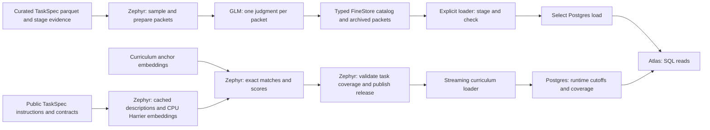

# RL Data Atlas

[RL Data Atlas](https://applets.marina.oa.dev/a/fb11c931-5861-4878-8bb5-a964d652b45f/)
reads a Postgres copy of the published [curation catalog](task-curation.md#run-catalog).
Curation owns source declarations, admission decisions, executed controls and
sampled GLM judgments. Atlas displays those records and their task packets.

The checked-in app also reads immutable curriculum-matching releases. The
curriculum pane shows task coverage by subject, group, capability and source.
Its loader and selected release are independent of the sampled grading catalog.

The 95% control pass threshold permits curation to skip validation of unsampled
tasks. Below that threshold, curation validates each task and retains individual
passes. The 80% Good threshold below grades a sample of the retained output.
Curation supplies the tasks and evidence; the grade does not change admission.



## Reading grades

FULL campaigns grade automatically; SAMPLE opts in with `--assess`.
The default sample covers 100 retained tasks and up to 20 excluded rows.
"Admitted" in the catalog means a task retained in the final TaskSpec parquet
after curation. Excluded rows are sampled separately to inspect filtering decisions.
Admitted opinions, excluded diagnostics and executed grader controls remain
separate. Grading does not change admission. Input populations may overlap.

SQL computes each cohort's verdict counts and label over the entire selected sample:

- Good: at least 80% have usable task evidence and a Good judgment.
- Bad: more than 20% have usable task evidence and a Bad judgment.
- Unknown: neither threshold is met and fewer than 80% have conclusive judgments.
- Some issues: the remaining samples.

A completed or gated pipeline that processes inputs and retains zero tasks is Bad.
An incomplete pipeline without retained tasks remains Unknown. Missing packets
and unavailable judgments count against coverage; they are never dropped from
the denominator. Atlas displays the Good fraction and the reason for the label.
These opinions describe the inspected sample, not an estimate of the whole source.

Large packets retain the task and answer contract, with bounded previews of long
text, collections and stage audits. Previews record original sizes and selected
indices or text prefixes and suffixes; full evidence remains in curation outputs.
The model names any missing fact that prevents a judgment. Omitted private fixture
text alone does not force Unknown.

Assessment keys use ordinary artifact dependencies and explicit versions.
Changing only the rubric or grading model reuses curation. A failed new key has
no current grade; archived evidence remains available. Inventory-only sources
carry a skip reason. The source table shows the latest curation outcome; the
assessment page shows the curation associated with its selected grade.

## Updating Atlas

Source code lives in `infra/marina/applets/rl_data_catalog/`. Its migration
creates the SQL tables; it does not read object storage or run curation.
Publish code when the schema or UI changes, then load data explicitly:

```bash
uv run marina validate infra/marina/applets/rl_data_catalog
uv run marina applets versions fb11c931-5861-4878-8bb5-a964d652b45f --json
uv run marina publish infra/marina/applets/rl_data_catalog \
  --update fb11c931-5861-4878-8bb5-a964d652b45f --base-version CURRENT_VERSION

uv run python infra/marina/applets/rl_data_catalog/load.py \
  --catalog-root CATALOG_ROOT \
  --applet-id fb11c931-5861-4878-8bb5-a964d652b45f
```

The first code update requires the applet's publisher. Run the loader in the
catalog's storage region. It reads through `CurationCatalog`, sends byte-bounded
SQL batches, checks sample and packet coverage, then selects the load with one
UPDATE. An unchanged snapshot skips loading. One operator runs updates; concurrent
loaders are unsupported. Abandoned and obsolete staging rows are removed on the
next update. Schema changes may require downtime.

Packets are stored separately as JSON text, preserving escaped null characters.
Inventory queries scan structured metadata and verdict rows. Atlas performs no
cloud reads, background refresh or inference. Request/response traces remain
archival references in the assessment record.

For a local preview, start disposable Marina and Postgres, then run the same
loader against a local curation cache using the printed applet ID and origin:

```bash
uv run marina publish infra/marina/applets/rl_data_catalog --local --json
uv run python infra/marina/applets/rl_data_catalog/load.py \
  --catalog-root ~/.cache/marin/rl-curation/campaigns/catalog \
  --applet-id PRINTED_ID --url PRINTED_ORIGIN
```

Inspect the inventory, an assessment and its task evidence. Stop the local stack
with Ctrl-C when finished; its database is disposable.

## Curriculum coverage

Open **Curriculum coverage** from the source inventory. The heatmap starts with
subjects and source families. Open a subject or group to descend through the
hierarchy, or search names and descriptions across the curriculum. Search returns
at most 100 areas. Select a cell for its task instances and a task for its public
instruction preview, core-work description, cosine scores and alternatives.
Long instruction previews record the original character count and truncation.

Displayed cosine scores are similarities; distance is `1 - similarity`.
The subject and capability distance defaults are 0.45 and 0.25. Smaller values
are stricter. **Apply cutoffs** runs new SQL queries over saved scores. It does
not run inference or matching. A task can have a capability match, a subject-only
match, no match within the cutoff, or insufficient context for a description.
The nearest capabilities across all subjects remain available as diagnostics.

Count task instances or unique public inputs. Public-input hashes cover
instructions and public tool/answer contracts. For each column, the denominator
includes every task selected for the release, including insufficient context
and matches outside the cutoff. Sampled releases use the selected sample as
the denominator. Unique mode deduplicates hashes within
the selected sources for both numerator and denominator. Parent cells count a
task once across descendants. Columns can overlap and must not be summed to
recover the global unique count. Task drilldown always lists source instances.

Converted populations contain successfully converted TaskSpecs before admission.
They retain training/evaluation intent. Input rows, conversion rejections, task
instances and unique embedding texts are separate quantities. Selecting a source
shows its full conversion ledger when available. A sampled release states its
sample size. Sources outside the release remain in the inventory; enable
**Show sources without processed tasks** to show their striped columns.

The embedding command's default `publication` stage produces `release.json`.
It validates task IDs and lineage against the selected population and requires
full converted releases to match conversion-manifest counts. Run the loader
process in the release's storage region:

```bash
uv run python -m infra.marina.applets.rl_data_catalog.load_curriculum \
  --release IMMUTABLE_RELEASE_ROOT/release.json \
  --applet-id APPLET_ID --url MARINA_ORIGIN
```

The loader streams Parquet in bounded batches and checks each task's source key,
converted/admitted population, training/evaluation use and curriculum references.
It compares per-source and global counts against the release manifest, then
switches the selected release atomically. Each SQL request inserts tasks and
expands their matches within the same byte-bounded batch. Compact hashes count
distinct public inputs and embedding texts without a whole-release SQL scan.
Failed loads preserve the selected release. The loader retains the selected
release and its immediate predecessor; other abandoned or obsolete staged loads
are removed in bounded batches at the next update. If the requested release is
already selected, the loader skips loading. Run one curriculum loader per applet
at a time.
Curriculum-only updates do not require a grading-catalog reload. APIs read
Postgres without cloud scans.

Start the local stack as shown in [Updating Atlas](#updating-atlas), then use the
same curriculum-loader command with its printed ID and origin. Stop the stack
with Ctrl-C when finished.

## Historical reviews

Historical reviews and raw artifacts remain in their original Postgres tables.
They do not affect current grades. Atlas retains an archive reader; the previous
manual review, source-verification and difficulty workflows are removed.
