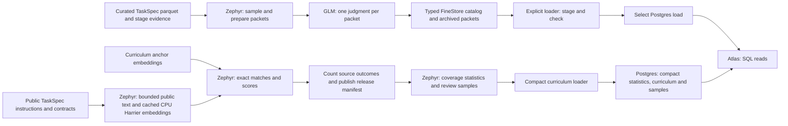

# RL Data Atlas

[RL Data Atlas](https://applets.marina.oa.dev/a/fb11c931-5861-4878-8bb5-a964d652b45f/)
reads a Postgres copy of the published [curation catalog](task-curation.md#run-catalog).
Curation owns source declarations, admission decisions, executed controls and
sampled GLM judgments. Atlas displays those records and their task packets.

The checked-in app also reads immutable curriculum-matching releases. The
curriculum pane shows task coverage by subject, group, capability and source.
Its loader and selected release are independent of the sampled grading catalog.

The 95% control pass threshold permits curation to skip validation of unsampled
tasks. Below that threshold, curation validates each task and retains individual
passes. The Result thresholds below grade a reviewed sample of the retained output.
Curation supplies the tasks and evidence; the grade does not change admission.



## Reading grades

FULL campaigns grade automatically; SAMPLE opts in with `--assess`.
The default sample covers 100 retained tasks and up to 20 excluded rows.
"Admitted" in the catalog means a task retained in the final TaskSpec parquet
after curation. Excluded rows are sampled separately to inspect filtering decisions.
Admitted opinions, excluded diagnostics and executed grader controls remain
separate. Grading does not change admission. Input populations may overlap.

Result is computed from conclusive reviewed tasks in each cohort. A task has
issues when its judgment is Some issues or Bad:

- Good: at least 90% clean (no more than 10% with issues).
- Bad: at least 50% with issues.
- Some issues: more than 10% and fewer than 50% with issues.
- Unknown: no conclusive reviewed tasks or incomplete sample coverage.

Exactly 10% issues is Good; exactly 50% is Bad. Store the reviewed and issue
counts, issue rate, issue evidence and repair recommendation. Unavailable and
uncertain judgments remain explicit coverage diagnostics. Mechanical exclusions
and zero retained tasks do not invent quality observations. QC never rejects
sources or tasks. These opinions describe the inspected sample.

Large packets retain the task and answer contract, with bounded previews of long
text, collections and stage audits. Previews record original sizes and selected
indices or text prefixes and suffixes; full evidence remains in curation outputs.
The model names any missing fact that prevents a judgment. Omitted private fixture
text alone does not force Unknown.

Assessment keys use ordinary artifact dependencies and explicit versions.
Changing only the rubric or grading model reuses curation. A failed new key has
no current grade; archived evidence remains available. Every source has a registered converter and enters through QUICK, SAMPLE or FULL.
QUICK records conversion without review. Source details show the latest curation outcome; the
assessment page shows the curation associated with its selected grade.

## Browsing sources

**By source** lists each source's unique example count, training/evaluation use,
Quality, Result, lexical contamination, actor-only Daytona verdict and leading
curriculum area. The levels define required content-review scope: QUICK converts
without content review, SAMPLE requires a complete review of the selected sample,
and FULL requires a complete review of the whole retained population. Execution qualification is recorded separately. Result uses the
inclusive issue-rate boundaries above.

The loader records required and conclusive reviewed counts plus coverage
completeness. Result is provisional if coverage is incomplete or any required
observation remains unreviewed or uncertain. A completed SAMPLE review is final
for its sample; the Quality label alone never makes Result provisional. These
counts follow the selected Result's review panel, not the execution campaign's
processing mode or the source's entire population when only a sample is required.

The default view hides QUICK and BAD entries and folds advisory duplicate groups.
Expand a group to inspect matching members, or enable **Show QUICK-quality and
BAD-result sources**. Search and filters apply before grouping; a hidden canonical
member cannot reappear through a group. Search names, datasets or tags, select a
column heading to sort, and export filtered rows as CSV. Filters and sorting stay
in the URL. The four totals show canonical groups, unique examples, displayed
quality counts and catalog freshness. Source evidence pages include exact release
pins, deduplication ledgers, lexical measurements, QC and archived assessment packets.

**Contamination** is computed from each source's lexical-decontamination record:

- **NO ISSUES**: zero overlap measured for the current input pin or certified by
  a validated current retained-release receipt.
- **REMEDIATED**: TRAIN overlap was excluded in a new pinned private TaskCompendium
  release, with a validated remediation receipt matching the current dataset pin.
- **MEASURED, EVAL**: EVAL or benchmark overlap is retained by policy; the overlapping
  count remains visible.
- **REMEDIATION REQUIRED**: TRAIN overlap lacks verified remediation for the current
  private pin. This state violates the ingestion requirement.
- **NOT MEASURED**: no applicable current-pin record exists; cleanliness is unknown.

Counts describe the measured input before duplicate and lexical exclusions. They do
not describe residual overlap in the retained release or semantic decontamination.
The source table legend and Getting started guide define the same five states.
Enum chips have no subtitle text. Issue rate and Overlap have numeric columns; a
Result from incomplete content review carries a provisional variant within its
chip. Review progress and lower bounds appear only on the source Evidence page.

**Daytona safe** measures the actor only: SAFE requires at most ten snapshot
identities and no refused actor requirements. Sources without an actor show N/A;
grandfathered blends still using the legacy internal format show a dash. Retained
TaskCompendium releases use their new actor measurements. A verified byte-identical
subset may retain an admitted original's qualification through its recorded
remediation lineage; changed task bytes require new qualification. Package-lock
graders run on LOCAL with separate compatibility evidence. A source without a measured actor verdict cannot enter
new ingestion. The backend map records each role's demands and blockers.

Example counts describe unique converted task contracts after mandatory within-source
deduplication, before training selection. Source details include the raw converted count,
duplicates dropped, and the exclusion manifest.
Every entry has a registered conversion pipeline; there is no inventory-only
path that substitutes a declared count for conversion.
**Not assessed** means there is no current sampled assessment; **Unknown** is a
completed assessment without enough conclusive judgments. Curation never re-grades
independent QC; the **Independent QC** column and the source details present the
release's own admission evidence — verdict, method, reviewed count, admitted count
where the release claims one, and a link to its pinned manifest — beside, and
distinct from, the sampled quality. Open a source for
pipeline details and links to its original dataset, assessment and curriculum
coverage. The leading curriculum domain links directly to that source's coverage
within the domain. On small screens, the table keeps name, count and quality
visible; source details contain the remaining fields.

## Updating Atlas

Before selecting a new catalog load:

1. Validate every source's typed upstream origin, build path and generated title.
   Resolve historical IDs through the permanent source alias table. Preserve
   assessment keys, packet URIs and artifact identities when loading canonical IDs.
2. Verify `current_release.repo`, `revision` and `url` identify the exact consumed
   pin. QA/repair releases must be private open-athena TaskCompendium datasets;
   decontamination remediation must configure the new version as the pipeline input. Its URL must match the repository and revision. Keep `url` as upstream
   provenance.
3. Check task-derived SHARED/SEPARATE grading evidence and actor-only Daytona
   measurements. Every UNSAFE reason needs details and affected actor-task counts;
   retain independent grader compatibility evidence. Grandfathered blends keep
   their explicit dash exemption. Task curation owns the fixed list of Daytona-exempt blends and
   records the exemption reason in `SourceDeclaration.daytona_exemption`; the packaged Atlas
   renderer reads that reason without owning source-specific policy.
4. Recompute Result from reviewed issue counts using the inclusive 10% and 50%
   boundaries. Retain issues and repair recommendations separately from exclusions.
5. Check Evalchemy benchmarks retain evaluation/heldout use. Run conversion in
   QUICK, SAMPLE or FULL; changed behavior requires SAMPLE/FULL QA and new pins.
6. Keep unmeasured sources pending. N/A requires measured zero actor slots,
   snapshots and refusals with a count basis; null is reserved for grandfathered
   blends. Preserve the selected legacy SQL load until all new declarations have
   evidence-backed census records.
7. Retain lexical decontamination receipts and original artifacts. Stage and
   validate the complete load before selecting it.

### Deployment checklist

1. Use Marin latest and inspect the current Atlas package version and selected catalog.
   Record the package version, selected catalog snapshot, source commit and survey
   artifact URIs in the deployment's issue or PR.
2. Survey the production backends at Marin latest for their current capabilities
   with the [survey procedure](#backend-survey), and publish the matrix beside the deployment record.
   Execute this survey at each deployment; do not reuse an older deployment's matrix.
3. Require `sandbox-image-workdir` in the direct Kubernetes backend descriptor
   before submitting any prepared-image Iris task, even without declared disk.
   Older controllers hide `/app` and must be rejected before submission.
   Keep Iris sandbox storage admission disabled until a real
   `CONTAINER_PROFILE_SANDBOX` overflow succeeds on the pinned CPU pool. Record
   the node's CoreWeave-provided `runsc.toml` `overlay2` setting beside the raw
   kubelet eviction status; a restricted-profile overflow is insufficient.
   Check one sandbox container and one replica per task, exact-byte storage
   quantities, no writable hostPath, and CPU/memory pod limits. Confirm an
   own-limit eviction is `FAILED / RESOURCE_LIMIT_DISK`, rather than memory OOM
   or node pressure. Only then enable Harbor storage admission and advertise
   `sandbox-storage-limit` as an explicit backend fact. The current controller
   advertises no such capability, and Harbor `iris-sandbox` rejects declared disk.
   Controller deployment/restart requires separate user authorization. Service
   groups and model relays remain unsupported on this environment.
4. Verify every source has a complete, exact-pin `within_source_dedup` receipt and
   Examples equals its `unique_count`, including QUICK sources. Check raw and duplicate
   counts against the drop manifest, then verify version-bound lexical evidence.
   New or changed admissions require a private TaskCompendium clean/remediated
   receipt after [lexical decontamination](task-curation.md#lexical-decontamination-before-publication);
   preserve grandfathered selection until explicitly approved.
5. Validate and release the app against the inspected package version, then load
   the catalog with that survey's `--backend-map` artifact and the selected
   snapshot's `--source-identities` artifact. Fingerprint changed sources and
   resolve or acknowledge their shortlisted source-overlap flags before admission.
6. Check `/backends`, `/source-duplicates`, `/sources`, an assessment and its evidence. Confirm the
   selected snapshot and survey revision agree with the deployment record.

### Preview packaging before the shared runtime is updated

The preview can carry the exact canonical catalog models in its own package.
This avoids a shared Marina deployment while the integration branch is under
review. The staging command copies the alias table and model definitions from the
specified checkout, relocates their imports into the app namespace, and records
source and packaged SHA-256 values in `dist/bundled-model-provenance.json`.
It writes a new directory and fixes its manifest to the preview UUID.

From the clean integrated build checkout:

```bash
uv run python infra/marina/apps/rl_data_catalog/prepare_preview.py \
  --checkout "$PWD" --output /tmp/atlas-preview-package
uv run marina validate /tmp/atlas-preview-package
uv run marina apps versions c9742a15-fb46-4d56-bc88-aa916351ebd3 --json
uv run marina release /tmp/atlas-preview-package --allow-dirty --base-version CURRENT_VERSION --json
```

Use a fresh output directory for each build. Replace `CURRENT_VERSION` with the
versions response's top-level `current_version`.

Before validation and release, optional frozen partial-review observations can
replace `dist/measurements/content-progress.json`. Its JSON object contains
`as_of` and a `sources` list. Each row contains `source_id`, `dataset_id`,
`dataset_revision`, `retained_count`, `valid_reviews_lower_bound` and `evidence_uri`.
The renderer requires an exact current ID, pin and unique-count match. Progress
never determines FULL or Result.

After the package release, load the complete catalog with the
[catalog loader](#updating-atlas), using the explicit preview app ID above.
Use the [curriculum loader](#curriculum-coverage) twice: first pass the deployment's
pre-remediation `release.json` and `coverage.json`, then the retained pair.
Each successful load selects its release and retains the previous selection,
so this order makes retained coverage primary and pre-remediation coverage previous
evidence. Keep the exact input URIs and hashes in the deployment record.

Production remains on hold. Before a production release, the shared runtime must
carry these canonical modules natively; this preview staging command always targets
the separate preview app.

### Backend survey

The enum in `shellbox.requirements` classifies TaskCompendium environments,
resources, runtime shapes, machine sources and commands, plus Harbor environment
fields. Schema tests fail when a field is added without classification. Backend
selection stays deployment metadata. The survey calls production factory checks
over generated specs, then validates each converted task's combined agent and
grader machine demands through rolloutengine's machine mapping.

Prepare `survey-inputs.json` with `inputs` entries containing `source_id`, local
Parquet `paths`, JSON spec `column` and `expected_tasks`. Use complete converted
populations, not sampled assessment packets. Each entry must match the selected
catalog's pinned source revision. Stage remote shards with `uv run fsutil cp`
near their storage region. The survey streams rows and records input SHA-256s.
Sources without converted inputs remain explicitly `unassessed`.

Set `runtime_defaults.agent` and `runtime_defaults.grader` to the deployment's
explicit machine settings: `network`, `cpus`, `memory_mb`, `storage_mb`, `gpus`,
`user`, `startup_timeout` and `cleanup_timeout`. Use JSON null for unset limits.
Published task values override this profile. The artifact records the profile;
it never infers missing resource or network policy from backend choice.

```bash
uv run --prerelease allow --with-editable './lib/shellbox[daytona,qemu,shellsim,iris]' python -m \
  experiments.post_training.task_curation.backend_capabilities \
  --catalog-root s3://marin-us-east-02a/marin/rl-data/catalog/production \
  --manifest survey-inputs.json --output backend-map.json
```

The versioned artifact contains every backend/requirement cell, evidence and
conditions, per-role requirement counts and resource ranges, and per-backend task
outcomes. `supported` means the declared feature passes its check; `partial`
records an implementation or deployment condition; `unsupported` records a
rejection or missing implementation. These are execution-contract checks, not
provider capacity or verifier-liveness measurements. Docker storage quotas depend
on its storage driver. Iris storage enforcement remains unqualified and is not advertised. It requires
one sandbox per task on a direct Kubernetes controller and the SANDBOX overflow
evidence described in the deployment checklist. Shared-worker LOCAL has no disk quota.
QEMU OCI inputs need configured assets and caches. Uploaded mtimes and non-root users have separate cells.

This offline survey makes no provider calls and creates no machines or snapshots.
Record measured account limits separately in `deployment_limits`, keyed by backend,
with `max_concurrent_sandboxes`, `snapshot_cap`, `observed_at` and `evidence`.
Unmeasured limits stay null. The ten-snapshot source budget differs from an
account's snapshot quota. Live Daytona observations use only the RL organization
and existing snapshots. Any agent may remove a snapshot only when provider
last-use is older than one hour and the active run's snapshot reference registry
has `queued_reference_inventory_complete=true` with no reference to that
snapshot from any live or queued run. An unavailable or incomplete registry
blocks cleanup.

`/backends` serves the selected matrix, revision, profile and limit observations.
Each `/sources` row includes `backend_capabilities`: census basis, input digests,
role demands, resource ranges, supported/partial/unsupported task counts and
blockers. Both slots must fit for a single-backend deployment; per-role results
also describe split execution. `role_backend_assignments` records the Daytona
deployment: the actor uses Daytona and a package-lock grader uses LOCAL. Read
the assigned backend's `roles` counts for each role. Daytona safety counts only
actor snapshots and actor refusals; a reply-only task has no Daytona actor and
is N/A. LOCAL grader quota or feature failures remain visible independently.
Backend names are never distribution features.
The map carries the catalog's `grading_environment` census unchanged; its
required/declared boundary counts and mismatch reasons come from converted-row
evidence. The loader rejects a map carrying different grading evidence.
The offline `daytona_census` command measures registered converters' TaskSpec
outputs before admission gates and records admission rejections separately.
An all-rejected population retains its measured execution cost and a BAD
curation result. A converter emitting no TaskSpecs is an ingestion failure.
The loader checks schema, snapshot and source coverage and stages the matrix and
source maps under the catalog load ID before its conditional atomic selection.
Changing a survey refreshes an otherwise unchanged catalog. A failed import
preserves the selected map.

Source code lives in `infra/marina/apps/rl_data_catalog/`. Its migration
creates the SQL tables; it does not read object storage or run curation.
Publish code when the schema or UI changes, then load data explicitly:

```bash
uv run marina validate infra/marina/apps/rl_data_catalog
uv run marina release-status infra/marina/apps/rl_data_catalog --json
uv run marina apps versions fb11c931-5861-4878-8bb5-a964d652b45f --json
uv run marina release infra/marina/apps/rl_data_catalog --base-version CURRENT_VERSION

uv run python infra/marina/apps/rl_data_catalog/load.py \
  --app-id fb11c931-5861-4878-8bb5-a964d652b45f --backend-map backend-map.json \
  --source-identities source-identities-reviewed.json
```

`applet.toml` declares the existing app's UUID. Any authenticated internal
Marina user can release an update. By default, source must be a clean
checkout at the current remote main. A Marina image deployment does not publish Atlas. A
default release records its source commit and subtree hash in the immutable package;
`release-status` reports whether that tree matches this checkout.
Use `--allow-dirty` to explicitly release branch or uncommitted source without
verified Git provenance; `release-status` then reports `unrecorded` from a clean checkout.

The loader defaults to the published catalog in CoreWeave's `us-east-02a` bucket at
`s3://marin-us-east-02a/marin/rl-data/catalog/production`.
Use `--catalog-root` to explicitly select another catalog, such as a local preview.
The default keeps production updates independent of an operator's local curation cache.

Production FULL campaigns add `--publish-catalog
s3://marin-us-east-02a/marin/rl-data/catalog/production` to the
[campaign command](task-curation.md#run-a-campaign) with assessment enabled.
`--cache-dir` selects local execution and a local artifact root, so production
publication rejects it. Production uses the shared artifact cache under
`--artifact-root` (default `s3://marin-us-east-02a/marin`) and an explicit
`--review-cache` for model requests. Reuse the existing cache locations, pinned
inputs, recipe versions, rubric and model revisions to reuse completed work.
Assessment can use cached results; enabling it does not force regrading.
A new report directory does not invalidate the caches. Switching a local or GCP
artifact root to S3 does not move its cached work. Verify retained artifacts and
model-request caches are available before running a campaign from the new root.
The publication destination is independent: a GCP campaign can keep its existing
`--artifact-root` and `--review-cache` while publishing to the S3 catalog. Run
beside those caches. The default S3 artifact root will not reuse work present
only at a different GCP root.
Run history, assessments and evidence accumulate in the shared catalog.
Without this option, SAMPLE/FULL publish beside their report. QUICK does not publish
a grading snapshot. Adding a dataset declaration alone does not execute its pipeline.

Publication updates selected sources and preserves all other production entries,
including their pinned declarations. Use `--source` to grade only new or changed
sources; the other sources' assessments carry forward without executing their
pipelines. Metadata changes can use `catalog_snapshot.refresh_catalog` with a new snapshot
ID and matching pinned declarations. It preserves assessments and historical
snapshots while explicitly retiring the supplied source IDs. A changed input or
pipeline pin requires a conversion campaign. Removing pipeline-less declarations
from code also prevents them from being carried into new campaign snapshots.
Older attempts are ignored per
source, so an out-of-order campaign can still publish its other sources. Failed
attempts under a changed assessment key clear the old grade; exact-key retries
can reuse completed evidence. The key includes rubric, model and pipeline identity.

After the campaign publishes, run the loader above to refresh Postgres. The shared
catalog updates during production runs; Atlas refresh remains an explicit operation
and can be retried without inference or a Marina restart. Curriculum publication
and import are separate; grading a new source does not generate its heatmap coverage.

Coordinate the code release and data load: the new API returns 503 until a
catalog has been selected. The loader reads through `CurationCatalog`, sends byte-bounded
SQL batches, checks sample and packet coverage, then selects the load with one
conditional UPDATE. An unchanged snapshot skips loading. If the catalog or serving
selection changes during an import, that import fails and can be retried. Cleanup
after successful selection removes only older loads observed before staging; it
preserves imports that started later. Schema changes may require downtime. FineStore's snapshot reader caches
requested Parquet byte ranges under a shared memory budget. The loader needs no
separate metadata cache and keeps evidence packet reads batched. A bounded import
can run from a workstation; prefer the catalog's storage region for large transfers.

The production catalog was seeded from the relocated October 12 snapshot. Its initial
manifest retains immutable shards in
`s3://marin-us-east-02a/marin/rl-data/migrations/2026-10-15/`.
That verified archive remains part of production storage and must be retained.
Schemas were copied into the production root so writers can extend the catalog.
New writes use that root. The legacy catalog remains historical evidence.
This catalog bootstrap preserves published grades and evidence; it does not
relocate the original GCP execution artifacts or model-request cache.

Packets are stored separately as JSON text, preserving escaped null characters.
Inventory queries scan structured metadata and verdict rows. Atlas performs no
cloud reads, background refresh or inference. Request/response traces remain
archival references in the assessment record.

For a local preview, start disposable Marina and Postgres, then run the same
loader against a local curation cache using the printed app ID and origin:

```bash
uv run marina release infra/marina/apps/rl_data_catalog --local --json
uv run python infra/marina/apps/rl_data_catalog/load.py \
  --catalog-root ~/.cache/marin/rl-curation/campaigns/catalog \
  --app-id PRINTED_ID --url PRINTED_ORIGIN --backend-map local-backend-map.json \
  --source-identities local-source-identities-reviewed.json
```

Inspect the inventory, an assessment and its task evidence. Stop the local stack
with Ctrl-C when finished; its database is disposable.

### Source identity and overlap review

`source_duplicates fingerprint` reads complete converted TaskSpec populations
before admission using the [backend survey's manifest shape](#backend-survey).
It records seed-0 samples of at most
20 normalized tasks, instruction MinHash sketches, reference/test hashes,
upstream dataset revisions, identifier/URL hashes and within-source duplicate
counts. Pin each source's fingerprint artifact URI, its SHA-256 and task-input digest
in a staged raw copy of `experiments/post_training/task_curation/source_fingerprint_index.json`.
That Git path holds a registry reference. Use the
[registry update command](task-curation.md#updating-pinned-registry-receipts)
to archive the complete updated index, verify readback and replace its reference;
do not insert fingerprint entries into the reference object.
The task-input digest binds the consumed dataset revision, pipeline, converter
revision and the actor census's `task_specs_sha256` for that population.
Catalog titles, counts and assessment
evidence can change while reusing an unchanged population's fingerprint.

The `Atlas source overlap` workflow detects added or changed declarations and
requires their fingerprints. Generated CI input surveys are staged in private
object storage under the run/attempt prefix; the code bundle carries only their
SHA-256 manifest. The worker downloads and verifies those bytes before scanning,
keeping input data outside Iris's workspace-bundle size limit.
It ranks candidates mechanically and reviews only
the top three per changed source. The runtime-selected `JudgeEndpoint` uses
`Qwen/Qwen3.8-27B` at revision
`37561816e66b5b9153b1b64c10968c18c1e6f4a0`, temperature 0.7 and prompt
`source-overlap-v1`. Hosted endpoints must advertise that exact model. The local
route owns one H100 through `remote_inference`, with compilation and CUDA graphs
enabled, and releases it when the bounded batch exits. The local judge uses
batch priority and a 65,536-token context, including up to 2,048 output tokens.
The 4,200-second client read deadline covers worker readiness and one request,
allowing managed batch-preemption recovery to finish before the caller times out.
Every model response is checkpointed before opinion validation. Invalid opinions
receive at most three attempts with unchanged request bytes and sampling settings.
An exhausted pair is recorded as unresolved, including all response paths and
validation errors; the scan continues through the remaining pairs. The CLI writes
valid verdicts to `.receipts.jsonl`, raw responses beneath `.receipts.responses/`
and unresolved pairs to `.receipts.unresolved.jsonl` beside the selected output.
It fails after scanning if any pair remains unresolved. Unresolved pairs receive
no duplicate/distinct label, group edge or acknowledgement. Transport and storage
failures propagate. Identical complete requests reuse cached reviews without a
model lease. Use a labelled duplicate/distinct fixture before
accepting a new model or prompt.

```bash
uv run --extra dedup python -m experiments.post_training.task_curation.source_duplicates fingerprint \
  --manifest identity-inputs.json --output source-identities.json
uv run --extra dedup python -m experiments.post_training.task_curation.source_duplicates scan \
  --fingerprints source-identities.json --changed-sources changed-sources.json \
  --top-k 3 --route local --labels labelled-pairs.json \
  --acknowledgements experiments/post_training/task_curation/source_duplicate_acknowledgements.json \
  --require-acknowledged --output source-identities-reviewed.json
```

Reviews label pairs `duplicate`, `partial_overlap` (with the estimated fraction
of the smaller population present in the larger), or `distinct`, with a reason.
Non-distinct flags require resolution or an acknowledgement keyed by the exact
request digest in `source_duplicate_acknowledgements.json`. Groups choose a
stable canonical member for default collapsing; every source and its assessment
remains available. These are advisory opinions, not deletion instructions.

The staged loader selects fingerprints, pair reviews and groups atomically with
the catalog and backend map. Pass the scan's reviewed output to the loader's
`--source-identities` option. `/sources` returns a compact fingerprint summary
and group membership; `/source-fingerprint?source_id=...` returns its bounded
sample, and `/source-duplicates` returns review provenance, opinions and groups.

## Curriculum coverage

**By curriculum** opens a heatmap of all curriculum domains and their topics.
Choose a domain from the picker or open an area to see its topics and skills.
Breadcrumbs return to parent areas or all domains. Search names and descriptions
across the curriculum, and filter counts by source or training/evaluation use.
The URL preserves the selected area, release and filters. The coverage-population picker keeps the retained release primary and makes the previous pre-remediation release available as evidence. Select a count to read sampled
examples, then open an example for its public instruction preview, embedding
text, cosine similarity to curriculum anchors and alternative matches.
Long instruction previews record the original character count and truncation.

Displayed cosine scores are similarities; distance is `1 - similarity`.
The export uses fixed maximum distances of 0.45 for subjects and 0.25 for
capabilities. A task can have a capability match, a subject-only match, no
match within the cutoff, insufficient context, or a skipped embedding.
Alternative subject and capability matches remain available in sampled task details.

Counts shade each area on a logarithmic scale; zeros stay visible to expose gaps.
Domain counts include tasks that match the subject but fall outside the
capability cutoff. Topic and skill counts require a capability match. Opening an
area loads its sampled examples below the map;
**Read sampled examples** jumps to that list. Empty areas explain when no
examples are available.

Heatmap counts and outcome totals describe every task
instance in the exported population. A Zephyr pass computes these counts by
source and curriculum node, including hierarchy rollups. Postgres sums these
small statistics for dataset and train/eval filters. Overview requests do
not scan task or match tables.

Examples combine two independent deterministic samples: up to 100 tasks per
source and 10 per curriculum node, including subjects, groups and capabilities.
The combined sample removes repeated source/task identities. The task list
and details show this bounded review sample; their size does not change the
full-population counts. Curriculum entries, statistics and samples form the
compact serving dataset. The complete task and embedding outputs stay in
object storage.

Converted populations contain successfully converted TaskSpecs before admission.
They retain training/evaluation intent. Selecting a source shows its full
conversion ledger in **About counts and matching** when available. All Atlas entries have conversion evidence from QUICK, SAMPLE or FULL. Entries
without a registered converter are retired from the served catalog; their prior
snapshots, packets and underlying artifacts remain archived.

Run the embedding graph through `--embed coverage`. The `publication` stage
counts assignment outcomes by source, reconciles complete converted populations
against source manifests, and writes `release.json` referencing the assignment Parquet. The subsequent `coverage` stage writes aggregated
statistics, bounded example Parquet and `coverage.json` without rerunning
embeddings or matching. Re-running from a completed campaign's `corpus.json`
merges the current dataset declarations over the recorded inventory, so added
sources or count and independent-QC edits reach the release without re-curation.
Load both manifests:

```bash
uv run python -m infra.marina.apps.rl_data_catalog.load_curriculum \
  --release IMMUTABLE_RELEASE_ROOT/release.json \
  --coverage IMMUTABLE_COVERAGE_ROOT/coverage.json \
  --app-id APP_ID --url MARINA_ORIGIN
```

The loader reads statistics and sampled task files. It checks sample lineage,
training/evaluation use, curriculum references and sample counts. It reconciles
statistics against complete-population totals in the task release manifest before atomically selecting
the release. Byte-bounded SQL requests keep import work proportional to the
compact export. Failed loads preserve the selected release; the current and
previous releases are retained. Run one curriculum loader per app at a time.
APIs read Postgres without cloud scans.

A metadata-only TRAIN-to-EVAL correction requires `--role-projection RECEIPT_URI
RECEIPT_SHA256`. Set `--release` and `--coverage` to the receipt's exact corrected
manifest URIs. The loader verifies the receipt and referenced artifact hashes,
recomputes release identities, and requires each correction to match the current
catalog's exact dataset pin and EVAL policy. Only the listed source roles and
release identities may change; paths, counts and frozen data remain identical.
Ordinary imports still require matching sample roles. Corrected task details show
the effective Use alongside the historical `recorded_intended_use`, and the
curriculum page links to the correction receipt.

Start the local stack as shown in [Updating Atlas](#updating-atlas), then use the
same curriculum-loader command with its printed ID and origin. Stop the stack
with Ctrl-C when finished.

## Historical reviews

Historical reviews and raw artifacts remain in their original Postgres tables.
They do not affect current grades. Atlas retains an archive reader; the previous
manual review, source-verification and difficulty workflows are removed.


Before deploying a source release, retain its task-derived grading-environment
census beside the backend capability evidence. Check that no admitted task has
`grading_environment_mismatch`; repair and qualify a new dataset version before
loading a source whose workspace grader requires SHARED execution.

Check that every retained task declares CPU, memory, disk, agent timeout and
verifier timeout, backed by its full-population resource-calibration receipt.
Declared limits must match the production Harbor trial exactly; calibration-only
solutions cannot serve as admission evidence. Publish the calibrated TaskSpecs
and receipt together in a new private, pinned TaskCompendium release. A uniform
source shape requires every task to have passed at that shape.

## Within-source deduplication before deployment

Every source declaration must contain a complete `within_source_dedup` receipt for the configured
dataset pin and converter version, including QUICK sources. The receipt records raw converted
TaskSpecs, unique contracts, duplicates dropped, and the duplicate-to-kept manifest. Atlas Examples
uses the unique count; source details retain the raw count, duplicate count and exclusion manifest URI,
with a Filer link beside S3 URIs.

Ingest in this order: conversion → exact within-source deduplication → lexical decontamination →
resource calibration and full-population oracle filtering → SAMPLE/FULL QA. Keep the lowest task
ID for each exact full contract. Different graders or private references remain distinct tasks.
Record duplicate exclusions as `DUPLICATE_WITHIN_SOURCE`, separately from QC.

Before a TRAIN remediation release, union duplicate and lexical exclusions and qualify the retained
population. Eval/benchmark sources strictly drop duplicates while recording lexical matches without
lexical exclusions. Publish one new private `open-athena` TaskCompendium version per source only after the
release has been authorized. Preserve the previous artifacts and receipts.
