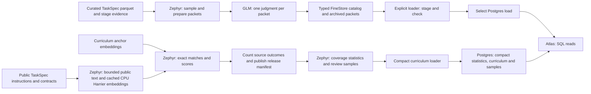

# RL Data Atlas

[RL Data Atlas](https://applets.marina.oa.dev/a/fb11c931-5861-4878-8bb5-a964d652b45f/)
reads a Postgres copy of the published [curation catalog](task-curation.md#run-catalog).
Curation owns source declarations, admission decisions, executed controls and
sampled GLM judgments. Atlas displays those records and their task packets.

The checked-in app also reads immutable curriculum-matching releases. The
curriculum pane shows task coverage by subject, group, capability and source.
Its loader and selected release are independent of the sampled grading catalog.

The 95% control pass threshold permits curation to skip validation of unsampled
tasks. Below that threshold, curation validates each task and retains individual
passes. The Result thresholds below grade a reviewed sample of the retained output.
Curation supplies the tasks and evidence; the grade does not change admission.



## Reading grades

FULL campaigns grade automatically; SAMPLE opts in with `--assess`.
The default sample covers 100 retained tasks and up to 20 excluded rows.
"Admitted" in the catalog means a task retained in the final TaskSpec parquet
after curation. Excluded rows are sampled separately to inspect filtering decisions.
Admitted opinions, excluded diagnostics and executed grader controls remain
separate. Grading does not change admission. Input populations may overlap.

Result is computed from conclusive reviewed tasks in each cohort. A task has
issues when its judgment is Some issues or Bad:

- Good: at least 90% clean (no more than 10% with issues).
- Bad: at least 50% with issues.
- Some issues: more than 10% and fewer than 50% with issues.
- Unknown: no conclusive reviewed tasks or incomplete sample coverage.

Exactly 10% issues is Good; exactly 50% is Bad. Store the reviewed and issue
counts, issue rate, issue evidence and repair recommendation. Unavailable and
uncertain judgments remain explicit coverage diagnostics. Mechanical exclusions
and zero retained tasks do not invent quality observations. QC never rejects
sources or tasks. These opinions describe the inspected sample.

Large packets retain the task and answer contract, with bounded previews of long
text, collections and stage audits. Previews record original sizes and selected
indices or text prefixes and suffixes; full evidence remains in curation outputs.
The model names any missing fact that prevents a judgment. Omitted private fixture
text alone does not force Unknown.

Assessment keys use ordinary artifact dependencies and explicit versions.
Changing only the rubric or grading model reuses curation. A failed new key has
no current grade; archived evidence remains available. Every source has a registered converter and enters through QUICK, SAMPLE or FULL.
QUICK records conversion without review. Source details show the latest curation outcome; the
assessment page shows the curation associated with its selected grade.

## Getting started page

**Getting started** (`guide.html`) explains, for a reader new to Marin, every
path from a candidate dataset to an Atlas source: the task format gate,
environment fidelity, curation modes, qualification, Daytona safety and
publication. It states what each outcome guarantees and links each step to the
normative section of the [task curation reference](task-curation.md) and to the
enforcing code. Per-outcome counts, Daytona labels and oracle-validation counts
are computed in the browser from the same `/sources` response as **By source**,
so they follow each catalog load without a code release. Sources from snapshots
published before declarations carried an oversight level count as *oversight
not declared*. Edit the rules in the reference first, then the page text in
`infra/marina/apps/rl_data_catalog/dist/guide.html`, and release the app.

## Browsing sources

**By source** currently shows Pending for post-filtration admitted Examples, and lists training/evaluation use,
Quality, Result, lexical contamination, actor-only Daytona verdict and leading
curriculum area. The levels define required content-review scope: QUICK converts
without content review, SAMPLE requires a complete review of the selected sample,
and FULL requires a review of the whole retained population. An explicitly accepted
whole-source waiver also displays FULL when its pinned evidence accounts for every
unreviewed task and reason; strict coverage remains false. Execution qualification is recorded separately. Result uses the
inclusive issue-rate boundaries above.

The loader records required and conclusive reviewed counts plus coverage
completeness. Result is provisional if coverage is incomplete or any required
observation remains unreviewed or uncertain, unless a verified whole-source
finalization accepts those observations with pinned waiver evidence. Its Result is
final while Evidence retains the incomplete coverage, unreviewed count and exact
reasons. A completed SAMPLE review is final
for its sample; the Quality label alone never makes Result provisional. These
counts follow the selected Result's review panel, not the execution campaign's
processing mode or the source's entire population when only a sample is required.

The default view hides QUICK and BAD entries and folds advisory duplicate groups.
Expand a group to inspect matching members, or enable **Show QUICK-quality and
BAD-result sources**. Search and filters apply before grouping; a hidden canonical
member cannot reappear through a group. Search names, datasets or tags, select a
column heading to sort, and export filtered rows as CSV. Filters and sorting stay
in the URL. The four totals show canonical groups, unique examples, displayed
quality counts and catalog freshness. Source evidence pages include exact release
pins, deduplication ledgers, lexical measurements, QC and archived assessment packets.

**Use** comes from the registered converter's explicit TRAIN or EVAL policy. A
benchmark tag describes a source and never overrides TRAIN. Historical declarations
without recorded Use display Unknown.

**Contamination** is computed from each source's lexical-decontamination record:

- **NO ISSUES**: zero overlap measured for the current input pin or certified by
  a validated current retained-release receipt.
- **REMEDIATED**: TRAIN overlap was excluded in a new pinned private TaskCompendium
  release, with a validated remediation receipt matching the current dataset pin.
- **MEASURED, EVAL**: declared EVAL overlap is retained by policy; the overlapping
  count remains visible.
- **REMEDIATION REQUIRED**: TRAIN overlap lacks verified remediation for the current
  private pin. This state violates the ingestion requirement.
- **NOT MEASURED**: no applicable current-pin record exists; cleanliness is unknown.

Counts describe the measured input before duplicate and lexical exclusions. They do
not describe residual overlap in the retained release or semantic decontamination.
The source table legend and Getting started guide define the same five states.
Backends shows each measured backend's fit, with partial or unsupported requirement
variants inside its chip. Evidence separates agent and grader support and blockers.
Grading shows the required SHARED or SEPARATE boundary from the complete census;
a declaration mismatch uses a warning variant and remains explicit in Evidence.
N/A requires an applicable measured absence; missing evidence remains unmeasured.
Enum chips have no subtitle text. Issue rate and Overlap have numeric columns; a
Result from incomplete content review carries a provisional variant within its
chip unless an explicit whole-source waiver finalizes it. Review progress and lower bounds appear only on the source Evidence page.

**Daytona safe** measures the actor only: SAFE requires at most ten snapshot
identities and no refused actor requirements. Sources without an actor show N/A;
grandfathered blends still using the legacy internal format show a dash. Retained
TaskCompendium releases use their new actor measurements. A verified byte-identical
subset may retain an admitted original's qualification through its recorded
remediation lineage; changed task bytes require new qualification. Package-lock
graders run on LOCAL with separate compatibility evidence. A source without a measured actor verdict cannot enter
new ingestion. The backend map records each role's demands and blockers.

Examples requires completed oracle filtration and admission evidence, after oracle
failures, within-source duplicates and training lexical overlap have been removed.
Without that proof, Examples and admitted totals remain pending. Evidence and
curriculum coverage separately show the retained converted population; content QA
Results and sampled controls do not certify execution or admission. Source details include the raw converted count,
duplicates dropped, and the exclusion manifest.
Every entry has a registered conversion pipeline; there is no inventory-only
path that substitutes a declared count for conversion.
**Not assessed** means there is no current sampled assessment; **Unknown** is a
completed assessment without enough conclusive judgments. Curation never re-grades
independent QC; source details present the release's reported verdict, method,
reviewed count and pinned manifest beside the sampled quality. The manifest
retains the full historical record; it does not substitute for current filtration
and admission evidence. Open a source for
pipeline details and links to its original dataset, assessment and curriculum
coverage. The leading curriculum domain links directly to that source's coverage
within the domain. Columns size to their contents, and enum chips stay on one line
without subtitles.
On small screens, scroll the table horizontally to reach every column; its header
and body scroll together without widening the page.

## Updating Atlas

Before selecting a new catalog load:

1. Validate every source's typed upstream origin, build path and generated title.
   Resolve historical IDs through the permanent source alias table. Preserve
   assessment keys, packet URIs and artifact identities when loading canonical IDs.
2. Verify `current_release.repo`, `revision` and `url` identify the exact consumed
   pin. QA/repair releases must be private open-athena TaskCompendium datasets;
   decontamination remediation must configure the new version as the pipeline input. Its URL must match the repository and revision. Keep `url` as upstream
   provenance.
3. Check task-derived SHARED/SEPARATE grading evidence and actor-only Daytona
   measurements. Every UNSAFE reason needs details and affected actor-task counts;
   retain independent grader compatibility evidence. Grandfathered blends keep
   their explicit dash exemption. Task curation owns the fixed list of Daytona-exempt blends and
   records the exemption reason in `SourceDeclaration.daytona_exemption`; the packaged Atlas
   renderer reads that reason without owning source-specific policy.
4. Recompute Result from reviewed issue counts using the inclusive 10% and 50%
   boundaries. Retain issues and repair recommendations separately from exclusions.
5. Check Evalchemy benchmarks retain evaluation/heldout use. Run conversion in
   QUICK, SAMPLE or FULL; changed behavior requires SAMPLE/FULL QA and new pins.
6. Keep unmeasured sources pending. N/A requires measured zero actor slots,
   snapshots and refusals with a count basis; null is reserved for grandfathered
   blends. Preserve the selected legacy SQL load until all new declarations have
   evidence-backed census records.
7. Retain lexical decontamination receipts and original artifacts. Stage and
   validate the complete load before selecting it.

### Deployment checklist

1. Use Marin latest and inspect the current Atlas package version and selected catalog.
   Record the package version, selected catalog snapshot, source commit and survey
   artifact URIs in the deployment's issue or PR.
2. Survey the production backends at Marin latest for their current capabilities
   with the [survey procedure](#backend-survey), and publish the matrix beside the deployment record.
   Execute this survey at each deployment; do not reuse an older deployment's matrix.
   The source map must census every current pinned source's complete converted
   population; sources without converted inputs are listed `unassessed` with
   their reason and never as fit.
   For storage-enforcing LOCAL workers, run the survey on the actual PRIVILEGED
   worker with `--local-disk-root /cache/shellbox-disks`. Require its ext4 loop,
   OverlayFS, ENOSPC and cleanup probe to pass. Retain the overflow/neighbor and
   post-teardown loop/mount evidence; a workstation survey cannot qualify the host.
3. Require `sandbox-image-workdir` in the direct Kubernetes backend descriptor
   before submitting any prepared-image Iris task, even without declared disk.
   Older controllers hide `/app` and must be rejected before submission.
   Keep Iris sandbox storage admission disabled until a real
   `CONTAINER_PROFILE_SANDBOX` overflow succeeds on the pinned CPU pool. Record
   the node's CoreWeave-provided `runsc.toml` `overlay2` setting beside the raw
   kubelet eviction status; a restricted-profile overflow is insufficient.
   Check one sandbox container and one replica per task, exact-byte storage
   quantities, no writable hostPath, and CPU/memory pod limits. Confirm an
   own-limit eviction is `FAILED / RESOURCE_LIMIT_DISK`, rather than memory OOM
   or node pressure. Only then enable Harbor storage admission and advertise
   `sandbox-storage-limit` as an explicit backend fact. The current controller
   advertises no such capability, and Harbor `iris-sandbox` rejects declared disk.
   Controller deployment/restart requires separate user authorization. Service
   groups and model relays remain unsupported on this environment.
4. Verify every source has a complete, exact-pin `within_source_dedup` receipt and
   Evidence and curriculum retained counts equal its `unique_count`, including QUICK
   sources. Examples requires the separate post-oracle admission proof. Check raw and
   duplicate counts against the drop manifest, then verify version-bound lexical evidence.
   New or changed admissions require a private TaskCompendium clean/remediated
   receipt after [lexical decontamination](task-curation.md#lexical-decontamination-before-publication);
   preserve grandfathered selection until explicitly approved.
5. Validate and release the app against the inspected package version, then load
   the catalog with that survey's `--backend-map` artifact and the selected
   snapshot's `--source-identities` artifact. Fingerprint changed sources and
   resolve or acknowledge their shortlisted source-overlap flags before admission.
6. Check `/backends`, `/source-duplicates`, `/sources`, an assessment and its evidence. Confirm the
   selected snapshot and survey revision agree with the deployment record.

### Preview packaging before the shared runtime is updated

The preview can carry the exact canonical catalog models in its own package.
This avoids a shared Marina deployment while the integration branch is under
review. The staging command copies the alias table and model definitions from the
specified checkout, relocates their imports into the app namespace, and records
source and packaged SHA-256 values in `dist/bundled-model-provenance.json`.
It writes a new directory and fixes its manifest to the preview UUID.

From the clean integrated build checkout:

```bash
uv run python infra/marina/apps/rl_data_catalog/prepare_preview.py \
  --checkout "$PWD" --output /tmp/atlas-preview-package
uv run marina validate /tmp/atlas-preview-package
uv run marina apps versions c9742a15-fb46-4d56-bc88-aa916351ebd3 --json
uv run marina release /tmp/atlas-preview-package --allow-dirty --base-version CURRENT_VERSION --json
```

Use a fresh output directory for each build. Replace `CURRENT_VERSION` with the
versions response's top-level `current_version`.

The loader selects preview display policy only for UUID
`c9742a15-fb46-4d56-bc88-aa916351ebd3`. A source awaiting an exact-input SAMPLE
Result displays QUICK with “SAMPLE review in progress” in its details and Quality
tooltip. The declaration's oversight and evidence remain unchanged, and absent
Results, issue rates and coverage remain unmeasured. Sources displayed as SAMPLE
or FULL still require a computed Result. Catalog publication and production
imports retain their strict Result gate; preview imports retain all admission
and grading-census checks. Display policy is part of the load identity, so a
preview import cannot make a later strict import skip validation.
Matching computed aggregate and independent sample-panel counts display SAMPLE
without changing execution oversight. The same pure projection runs during
loading and API reads, so a code upgrade keeps an existing selected catalog
readable even if a later strict reload is rejected.

Before validation and release, optional frozen partial-review observations can
replace `dist/measurements/content-progress.json`. Its JSON object contains
`as_of` and a `sources` list. Each row contains `source_id`, `dataset_id`,
`dataset_revision`, `retained_count`, `valid_reviews_lower_bound` and `evidence_uri`.
The renderer requires an exact current ID, pin and unique-count match. Progress
never determines FULL or Result.

Pass `--oracle-inventory /path/to/current-310-oracle-inventory-ledger-v2.json`
to `prepare_preview.py` to package an immutable full-population ledger produced
from task curation's typed `SampleInventory` receipts. The preparer validates each
receipt against its `ActorCensusInput`, checks population totals, canonicalizes
source aliases and records input/output byte hashes. It emits
`dist/measurements/oracle-inventory.json` with a `sources` list
of frozen population observations: `source_id`, the complete `ActorCensusInput`
object as `input`, `oracle_tasks`, `execution_qualification` and `evidence_url`.
The renderer requires the entire actor input, current dataset pin, converter
version and retained count to match. A measured zero establishes no shipped
oracle solutions; it does not establish calibration, execution or admission.
Missing and stale rows leave oracle filtering pending. No full-population
oracle-filter receipt is currently attached to the catalog, so admitted counts
remain pending even where the no-oracle census is complete.
The filtration ledger separately records tasks dropped because their whole
contract cannot execute on a production backend, grouped by typed reason. Until
pin-bound per-task executability receipts are attached, this step and admitted
counts remain Pending. Backend requirement fit alone does not establish execution.

After the package release, load the complete catalog with the
[catalog loader](#updating-atlas), using the explicit preview app ID above.
Use the [curriculum loader](#curriculum-coverage) to select the verified live-source
`release.json` and `coverage.json`. Preserve the existing retained 59-source load
as the previous selectable release. On a new app, load that retained pair before
the live-source pair. Older pre-remediation and archived all-source artifacts
remain immutable historical evidence in the SHA-bound provenance receipt; they
are not additional selectable releases. Keep exact input URIs and hashes in the
deployment record.

Production remains on hold. Before a production release, the shared runtime must
carry these canonical modules natively; this preview staging command always targets
the separate preview app.

### Backend survey

The enum in `shellbox.requirements` classifies TaskCompendium environments,
resources, runtime shapes, machine sources and commands, plus Harbor environment
fields. Schema tests fail when a field is added without classification. Backend
selection stays deployment metadata. The survey calls production factory checks
over generated specs, then validates each converted task's combined agent and
grader machine demands through rolloutengine's machine mapping.

Prepare `survey-inputs.json` with `inputs` entries containing `source_id`, local
Parquet `paths`, JSON spec `column` and `expected_tasks`. A `runtime_column`
entry reads the published machine allocations from a second Parquet column and
surveys each row as `{"task": …, "runtime": …}`; converted-spec shards store
`task_spec` and `runtime` side by side, while published TaskCompendium
`tasks.parquet` files embed both in `lowered_task_spec`. Use complete converted
populations, not sampled assessment packets. Each entry must match the selected
catalog's pinned source revision. On a worker near the shards' storage region,
stage remote inputs and rewrite their manifest paths with:

```bash
uv run python -m experiments.post_training.task_curation.stage_survey_manifest \
  --manifest survey-inputs.json --stage-dir survey-shards \
  --output staged-survey-inputs.json
```

The survey streams staged rows and records input SHA-256s. Sources without
converted inputs remain `unassessed`, and the manifest must declare a
`unassessed_reasons` entry for each of them individually — a shared blanket
reason cannot hide an accidentally omitted input, and an entry naming a source
that has inputs is rejected.

Set `runtime_defaults.agent` and `runtime_defaults.grader` to the deployment's
explicit machine settings: `network`, `cpus`, `memory_mb`, `storage_mb`, `gpus`,
`user`, `startup_timeout` and `cleanup_timeout`. Use JSON null for unset limits.
Published task values override this profile. The artifact records the profile;
it never infers missing resource or network policy from backend choice.

```bash
uv run --prerelease allow --with-editable './lib/shellbox[daytona,qemu,shellsim,iris]' python -m \
  experiments.post_training.task_curation.backend_capabilities \
  --catalog-root s3://marin-us-east-02a/marin/rl-data/catalog/production \
  --manifest staged-survey-inputs.json --output backend-map.json
```

On a worker workspace without git metadata, pass the code revision explicitly
with `--revision`. Pass `--local-disk-root` to verify a LOCAL disk pool on a
privileged Linux worker: the local checker is constructed with that pool and
the artifact records the verified pool root from the checker itself, so a
manifest can never claim a pool the checkers do not use. Without a verified
pool the LOCAL storage cell stays unsupported with its deployment condition;
never widen it by hand. Full
population surveys of every current pinned source (millions of tasks) shard the
manifest by source, stage each shard beside its storage region, and run one
survey process per shard concurrently on a CPU worker at production priority.
Combine the shard artifacts with the tracked merge, which rejects shards that
disagree on the matrix, runtime profile, deployment limits, schema, revision or
verified disk pool, rejects a source measured twice, and drops shard-level
unassessed placeholders:

```bash
uv run --prerelease allow --with-editable './lib/shellbox[daytona,qemu,shellsim,iris]' python -m \
  experiments.post_training.task_curation.backend_capabilities \
  --merge partials/shard-01.json partials/shard-02.json \
  --catalog-root s3://marin-us-east-02a/marin/rl-data/catalog/production \
  --snapshot-id <selected snapshot> --output backend-map.json
```

The merged artifact must then cover the selected snapshot's complete source
set; the loader re-checks that coverage and the grading evidence at import.

Add `--local-disk-root /cache/shellbox-disks` only on a worker configured for
[LOCAL disk enforcement](task-curation.md#full-population-oracle-filter).
The survey constructs the same verified `LocalDiskPool` used by factory admission.
Without it, LOCAL storage stays unsupported. A successful check records conditional
support tied to that worker configuration; use the same `disk_root` in Harbor's
environment kwargs when executing the surveyed tasks.

The versioned artifact contains every backend/requirement cell, evidence and
conditions, per-role requirement counts and resource ranges, and per-backend task
outcomes. `supported` means the declared feature passes its check; `partial`
records an implementation or deployment condition; `unsupported` records a
rejection or missing implementation. These are execution-contract checks, not
provider capacity or verifier-liveness measurements. Docker storage quotas depend
on its storage driver. Iris storage enforcement remains unqualified and is not advertised. It requires
one sandbox per task on a direct Kubernetes controller and the SANDBOX overflow
evidence described in the deployment checklist. Shared-worker LOCAL has no disk quota.
QEMU OCI inputs need configured assets and caches. Uploaded mtimes and non-root users have separate cells.

This offline survey makes no provider calls and creates no machines or snapshots.
Record measured account limits separately in `deployment_limits`, keyed by backend,
with `max_concurrent_sandboxes`, `snapshot_cap`, `observed_at` and `evidence`.
Unmeasured limits stay null. The ten-snapshot source budget differs from an
account's snapshot quota. Live Daytona observations use only the RL organization
and existing snapshots. Any agent may remove a snapshot only when provider
last-use is older than one hour and the active run's snapshot reference registry
has `queued_reference_inventory_complete=true` with no reference to that
snapshot from any live or queued run. An unavailable or incomplete registry
blocks cleanup.

`/backends` serves the selected matrix, revision, profile and limit observations.
Each `/sources` row includes `backend_capabilities`: census basis, input digests,
role demands, resource ranges, supported/partial/unsupported task counts and
blockers. Both slots must fit for a single-backend deployment; per-role results
also describe split execution. `role_backend_assignments` records the Daytona
deployment: the actor uses Daytona and a package-lock grader uses LOCAL. Read
the assigned backend's `roles` counts for each role. Daytona safety counts only
actor snapshots and actor refusals; a reply-only task has no Daytona actor and
is N/A. LOCAL grader quota or feature failures remain visible independently.
Backend names are never distribution features.
The map carries the catalog's `grading_environment` census unchanged; its
required/declared boundary counts and mismatch reasons come from converted-row
evidence. The loader rejects a map carrying different grading evidence.
Frozen-population grading receipts bind that evidence to the current actor census
input, including the dataset pin, converter and TaskSpec digest. The receipt's
per-task Parquet records retain mismatches, unavailable graders and validation
failures with their reasons. A changed source binding clears stale grading
evidence before catalog export. See the
[grading census procedure](task-curation.md#curation-modes-and-oversight-levels).
Admission uses the grading evidence carried by each declaration. The actor input
must match the configured dataset pin and converter version; every retained task
must have a grading assessment, and the retained population must be nonempty.
The `No executable grader is declared` assessment reason blocks admission. Other unavailable
boundary assessments remain visible without being relabeled as missing graders.
Native Harbor packages must pass package validation during import and grading
census. QUICK conversion can run before admission evidence exists. Publication,
metadata refresh and Atlas loading reject SAMPLE/FULL entries without a computed
content Result before changing the selected snapshot.

The offline `daytona_census` command measures registered converters' TaskSpec
outputs before admission gates and records admission rejections separately.
An all-rejected population retains its measured execution cost and a BAD
curation result. A converter emitting no TaskSpecs is an ingestion failure.
The loader checks schema, snapshot and source coverage and stages the matrix and
source maps under the catalog load ID before its conditional atomic selection.
Changing a survey refreshes an otherwise unchanged catalog. A failed import
preserves the selected map.

Source code lives in `infra/marina/apps/rl_data_catalog/`. Its migration
creates the SQL tables; it does not read object storage or run curation.
Publish code when the schema or UI changes, then load data explicitly:

```bash
uv run marina validate infra/marina/apps/rl_data_catalog
uv run marina release-status infra/marina/apps/rl_data_catalog --json
uv run marina apps versions fb11c931-5861-4878-8bb5-a964d652b45f --json
uv run marina release infra/marina/apps/rl_data_catalog --base-version CURRENT_VERSION

uv run python infra/marina/apps/rl_data_catalog/load.py \
  --app-id fb11c931-5861-4878-8bb5-a964d652b45f --backend-map backend-map.json \
  --source-identities source-identities-reviewed.json
```

`applet.toml` declares the existing app's UUID. Any authenticated internal
Marina user can release an update. By default, source must be a clean
checkout at the current remote main. A Marina image deployment does not publish Atlas. A
default release records its source commit and subtree hash in the immutable package;
`release-status` reports whether that tree matches this checkout.
Use `--allow-dirty` to explicitly release branch or uncommitted source without
verified Git provenance; `release-status` then reports `unrecorded` from a clean checkout.

The loader defaults to the published catalog in CoreWeave's `us-east-02a` bucket at
`s3://marin-us-east-02a/marin/rl-data/catalog/production`.
Use `--catalog-root` to explicitly select another catalog, such as a local preview.
The default keeps production updates independent of an operator's local curation cache.

Production FULL campaigns add `--publish-catalog
s3://marin-us-east-02a/marin/rl-data/catalog/production` to the
[campaign command](task-curation.md#run-a-campaign) with assessment enabled.
`--cache-dir` selects local execution and a local artifact root, so production
publication rejects it. Production uses the shared artifact cache under
`--artifact-root` (default `s3://marin-us-east-02a/marin`) and `--review-cache`
(default `<artifact-root>/rl-data/review-cache`) for model requests. Reuse the existing cache locations, pinned
inputs, recipe versions, rubric and model revisions to reuse completed work.
Assessment can use cached results; enabling it does not force regrading.
A new report directory does not invalidate the caches. Switching a local or GCP
artifact root to S3 does not move its cached work. Verify retained artifacts and
model-request caches are available before running a campaign from the new root.
The publication destination is independent: a GCP campaign can keep its existing
`--artifact-root` and `--review-cache` while publishing to the S3 catalog. Run
beside those caches. The default S3 artifact root will not reuse work present
only at a different GCP root.
Run history, assessments and evidence accumulate in the shared catalog.
Without this option, SAMPLE/FULL publish beside their report. QUICK does not publish
a grading snapshot. Adding a dataset declaration alone does not execute its pipeline.

Publication updates selected sources and preserves all other production entries,
including their pinned declarations. Use `--source` to grade only new or changed
sources; the other sources' assessments carry forward without executing their
pipelines. Metadata changes can use `catalog_snapshot.refresh_catalog` with a new snapshot
ID and matching pinned declarations. It preserves assessments and historical
snapshots while explicitly retiring the supplied source IDs. A changed input or
pipeline pin requires a conversion campaign. Removing pipeline-less declarations
from code also prevents them from being carried into new campaign snapshots.
Older attempts are ignored per
source, so an out-of-order campaign can still publish its other sources. Failed
attempts under a changed assessment key clear the old grade; exact-key retries
can reuse completed evidence. The key includes rubric, model and pipeline identity.

After the campaign publishes, run the loader above to refresh Postgres. The shared
catalog updates during production runs; Atlas refresh remains an explicit operation
and can be retried without inference or a Marina restart. Curriculum publication
and import are separate; grading a new source does not generate its heatmap coverage.

Coordinate the code release and data load: the new API returns 503 until a
catalog has been selected. The loader reads through `CurationCatalog`, sends byte-bounded
SQL batches, checks sample and packet coverage, then selects the load with one
conditional UPDATE. An unchanged snapshot skips loading. If the catalog or serving
selection changes during an import, that import fails and can be retried. Cleanup
after successful selection removes only older loads observed before staging; it
preserves imports that started later. Schema changes may require downtime. FineStore's snapshot reader caches
requested Parquet byte ranges under a shared memory budget. The loader needs no
separate metadata cache and keeps evidence packet reads batched. A bounded import
can run from a workstation; prefer the catalog's storage region for large transfers.

The production catalog was seeded from the relocated October 12 snapshot. Its initial
manifest retains immutable shards in
`s3://marin-us-east-02a/marin/rl-data/migrations/2026-10-15/`.
That verified archive remains part of production storage and must be retained.
Schemas were copied into the production root so writers can extend the catalog.
New writes use that root. The legacy catalog remains historical evidence.
This catalog bootstrap preserves published grades and evidence; it does not
relocate the original GCP execution artifacts or model-request cache.

Packets are stored separately as JSON text, preserving escaped null characters.
Inventory queries scan structured metadata and verdict rows. Atlas performs no
cloud reads, background refresh or inference. Request/response traces remain
archival references in the assessment record.

For a local preview, start disposable Marina and Postgres, then run the same
loader against a local curation cache using the printed app ID and origin:

```bash
uv run marina release infra/marina/apps/rl_data_catalog --local --json
uv run python infra/marina/apps/rl_data_catalog/load.py \
  --catalog-root ~/.cache/marin/rl-curation/campaigns/catalog \
  --app-id PRINTED_ID --url PRINTED_ORIGIN --backend-map local-backend-map.json \
  --source-identities local-source-identities-reviewed.json
```

Inspect the inventory, an assessment and its task evidence. Stop the local stack
with Ctrl-C when finished; its database is disposable.

### Source identity and overlap review

`source_duplicates fingerprint` reads complete converted TaskSpec populations
before admission using the [backend survey's manifest shape](#backend-survey),
plus an `input_uris` list aligned with each entry's local `paths`. Upload those
complete TaskSpec files first; fingerprints retain their durable S3 URIs and
verified local-file digests.
It records seed-0 samples of at most
20 normalized tasks, instruction MinHash sketches, reference/test hashes,
upstream dataset revisions, identifier/URL hashes and within-source duplicate
counts. Pin each source's fingerprint artifact URI, its SHA-256 and task-input digest
in a staged raw copy of `experiments/post_training/task_curation/source_fingerprint_index.json`.
That Git path holds a registry reference. Use the
[registry update command](task-curation.md#updating-pinned-registry-receipts)
to archive the complete updated index, verify readback and replace its reference;
do not insert fingerprint entries into the reference object.
The task-input digest binds the consumed dataset revision, pipeline, converter
revision and the actor census's `task_specs_sha256` for that population.
Catalog titles, counts and assessment
evidence can change while reusing an unchanged population's fingerprint.

The `Atlas source overlap` workflow detects added or changed declarations and
requires their fingerprints. Generated CI input surveys are staged in private
object storage under the run/attempt prefix; the code bundle carries only their
SHA-256 manifest. The worker downloads and verifies those bytes before scanning,
keeping input data outside Iris's workspace-bundle size limit.
It ranks candidates mechanically and measures the top three per changed source on
CPUs co-located with the TaskSpec inputs. Task IDs never select a partner or
establish duplication. For each direction, the scan samples up to 4,096 task
occurrences with seed 0, looks up their complete normalized instruction hashes
in the other source's full population, then searches remaining queries with
128-permutation character-5-gram MinHash and 32 LSH bands. Long whole wrapper
lines shared by at least 90% of a source panel are removed before near matching.
Complete conversation context is retained. Assistant prefills and tool state
must agree before near matching can count a pair. Retrieved candidates are scored with word-trigram Jaccard; a score of at least
0.90 counts as a near duplicate. The partner ID, score, reference-hash agreement
and test-hash agreement are retained as evidence. Reference-only matches, such
as the same A–D answer letters in different MMLU subjects, do not count.

Every review carries both directional fractions and 95% Wilson intervals, plus
full-population exact-instruction match counts. Census panels have point
intervals. Duplicate requires at least 98% overlap in both directions, using
the larger of each direction's interval lower bound and exact census fraction.
Partial overlap requires a lower bound of at least 1% in either direction.
Remaining pairs are distinct at that reporting threshold. The scalar partial
overlap fraction is the smaller positive directional estimate; the two
explicit directions remain authoritative for asymmetric subsets. LSH is
approximate, and the intervals describe sampling uncertainty, not retrieval
recall. The labels use deterministic measurements; no model can downgrade them.

```bash
uv run --all-packages python -m experiments.post_training.task_curation.source_duplicates fingerprint \
  --manifest identity-inputs.json --output source-identities.json
uv run --all-packages python -m experiments.post_training.task_curation.source_duplicates scan \
  --fingerprints source-identities.json --changed-sources changed-sources.json \
  --manifest identity-inputs.json --top-k 3 --labels labelled-pairs.json \
  --acknowledgements experiments/post_training/task_curation/source_duplicate_acknowledgements.json \
  --require-acknowledged --output source-identities-reviewed.json
```

Omit `--manifest` when fingerprints pin complete durable S3 TaskSpec inputs.
The pinned `source_population_locators.json` registry resolves historical opaque
input names by file SHA-256 without changing their fingerprint or acknowledgement
identities. It also selects SHA-verified regional content caches prepared next to
their raw data. Unknown or out-of-region inputs fail preflight. CI selects pairs
first, caches only those sources, and loads two populations at a time.
The scan verifies each input SHA-256 and population count before matching.
CI uses `cw-us-east-02a`, 16 CPUs, 64 GB RAM and a three-day Iris timeout.
The hosted GitHub job can wait six hours; its expiry leaves the Iris job running
under its own deadline.
Measured receipts are written to `.receipts.jsonl` and `.receipts.neighbors/`.
Non-distinct flags require resolution or an acknowledgement keyed by the exact
measurement digest in `source_duplicate_acknowledgements.json`. The digest includes a hash of every sampled neighbor and excludes output URIs,
example truncation and shortlist scores, so CI and survey reruns agree. Old approvals
remain attached to their old request; new content measurements need new approvals.
Groups choose a stable canonical member for default collapsing; every source
and assessment remains available. The flags are advisory.

For a versioned survey rerun, use `source_neighbor_survey --survey URI
--survey-sha256 SHA --output-root NEW_URI --allocated-cpus 16`. It retains every old pair, widens
with full fingerprint hash evidence and a 256-task-per-source LSH discovery
panel, then measures each selected pair against complete populations. It writes
`source-identities-content-nn-v3.json`, `label-diff.json`, `openqa-integrity.json`
and `result.json`. Complete per-sample neighbors live under `neighbors/`; the
survey includes bounded examples and their receipt URIs. The diff preserves
old labels, request digests and acknowledgements. Full exact-question reference
checks for the OpenQA pairs are checkpointed under `integrity/` as soon as they
complete. Cross-source agreement cannot exclude an answer defect shared by
both sources. Use a fresh output root; old evidence is never overwritten.

During direction measurement, exact instruction hashes and disjoint conversation
states are checked before loading text. Discovery still prepares every population
and scans its full text on a resumed run. Remaining directions share an atomic local normalization cache per source,
and target populations are sharded across `--workers` CPU processes. To resume a
run in a fresh output prefix, pass `--reuse-neighbor-root <prior-output-root>`;
complete direction receipts are reused only under their input-bound direction
key and after checking the full neighbor digest. Old outputs remain immutable.

The staged loader selects fingerprints, pair reviews and groups atomically with
the catalog and backend map. Pass the scan's reviewed output to the loader's
`--source-identities` option. `/sources` returns a compact fingerprint summary
and group membership; `/source-fingerprint?source_id=...` returns its bounded
sample, and `/source-duplicates` returns review provenance, opinions and groups.

## Curriculum coverage

**By curriculum** opens a heatmap of all curriculum domains and their topics.
Choose a domain from the picker or open an area to see its topics and skills.
Breadcrumbs return to parent areas or all domains. Search names and descriptions
across the curriculum, and filter counts by source or training/evaluation use.
The URL preserves the selected area, release and filters. The coverage-population
picker shows the selected live-source release and the previous retained 59-source
release. Older pre-remediation and archived all-source artifacts remain historical
evidence through their SHA-bound provenance receipts. Select a count to read sampled
examples, then open an example for its public instruction preview, embedding
text, cosine similarity to curriculum anchors and alternative matches.
Long instruction previews record the original character count and truncation.

Displayed cosine scores are similarities; distance is `1 - similarity`.
The export uses fixed maximum distances of 0.45 for subjects and 0.25 for
capabilities. A task can have a capability match, a subject-only match, no
match within the cutoff, insufficient context, or a skipped embedding.
Alternative subject and capability matches remain available in sampled task details.

Counts shade each area on a logarithmic scale; zeros stay visible to expose gaps.
Domain counts include tasks that match the subject but fall outside the
capability cutoff. Topic and skill counts require a capability match. Opening an
area loads its sampled examples below the map;
**Read sampled examples** jumps to that list. Empty areas explain when no
examples are available.

Heatmap counts and outcome totals describe every task
instance in the exported population. A Zephyr pass computes these counts by
source and curriculum node, including hierarchy rollups. Postgres sums these
small statistics for dataset and train/eval filters. Overview requests do
not scan task or match tables.

Examples combine two independent deterministic samples: up to 100 tasks per
source and 10 per curriculum node, including subjects, groups and capabilities.
The combined sample removes repeated source/task identities. The task list
and details show this bounded review sample; their size does not change the
full-population counts. Curriculum entries, statistics and samples form the
compact serving dataset. The complete task and embedding outputs stay in
object storage.

Converted populations contain successfully converted TaskSpecs before admission.
They retain training/evaluation intent. Selecting a source shows its full
conversion ledger in **About counts and matching** when available. All Atlas entries have conversion evidence from QUICK, SAMPLE or FULL. Entries
without a registered converter are retired from the served catalog; their prior
snapshots, packets and underlying artifacts remain archived.

Run the embedding graph through `--embed coverage`. The `publication` stage
counts assignment outcomes by source, reconciles complete converted populations
against source manifests, and writes `release.json` referencing the assignment Parquet. The subsequent `coverage` stage writes aggregated
statistics, bounded example Parquet and `coverage.json` without rerunning
embeddings or matching. Re-running from a completed campaign's `corpus.json`
merges the current dataset declarations over the recorded inventory, so added
sources or count and independent-QC edits reach the release without re-curation.
Load both manifests:

```bash
uv run python -m infra.marina.apps.rl_data_catalog.load_curriculum \
  --release IMMUTABLE_RELEASE_ROOT/release.json \
  --coverage IMMUTABLE_COVERAGE_ROOT/coverage.json \
  --app-id APP_ID --url MARINA_ORIGIN
```

The loader reads statistics and sampled task files. It checks sample lineage,
training/evaluation use, curriculum references and sample counts. It reconciles
statistics against complete-population totals in the task release manifest before atomically selecting
the release. Byte-bounded SQL requests keep import work proportional to the
compact export. Failed loads preserve the selected release; the current and
previous releases are retained. Run one curriculum loader per app at a time.
APIs read Postgres without cloud scans.

The loader rejects admission-retired sources before any SQL or current-release
selection, including historical source aliases and inventory-only rows. Archived
coverage artifacts and previously stored releases remain available as historical
evidence. An archived all-source cut is distinct from a newer selected catalog:
prepare a separate release and coverage pair with consistent source lineage for
that selection instead of relabelling the archived manifests or changing their pins.

`experiments.post_training.task_curation.curriculum_projection` produces this
separate pair from existing scored assignments. Its immutable inputs manifest
binds the archived release, coverage and verification receipt, the exact current
declarations, registered converter Use bindings and retirement ledger, and any
replacement public-input manifests.
It requires the live source set to equal the archived set minus retired sources.
Registered converter Use is authoritative; a benchmark marker does not override
an explicit TRAIN Use. QC metadata updates are recorded separately from
task-producing inputs. Changed
pins require a complete task-ID and public-input comparison; only an exact match
permits reusing scores while rebinding TaskSpec hashes and source keys.

The CPU pass filters full assignment files, verifies every retained value after
readback, and rebuilds statistics and deterministic review samples for the selected
population. Selected-source statistics must equal the archived statistics. This
replenishes area samples whose old candidates came from retired sources. It does
not compute vectors or matching scores and never overwrites archived artifacts.
Run it in the data's region with a new artifact prefix:

```bash
uv run python -m experiments.post_training.task_curation.curriculum_projection \
  --inputs IMMUTABLE_PROJECTION_INPUTS_JSON --inputs-sha256 INPUTS_SHA256 \
  --artifact-root REGIONAL_NEW_ARTIFACT_PREFIX --workers 2 --worker-memory 64g
```

The dry run prints the identity-bound output path. Add `--run` inside a CPU Iris
job with an explicit co-located `--target-cluster`, production priority and
`--timeout 259200`. The output contains `release.json`, `coverage.json` and
`projection-receipt.json`; pass the two manifests to the maintained loader above
after validating them against the selected catalog. Keep the original manifests
for historical reads.

A metadata-only TRAIN-to-EVAL correction requires `--role-projection RECEIPT_URI
RECEIPT_SHA256`. Set `--release` and `--coverage` to the receipt's exact corrected
manifest URIs. The loader verifies the receipt and referenced artifact hashes,
recomputes release identities, and requires each correction to match the current
catalog's exact dataset pin and EVAL policy. Only the listed source roles and
release identities may change; paths, counts and frozen data remain identical.
Ordinary imports still require matching sample roles. Corrected task details show
the effective Use alongside the historical `recorded_intended_use`, and the
curriculum page links to the correction receipt.

Start the local stack as shown in [Updating Atlas](#updating-atlas), then use the
same curriculum-loader command with its printed ID and origin. Stop the stack
with Ctrl-C when finished.

## Difficulty

Difficulty records a solver's pass fraction on a frozen sample of up to 100
retained tasks per source, including evaluation sources. It never excludes a
task or changes Quality, Result, admission, or intended use. The table shows
four bars in this order: Small, Large, Hosted, Snowball v0.1. Select a Difficulty
model to sort by its solve rate. Hover or focus a row for its solve count,
denominator, Wilson 95% confidence interval, model revision, protocol and
pre-oracle-filter status. Source details show the same bars; Evidence includes
sample and attempt receipts and historical observations. Missing results have
an explicit reason and no solve rate.
Full credit (`reward == 1`) counts as solved. A scored partial-credit answer
counts in the denominator without counting as solved. A missing or failed
grader remains unscored until it can be re-driven.
`finestore.rl.difficulty.measurement_from_attempts` owns this counting rule,
rejects duplicate scored attempts, and computes the Wilson interval. Protocol
validation is bound to the immutable entry in `PROTOCOLS`; adding a protocol
does not change the settings accepted for earlier observations.

`atlas-difficulty-v3` uses Qwen3-Coder-30B-A3B-Instruct with thinking off,
Qwen3.5-122B-A10B with thinking on, production hosted GLM-5.3 with low reasoning
effort, and Marin-Snowball-67B-A2B-v0.1. Every run records checkpoint, tokenizer
revision and chat-template digest. Snowball v0.1 is pinned to
`adc0078a19a4383bc998fcdb43867b3360baf5f3`; its tokenizer and template come
from that same repository revision. Its established serving recipe uses
expert parallelism, tensor parallelism 1 and data parallelism 8 on H100s,
with the Hermes tool parser. Atlas uses temperature 0.7, overriding the earlier
sampling re-evaluation's 0.6.

Each model request has a 65,536-token context budget, at most 49,152 input and
16,384 output tokens. These are per-request limits, including requests within
an agent's tool loop. Sampling uses temperature 0.7, top-p 0.95, top-k 20, min-p 0,
repetition penalty 1, and presence/frequency penalties 0. A served context that
cannot fit these budgets requires an explicit recorded deviation. Hosted
services that omit a sampling parameter must record that omission. LLM graders
also use temperature 0.7 through the production host judge service.

The sample receipt binds the exact dataset release, converter, population
digest, drop-manifest digest, selection seed, selected IDs and task digests.
The standard SAMPLE QC seed-zero panels can be reused after their population
and byte digests have been checked. For the 42 oracle-bearing sources whose
filter has not run (630,595 retained tasks in the November 13 inventory),
samples carry `pre_oracle_filter=true` and
`resample_after_oracle_filter=true`. Draw a new seeded sample from the new
retained population when filtering completes; preserve the earlier receipt and
observations. A changed release pin or converter makes its prior results
historical automatically.

For a post-filter sample, pass `--oracle-filters <bindings.json>` to
`experiments.post_training.task_curation.difficulty_samples`. Each source-keyed
binding contains `population_count`, `task_specs_sha256`, and `receipt`
(`uri` and `sha256`) for its completed `OracleFilterReceipt`. The sampler checks
the binding against the retained census and checks each selected task and
runtime against passing filter evidence. It stores that receipt, clears the
pre-filter flags and leaves the source out of the resampling queue. Oracle
presence alone does not indicate whether filtering is complete.

Run tasks through production Harbor trials in their declared environments and
grade each with its own grader. Select Daytona only for measured SAFE sources;
use LOCAL/Iris otherwise. Keep provider waits separate from task attempts and
preserve infrastructure-failed attempts for re-driving. Those attempts never
enter the scored denominator. A completed measurement requires every sampled
task to have a score and an archived attempt receipt. Pending observations do
not acquire a solve-rate bar. Use Iris H100 serving in `cw-rno2a`, with explicit
target placement and compilation and CUDA graphs enabled. Record GPU-hours per
model and input/output tokens; jobs have a three-day limit.

The campaign launcher consumes a frozen `difficulty_samples` source queue and
its SHA256. Resolve `GLM_BULK_TOKEN` and `HF_TOKEN` in the launch shell, then
forward them as host-side secret files:

```bash
uv run iris --cluster marin job run --no-wait \
  --job-name <new-run-name> --target-cluster cw-rno2a \
  --enable-extra-resources --cpu 32 --memory 128GB --disk 1TB \
  --timeout 259200 --container-profile container_profile_privileged \
  --sync-package marin-core --extra cpu --extra dedup \
  --secret GLM_BULK_TOKEN env:GLM_BULK_TOKEN --secret HF_TOKEN env:HF_TOKEN \
  -- python -m experiments.post_training.task_curation.difficulty_campaign \
  --solver hosted --sources <sources.json> --sources-sha256 <sha256> \
  --output-root <new-s3-run-prefix> --local-root /tmp/<new-run-name> \
  --workers 8 --attempts-per-task 3
```

Choose `small`, `large`, `hosted` or `snowball`. Local model serving requests
2, 8 and 8 H100s for Small, Large and Snowball respectively; Hosted uses the
production relay. Every prepared task preserves the original runtime packet.
TaskSpec trial archives include `network-policy.json`, bound to that packet's
hash, with declared and effective actor and grader policies recorded separately.
SAFE tasks remain explicitly unmeasured until their Daytona factory and snapshot
qualification are available. Missing original environment artifacts and
unqualified judge routes also retain explicit reasons.

Inspect `serving.json`, `prepared.json`, `trials/*/measurement.json` and
`completion.json` in the new run prefix. A completed coordinator can still have
pending or unmeasured sources. Each infrastructure retry receives a fresh trial
directory. Keep existing run prefixes immutable.

Typed `difficulty_measurements` live in a FineStore catalog or campaign archive.
Load them into an installed Atlas after its schema migration:

```bash
uv run python -m infra.marina.apps.rl_data_catalog.load_difficulty \
  --catalog-root <catalog-or-campaign-root> \
  --applet-id <atlas-applet-id> --receipt <new-load-receipt.json>
```

The loader is idempotent for identical records and rejects an existing ID with
different evidence. It leaves the source catalog selection unchanged and keeps
historical difficulty records across catalog refreshes. Publication of a UI
or schema change alone does not establish a measured difficulty.

## Historical reviews

Historical reviews and raw artifacts remain in their original Postgres tables.
They do not affect current grades. Atlas retains an archive reader; the previous
manual review, source-verification and difficulty workflows are removed.


Before deploying a source release, retain its task-derived grading-environment
census beside the backend capability evidence. Check that no admitted task has
`grading_environment_mismatch`; repair and qualify a new dataset version before
loading a source whose workspace grader requires SHARED execution.

Check that every retained task declares CPU, memory, disk, agent timeout and
verifier timeout, backed by its full-population resource-calibration receipt.
Declared limits must match the production Harbor trial exactly; calibration-only
solutions cannot serve as admission evidence. Publish the calibrated TaskSpecs
and receipt together in a new private, pinned TaskCompendium release. A uniform
source shape requires every task to have passed at that shape.

## Within-source deduplication before deployment

Every source declaration must contain a complete `within_source_dedup` receipt for the configured
dataset pin and converter version, including QUICK sources. The receipt records raw converted
TaskSpecs, unique contracts, duplicates dropped, and the duplicate-to-kept manifest.
Source details and curriculum coverage retain this converted-population count;
Examples requires completed post-oracle admission evidence. Details also retain
the raw count, duplicate count and exclusion manifest URI, with a Filer link
beside S3 URIs.

Ingest in this order: conversion → exact within-source deduplication → lexical decontamination →
resource calibration and full-population oracle filtering → SAMPLE/FULL QA. Keep the lowest task
ID for each exact full contract. Different graders or private references remain distinct tasks.
Record duplicate exclusions as `DUPLICATE_WITHIN_SOURCE`, separately from QC.

Before a TRAIN remediation release, union duplicate and lexical exclusions and qualify the retained
population. Eval/benchmark sources strictly drop duplicates while recording lexical matches without
lexical exclusions. Publish one new private `open-athena` TaskCompendium version per source only after the
release has been authorized. Preserve the previous artifacts and receipts.
