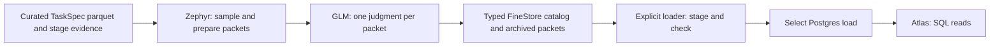

# RL Data Atlas

[RL Data Atlas](https://applets.marina.oa.dev/a/fb11c931-5861-4878-8bb5-a964d652b45f/)
reads a Postgres copy of the published [curation catalog](task-curation.md#run-catalog).
Curation owns source declarations, admission decisions, executed controls and
sampled GLM judgments. Atlas displays those records and their task packets.



## Reading grades

FULL campaigns grade automatically; SAMPLE opts in with `--assess`.
The default sample covers 100 admitted tasks and up to 20 excluded rows.
Admitted opinions, excluded diagnostics and executed grader controls remain
separate. Grading does not change admission. Input populations may overlap.

SQL computes each cohort's verdict counts and label. An empty sample, missing
TaskSpec or unavailable judgment gives Unknown; otherwise Bad takes precedence
over Some issues, Unknown and Good. Read the task explanations, citations and
omissions beside the label. These opinions describe the inspected sample.

Assessment keys use ordinary artifact dependencies and explicit versions.
Changing only the rubric or grading model reuses curation. A failed new key has
no current grade; archived evidence remains available. Inventory-only sources
carry a skip reason. The source table shows the latest curation outcome; the
assessment page shows the curation associated with its selected grade.

## Updating Atlas

Source code lives in `infra/marina/applets/rl_data_catalog/`. Its migration
creates the SQL tables; it does not read object storage or run curation.
Publish code when the schema or UI changes, then load data explicitly:

```bash
uv run marina validate infra/marina/applets/rl_data_catalog
uv run marina applets versions fb11c931-5861-4878-8bb5-a964d652b45f --json
uv run marina publish infra/marina/applets/rl_data_catalog \
  --update fb11c931-5861-4878-8bb5-a964d652b45f --base-version CURRENT_VERSION

uv run python infra/marina/applets/rl_data_catalog/load.py \
  --catalog-root CATALOG_ROOT \
  --applet-id fb11c931-5861-4878-8bb5-a964d652b45f
```

The first code update requires the applet's publisher. Run the loader in the
catalog's storage region. It reads through `CurationCatalog`, sends byte-bounded
SQL batches, checks sample and packet coverage, then selects the load with one
UPDATE. An unchanged snapshot skips loading. One operator runs updates; concurrent
loaders are unsupported. Abandoned and obsolete staging rows are removed on the
next update. Schema changes may require downtime.

Packets are stored separately as JSON text, preserving escaped null characters.
Inventory queries scan structured metadata and verdict rows. Atlas performs no
cloud reads, background refresh or inference. Request/response traces remain
archival references in the assessment record.

For a local preview, start disposable Marina and Postgres, then run the same
loader against a local curation cache using the printed applet ID and origin:

```bash
uv run marina publish infra/marina/applets/rl_data_catalog --local --json
uv run python infra/marina/applets/rl_data_catalog/load.py \
  --catalog-root ~/.cache/marin/rl-curation/campaigns/catalog \
  --applet-id PRINTED_ID --url PRINTED_ORIGIN
```

Inspect the inventory, an assessment and its task evidence. Stop the local stack
with Ctrl-C when finished; its database is disposable.

## Historical reviews

Historical reviews and raw artifacts remain in their original Postgres tables.
They do not affect current grades. Atlas retains an archive reader; the previous
manual review, source-verification and difficulty workflows are removed.
