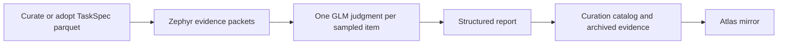

# RL Data Atlas

[RL Data Atlas](https://applets.marina.oa.dev/a/fb11c931-5861-4878-8bb5-a964d652b45f/)
mirrors the published [curation catalog](task-curation.md#run-catalog). The catalog
owns source declarations, executed curation outcomes and sampled grading reports.
Atlas caches its current snapshot in Postgres and serves archived evidence.
TaskSpec is the task format used by RL training. Zephyr prepares the evidence;
GLM is the model that judges each sampled task against the grading rubric.



## Reading grades

Each [FULL campaign](task-curation.md#run-a-campaign) is assessed automatically.
The default sample is 100 admitted tasks and up to 20 excluded rows. SAMPLE opts
in with `--assess` on the same campaign command. Read admitted
opinions separately from excluded diagnostics and executed controls. Grading
never changes task admission. Input populations may overlap.

A source label is conservative: missing required evidence or an empty admitted
sample gives Unknown; otherwise the worst sampled verdict determines the label.
A completed assessment can contain Unknown opinions. It does not prove that the
whole source is valid. Open its report to inspect selected tasks, explanations,
evidence citations and omissions.

Assessment identity follows the pipeline key, source dependencies, sample,
rubric and model configuration. Failed retries preserve a previous grade only
under the same key. Sources without conversion pipelines remain inventory entries
with a skip reason. No running assessment state is published.

## Catalog mirror

Publishing a curation campaign archives selected packets, judgments, request
traces and reports before selecting the current catalog snapshot. Inventory rows
carry counts, control policies and evidence links. Detailed controls and model
examples remain in the reports. Run catalog publication in the data's storage
region because it archives evidence from the curation outputs.

Atlas reads the published snapshot during deployment. Its authenticated Refresh catalog action
reads `catalog_current` and atomically replaces the saved mirror. Private visits
also refresh it on page load; public visits read the saved mirror. A failed refresh preserves
the last saved snapshot. Atlas has no manual rating overlay or independent
source registry. Current data lives in its `curation_catalog` Postgres table.

## Historical reviews

The Historical reviews page opens the earlier review collections and raw artifacts.
Legacy source ratings, difficulty measurements and defect records remain in the
applet's original Postgres tables. They do not contribute to current grades.
The archive preserves storage and original IDs; it does not reproduce the old
review or difficulty workflows.

## Publishing

Source code lives in `infra/marina/applets/rl_data_catalog/`. The backend reads
the catalog from object storage using Marina's credentials; deployment never
launches conversion or inference. To use a different catalog, change the explicit
root in `server/catalog.py`. The reader supports GCS, S3 and local paths. A live
catalog must be published at a storage URL that Marina can read; local cache
paths are suitable for local previews only.

```bash
uv run marina validate infra/marina/applets/rl_data_catalog
uv run marina publish infra/marina/applets/rl_data_catalog --local
```

Inspect the local source table, grading report, task evidence and archive before
updating the live applet. Stop the disposable local stack after inspection.

```bash
uv run marina applets versions fb11c931-5861-4878-8bb5-a964d652b45f --json
uv run marina publish infra/marina/applets/rl_data_catalog \
  --update fb11c931-5861-4878-8bb5-a964d652b45f --base-version CURRENT_VERSION
```

Export a snapshot without publishing:

```bash
uv run --with-editable './lib/taskcompendium[pipeline]' python \
  -m experiments.post_training.task_curation.catalog_snapshot \
  --catalog-root /path/to/cache/campaigns/catalog \
  --output /path/to/catalog.json
```

Catalog declarations and assessment changes belong in curation. Catalog data
and evidence stay outside the applet package.
