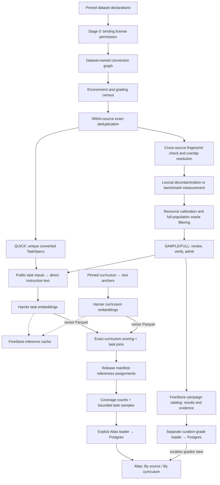

# Task curation

Task curation turns pinned training and evaluation datasets into TaskSpec parquet files. Each dataset
is declared once as an `RlDataSource` under
[`experiments/post_training/task_curation/datasets/`](https://github.com/marin-community/marin/blob/main/experiments/post_training/task_curation/datasets/README.md),
and the catalog
[`sources.py`](https://github.com/marin-community/marin/blob/main/experiments/post_training/task_curation/sources.py)
lists every declaration:

```python
from experiments.post_training.task_curation.sources import all_sources

sources = all_sources()  # stable Atlas ID -> RlDataSource
```

Building the catalog performs no downloads, inference or job submission.

[Evaluation tasks](evaluation-tasks.md) use population-preserving publication and
carry execution protocols beside canonical tasks. Name them explicitly with
`--source` and `--mode quick`; the default selection contains training sources.
`experiments.evaluation.preparation.EvaluationCorpusRecipe` binds the recipe,
protocol, and item builder. Evaluation owns shot selection and prompt preparation;
shared curation code supplies acquisition and catalog publication. TaskCompendium
owns reusable source importers and the corpus publisher.

## Stage 0: binding license gate

Run the deterministic checker before conversion, census, oracle or QA spend; never interpret licenses by hand. It checks only the pinned dataset's card, root/task LICENSE files and README license statements. **PASS** permits ingest; **FAIL** stops it; **ESCALATE** goes to the coordinator and user for a recorded decision. Do not trace upstream lineage, teacher models, source repositories or mixtures. The checker never changes admissions or the ban registry from its findings.

For our `open-athena` retained, filtered and TaskCompendium wrappers, the dataset
is the one input pin explicitly recorded in `license_source` card metadata (or
the older `Source pin` / `Upstream` declaration, provenance table or
`selection-manifest.json` source fields). Follow recorded pins through our own wrapper releases to the first dataset,
then apply the dataset-level rules below without following that dataset's lineage.
Receipts preserve every wrapper declaration alongside the dataset's license evidence. Our generic upstream-terms boilerplate
is not license evidence. New release cards must retain the upstream license ID,
evidence URL, notices and attribution, and declare `license_source` with
`dataset_id`, `revision` and `url`. The card's license field states the
checker-verified identifier, lowercased (`apache-2.0`, `cc0-1.0`), and a
per-folder repackager receipt binds the resolved upstream pin. Missing or
ambiguous input pins escalate to the coordinator and user.

```bash
uv run python -m experiments.post_training.task_curation.license_check \
  'https://huggingface.co/datasets/<owner>/<dataset>@<commit>' \
  --source-id '<declared Atlas source ID>' \
  --output /tmp/license-check.json --receipts-output /tmp/license-receipts.json

uv run python -m experiments.post_training.task_curation.driver \
  --source <name> --mode quick --license-receipts /tmp/license-receipts.json \
  --output-root /path/to/output --run
```

The shared rule evaluator in `finestore.rl.licenses` binds QUICK, SAMPLE, FULL,
native imports and evaluation publication to the same exact-pin result. Its
canonical accepted list is Data Belay's Blue Oak Council v16 list plus the
existing data-license additions; Data Belay imports that same table.

| Rule | Result | Pinned-source evidence |
|---|---|---|
| P1 | PASS | Accepted permissive license, including Apache, MIT, BSD, CC0, CC BY/CC BY-SA, ODC-By/PDDL and OpenMDW; no failing or uncertain signal |
| F1 | FAIL | NC, ND, research-only, no-commercial or no-model-training restriction in the card, root/task license or README license statement |
| F2 | FAIL | No license declaration, file or README license statement |
| F3 | FAIL | Active source ban in the shared registry linked to #11497 |
| E1 | ESCALATE | Custom, other, unknown or unmapped license |
| E2 | ESCALATE | Conflicting permissive and unresolved license signals |
| E3 | ESCALATE | The README explicitly defers content to unidentified separate third-party terms |
| E4 | ESCALATE | Parser error or unreachable/invalid pin |

Underlying OSS repository licenses and generated outputs alone are not doubt
criteria. The doubt bar is dataset-level and applies to new and existing sources
alike: a permissive dataset-level license at the pinned revision passes.
Explicit NC/ND/research-only or model-training restrictions anywhere in the
pinned source (including bundled task content), a missing or unknown dataset
license, outputs under unidentified or training-restricting third-party terms,
and lineage that cannot be traced to a permissive dataset-level grant are doubt.
Doubt means ban: a doubted source is banned and recorded in the #11497 registry,
and no evaluation-only exception exists. Resolver hints `bundled_third_party`
and `model_generated_outputs` remain evidence metadata; they do not override
PASS. Model-generated outputs from a named teacher whose license allows training
use are not doubt; record the teacher and its license evidence in the receipt.
Our own repackaged containers carry their upstream's license: an aggregate
container card listing several licenses, or a revision-bookkeeping mismatch in
our own metadata, is not doubt. A third-party repackager that collects other
projects' data is checked per folder: each folder's license follows its original
upstream, and the repackager's own empty or missing card never bans the whole
dataset. A restrictive license that the repackager declares stays binding.
A dataset whose tasks are each built from its own upstream repository, such as
OpenSWE, is checked per task against that repository's license at its pin; only
tasks whose repository passes the accepted permissive list are kept, and the
per-repository decision is recorded with its receipts. Marin's own converted and structure datasets are
released under OpenMDW 1.1. First-party data that Marin or Open Athena generates
(for example structure-closure and the forge main split) is also OpenMDW 1.1 and
valid for TRAIN and EVAL: its card declares `license: openmdw-1.1` with the full
LICENSE file, and the checker resolves it from the card. Dependency folders such as `node_modules`, `vendor`
and virtual environments are not task-license roots.

Receipts retain evidence URLs, SHA-256, quoted statements, resolution time and
resolver version. `--catalog` checks every current Atlas pin; `--input-manifest`
adds a JSON array of `LicenseTarget` fields for a queue. The output includes each
active ban's underlying evidence verdict so the user can review proposed changes.
Exit status is zero for PASS, FAIL and ESCALATE; execution/configuration errors
are nonzero.

Agents never edit license decisions or the ban registry by hand, and never trace
lineage to justify a ban. They run the checker and send each ESCALATE to the
coordinator.

**Decisions and existing bans.** An ESCALATE is neither a ban nor permission.
The user's explicit decision is a typed `LicenseDecision` on the receipt, with
who, when, exact source/dataset/revision, TRAIN/EVAL scope, rationale, evidence
URLs and the [decision issue](https://github.com/marin-community/marin/issues/11497).
A scoped approval uses `exception`; a negative decision blocks that scope.
Decisions never transfer to another input pin. Current source-wide bans live in
`infra/marina/apps/rl_data_catalog/server/license_registry.py` and bind ingest,
selection and admission counts. A checker run cannot lift them: the user approves
a recorded registry change. Earlier declarations, task artifacts and app revisions
remain intact.

## Current admission policy

Ruling 72 (2026-11-20, clarified the same day): `CONSUMER` checks are advisory.
They record typed findings for bespoke requirements and show a per-source flag.
They never change Available, Pending or Excluded status, or admission counts,
without an explicit user decision for that source. Standard sources remain exempt.

`consumer_scope.consumer_needs` classifies each frozen TaskSpec. A required tool
or provider, custom judge, service binding or distinct verifier allocation selects
bespoke scope. CPU, memory, disk and deadlines select scope only when they exceed
the configured consumer limits. Ordinary actor allocations within those limits
are exempt; a distinct verifier allocation always selects scope.
The audit configuration records the capacity and deadline limits explicitly.
Shared schema drift, including integrity and execution fields unknown to an older
runtime, is one global runtime-alignment issue. It is reported separately and
never changes a source's admission status.

The receipt binds the source ID, frozen dataset revision, population digest and
count, scoped requirement counts, and runtime commit in
`experiments.post_training.task_curation.consumer_scope.CONSUMER_RUNTIME_COMMIT`. The audit reads every frozen
TaskSpec, classifies its needs, and checks the pinned consumer's real loader and
provider registry. Shared loader schema errors are recorded independently, so
a task can pass its bespoke check while the global runtime alignment is pending.
Bespoke failures use `CONSUMER_TOOL_UNREGISTERED`,
`CONSUMER_JUDGE_UNREGISTERED`, `CONSUMER_SERVICE_UNREGISTERED` or
`CONSUMER_EXECUTION_UNSUPPORTED`. Provider requirements use the tool code; over-capacity allocations and deadlines
use the execution code. Missing receipts and changed runtime or population pins
produce advisory findings. Only the canonical runtime pin qualifies a current
consumer result; audits of other pins remain historical evidence. Standard
sources need no receipt.

`datasets/consumer_decisions.json` records user-approved status actions, one entry
per source. It starts empty. Each entry cites the user ruling and binds the source
ID, runtime commit, population fingerprint, typed finding and approved Pending or
Excluded status. A decision applies only while all of these match. Audit and
receipt-publication commands never write decisions. A finding without such a
decision leaves the source's status and filtration counts unchanged.

Ruling 73 (2026-11-20): every consumer-driven Pending or Excluded status needs an
explicit user decision for that source, recorded in `consumer_decisions.json`. The
consumer gate itself only records typed findings.

Ruling 74 (2026-11-20): a verifier-deadline finding goes to repair, not to a status
change. The repaired source uses an effective verifier deadline of
`max(declared deadline, 1800 s)`, so a repair never shortens a declared deadline.

Ruling 75 (2026-11-20): a missing-tool finding goes to repair. The repair runs the
tool on the shellbox `LOCAL` backend (bubblewrap on an Iris pod). Such a source can be
admitted with limited backend support: `LOCAL` supported and Daytona unsupported. If
the tool cannot run under bubblewrap, the repair hosts it as a service that the
sandbox reaches through the relay, as OpenResearcher's retrieval index does.

Ruling 76 (2026-11-21): the Atlas carries a Format metadata column that states
which format each source's payload is in.

Ruling 77 (2026-11-21): TaskFormat is required ingestion metadata, detected
purely from payload shape; a format check never asks where a payload came
from. The shapes are `HARBOR` (Harbor task package rows), `TASKSPEC` (TaskSpec
rows with no task package) and `MARINSKYRL` (MarinSkyRL blend records). The
declared shape must equal the detected shape for every row, and a source whose
rows span several shapes is rejected until it is split into one source per
shape. Consequence: the grandfathered-blend admission machinery is retired — a
MarinSkyRL blend record is an ordinary payload shape, no frozen exception list
admits a blend source, and the historical provenance-era labels
(`taskcompendium`, `native_taskspec`) parse onto their shape and never re-enter
declarations. See [Declarations](#declarations).

Run `experiments.post_training.task_curation.consumer_audit` in the population's
storage region. Supply a frozen input inventory, runtime git archive and JSON
configuration with `runtime_commit`, `runtime_archive_sha256`, `regional_bucket`,
`session`, `capacity`, `default_judge` and `judge_binding`. `capacity` contains `cpus`,
`memory_mb`, `storage_mb`, `agent_timeout` and `verifier_timeout`. A null deadline
means the consumer has no cap for that phase. `judge_binding` records the launcher's
actual `remote_judge` endpoint and credential environment name, with no credential
value. Derive the default from the actual `MICRO210_JUDGE` object in the consumer
runtime's `experiments/evaluation/judge_config.py`. The task's explicit model wins.
Judges bind at launch through `JudgeConnection`; they need no static model-name
roster. Preserve the task's JudgeSpec and record a pass with launch binding when
that path can supply it. This check proves binding, not a live API response.
The archive SHA is checked before extraction. Results contain counts, hashes and
schema paths without task content. Frozen-stream digest differences are recorded
separately for provenance investigation. The receipt binds the census population
fingerprint; the observed Parquet stream digest is a separate diagnostic.

Keep results in regional storage. Stage the receipt metadata below, publish it to
private `open-athena/marin-rl-data-atlas-registry` through the serialized registry
publisher with SHA readback, and commit references under
`datasets/consumer_receipt_refs/`. The committed reference fixes the registry
revision and document hash; a mismatch is an error. The source declarations, admission writer and
served Atlas projection apply the same advisory and user-decision rule. The app package
includes immutable scope and receipt metadata for retained declarations; standard
rows pass through unchanged. This static check does not prove machine startup or
original grader execution. Backend and original-oracle qualification remain
required.

```bash
uv run python -m experiments.post_training.task_curation.consumer_audit \
  --inputs "$AUDIT_INPUTS" --runtime-archive "$RUNTIME_ARCHIVE" \
  --config "$CONSUMER_CONFIG" --workers 8 --output "$REGIONAL_OUTPUT"
uv run python -m experiments.post_training.task_curation.datasets.consumer_receipts \
  --audit "$LOCAL_AUDIT_JSON" --staged-root "$REGISTRY_STAGING"
```


Synced to Atlas revision r38 (cut 558dce231f, 2026-11-21). These rules include
the admission display policy for Atlas preview revision 36. When a later section
of this reference conflicts with them, this section is current.

**SAMPLE panels across re-pins.** A SAMPLE panel drawn at an earlier pin binds at the
current pin when its task specs are byte-identical to the current pin's actor census
(same digest and count); the binding records the cross-pin digest equality. A panel
whose task bytes changed is refused, and the source needs a fresh panel.

**Examples.** Atlas Examples is the admitted count after filtration. The Atlas
has no separate oracle column. Every header count is in tasks. Admission totals
split TRAIN and EVAL, alongside tasks pending oracle filtration and tasks excluded.
Quality totals count tasks by their source's QUICK/SAMPLE/FULL label. A no-oracle source
shows its static-retained count (below). An oracle source shows Examples Pending
until its current-pin admission receipt exists.

- *Sources with oracles.* A filtered private release alone does not admit a source.
  Its tasks count as admitted only after the final pin has its own actor census,
  exact deduplication, lexical measurement, grading and consumer bindings, a
  physical SAMPLE receipt and an oracle-admitted release receipt; nothing is
  inherited from an earlier pin. Until then Atlas shows the filtered release on
  Evidence as pending qualification. Run the original oracle over the complete population
  through the production Harbor trial path, in SAMPLE and FULL. Tasks that fail
  are dropped before ingestion. Workspace-graded tasks also need a `nop` negative
  control: admit a task only when its oracle passes and its nop does not pass. A
  nop pass excludes the task as `NEGATIVE_CONTROL_PASSED`. A nop run that ends
  with signal -9, -6 or -11, or with a producer interruption, gets exactly one
  re-drive at the same budget. A 600-second verifier deadline or a source error
  on the unsolved state is a non-passing annotation. Answer-graded tasks need no
  negative control (N/A). See [workspace oracle negative controls](#workspace-oracle-negative-controls).
- *Sources without oracles.* Examples is the retained count after strict
  within-source deduplication and lexical decontamination, minus tasks with typed
  static blockers such as `tool_provider_required` or `shared_executor_required`.
  No per-task executability proof is required. This requirement is suspended and
  can be restored later. Every other gate still applies.
- *Use=EVAL sources* are admitted to Atlas as evaluation data after applicable
  filtration. Total admission is TRAIN plus EVAL. EVAL tasks remain excluded from
  TRAIN selection; deduplication and lexical measurement still apply, with no
  lexical remediation of EVAL overlap.
- *Re-pins.* A re-pin requires a fresh census at the new pin even when the task
  count matches: a new revision can change content. A census receipt that its own
  evidence contradicts is refused at bind time
  (`census_binding.check_receipt_evidence`), and
  `census_binding --audit-receipt-evidence` audits every staged receipt. A
  content-changed source needs fresh deduplication, lexical measurement and a
  SAMPLE panel drawn on the current pin (`SamplePanelCurrency.CURRENT_PIN`)
  before its status is current; an archived-lineage panel cannot qualify a new
  admission (`require_sample_pin_currency`).
- *Content identity.* Re-measuring a pin can re-serialize the same TaskSpec
  bytes into a different artifact layout, changing the artifact-level
  `task_specs_sha256` without changing any task. `content_identity.py` records
  when that happened: the builder digests every TaskSpec's exact bytes on both
  sides and refuses unless the two per-task maps are identical, then binds both
  artifact digests and the task counts in a `ContentIdentityReceipt` with the
  per-task digest evidence staged beside it. The SAMPLE binding consults the
  receipt two ways: `sample_matches_lineage` accepts an archived panel whose
  recorded digest and the lineage input's digest are exactly the receipt's
  bound pair (zero-drop retained lineage), and a pin-matching panel whose
  digest differs only through re-serialization stays `CURRENT_PIN` under the
  same receipt. Any differing task refuses; without a receipt the digests must
  match exactly. The receipt never re-binds a measurement: the underlying
  census, lexical or panel evidence still describes the same pin it measured.
- *Review carry-forward.* A re-pin keeps a source's QC reviews.
  `experiments/post_training/task_curation/review_carry_forward.py` is the
  typed mechanism for it, shared with the FULL campaign's grandfathered
  receipts. Each
  review is keyed on the task-contract identity
  (`taskcompendium.identity.task_identity`), never on the task ID or the
  population digest. A review from an earlier pin carries forward only when a
  retained task's identity matches exactly, and only when that review is
  conclusive. Carried reviews keep the earlier receipt's recorded reviewer
  identity verbatim. Relabeling them as another reviewer's output is refused.
  `plan_review_carry_forward` produces the delta plan: carried, changed, new
  and dropped counts, plus the exact task IDs that need review. Carried counts
  the retained tasks whose identity existed at the earlier pin, changed the
  retained tasks whose ID existed earlier with a different identity, and
  dropped the earlier task IDs that left the population. SAMPLE panels
  keep their unchanged members, redraw only the replaced ones with the fixed
  seed, and keep the slots of members whose observation was not conclusive.
  `merged_review_result` derives the oversight level from carried plus fresh
  reviews: FULL when every retained task has an observation and none are
  unavailable, or when a recorded waiver covers at most 1% of the population.
  Otherwise the level stays SAMPLE.
- *Absent-versus-null normalization.* A converter upgrade can start
  serializing a null-default field explicitly, which changes every task's
  contract hash without changing its content.
  `build_normalization_receipt` verifies that one such field is the only
  difference between two population pins: the field must be a TaskSpec field
  whose documented default is None, absent on one side and explicitly null on
  the other, with byte-equal payloads once it is dropped. It writes a typed
  `ContractNormalization` record with per-task evidence. An explicit non-null
  value, or any other difference, refuses the record. `task_identity` itself
  is never changed. Pass the record to `plan_review_carry_forward` with
  identity maps built through `population_identities(normalized_fields=...)`:
  the plan re-derives the record's verified digest from those maps, so they
  cannot drift from the evidence.
- *Grading-environment equivalence.* A re-conversion may change only how
  each task's grader runs (for example a packages-lock exchange for the
  task's own workspace image). `build_grader_environment_receipt` verifies,
  per shared task, that every differing contract path lies inside
  `grader.environment` and everything outside it is byte-identical; the
  evidence parquet records both task digests and the exact differing paths.
  The verified record lets the prior SAMPLE reviews carry under ruling 54:
  pass it to `plan_review_carry_forward` with the plain identity maps, and
  the plan re-derives the verified pairs from them. Any change outside
  `grader.environment` refuses the record for the whole pair, and
  `task_identity` is never changed.
  Further contract changes ride the record only as typed allowances, each
  recorded per task in the evidence parquet: `calibration_completion` lets
  `execution_requirements` / `verifier_execution_requirements` go from
  absent-or-null to calibrated values (a value-to-value change refuses);
  `actor_setup_pinning` lets `environment_requirements.setup_commands`
  replace floating pip installs with the hashed lock install; and
  `lock_resources` lets `resources.worker` / `resources.verifier` gain
  appended lock resources. The recovery runner enables them per run with
  `--allowance`; without the flag only `grader.environment` rides.
- *Recovered SAMPLE evidence.* `sample_recovery_outcome` joins carried prior
  reviews onto one source's fixed panel under the augmented rules. The Result
  stays computed from the fixed panel alone, so carried reviews cannot bias
  its issue rate; the carried set's own rate is reported beside the coverage.
  Carried reviews join the reviewed set: a task the panel also observed counts
  once in the coverage, and the panel's own observation governs its merged
  determination. The level promotes to FULL only when the merged observations
  cover every retained task under the existing completeness and waiver rules.
  `sample_review_recovery` surveys the registry's superseded SAMPLE receipts
  and recovers every source in one in-region job; the recovered coverage binds
  on the declaration's oversight evidence, and the Atlas Quality display shows
  it as `SAMPLE, <reviewed> of <retained> reviewed`.
  Run the carry-forward plan as an in-region CPU job when a population is
  large:

  ```bash
  uv run iris --cluster marin job run --target-cluster cw-us-east-02a \
    --cpu 8 --memory 64G --disk 200G --enable-extra-resources --extra cpu \
    --priority batch --timeout 86400 --no-wait -- \
    python -m experiments.post_training.task_curation.review_carry_forward \
    --source-id "SOURCE_ID" \
    --earlier-receipt EVIDENCE_RECEIPT_JSON \
    --earlier-population EARLIER_POPULATION_ARTIFACT \
    --current-population CURRENT_POPULATION_ARTIFACT \
    --output s3://REGIONAL-BUCKET/rl-data/atlas/review-carry-forward/VERSION/plan.json --run
  ```

- *Declaration currency.* The canonical RL source layer is the `RlDataSource`
  declarations cataloged by `all_sources()`; the registry holds receipts ABOUT
  sources and is never the source of truth for which sources exist or at which
  pin. Whenever an Atlas flow publishes a new source version (a re-pin, a
  retained or remediated release, a variant) or adds a source, the same landing
  must update that source's declaration so `all_sources()` reflects the new
  state. `declaration_audit.py` enforces the pairing: the audit assembles the
  canonical layer (the assembled sources, the pending-intake declarations at
  their intake pins, the archived bindings' recorded original pins, and the
  retirement ledger) and fails while any census, lexical, grading-census, dedup
  or retained-release receipt names a source or pin that layer does not carry.
  A retained release whose source then went through oracle filtration is the
  filtration input, and a remediated release staged for a pending source's
  intake adoption is reported, not failed. The audit runs as an atlas-push gate
  for every task-curation landing and as `python -m
  experiments.post_training.task_curation.declaration_audit`.

  The serving audit reads only the active `atlas_current.latest` load. Staged
  and historical declarations cannot satisfy it. A derived-contract receipt
  must match all six actor census input fields used by the serving projection;
  evidence locations and carry-forward references do not change those inputs.
  The contract archive is independent of catalog loads: every receipt for a
  source remains a candidate. Receipts matching the same six input fields must
  have identical summaries. Curriculum rows must match the dataset ID, revision,
  and complete pipeline reference and carry a non-null alignment. Refresh stale
  data through the `infra.marina.apps.rl_data_catalog.load`,
  `infra.marina.apps.rl_data_catalog.load_derived_contract`, and
  `infra.marina.apps.rl_data_catalog.load_curriculum` entry points. A registry
  receipt alone cannot satisfy a served-data check.

**Non-agentic tasks.** A TaskSpec with no actor role, agent harness or agent
workspace is non-agentic: the model answers and the task's grader checks the
answer. Decide this per TaskSpec from its contract, never from the source name.
Non-agentic tasks are exempt from every check that exists only because an agent
runs in an environment:

- resource and timeout specs, calibration and machine-role allocation evidence
  (`verifier_execution_requirements`);
- package locks (`missing_packages_lock`);
- Docker base mutability (`mutable_docker_base`), environment builds and prepared images;
- tool providers (`tool_provider_required`) and shared executors (`shared_executor_required`);
- Daytona and backend fit, and network policy;
- workspace nop negative controls.

None of these can exclude a non-agentic task or block its admission. These checks
still apply: the grader must produce a verdict, oracle filtering runs wherever an
original oracle exists, and content QA, within-source deduplication, lexical
decontamination, cross-source overlap, the Use=EVAL rules and the SHARED/SEPARATE
grading assessment are unchanged.

**Agentic tasks.** Every rule in this reference applies:

- The environment spec is data. Each task runs in exactly its own environment;
  a shared or substitute image is never acceptable. A task may move to another
  image only with a mechanical proof that its environment is a no-op against that
  image, followed by a new dataset version. A source is repaired when its
  published spec completely describes what it does.
- Declared limits are preserved. Calibrate only missing dimensions, starting at
  1 CPU, 2 GiB memory, 2 GiB disk, a 300-second agent timeout and a 60-second
  verifier timeout, and double only the dimension that failed. See
  [Full-population oracle filter](#full-population-oracle-filter).
- The whole contract (actor, tool providers, shared executor, environment and
  grader) must run on a production backend through the path Atlas consumers use.
  A task that cannot is filtered with a typed reason and its evidence.
- Backends carry typed deployment classes (`shellbox.machine.BACKEND_DEPLOYMENT`):
  Iris gVisor, Daytona and LOCAL-on-cluster-workers are **production**; local
  Docker, Docker+runsc, QEMU and shellsim are **dev only**. Admission counts
  production backends only — a dev-only SUPPORTED cell never satisfies it — and
  the Atlas marks dev-only backends accordingly.
- Each task's declared network policy (ALLOW or DENY) is honored. A backend that
  cannot provide it records `network_policy_unsupported`; the task is filtered
  unless another backend can run it.

**Releases, images and overlap.**

- Remediation publishes one new **private** `open-athena` pinned version per
  source. Never delete or overwrite an artifact; publish a new version.
- Prepared task images go in a new GHCR package per source, never shared across
  sources. Packages have INTERNAL (organization-only) visibility, recorded in the
  receipt. Never make one public. Every puller needs a read credential: the Iris
  clusters rno2a, 02a and 08a and the Daytona RL and EVAL organizations. The
  backend survey probes the internal-image pull live
  (`experiments/post_training/task_curation/backend_live_probes.py`); a backend
  that cannot pull is UNSUPPORTED for internal-image sources.
- Strict exact-contract deduplication applies to every source, including EVAL
  sources and MarinSkyRL blends.
- Lexical 13-gram decontamination removes flagged TRAIN tasks. EVAL sources are
  measured only.
- Cross-source overlap matches each task to its nearest neighbor in the other
  source (exact hash, then near-duplicate or embedding search). Task IDs never pair
  tasks. A model may not downgrade a pair whose measured overlap clears the threshold.
  Cross-source overlap is advisory: it never removes tasks from a source. The Atlas
  folds source B under source A only when at least 95% of B's tasks are measured
  inside A. Pairs below 95% containment in both directions and unmeasured pairs never
  fold. Every folded member needs a direct measurement against the canonical; groups
  never chain. Other measured overlaps appear as directional notes, such as "73% of X's
  tasks are in Y".
  The superset is shown on top; mutual duplicates prefer the larger task count, then
  FULL, SAMPLE, QUICK, then source ID. See
  [cross-source overlap](rl-data-atlas.md) for the measurement details.
- The Daytona SAFE/UNSAFE/N/A measurement is still required at ingestion for
  agentic sources, but the Atlas shows it on the Backends evidence page rather than
  as a main-table column.

**Derived fields.** Ingestion never trusts hand-written shape or level labels.
A late-stage step, after conversion, repairs and filtration, derives them from
each population's final TaskSpecs and QA records:

- *Grader type* is one of `llm-judge`, `exact-match`, `math-verify`,
  `unit-tests`, `script`, `reward-model` or `none`, with `mixed` and a per-type
  breakdown at source level. A grader that maps to none of these fails ingestion.
- *Contract tags* (agentic or non-agentic, single- or multi-turn, reply-only
  rewrite, workspace-graded) come from the TaskSpec. Declared tags keep only
  license, family and upstream provenance.
- *Oversight level* is FULL with a current-pin FULL binding or a SAMPLE panel
  that covers the whole retained population, SAMPLE with a current-pin SAMPLE
  receipt, and QUICK otherwise. Source declarations carry no level; historical
  recipe-QA prose is kept as notes that cannot assert one.

A declared value that contradicts a derived one fails ingestion. Atlas shows the
derived oversight level once, identical to the main-table Quality, with a link to
its receipt.

**Atlas display.** Every authored UI surface meets WCAG 2.2 AA in both themes at 1440, 390 and 320 px, and prose, notes and muted text reach 7:1; the release gate fails on any violation (see the app's `RELEASE.md`). Source cells show only the source name and fold toggle; origin,
dataset links and overlap notes belong on Evidence. Backend fit is binary: a
backend is Supported only when every present role is supported, and conditional
or partial support counts as Unsupported with its blockers. N/A means the role
does not exist. Curriculum places every task at its nearest subject and
capability and offers five confidence levels as display filters (see
[curriculum coverage](rl-data-atlas.md#curriculum-coverage)). Examples are pooled
across sources, each with its Source.

**Quality.** Result is GOOD when at least 90% of reviewed tasks are clean, BAD
when at least 50% have issues, and SOME_ISSUES otherwise. QC never rejects a
task or a source by itself: a BAD-quality source can be admitted as-is with its
weakness documented, as with Terminal-Pivot's original weak grader. A FULL
review may be finalized under a pinned waiver when at most 1% of retained tasks
are unreviewed; both the final binding and the Atlas display refuse a waiver above
that bound. LLM judges run at temperature 0.7 through the production judge
service. The pinned SAMPLE reviewer profile for new campaigns is V4
(`glm-5.3`, payload revision 6, max_tokens 16384 — V3 with a doubled review
budget; user ruling 2026-11-19 after the long-fixture truncation evidence).
`local_reviewer(SAMPLE_REVIEWER_VERSION)` builds it; every new SAMPLE campaign
qualifies the profile with one canary review (`qualify_reviewer`) before it
serves. V3 receipts stay untouched; payload revision 6 admits both the V3 and
the V4 identities, and past reviews are never re-run under V4. Every recorded
review carries typed defects from the shared `Defect`
enum (`missing_context`, `ambiguity`, `wrong_reference`, `answer_leakage`,
`malformed`, `rubric_mismatch`) beside its verdict, confidence and reference
status; the Atlas assessment page shows one chip per defect with its count and
rate, and filters the stored reviews by verdict, confidence, reference status
and defect. A signed-in Marina user can also run a manual audit there: it draws
a reproducible seeded sample of one source's stored reviews (random, or
stratified across verdict and defect-set strata), records one judgment per
task — agree or disagree, with a corrected verdict and defects from the
reviewer's own enums — and reports reviewer-versus-human agreement with 95%
Wilson intervals. Audit judgments are advisory evidence; nothing in the audit
changes an admission or a quality label.

**Jobs.** Use three-day job timeouts and an explicit `--target-cluster` in the
data's region. Infrastructure failures are re-driven and never count as task failures.

Task and oracle-control identity hashes bind the stored source JSON after
canonical normalization (sorted keys and compact UTF-8 encoding).
Parsing a frozen row under a newer TaskSpec model may expose added defaults,
but those defaults do not change the row's identity or its controls.
`task_spec_sha256` hashes the stored document after JSON validation. Admission
checks use that identity and continue to reject task or runtime changes. New task
construction and deliberate task edits receive identities for their new state.
Publication validates current registry bans and the exact pinned license grant
through `require_publication_license` before creating a repository.

**Landing changes (temporary).** While CI is suspended, Atlas workers land their
own committed changes on `atlas-env-audit` instead of opening child PRs. Run from
your dedicated worktree on a named branch other than `main`:

```bash
atlas-push --test "<affected test command>" --who "<session id>" --what "<change summary>"
```

The script takes a machine-wide lock, fetches and rebases onto
`origin/atlas-env-audit`, runs the docs check, catalog tests and fingerprint
pre-push checks, then lint and your affected tests on the rebased head,
pushes without force and verifies the remote. A failure stops the push; resolve
rebase conflicts and rerun. When the branch's new commits carry merge commits
(for example a maintenance merge of main), the script switches to a
merge-preserving mode instead: it verifies the target tip is already an ancestor
of the branch, runs the same gates, and pushes the branch unchanged so the merge
commits survive; if the target moved, it aborts and the branch must merge the
new tip first. The tool's source and tests live at `infra/ci/atlas-push` and
`tests/ci/test_atlas_push.py`. Advisory review remains required for non-trivial
changes. Report the landed SHA to the coordinator. Never force-push or push to
`main`. This rule ends when CI resumes.

Ruling 60 (2026-11-19) temporarily permits missing/stale serving-projection
waivers while the preview load and coordinated refresh complete. Use the explicit
waiver file for a landing:

```bash
atlas-push --waivers experiments/post_training/task_curation/declaration-projection-waivers.json \
  --test "<affected test command>" --who "<session id>" --what "<change summary>"
```

The rule evaluates the gaps and per-source declaration drift in the gated audit
run, so sources and projections added after the rule file was written are covered.
Only missing/stale serving projections on sources with zero declaration drift
qualify. Every applied exception records
`preview projection lag; declaration drift 0; ruling 2026-11-19`. The file binds
this rule to the preview applet. Each audit resolves its current selected load;
load changes during an unfinished refresh do not expire waivers. Declaration
drift, query errors, validation failures and conflicting contract summaries still
block. Every applied pair, state and reason is included in the gated audit JSON
and embedded in the atlas-push landing receipt.

After the initial catalog import has sealed and the subsequent declaration,
contract, and curriculum refresh is complete, finalize that refresh with a strict
audit:

```bash
uv run python -m experiments.post_training.task_curation.declaration_audit \
  --seal-refresh --output /tmp/preview-refresh-seal.json
```

`--seal-refresh` cannot be combined with `--waivers`. Only a passing strict audit
records the permanent `atlas_projection_refresh_seals` event and its full audit
receipt. The event expires all ruling-60 waivers for that preview applet, including
after later load changes or rollbacks. Failed strict checks record no seal;
ordinary strict diagnostics without `--seal-refresh` remain read-only. Production
cannot be sealed by the preview-scoped rule.

## Atlas workflows

Use one of the flows below for every change to an Atlas source. Ingestion creates a
source identity. Repair, task replacement and drift analysis create a new pinned
version of an existing source. Deprecation, bans and overlap rulings change its
recorded standing. Enrichment, quality review and publication attach records to
one source version. The [Getting started guide](https://github.com/marin-community/marin/blob/main/infra/marina/apps/rl_data_catalog/dist/guide.html)
shows one diagram for each flow and defines the [workflow terms](#workflow-glossary).
Policy belongs in that guide and this reference. Tables, tooltips and Evidence
cards show measured state, reasons and receipt links.

### Ingestion stage map

These letters identify re-entry points. They do not rename the driver's modes or
its existing stage-0 license gate. A gate must bind to the exact source version
and population it checks. Keep the receipt and the failed check when a gate fails.

| Stage | Required action and evidence | Procedure and enforcing code |
| --- | --- | --- |
| <span id="atlas-stage-a">a</span> Declare | Register the candidate's immutable HF revision, stable source ID, converter identity, provenance, Use and restriction. Run the binding license gate before spend. | [Declarations](#declarations), [license gate](#stage-0-binding-license-gate); [sources.py](https://github.com/marin-community/marin/blob/main/experiments/post_training/task_curation/sources.py), [license_check.py](https://github.com/marin-community/marin/blob/main/experiments/post_training/task_curation/license_check.py) |
| <span id="atlas-stage-b">b</span> Convert | Preserve prompts, references, grader and environment in TaskSpecs. Apply the payload-shape format check; answer-only tasks still need a complete task contract. | [Conversion](#conversion-modes); [pipeline.py](https://github.com/marin-community/marin/blob/main/experiments/post_training/task_curation/pipeline.py), [source.py](https://github.com/marin-community/marin/blob/main/experiments/post_training/task_curation/source.py) |
| <span id="atlas-stage-c">c</span> Census | Check environment fidelity, actor and grader roles, SHARED/SEPARATE grading, locks, image identities and backend fit. Record population digests and complete grading counts. Reconcile the final retained population again at admission. | [Census](#actor-census-registration), [fidelity](#environment-fidelity-and-repair); [census_binding.py](https://github.com/marin-community/marin/blob/main/experiments/post_training/task_curation/census_binding.py), [grading_census.py](https://github.com/marin-community/marin/blob/main/experiments/post_training/task_curation/grading_census.py) |
| <span id="atlas-stage-d">d</span> Exact deduplication | Drop exact within-source duplicate contracts. Preserve raw, unique and dropped counts and the drop manifest. | [Within-source deduplication](#mandatory-within-source-duplicate-removal); [within_source_census.py](https://github.com/marin-community/marin/blob/main/experiments/post_training/task_curation/within_source_census.py) |
| <span id="atlas-stage-d2">d2</span> Cross-source check | Compare the candidate's source fingerprint against admitted sources. Resolve every duplicate group through the overlap flow before admission. | [Overlap resolution](#overlap-resolution); [source_fingerprints.py](https://github.com/marin-community/marin/blob/main/experiments/post_training/task_curation/source_fingerprints.py) |
| <span id="atlas-stage-e">e</span> Lexical decontamination | Measure evaluation-corpus overlap at the pin. Remove TRAIN overlap; retain measured EVAL overlap. Bind the retained-release receipt and drop union. | [Lexical decontamination](#lexical-decontamination-before-publication); [lexical_binding.py](https://github.com/marin-community/marin/blob/main/experiments/post_training/task_curation/lexical_binding.py) |
| <span id="atlas-stage-f">f</span> Resource calibration | For agentic tasks, preserve declared limits and calibrate missing ones. Record actor and verifier profiles and supported production execution. Non-agentic tasks skip this stage. | [Calibration prerequisites](#inventory-calibration-prerequisites); [oracle_filter.py](https://github.com/marin-community/marin/blob/main/experiments/post_training/task_curation/oracle_filter.py) |
| <span id="atlas-stage-g">g</span> Oracle and NoP | Filter every oracle-bearing task through the production trial path. Workspace graders also require a non-passing NoP. No-oracle sources use static retention under the current ruling. Infrastructure failures remain pending and are re-driven. | [Oracle filtration](#full-population-oracle-filter), [NoP](#workspace-oracle-negative-controls); [oracle_filter.py](https://github.com/marin-community/marin/blob/main/experiments/post_training/task_curation/oracle_filter.py) |
| <span id="atlas-stage-h">h</span> SAMPLE QC | Review the fixed retained-population panel with a pinned reviewer. Record coverage and Result. BAD content quality alone never rejects a source. Existing QUICK admission policy remains in force; a QUICK receipt does not claim SAMPLE review. | [SAMPLE coverage](#sample-missing-review-tolerance), [reviewer](#qa-reviewer); [sample_qc_binding.py](https://github.com/marin-community/marin/blob/main/experiments/post_training/task_curation/sample_qc_binding.py) |
| <span id="atlas-stage-i">i</span> Admission | Reconcile final census, deduplication, lexical, grading, control and oversight evidence. Clear every source exclusion claim and bind the exact final pin in the declaration and registry together. | [Current admission policy](#current-admission-policy); [source.py](https://github.com/marin-community/marin/blob/main/experiments/post_training/task_curation/source.py), [declaration_audit.py](https://github.com/marin-community/marin/blob/main/experiments/post_training/task_curation/declaration_audit.py) |
| <span id="atlas-stage-j">j</span> Upload | Upload the qualified version only when every applicable gate passes. Default to a private release, preserve its read-back receipt and provenance, and keep previous versions. | [Storage and publication](#storage-and-publication); [remediation_publish.py](https://github.com/marin-community/marin/blob/main/experiments/post_training/task_curation/remediation_publish.py) |

Start ingestion from a pinned HF dataset row in the candidate intake list
(`CANDIDATES`). Register it through the [pending source intake](#pending-source-intake)
and [dataset declaration](#declarations) procedures.
It is the only flow that starts every stage from scratch and creates a new source
identity. Its exit is Available, or Excluded with typed reasons and evidence;
incomplete work stays Pending where the status rules require it. Private
qualification artifacts can exist before final admission; their upload never
establishes availability. Stage j means the final qualified release. Sources with
`private_always` restriction stay in their private store: publication helpers refuse
their upload, even to a private release repository.

### Repair of an Excluded source or task

Start from the exact excluded pin and its typed claims. Diagnose each claim with
its recorded evidence. Apply only the fix listed in the [per-reason table](#admission-procedure-for-excluded-sources).
A repair records a new variant label, such as `@repaired-YYYYMMDD` or `@rhs`, and
an immutable output revision. The label alone is not a pin. Keep the parent source
identity, before/after task hashes, allowed change and ruling with the new version.

Re-enter ingestion at the earliest stage invalidated by any change. Run that stage
and every later applicable stage. Earlier receipts carry only when their exact
inputs still match; a changed pin always requires a fresh actor census, even when
the task count is unchanged. The final release needs its own admission bindings.

| Change type | Earliest re-entry | Additional requirements |
| --- | --- | --- |
| License grant, ban lift or source-use ruling | a | Recheck the exact-pin license and registry scope; run later applicable gates. |
| Converter code, prompt, reference, task content or population | b | Fresh census, deduplication, cross-source check, lexical measurement and changed-task QC. |
| Environment, package lock, image or backend/runtime behavior | c | Recheck fidelity, grading boundary and backend fit; rerun calibration and controls. |
| Grader code, verifyit module or grading protocol | c | Fresh grading census, g controls and h QC, even if task JSON is unchanged. |
| Lexical corpus or contamination ruling | e | Rebuild retained population; bind its census, deduplication and review evidence at i. |
| Resource limit change | f | Recalibrate, rerun controls and bind final census; declared limits need an approved deviation. |
| Reviewer model, rubric, payload or profile | h | Follow quality review; do not relabel earlier reviews. No source version is needed if task behavior stays unchanged. |
| Serving projection or loader only | Publication | Audit the projection against the same admitted version; source receipts stay unchanged. |

SAMPLE review reuse requires `review_carry_forward.py` evidence. Exact task-contract
identity permits conclusive reviews to carry with their original reviewer identity.
Typed normalization receipts can prove absent-versus-null equivalence.
Grading-environment equivalence permits only `grader.environment` changes and the
explicit `calibration_completion`, `actor_setup_pinning` and `lock_resources`
allowances after per-task verification. It does not permit arbitrary grader-code
or content changes. Preserve fixed panel slots and draw only the required changed
members under the existing rules. These are the implemented equivalence limits;
no ruling label alone authorizes reuse.

Upload at j if and only if all reasons' gates and the final admission gates clear.
The output defaults to private. If a gate still fails, retain the Excluded version
and its evidence; missing work remains pending under the status rules. Never clear
a reason just because a patch was written or a candidate was uploaded.

### Task replacement and repair union

Start with an Available source and preserve its status while qualifying candidates.
The default is [judged task replacement](#repair-candidates): classify content as
`identical`, `repaired`, `new` or `conflicting`; compare repaired pairs; then require
candidate oracle and applicable NoP controls. `new` tasks enter ingestion.
`conflicting` matches stop for a ruling. A dry-run match report is not a release.

A deterministic repair uses a versioned rule on an explicitly frozen task subset.
Record the rule, input pin, selected task identities, allowed differing fields,
before/after hashes and behavior tests for the defect. Prove unaffected tasks stay
unchanged, then re-enter at the earliest invalidated stage and clear its remaining
gates. For example, [pdbthink_verifier_repair.py](https://github.com/marin-community/marin/blob/main/experiments/post_training/task_curation/pdbthink_verifier_repair.py)
checks the original native allocation and changes only the approved verifier
allocation. A deterministic transform does not need a comparative preference
judgment, but it needs its own defect check and qualification evidence.

When several repairs accumulate, collect their receipts against the same base pin.
Their claimed task sets must be disjoint, with no task claimed by two members.
Apply the union to the base once, then check every member's allowed changes and
gates together on the union. Rerun the affected stages and final census and
admission on that combined output. If claims overlap or any member's gates cannot
hold together, return `unsatisfiable`, name the conflicting members and gates,
and stop for a ruling. Do not choose an order that silently overwrites a repair.

The successful exit is one new private version with `original`, `replaced` or
`added` provenance per task and links to the member receipts. The source stays
Available; a failed candidate leaves the admitted version selected. The code has
source-specific deterministic transforms and judged-pair records. A shared
repair-union validator and typed `unsatisfiable` result are required additions;
this procedure does not claim they already exist.

### Drift analysis

An Atlas source must change through a recognized flow. Its required behavioral
identity is a canonical hash of these pinned inputs:

- dataset repository and immutable revision;
- converter version and converter code hash;
- grader code hashes, including verifyit and TaskCompendium grading modules;
- environment lock hashes and image digests;
- backend implementation and runtime version;
- task judge model and configuration, plus the QC reviewer profile;
- the scoped license receipt and versioned ruling record.

Keep the component hashes as evidence beside the combined hash. A dataset revision
alone cannot identify behavior: a verifyit fix can change rewards without changing
TaskSpec bytes. A QC reviewer change affects review evidence and can leave task
execution unchanged. Projection identity also includes the selected catalog load
and projection code; it is separate from source execution identity.

The required scheduled check recomputes these components against each declaration
and its registry receipts. It records old/new components, affected attributes,
route and evidence. A change with no demonstrated behavioral effect gets a recorded
no-op after its affected evidence is checked. A behavior change that still passes
re-enters ingestion at the earliest invalidated stage. A failing behavior enters
Repair with a typed reason. Never silently update the admitted pin or its receipts.

| Observed change vector | Detection and route | Prevention and remaining exposure |
| --- | --- | --- |
| Upstream dataset revision | Compare declared and proposed revisions; a content change enters b, and a failing task enters Repair with its failure reason. | Immutable commits prevent the selected bytes from floating. New upstream commits can still appear. |
| Converter edit | Compare version and code hash; enter b, or record a proven no-op. Failures use format, census or reference reasons. | A version string alone misses an unbumped code edit. |
| Grader edit, including verifyit fixes | Hash grading modules; enter c grading census, g controls and h QC. Reward defects use `GRADER_DEFECT`. | A task hash alone misses library-code changes. |
| Unpinned dependency drift | Compare resolved environment and lock evidence; enter c. Unresolved tasks carry `UNPINNED_ENVIRONMENT` at task level. | An installed hashed lock prevents package substitution only when every install uses it. Floating setup commands remain exposed. |
| Mutable image tag | Resolve the tag and compare digest; enter c. Missing artifacts use `ENVIRONMENT_ARTIFACT_MISSING`. | An image consumed by verified digest cannot drift at that reference. Legacy tags can move. Deletion remains possible. |
| Backend or runtime change | Compare implementation/runtime versions and capability evidence; enter c, f and g. A failed survey uses `NO_SUPPORTED_BACKEND`. | Digest pins do not freeze external backend services or their capability changes. |
| Reviewer profile V3 to V4 | Compare reviewer specs, including token budgets; run quality review at h for required new observations. | `full_qc.py` selects V4 for new SAMPLE work. V3 receipts keep their recorded identity. |
| License or ruling change | Compare scoped receipt and registry version; enter a or the ban/unban flow. | Registry scope and revision are inputs even when task bytes stay fixed. |
| Serving-projection staleness | Compare declarations, receipts, selected load and projection inputs; enter Publication and block a stale preview. | A code release does not refresh the selected catalog by itself. |

Hash-checked locks and digest-pinned images prevent their respective byte drift
by construction when consumed as specified. They do not make every source immune
to drift. Current code checks pins and selected receipt identities through
`census_binding.py`, `declaration_audit.py`, `sample_qc_binding.py` and Atlas release
checks. A scheduled registry-wide check with the complete behavioral identity above
is not implemented in this cut. Until it exists, operators must compare these
inputs before a version change or publication and retain that audit evidence.

### Deprecation

Start from Available. First admit the qualified replacement through ingestion or
Repair. Then mark the old source Deprecated with its replacement link and
provenance. Run no pipeline stages on the old version for this status change.
It remains selectable only by explicit request and carries no exclusion claims.
A population with a ban or any other exclusion reason is Excluded instead.
`SourceStatus` and `source.py` enforce that distinction.

### Banning and unbanning

Start from any status. Record the license or policy decision, scope, reason and
primary evidence in [#11497](https://github.com/marin-community/marin/issues/11497).
Only an authorized user ruling can change the ban registry. Update the registry,
record the typed ban claim and exclude the source from selection and admission.
Remove it from mixes and curricula. Redact its content on public routes before
publishing a preview or production revision; retain only permitted identity,
counts and decision evidence. A registry change alone does not prove that all
served copies have been redacted.

`license_registry.py`, `license_binding.py` and selection enforce license bans.
The public-route redaction check is a required preview-builder gate; it must prove
that banned content is absent across task, review, curriculum and rollout routes.
Do not treat the separate `private_always` guards as proof that ban propagation is
complete. The preview-builder work supplies that gate; this documentation adds no
redaction implementation.

To unban, record the reversing ruling and update the registry. Re-enter ingestion
at the earliest invalidated stage, starting with a when license permission
changed and resuming all unfinished gates from where the source left. Clear every
other reason, recheck propagation and upload privately only after all gates pass.
A reversed ruling alone does not restore Available status.

### Overlap resolution

Ingestion d2 detects a candidate's overlap with admitted sources using source
fingerprints and duplicate groups. This flow spans sources: freeze every group's
member pins, inspect the task-content matches, and choose the canonical member.
Fold display duplicates, exclude a duplicate with `DUPLICATE_OF_SOURCE` and
ruling evidence, or acknowledge a known lineage through a recorded ruling.
The calibforge pair is a recorded-lineage example. Folding is a display choice
and does not resolve admission by itself. If the other member is an inadmissible
duplicate, record its exclusion. If both populations are permitted, record the
ruling that explains their lineage or distinct use. Either disposition can retain
a display fold. Keep every member and its provenance; folding never deletes data
or clears other admission gates.

`source_fingerprints.py` produces measurements;
[duplicate_folding.py](https://github.com/marin-community/marin/blob/main/infra/marina/apps/rl_data_catalog/server/duplicate_folding.py)
projects groups for display. Matches use content, never task IDs, and a model may
not downgrade measured overlap. A distinct-population ruling is required to clear
a duplicate exclusion. Resume ingestion after d2 with the recorded resolution.

### Attribute lifecycles

Each attribute record consumes a specific source version and records its own
input pins, producer, configuration, receipt and output hash. Ingestion, Repair
or drift analysis can produce a new source version that starts these side flows.
An attribute update alone does not change source status. Drift analysis invalidates
only the records whose inputs changed; keep the old records as historical evidence.
A discovered source defect follows Repair through a separate typed claim.

| Attribute flow | Existing states in code | Gates and output |
| --- | --- | --- |
| Enrichment: difficulty | `MeasurementStatus`: `measured`, `pending`, `blocked`, `not_measured`. Coverage uses the distinct `CoverageStatus`: `measured`, `needs_measurement`, `blocked`. | Freeze release, converter, population and solver protocol. Measure, retain typed gaps and per-solver evidence, then bind current-pin observations. Difficulty never excludes by itself. See [Difficulty](#difficulty-measurement), [difficulty.py](https://github.com/marin-community/marin/blob/main/lib/finestore/src/finestore/rl/difficulty.py) and [coverage](https://github.com/marin-community/marin/blob/main/infra/marina/apps/rl_data_catalog/server/difficulty_coverage.py). |
| Enrichment: curriculum | No curriculum lifecycle-status enum exists. `AlignmentRelease` and `CurriculumCoverage` are immutable records; `population` is `converted` or `admitted`, not a progress status. | Pin public semantic inputs, taxonomy and embedding specification; score assignments, reconcile coverage, apply privacy guards and load an explicit release. See [Pipeline overview](#pipeline-overview) and [curriculum models](https://github.com/marin-community/marin/blob/main/lib/taskcompendium/src/taskcompendium/pipeline/curriculum/models.py). |
| Quality review | Atlas `Quality`: `QUICK`, `SAMPLE`, `FULL`. `JudgmentStatus`: `reviewed`, `unavailable`. `AssessmentStatus`: `complete`, `failed`, `skipped`. `QualityResultFinalization`: `complete`, `accepted_incomplete`. Result is `GOOD`, `SOME_ISSUES`, `BAD` or absent. | Freeze panel and reviewer profile; run SAMPLE or FULL and bind coverage and Result. SAMPLE permits at most 5% missing observations; FULL waiver permits at most 1%. A profile upgrade retains old identities and creates new evidence where required. See [Current admission policy](#current-admission-policy), [quality.py](https://github.com/marin-community/marin/blob/main/infra/marina/apps/rl_data_catalog/server/quality.py), [curation.py](https://github.com/marin-community/marin/blob/main/lib/finestore/src/finestore/rl/curation.py). |
| Publication | No single publication-status enum exists. `ReleaseReceipt.phase` is the literal `preflight`, `hosted` or `postpublish`, with `passed` and the failing `gate`. A catalog load ID, selected pointer and numeric app revision are separate records. | Stage and verify catalog load; refresh serving projections; pass declaration, accounting, privacy/redaction and browser audits; publish and verify private preview; publish production only under its explicit release authority. See [Atlas publication](rl-data-atlas.md#publication-lifecycle) and [release_receipts.py](https://github.com/marin-community/marin/blob/main/infra/marina/apps/rl_data_catalog/release_receipts.py). |

### Workflow glossary

The [guide glossary](https://github.com/marin-community/marin/blob/main/infra/marina/apps/rl_data_catalog/dist/guide.html#glossary)
uses these definitions. Names such as behavioral identity and repair union name
required procedures above; they do not imply a new code enum or automatic service.

| Term | Definition |
| --- | --- |
| Source | One declared RL task population with a stable Atlas identity and pinned input. |
| Task | One RL problem encoded by a TaskSpec: context, completion contract, resources, environment and grader. |
| Variant ID | A label for a derived version of a source, with parent provenance; it is not an immutable dataset revision. |
| Pin | An immutable revision or verified content digest that identifies an input. |
| Version | A source release and its pinned conversion inputs; changed behavior needs recorded new provenance. |
| Behavioral identity | The combined hash of the dataset, converter, grader, environment, runtime, judge/reviewer and license/ruling inputs listed above. |
| Status | The source's `Pending`, `Available`, `Excluded` or `Deprecated` standing, independent of attribute states. |
| Exclusion reason | A typed source claim in `ExclusionReason` with evidence; task-level reasons have their own enums. |
| Gate | A required check whose applicable evidence must pass before the flow can advance. |
| Receipt | A version-bound evidence record with input identity, check result and artifact references or hashes. |
| Census | A population measurement of task roles, environments, requirements and grading boundaries with reconciled counts. |
| Grading boundary | `SHARED` grades against the actor workspace; `SEPARATE` uses an independent grading environment under the task contract. |
| Lexical decontamination | Evaluation-corpus lexical overlap measurement and, for TRAIN, removal of flagged tasks; it makes no semantic-cleanliness claim. |
| Fingerprint | Deterministic content summaries used to find related or duplicate source populations. |
| Duplicate group | A recorded set of related source members with pinned overlap evidence and a canonical display choice. |
| Oracle | The source's original solution, executed through the production grading path as a positive control. |
| NoP control | A do-nothing negative control for workspace grading; it must not pass. Answer-only grading is exempt. |
| Resource calibration | Measurement of missing agentic limits while preserving declared limits and recording failures. |
| SAMPLE/FULL QC | Content review of a fixed selected panel / whole retained population, with recorded coverage. QC findings alone never reject tasks. |
| Reviewer profile | The pinned QC model, rubric, payload revision, budgets, temperature and retry configuration. |
| Equivalence | A verified typed proof that specified input differences permit defined evidence reuse. |
| Carry-forward | Reuse of conclusive reviews under exact task identity or accepted equivalence, preserving reviewer provenance. |
| Ruling | A recorded authorized decision with scope, reason and evidence; it is not an automatic checker result. |
| Ban | A binding negative license or policy ruling enforced by the registry and required propagation gates. |
| Drift | A detected change in behavioral or attribute inputs relative to the declared and recorded version. |
| Projection | A derived serving view of catalog and evidence inputs, which must stay current with their selected pins. |
| Catalog load | One staged and checked Postgres import, with its own load ID; selection of it is explicit. |
| Revision | An immutable dataset commit when discussing a source; a numeric app release when discussing Atlas deployment. |
| Preview | A private Atlas app revision used to check a release before production. |
| Production | The separately selected Atlas app and revision used by its readers. |
| Upload / private release | Writing a version to its permitted release store and recording its immutable output; private is the default and upload alone does not admit it. |

## Repair candidates

A *repair candidate* is a "cleaned subset" of a source the Atlas already tracks, offered by a
third party (for example the `FWeindel/validated-tasks` folders against their TaskTrove
counterparts). The repair-candidate lane replaces tasks task by task; it never deprecates or
excludes the tracked source and never admits the candidate as a parallel duplicate source.
The lane is content-only end to end: task IDs are display labels and never matching keys.

**Stage 0 first.** The candidate passes the automated license checker at its own pin before
any conversion or matching. Tasks its license disallows are never admitted.

**Match.** Load the candidate folder (for example `bugsinpy_v2` + `bugsinpy_v3`) and lower it
to preview TaskSpecs; the preview keeps the archive's own verifier as grading terms under
`NoGrader`, so nothing is graded on the preview's word. Match every candidate against the
tracked source's pinned population:

1. exact join on normalized instruction, state, reference and grading-contract hashes —
   `identical`;
2. exact instruction with a differing contract or reference — `repaired`;
3. nearest neighbor over stripped text — `repaired` only when each task is the other's
   unique best neighbor at similarity ≥ 0.5 (the standing mutual-best rule, user ruling
   2026-11-16; template setup sections are stripped from both sides before the comparison);
4. non-mutual nearest neighbors, or several candidates claiming one tracked task —
   `conflicting` (a manual ruling is required; nothing is replaced by itself);
5. below 0.5 — `new` (follows the normal admission pipeline);
6. tracked tasks with no candidate at or above 0.5 become `dropped-by-candidate` advisories.

A candidate folder with zero overlap is a parallel derivation, not a cleaned subset: the lane
suppresses its drop advisories and reports the folder for a separate ruling (empirically, the
FWeindel BugsInPy folder is a repo-level re-derivation of the single-file-kata
`laion__exp_rpt_bugsinpy-v4`, with no content overlap). Receipts (`repair-match-v1`) pin both
sides' identities, the method, similarity and class.

**Comparative review (FULL).** Every `repaired` pair runs one judge call with the tracked
original and the candidate side by side. Review and serving run on
`cw-us-east-08a`: 4xGB200 review/serving jobs do not place on `cw-us-east-02a`
(Kueue flavor). The report records `serving_cluster`, and the pinned reviewer
identity stays the same wherever the jobs place. The judge is the pinned FULL-QC reviewer (GLM-5.3,
temperature 0.7, V3 budgets) under the `atlas-repair-comparative` rubric, returning a typed
`ComparativeVerdict`: `BETTER`/`TIE`/`WORSE`/`INCOMPARABLE` plus the `Defect` members fixed
and introduced. A candidate replaces its tracked counterpart only for `BETTER` or `TIE`, with no
introduced defects, qualified oracle and applicable `nop` controls, no BAD static
quality finding and no reference conflict. `INCOMPARABLE` keeps the original.
These candidate-selection checks do not exclude the tracked source or task.
Every failed gate is recorded on the pair's `ComparativeRepairReceipt`.

**Dropped-by-candidate.** The candidate's own filter (for example pass@k) is a signal, not a
mandate: each advisory flag feeds the tracked task's QC evidence and never excludes the task
by itself.

**Output.** A new PRIVATE version of the tracked source with per-task provenance
(`original` | `replaced` | `added`), the replaced tasks' hashes, and the advisory drop flags.
Unchanged tasks keep their content-bound census, lexical, oracle and review receipts; replaced
and added content re-runs the gates it touches. The merged release carries its own
qualification, SAMPLE panel re-inventory and admission receipt. The Atlas renders provenance
and advisories through the catalog snapshot's per-task fields (`provenance`,
`replaced_task_sha256`, `repair_advisories`) on the assessment and evidence pages; the source
stays `Available` and carries no exclusion reason.

Dry-run one folder against one tracked source (in-region, CPU; add `--run` for the GPU judge):

```bash
uv run iris --cluster marin job run --target-cluster cw-us-east-02a \
  --cpu 8 --memory 64G --disk 200G --enable-extra-resources --extra cpu \
  --priority batch --timeout 86400 --no-wait -- \
  python -m experiments.post_training.task_curation.repair_lane \
  --tracked-source-id "TaskTrove:DCAgent2__nl2bash-tasks-cleaned-oracle-v2" \
  --candidate-source-id "FWeindel:validated-tasks:nl2bash" \
  --candidate-revision <pinned-candidate-commit> \
  --folder nl2bash_v2 --folder nl2bash_v3 --reviewer-version v3 \
  --report s3://REGIONAL-BUCKET/repair-candidates/<version>/nl2bash-dry-run.json
```

The report carries the match census, per-pair receipts, advisory flags, similarity
diagnostics with instruction previews, and — with `--run` — the comparative outcomes, defect
counts, token usage and GPU-hours.

## Source status and exclusion taxonomy

Every source carries exactly one `SourceStatus`: `Pending`, `Available`,
`Excluded` or `Deprecated`. The status and every exclusion reason live in
`finestore.rl.status_taxonomy`, the single source the catalog, the Atlas status
page, this reference and the guide all render from. Every served row's Status,
PendingStage, ExclusionReason, Use, Format and Method value is validated against
its enum at serve time: a value outside its enum is served-catalog drift, the
projection refuses it, and no Atlas page renders a status as free text.

- **Pending** covers every source queued in `sources.PENDING_MEASUREMENT_SOURCES`
  that is not configured for the catalog yet, every configured source
  whose only exclusion claim is a missing lexical remediation receipt, and
  every configured source whose only measured defect is the Daytona snapshot
  budget (a capacity constraint queues repair, never exclusion). Each
  Pending row records its current intake stage: `Intake queued`,
  `Measurements pending`, `Admission pending`,
  `Lexical remediation queued`, `Snapshot repair queued`, or one of the
  load-time backend stages. A remediation agent produces the missing
  receipt; the row is not Excluded and its claims stay visible on the status
  page.
- **Available** sources pass every admission check at their current pin.
- **Excluded** folds the former `Not selectable` state and every policy
  exclusion into one category. An Excluded source always carries at least one
  `ExclusionReason` with typed `ExclusionEvidence`; exclusion without a claim is
  a construction error, never a display state. A source with a lexical
  remediation claim and any other exclusion reason stays Excluded — only rows
  whose exclusion is remediation work alone queue as Pending. There is no
  eval-only exclusion: an eval benchmark is a valid source with Use=eval that
  goes through the normal gates, and a snapshot budget is never an exclusion
  reason.
- **Deprecated** means trainable but no longer supported or recommended.
  Selection may use a Deprecated source when explicitly asked, never by
  default. A Deprecated row must carry no exclusion reason; a deprecated-tagged
  source with any exclusion reason is Excluded instead. A source superseded by
  a replacement version is Deprecated with a typed `replacement_source_id`
  link (ruling 2026-11-23): the replacement must exist in the Atlas in any
  status — the audit refuses an unresolvable link — and the status page shows
  the replacement's own status beside the link.

### Exclusion reasons and evidence

`ExclusionReason` enumerates every reason a source can be Excluded. Admission
blockers map one-to-one onto reasons: census coverage strings fold into
`ACTOR_CENSUS_STALE` with the mismatched pin recorded in the evidence, the
population admission blockers map to `RETAINED_POPULATION_EMPTY`,
`GRADING_CENSUS_INCOMPLETE`, `GRADING_CENSUS_COUNTS_INCOMPLETE` and
`GRADER_MISSING`, declared environment artifacts that exist in no storage
region map to `ENVIRONMENT_ARTIFACT_MISSING`, the lexical evaluation and
training paths map to `LEXICAL_RECEIPT_MISSING` and
`LEXICAL_REMEDIATION_REQUIRED`, and the measurement gaps map to
`ACTOR_CENSUS_MISSING`, `OVERSIGHT_MISSING`, `AGENTIC_TASK_FORMAT_MISSING`,
`SNAPSHOT_IDENTITY_MISSING` and `EXECUTION_REQUIREMENT_MISSING`. Admission
also requires one surveyed backend that can run the population before a source
is Available: a cohort no backend supports is Excluded with
`NO_SUPPORTED_BACKEND`, while a source whose every backend cell is
`role_absent` — it declares no machine roles at all — needs no backend. The
rule holds after admission too (user ruling 2026-11-21): an Available source
that no surveyed backend can run must be repaired or excluded; stale admission
evidence does not keep an unrunnable source selectable.
Policy exclusions that the admission checks
cannot derive are recorded per source in
`experiments/post_training/task_curation/exclusion_registry.py`: license
reasons (`LICENSE_BAN`, `LICENSE_MISSING`), recorded defects (`GRADER_DEFECT`),
duplicates (`DUPLICATE_OF_SOURCE`), non-task-data upstreams
(`NOT_RL_TASK_DATA`) and `ORACLE_FILTRATION_RETAINED_ZERO`. There is no
eval-only, snapshot-budget or superseded exclusion: an eval benchmark is a
valid source with Use=eval, a snapshot budget queues Pending repair, and a
superseded source is Deprecated with its replacement link.

Each claim carries a typed `ExclusionEvidence` object — a receipt URI (with its
SHA-256 where pinned), the failing check's output, an issue link for bans, or
the missing artifact the failing stage expected. Every reason has one canonical
compact explanation (`label`, `meaning`, `clears`) defined next to the enum in
`REASON_EXPLANATIONS`; the status page, the guide and this reference render
that definition and nothing else.

Tests gate the taxonomy: every Excluded row in the real catalog has at least
one evidenced claim, every emitted blocker string maps to its claim's reason,
manual-exclusion registry rows carry exactly their recorded claims, and
`UNSPECIFIED_LEGACY` is transitional only — it is allowed solely on the sources
listed in `NEEDS_RULING_SOURCES` until the user rules on them, and the status
page shows that list under "Sources whose exclusion needs a ruling".

### Admission procedure for Excluded sources

Diagnose each claim against its receipt before making a repair. The rows below
are separate paths for all 27 members of `finestore.rl.status_taxonomy.ExclusionReason`.
The first column uses enum member names; serialized values are the lower-case,
hyphenated values in that module. No path clears other outstanding reasons.

Every row ends with the same sequence: create the new pinned variant, re-enter at
the earliest changed stage, rerun all later applicable stages, bind the final
version at i, then upload at j if and only if every gate passes. Carry earlier
receipts only under the [repair reuse rules](#repair-of-an-excluded-source-or-task).
The default output is private. Failed gates retain the exclusion and provenance.
A lexical-remediation-only row queues as Pending under `Lexical remediation queued`.

| Source reason | Diagnosis | Allowed fix | Re-entry and reason-clearing gates |
| --- | --- | --- | --- |
| `LICENSE_BAN` | License ban at the pinned scope. | Obtain a reversing user ruling on primary evidence; update the registry. | a: accepted license receipt and ban lift; propagation audit. |
| `LICENSE_MISSING` | No license in pinned primary evidence. | Obtain a recorded permissive grant or a new licensed upstream pin. | a: checker-accepted exact-pin license receipt. |
| `NOT_RL_TASK_DATA` | Harness or trajectories without RL tasks. | Use a republished upstream containing usable task data. | b: valid task contracts and nonempty retained population. |
| `ORACLE_FILTRATION_RETAINED_ZERO` | No task survives complete filtration. | Diagnose source, converter, environment or grader defect; repair only the evidenced cause. | b for conversion, c for environment/grader; g must retain tasks; publication seal. |
| `ACTOR_CENSUS_MISSING` | No actor census receipt. | Measure the licensed current version. | c: complete current-pin actor census. |
| `ACTOR_CENSUS_STALE` | Dataset, converter or evidence identity differs. | Re-measure the declared version; do not copy the old counts. | c: exact dataset/converter/population binding. |
| `RETAINED_POPULATION_EMPTY` | Current retained population is empty. | Repair an evidenced conversion or filtering defect, or select a nonempty upstream version. | b: nonempty retained population and reconciled drop counts. |
| `GRADING_CENSUS_INCOMPLETE` | Grading census misses retained tasks. | Complete the task-level boundary survey. | c: every retained task covered. |
| `GRADING_CENSUS_COUNTS_INCOMPLETE` | Typed grading counts do not reconcile. | Correct measurement or binding; preserve failing counts. | c: required, declared, status and reason counts sum to population. |
| `GRADER_MISSING` | Tasks lack runnable graders. | Recover the original grader or make a separately approved grader repair. | c: zero missing graders; g controls and h QC. |
| `LEXICAL_RECEIPT_MISSING` | EVAL has no current-pin lexical measurement. | Measure the frozen evaluation corpus; retain EVAL overlap. | e: measured receipt for the declared Use. |
| `LEXICAL_REMEDIATION_REQUIRED` | TRAIN lacks a clean/remediated release receipt. | Remove the duplicate/lexical drop union and bind the private retained version. | e: clean or remediated exact-pin release; final-population bindings at i. |
| `OVERSIGHT_MISSING` | No verified oversight evidence. | Produce a conversion receipt or run the required fixed-panel review. | h: SAMPLE/FULL receipt; current policy also accepts QUICK without claiming content review. |
| `AGENTIC_TASK_FORMAT_MISSING` | Agentic source declares no payload shape. | Declare the exact shape of every row (`HARBOR`, `TASKSPEC` or `MARINSKYRL`); the detector must confirm it. | b: declared shape the detector confirms; conversion and later qualification. |
| `SNAPSHOT_IDENTITY_MISSING` | Production snapshot identities unmeasured. | Measure the task-declared profiles through the production naming path. | c: current-pin identity receipt; static identity is not a live quota test. |
| `EXECUTION_REQUIREMENT_MISSING` | Execution requirements unmeasured. | Inventory declared limits; calibrate missing agentic limits. | c then f: bound requirement and calibration evidence. |
| `GRADER_DEFECT` | Grader/oracle defect changes reward trust. | Apply a versioned defect fix with a regression check; preserve the original protocol unless a ruling changes it. | c: grading census; g oracle/NoP; h QC and recorded defect check. |
| `CONTAMINATION_RISK` | Recorded exposure or canary contamination. | Remove the recorded exposure under the ruling. | e: decontamination receipt proving removal; affected content reruns from b. |
| `DUPLICATE_OF_SOURCE` | Population duplicates another admitted source. | Resolve the group; obtain a distinct-population ruling to clear this claim. | d2: pinned comparison and distinct-population ruling. |
| `UNSPECIFIED_LEGACY` | The legacy exclusion has no typed cause. | Obtain a user ruling; replace this reason with the evidenced typed claim. | a: typed ruling; follow the resulting reason, never clear directly to Available. |
| `ENVIRONMENT_ARTIFACT_MISSING` | Declared artifact exists in no region. | Rebuild faithfully in-region and bind its receipt; exclude only if unrebuildable. | c: artifact existence, fidelity and backend survey; f/g execution. |
| `NO_SUPPORTED_BACKEND` | No surveyed production backend runs the contracts. | Qualify a supported backend or make a faithful, versioned contract repair. | c: runnable current-pin survey; f/g at the declared profile. |
| `GRADER_JUDGE_UNAVAILABLE` | No qualified judge-model/API route. | Use a served JUDGE_TIERS tier in a new private remediation version. | c: grader census; g end-to-end judge controls; h fresh SAMPLE. |
| `INVALID_REFERENCE` | Expected target absent from frozen task. | Restore a faithful reference in a versioned content repair. | b: resolvable targets; c grading census; g controls; h changed-task QC. |

#### Task-level repair paths

`OracleExclusionReason` in
[TaskCompendium oracle_filter.py](https://github.com/marin-community/marin/blob/main/lib/taskcompendium/src/taskcompendium/pipeline/oracle_filter.py)
is a separate task filtration enum. These 20 paths do not invent source reason
labels. Bind the repaired task into a new population version; rerun the remaining
stages and final admission before upload. A runtime failure is evidence about a
task, not permission to weaken its grader or silently change its limits.

| Task reason (enum member) | Diagnosis and allowed fix | Re-entry and clearing gates |
| --- | --- | --- |
| `NEGATIVE_CONTROL_PASSED` | NoP passes an unsolved workspace; diagnose reward leakage or grading defect. Repair only the demonstrated defect. | c grading census, g oracle passes and NoP does not pass, h QC. |
| `NEGATIVE_CONTROL_PENDING` | Control not complete; finish the same pinned trial. | g complete negative-control receipt; no automatic task failure. |
| `ORACLE_FAILED` | Original solution failed; diagnose conversion, reference, grader or environment. | b for content or c for runtime/grader, then g original-oracle pass and h QC. |
| `OOM` | Measured memory failure; preserve declared limits, calibrate only missing limits. | f memory calibration and g controls; changed declared limits need a ruling and c. |
| `DISK_FULL` | Measured disk failure; calibrate missing disk only. | f disk calibration and g controls; preserve declared limits. |
| `AGENT_TIMEOUT` | Agent deadline exceeded; inspect the original workload. | f missing-limit calibration and g controls; declared deadline changes need a ruling. |
| `VERIFIER_TIMEOUT` | Verifier deadline exceeded; inspect verifier work and profile. | f missing-limit calibration, g oracle/NoP; preserve source deadlines. |
| `INFRASTRUCTURE` | Worker or producer failure; re-drive the same pinned work. | g successful retry; retain pending infrastructure evidence, never score it as task failure. |
| `NO_ORACLE_LIVENESS` | No-oracle diagnostic liveness proof missing/failed. Repair an evidenced runtime defect if present. | c for a runtime change; apply current static-retention policy, which suspends per-task executability proof. |
| `SOURCE_ENV_INCOMPATIBLE_WITH_GRADER` | Source environment cannot run its grader; restore a faithful supported grading setup. | c boundary/fidelity/backend evidence; f/g controls. |
| `SOURCE_VERIFIER_ERROR` | Original verifier errors; diagnose a source defect separately from infrastructure. | c grader defect check, g controls, h QC; do not count an error as oracle success. |
| `TOOL_PROVIDER_REQUIRED` | Task needs an unavailable external tool provider; qualify the actual provider contract. | c supported provider/backend, f/g controls. |
| `SHARED_EXECUTOR_REQUIRED` | Grader needs the actor workspace; use a SHARED executor. | c SHARED boundary and backend evidence, f/g controls. |
| `ENVIRONMENT_BUILD_FAILED` | Declared build failed; fix the evidenced build or provisioning fault faithfully. | c fidelity and artifact receipt, f/g controls. |
| `EXECUTABILITY_PROOF_MISSING` | Historical no-oracle proof absent; diagnose under current policy. | Current static-retention ruling removes this proof requirement; other static blockers and gates still apply. |
| `EXECUTABILITY_RUN_FAILED` | Historical no-oracle execution diagnostic failed; repair any evidenced static defect. | c if runtime changed; use static retention under the current no-oracle ruling, without a fabricated pass. |
| `NETWORK_POLICY_UNSUPPORTED` | Backend cannot enforce the task policy; qualify a backend that can. | c policy survey and live enforcement where needed, f/g controls. |
| `UNPINNED_ENVIRONMENT` | Floating dependencies or image; produce hashed locks and verified image digests. | c fidelity, pin and backend evidence, f/g; review carry-forward needs verified equivalence. |
| `ENVIRONMENT_CONTRACT_UNRESOLVED` | Environment contract incomplete; recover exact original requirements. | c complete faithful contract, f/g controls; changed content starts at b. |
| `BACKEND_CONTRACT_UNSUPPORTED` | Backend cannot satisfy the full contract; qualify a supported route. | c capability survey, f/g at the declared profile. |

`NoOracleStaticBlocker` contains `TOOL_PROVIDER_REQUIRED`, `SHARED_EXECUTOR_REQUIRED`,
`UNPINNED_ENVIRONMENT`, `ENVIRONMENT_CONTRACT_UNRESOLVED`,
`BACKEND_CONTRACT_UNSUPPORTED` and `SOURCE_ENV_INCOMPATIBLE_WITH_GRADER`; use the
same diagnosis and repair paths above, with static-retention evidence for tasks
without oracles. `OraclePendingExclusionReason` contains only `INFRASTRUCTURE`;
its retry path remains pending and does not count as an oracle failure.

Declaration-only metadata rows for known-but-rejected upstreams live in
`experiments/post_training/task_curation/metadata_exclusions.py`. They carry
identity metadata, typed claims and the upstream pin the ruling was made
against; they never download, convert, host or mirror data, and they publish
through the static status artifact rather than the catalog.

The Atlas status page (`status.html`) lists every source — catalog rows, the
pending intake queue and the metadata exclusions — with typed Status, Use,
Method and Format columns, the pending stage under each Pending row's status,
reason labels, evidence links and the last-change receipt. Every label and
explanation renders from the canonical tables in
`lib/finestore/src/finestore/rl/status_taxonomy.py` (`STATUS_EXPLANATIONS`,
`STAGE_EXPLANATIONS`, `REASON_EXPLANATIONS`, and the Use, Method and Format
tables); the page defines no label of its own and shows no free-text status.
Status counts render as chips, and stage, Use, Method and Format filter as
chip rows; reason explanations render only when a label is clicked open; the
page shows data, not policy prose. The main table's default view hides Excluded
and Pending rows alongside QUICK-quality and BAD-result ones; a Status-filter
click brings either group back, and Show everything clears every filter.

A Pending source always carries a `PendingStage` computed from pipeline
evidence — which measurement receipts exist, the consumer decision, or the
load-time backend survey verdict (backend verification, profile or
preparation pending). An Excluded source always carries at least one typed
`ExclusionReason`. This is a scripted contract, not an agent convention: the
declaration model refuses a Pending declaration without a stage or an Excluded
one without a reason, the catalog loader refuses to stage one, the
status-extras build refuses to publish one, and the declaration audit fails
the landing; every Use, Method, Format and Status value outside its enum
(`SourceUse`, `SourceMethod`, `TaskFormat`, `SourceStatus`) fails the same way.

## Pipeline overview

The [stage map](#ingestion-stage-map) fixes the workflow re-entry points. The mandatory
ingest order is license permission (stage 0) → conversion and census → exact
within-source deduplication → cross-source fingerprint check and overlap resolution → lexical
decontamination → resource calibration (agentic tasks only) and full-population
oracle filtering → SAMPLE/FULL QA → the late-stage derived contract census.
QUICK also deduplicates its complete converted population.

The driver runs each dataset's conversion graph, then binds the embedding graph
to the completed source artifacts. QUICK converts without review; SAMPLE reviews
a bounded panel; FULL expands accepted sources and verifies kept tasks.
`--embed coverage` writes the Atlas export; a separate loader imports it into
Postgres. `--corpus PATH/corpus.json --embed coverage` resumes from saved
conversions after checking their manifest hashes. Converted and admitted
populations remain distinct throughout the export.



Both embedding branches use the same model revision, embedding instruction
(retrieval rubric), tokenization and normalization. Optional
`--representation rewrite` replaces direct instruction
text with a cached LLM description. Alignment reads vector Parquet, keeps the
curriculum matrix in worker memory and scores batches exactly. A curriculum edit
reuses task vectors. Atlas imports precomputed counts and samples; the full task
release and vectors stay in object storage.

For a retained-population coverage backfill, `curriculum_backfill prepare`
accepts a JSON list of `FrozenCoverageSource` records. Freeze each current
declaration, exact population receipt and hash, TaskSpec column and directory,
Use, and any complete exclusion manifest and hash. Also freeze
`task_spec_scan_sha256`: SHA-256 of exact stored JSON cell bytes concatenated in
lexicographically sorted Parquet-path and physical row order. Preparation checks
that digest before publishing and rechecks raw inputs and exclusions before
per-source or whole-corpus reuse. The expected scan digest is part of the frozen
input and source key. Historical `task_specs_sha256` remains separate: some
producers hash their original iteration order before sorting rows for storage.
Do not equate those conventions or replace a frozen expectation with a new scan.
Preparation preserves task identities, accounts for every exclusion, and writes
only public semantic inputs.
The adopted input name includes the frozen selection key so changed source
lineage forks assignments even when instruction text and vectors are reused.
Run preparation beside the private inputs; its output root may stage public
inputs in the embedding worker's region. The existing embedding graph accepts
that prepared input artifact and retains its normal vector cache and release format.

```bash
uv run python -m experiments.post_training.task_curation.curriculum_backfill prepare \
  --selection FROZEN_SELECTION.json --output-root PUBLIC_INPUT_ROOT --workers 8
uv run python -m experiments.post_training.task_curation.curriculum_backfill embed \
  --corpus PUBLIC_INPUT_ROOT/corpus.json --artifact-root ARTIFACT_ROOT \
  --cache-root VECTOR_CACHE_ROOT --stage descriptions --device cpu \
  --workers 2 --worker-memory 64g --run
```

Then run `task_embeddings` and `curriculum_embeddings` with one CUDA worker
inside a batch GPU job, followed by `coverage` on CPU workers. Use the same
corpus, artifact root and cache for every stage. The final receipt binds the
release and coverage hashes, source/task counts and embedding specification.
Changed selections require a new output root; interrupted source attempts are
preserved and completed source projections can be reused. Coverage measures
converted populations and supplies no training admission or quality review.
Size the enclosing job for its worker memory and coordinator. With an in-process
worker pool, the shuffle samples the shared process RSS; an 8 GB worker budget
below that baseline forces two-way spill merges even when the enclosing job has
free memory. Choose the budget from measured reducer payloads and preserve the
shuffle's existing memory-safety model.

Harrier uses PyTorch SDPA with Flash, memory-efficient and math attention enabled.
cuDNN attention is excluded because its execution-plan selection can fail on
padded GB200 batches. Model/tokenizer pins, BF16 precision, pooling and cache
keys stay the same. Record cross-device vector agreement against the reference
cache before extending a CPU-produced population on GPU.
The `harrier_parity` entry point checks a frozen 2,048-key reference bundle and
writes a receipt before accepting the backend. Every vector must have cosine
similarity at least 0.999 to its CPU BF16 reference, and both primary area
assignments must agree for at least 99.5% of sampled tasks. A failed gate stops
the run; preserve its receipt rather than changing the thresholds. CUDA execution
requires `embed --parity-receipt IMMUTABLE_RECEIPT_URI`. The entry point checks
acceptance, the exact embedding specification, and the running GPU, Torch and
CUDA versions before executing the graph. The final coverage receipt records
the parity receipt URI and byte hash. A CPU coverage pass can supply the same
receipt to retain the accepted backend provenance without claiming to run on GPU.

For a regional move, copy public Parquet and cache objects without clobbering,
then verify sizes and checksums. Preserve source manifests and source keys;
write new regional pointer records instead of rewriting historical records.
A regional corpus can supply `prepared_descriptions` and
`prepared_curriculum_embeddings` so the graph adopts those completed stages.
Their adoption names include the immutable producer-record hash, so changed
instruction or anchor content forks dependent outputs. Anchor adoption also
requires the catalog, anchor records, hierarchy and embedding specification to
match the requested `TASK_CURRICULUM`. All referenced runtime paths must point
into the destination region.
FineStore HEADs, manifests and table metadata also contain absolute paths;
copying the cache bytes alone leaves reads pointed at the original region and
prevents registering the relocated table for writes. After verifying the copy,
FineStore's `fork_relocated_archive` admin operation creates a fresh regional archive manifest over the
copied immutable shards. It preserves row-commit bounds and sequences, writes
canonical table metadata under the new root, and accepts explicit prior roots
for caches that have moved more than once. Keep the historical cache and failed
attempts intact and use the fresh root for subsequent vector writes.

```bash
uv run python -m finestore.admin fork-relocated \
  --original-root ORIGINAL_CACHE --copied-root VERIFIED_REGIONAL_COPY \
  --output-root NEW_WRITABLE_CACHE --reference-root PRIOR_REGIONAL_ROOT
```

Repeat `--reference-root` for additional historical roots; omit it for a cache
that has not previously moved. Existing output archives are rejected.

| Part | Implementation and data models |
|---|---|
| Source selection and graph execution | [driver.py](https://github.com/marin-community/marin/blob/main/experiments/post_training/task_curation/driver.py), [pipeline.py](https://github.com/marin-community/marin/blob/main/experiments/post_training/task_curation/pipeline.py), [TaskSpec](https://github.com/marin-community/marin/blob/main/lib/taskcompendium/src/taskcompendium/models.py) |
| Embedding, alignment and export graph | [embedding.py](https://github.com/marin-community/marin/blob/main/experiments/post_training/task_curation/embedding.py) |
| Public input and text preparation | [semantics.py](https://github.com/marin-community/marin/blob/main/lib/taskcompendium/src/taskcompendium/pipeline/semantics.py): `TaskSemanticInput`, `TaskDescription` |
| Shared embedding pass and inference | [embedding.py](https://github.com/marin-community/marin/blob/main/lib/taskcompendium/src/taskcompendium/pipeline/curriculum/embedding.py), [HarrierEmbedder](https://github.com/marin-community/marin/blob/main/lib/marin/src/marin/processing/embeddings/harrier.py) |
| Curriculum anchors, ranking and task joins | [curriculum models](https://github.com/marin-community/marin/blob/main/experiments/post_training/task_curriculum/models.py), [alignment.py](https://github.com/marin-community/marin/blob/main/lib/taskcompendium/src/taskcompendium/pipeline/curriculum/alignment.py): `CurriculumVectors`, `TaskMatches`; [task_alignment.py](https://github.com/marin-community/marin/blob/main/lib/taskcompendium/src/taskcompendium/pipeline/curriculum/task_alignment.py): `TaskAlignment` |
| Full release and compact coverage | [embedding.py](https://github.com/marin-community/marin/blob/main/experiments/post_training/task_curation/embedding.py): release publication; [coverage.py](https://github.com/marin-community/marin/blob/main/lib/taskcompendium/src/taskcompendium/pipeline/curriculum/coverage.py); [EmbeddingSpec, AlignmentRelease, CurriculumCoverage](https://github.com/marin-community/marin/blob/main/lib/taskcompendium/src/taskcompendium/pipeline/curriculum/models.py) |
| Atlas import and serving | [curriculum loader](https://github.com/marin-community/marin/blob/main/infra/marina/apps/rl_data_catalog/load_curriculum.py), [grade loader](https://github.com/marin-community/marin/blob/main/infra/marina/apps/rl_data_catalog/load.py), [curriculum API](https://github.com/marin-community/marin/blob/main/infra/marina/apps/rl_data_catalog/server/curriculum.py), [Atlas reference](rl-data-atlas.md) |

## Storage and publication

### Decontamination before QA

QUICK produces unreviewed TaskSpecs for measurement. Before SAMPLE/FULL review,
each source must carry `lexical_contamination`, including a verified private
`open-athena` TaskCompendium release receipt at the exact input repository and
revision. `--decontamination-receipt PATH` loads the complete measurement and
receipt JSON; declarations expose the same evidence in the catalog.

A measurement with no receipt cannot admit tasks, including a measurement with
zero contaminated tasks. A clean receipt retains the complete measured
population. A remediated receipt drops every flagged task, records the drop
manifest and original private snapshot pin, and identifies a new output pin.
Retained plus dropped tasks must equal the measured population. The output pin
must match the source used for QA and admission. Preserve the raw measurement
input pin separately from the archived private snapshot and final release.

The recipe runner rejects missing or mismatched receipts before conversion,
reviewer requests or grader controls. Prebuilt imports also check the receipt
population against the published cohort and preserve the receipt in their
manifest. Receipt changes enter artifact identity. Existing MarinSkyRL blend
selection remains unchanged; their measurements and remediation candidates are
recorded without changing the blend wiring.

The curation driver defaults to `s3://marin-us-east-02a/marin` on CoreWeave.
`--artifact-root URL` selects another root explicitly and overrides the ambient
`MARIN_PREFIX`. Local `--cache-dir PATH` takes precedence for local execution.
`--output-root` and `--report-path` remain explicit locations, and `--review-cache`
defaults to `<artifact-root>/rl-data/review-cache`;
use the same CW bucket for retained remote runs and a new versioned output
directory for each campaign.

For remote QUICK runs, `--output-root` holds `campaign.json`, `corpus.json` and
`catalog/`; reusable source artifacts live under `--artifact-root`. For reviewed
runs, version the parent directory of `--report-path`. Shared content-addressed
caches can be reused across campaigns.

Artifacts retain their existing `<root>/<name>/<version>` paths. QUICK conversions
use `rl-semantics/converted/<source>-<identity>/<version>`; reviewed sources use
`data/rl/<name>-<identity>/<version>`. Completed fixed versions are reused. Changes
to inputs or recipes require a new identity or version; `dev` is for disposable
work. Source manifests and `corpus.json` record exact artifact locations and
manifest hashes. Consumers should follow these references rather than list
directories and infer the latest version.

By default, each campaign has a FineStore catalog beside its report. Production FULL
campaigns use `--publish-catalog s3://marin-us-east-02a/marin/rl-data/catalog/production`
to accumulate results across versioned report directories, with assessment enabled.
Campaign publication selects only the run's sources and preserves prior sources in
the catalog snapshot. A full inventory refresh is a separate operation.
`--cache-dir` selects local execution and a local artifact root, so shared
publication rejects it; local and SAMPLE runs keep separate catalogs. Remote runs
reuse completed artifacts under `--artifact-root` and model requests under
`--review-cache`. Reuse those locations, pinned inputs, recipe versions,
rubric and model revisions across campaigns. A new report directory or enabling
assessment does not force recomputation of completed work. Switching artifact
roots does not copy completed work or model-request caches; verify their reuse
before executing a campaign from a new root. Moving the publication catalog alone
does not change the artifact or model-request cache locations.
Source records retain each run's result and artifact path. FineStore's conflict check covers one writer
session; another writer can replace the same key. Catalog keys include run IDs
to separate results, but these conventions do not enforce access control.
Credentials with object write access can overwrite underlying files. Campaign
reports and `corpus.json` are mutable, so a shared unversioned `--output-root`
is unsuitable for publication.

Use `--source` to grade only new or changed sources. Shared publication preserves
unselected source entries, declarations and assessments without executing their
pipelines.
Published non-skipped attempts, including failed attempts, establish each source's
latest accepted run start time. A superseded source keeps its newer state while the rest of the
campaign publishes. Registry removal does not implicitly retire a production source.
After publication, run the [Atlas loader](rl-data-atlas.md#updating-atlas) explicitly;
Postgres refresh is independent of model execution and Marina rollout.

When building grader environments outside the driver, set `MARIN_PREFIX` to the
same artifact root:

```bash
MARIN_PREFIX=s3://marin-us-east-02a/marin \
  uv run python -m experiments.post_training.task_curation.images --all
```

## Mandatory within-source duplicate removal

Every source, including QUICK and prebuilt cohorts, drops exact duplicate contracts after
conversion. `taskcompendium.identity.task_identity` hashes the canonical TaskSpec with only
`id`, `source`, `tags` and `labels` excluded. Public conversation, tools, environment and execution
requirements, grader contract, private reference and tests all participate. Equal prompts with
different graders remain distinct. Near-duplicates remain advisory.

The lowest task ID is retained, using lexicographic string order. The drop manifest records each
`task_id` → `kept_id` with ledger reason `DUPLICATE_WITHIN_SOURCE`. This is a mechanical exclusion;
it does not contribute a QC defect. The raw locator ledger lists every selected input; retained
conversions, duplicate mappings and conversion rejections account for its outcomes. SAMPLE draws
its QA panel from the unique converted population; FULL reads the cached unique conversions.

Catalog declarations require `within_source_dedup` evidence bound to the input dataset pin and
converter version. Evidence and curriculum coverage show `unique_count`; Atlas Examples is the
post-filtration admitted count described in [Current admission policy](#current-admission-policy).
`raw_count` counts successfully converted TaskSpecs before deduplication, and
`within_source_duplicates` counts the dropped copies.
Conversion rejections remain a separate ledger. The source fingerprint uses the same exact
within-source contract identity to count duplicates in the successful pre-deduplication conversions.

For TRAIN remediation, union duplicate and lexical exclusion manifests by task ID, preserving both
reasons for an overlap. For eval/benchmark sources, drop duplicates and record lexical flags without
lexical exclusions. Both policies prepare one new
private `open-athena` TaskCompendium release per source. Bind calibration, full-population oracle
filtering, and SAMPLE/FULL QA to the retained population. Measurement and manifest preparation
alone never publish a Hugging Face release. Existing source artifacts remain immutable.

Evaluation protocols pin the upstream input and its raw task count. Evaluation manifests and
sidecars contain the unique contracts actually evaluated, in their original source order; the
conversion ledger reconciles raw rows with unique tasks and dropped copies. An interrupted or
unsuccessful publication attempt requires a new output artifact version.

For a remote QUICK conversion interrupted during deduplication, preserve the
incomplete artifact prefix and retry the driver with a fresh `--artifact-root`
and `--output-root`. Changing only `--output-root` reuses the conversion
artifacts. An infrastructure retry with unchanged converter semantics does not
require a source-version bump.

Selection-time deduplication retains the rules in [Final task selection](#final-task-selection); changing its grader and
reference semantics requires a separate decision.

## Final task selection

`--selection RECIPE.json` appends a terminal `ArtifactStep` to a FULL campaign.
The implementation is
[`inventory.py`](https://github.com/marin-community/marin/blob/main/experiments/post_training/task_curation/inventory.py).
It depends on the recipe's admitted source artifacts and a list of pinned heldout
inputs. Selection reads only `final/*.parquet` from training sources whose
manifests record `mode: full`. SAMPLE panels and QUICK conversions cannot supply
the training population.

For the current task-to-training recipe, see the [quick RL loop](../recipes/quick-rl-loop.md).

The recipe contains an explicit source allowlist and family quotas. For example,
this small recipe selects 100 calendar tasks from two admitted sources:

```json
{
  "name": "calendar-trial",
  "version": "2026.10.23.1",
  "sources": {
    "TaskTrove:laion__nemotron-gym-agent-calendar-v2": "calendar",
    "TaskTrove:laion__nemotron-gym-instruction-following-calendar-v3": "calendar"
  },
  "family_limits": {"calendar": 100},
  "heldout": [{
    "uri": "s3://marin-us-east-02a/marin/rl-data/inputs/snowball-heldout/2026.10.23.1/validation.parquet",
    "version": "2026.10.23.1",
    "rows": 910,
    "format": "historical"
  }],
  "validation_per_family": 20,
  "seed": 20261023
}
```

The retained S3 heldout input contains all 910 original Snowball development
tasks, with string columns `lowered_task_spec` (TaskSpec 0.27) and `teacher_route`.
Its pinned upstream is
[`cb728a7` on Hugging Face](https://huggingface.co/datasets/open-athena/Snowball-Smartie-RL-2026.10.15.32-Data/tree/cb728a7636caad3fc6fa6b6ba85a49194d9d69a3).

Use `--selection recipe.json` alongside the normal FULL campaign options, or
select again from the campaign's saved admitted corpus:

```bash
uv run --with-editable './lib/taskcompendium[pipeline]' python \
  -m experiments.post_training.task_curation.driver \
  --corpus s3://marin-us-east-02a/marin/rl-data/campaigns/RUN/corpus.json \
  --selection recipe.json --run
```

Omit `--run` to print the artifact and its dependencies. Source IDs in the recipe
must all be present in the campaign or saved corpus. Optional `source_limits`
must cover every source and sum to each family quota. Changing quotas, the seed,
source artifacts, the source allowlist or the heldout input requires a new recipe version.
The output lives under the active artifact root at
`rl-data/task-selection/<name>/<version>`; `--cache-dir` selects a local root.

Before sampling, selection removes matches against the **complete** heldout set
by task ID, public semantics or exact conversation context. It deduplicates
eligible training contracts with TaskCompendium's shared identity rules, retaining
distinct private script and closure contracts. Each source-quota group, or family
when source quotas are omitted, is sampled without replacement in seeded task-ID
order. Quotas must fit the eligible population;
a shortfall fails before publishing the training files. These rules provide
exact overlap checks, not semantic decontamination.

The artifact contains `train.parquet`, the per-family evaluation sample in
`validation.parquet`, and the complete exclusion set in `full_validation.parquet`.
These files have a `task_spec` JSON column. `summary.json` records the recipe,
source paths, eligible/overlap/duplicate/selected counts, evaluation IDs and
grader-kind counts for each file.

`task_manifest.parquet` records every heldout task's `task_id`, `family`,
`aaii_category`, `agentic` flag, `grader_kind` and `upstream_pass_rate` (NVIDIA's
eight-sample rate where available). The evaluation sample is a subset of this
complete heldout manifest. Historical Nemotron panel tasks use the package
environment from an admitted task in their matching training component; their
private grader resources and command stay attached to each task. The historical
structural heldout tasks use the shared closure converter. SkyRL chooses rollout
limits, harnesses and verifier backends when it loads these canonical tasks.

### EvalLite

EvalLite is a fixed sample of 1,500 public benchmark tasks that RL runs
grade on the training job's own machines, with no container image or judge
service. It draws only from evaluation sources and skips any task that matches
training data or the 910-task development panel, which tuning looks at. It
compares checkpoints of one model; it is not a headline benchmark (use
[`experiments/evaluation`](https://github.com/marin-community/marin/tree/main/experiments/evaluation) for that) and does not
cover multi-turn agent work or long context.

| family | sources (tasks) | fast subset |
|---|---|---|
| scientific_reasoning | MATH500 (500), AIME24 (20) | 35 |
| general | MMLU-Pro (200), GPQA-Diamond (50) | 17 |
| competitive_coding | HumanEval+ (164), MBPP+ (111) | 18 |
| structural | IFEval (150), IFBench (140) | 19 |
| agents | NeMo next tool call (165) | 11 |

Benchmark tasks come from the catalog's Evalchemy corpora, asked once in chat
form without examples. An agents task shows a tool-use conversation and asks for
the next tool call; only the exact function name with exact JSON arguments
scores 1. It measures tool-call accuracy, not agent ability. The agents part
stays only while the starting model passes 5%–95% of its answers; the published
panel measured 19.2%.

To change the panel:

1. Edit the parts of
   [`recipes/eval-lite.json`](https://github.com/marin-community/marin/blob/main/experiments/post_training/task_curation/recipes/eval-lite.json)
   (`source_id`, `family`, `count`, `fast_counts`) and its `version`. A new source
   is a `SourceInfo` plus `CurationRecipe(HfSource(...), convert,
   intended_use=IntendedUse.EVAL)` registered in `sources.py`, as in
   [`nemo_tool_calls.py`](https://github.com/marin-community/marin/blob/main/experiments/post_training/task_curation/datasets/nemo_tool_calls.py).
   Its tasks need the `eval` tag and an in-process or package grader.
2. Set `CORPUS_URI` to the converted corpus artifact from the campaign, then build it:

   ```bash
   uv run --package marin-core --extra cpu python -m experiments.post_training.task_curation.driver \
     --corpus "$CORPUS_URI" \
     --eval-lite experiments/post_training/task_curation/recipes/eval-lite.json --run
   ```

3. Measure the starting model with eight answers per task (temperature 1.0,
   24,576-token window, at most 8,192 generated tokens), add the result as
   `pass_rates`, and publish that as the final version. Rows bind a task by the
   SHA-256 of its TaskSpec, so rows of unchanged tasks can be reused. A separate
   greedy evaluation must score at least 99% of tasks with zero grading errors.

The artifact contains `full_validation.parquet` (all tasks), `validation.parquet`
(fast subset), `task_manifest.parquet` (family, category, grader kind, source,
license and difficulty per task) and `summary.json`.

### Rebuild a Snowball training selection

`recipes/snowball-100k.json` selects the 100,000 training tasks from twelve
admitted training sources, with a quota for each source. It excludes the
development panel (`heldout`) and EvalLite (`exclusions`) by task ID, full
conversation and whitespace-normalized final user statement, and refuses tasks
that need a container image or a judge service.

The checked-in recipe names version `2026.11.10.1`, which is not yet published;
build it before training on it. The published `snowball-100k@2026.11.04.1` was
built before EvalLite and has no `exclusions`; the panel build excludes it
instead, and existing Snowball controls use it. Published versions are frozen;
any recipe change takes a new version.

Run the driver with an admitted `--corpus`, `--selection RECIPE.json` and
`--run`. Use a separate `--artifact-root` for an independent rebuild.

## Dataset-owned invocation

`RlDataSource.pipeline` is one graph-building callable:

```python
def curate(source: RlDataSource[MyConfig], options: PipelineOptions) -> ArtifactStep[CampaignArtifact]:
    ...
```

`PipelineOptions` contains an explicit QUICK, SAMPLE or FULL mode, the campaign
runtime, input overrides and optional concrete recipe settings. The executor
receives output/cache paths separately. Each dataset constructs its own dependencies and chooses its
conversion, validation, review and control stages. Its run closure accesses the
active Zephyr context through the runtime. A pipeline can generate inputs or
read local files without reviewer credentials, grader builds or sandbox setup.

Recipe pipelines honor `InputOverrides` in all three modes. A primary `root` or
`files` mapping replaces the pinned download; `auxiliary` replaces named input
downloads. Local file contents enter the artifact identity and provenance, so
changing an input creates a new result. SAMPLE and FULL still run their normal
checks and controls. Set the invocation's recipe `rubric=None` to skip model
review while retaining those stages.
Overrides are checked against the planned hashes before and after execution;
changed inputs fail the artifact instead of publishing results under an old identity.

Nemotron blend downloads include one shared Zephyr preparation pipeline per pinned
file. `HfSource.prepare` loads JSONL, assigns original row indices, groups by
component, and uses Zephyr's Parquet writer to produce one file per component.
Component files have separate row groups; conversion uses Parquet footer filters
and row ranges. Records retain their values and upstream row IDs, so task IDs and
source locators remain stable. Declared selectors and decoders still run, including
the SWE-Gym membership split. Local overrides read their supplied raw files directly;
neighboring preparation files do not replace them. Acquisition preparation does not
calculate another source hash.
Prepared conversion ranges also cap each shard at 256 rows, so compact components
with expensive decoders or reference checks can use multiple workers. These
ranges may share a row group; each reader keeps the component predicate and the
stored original row index.

`CampaignArtifact.result` carries a `PipelineResult`: the existing `SourceStatus`,
named output and evidence paths, and the stages that actually ran. It requires no
`final` or admitted view. Exceptions enter the campaign's failure report while
peer results remain available.

`process_rows(source: RlDataSource[CurationRecipe], options)` is a reusable callable. It
chooses pinned downloads and grader dependencies, then invokes the existing
source processor. Review endpoints and credentials resolve only during its
chosen review path; controller lookup occurs when its grader machine is used.
QUICK executes the complete declared dependency graph through StepRunner. Its
terminal uses the executor's mutable `dev` rerun policy at the explicit output
root; ingestion dependencies retain their versions and caches. Recipe conversion
refuses existing `normalize/` or `manifest.json` payloads, including partial
outputs. Other datasets own their overwrite behavior.

`RlDataSource` stores its typed dataset-owned `config` and one plain callable.
Configurations expose catalog facts (`name`, `version`, `dataset`, `files`) without
converter, rubric or service requirements. Pinned inputs expose their reference
directly. Atlas reads these facts without invoking or inspecting the callable.

## Package organization

| Package | Responsibility |
|---|---|
| `experiments/post_training/task_curation/datasets/` | Dataset declarations, converters, rubrics, controls, `*_grade.py` grader scripts and vendored `scorers/` |
| `experiments/post_training/task_curation/environment.py` | `Environment`, what a machine must provide, and `placement`, which decides where it runs |
| `experiments/post_training/task_curation/images/` | `build.py`, which builds declared environments and records each as an artifact, and the build CLI |
| `taskcompendium.runtime.local` | The uv environments that local graders run in on the Zephyr worker |
| `experiments/post_training/task_curation/sources.py` | The source registry, `all_sources()` and `runnable_sources()` |
| `experiments/post_training/task_curation/source.py` | Source declarations and inventory metadata |
| `experiments/post_training/task_curation/catalog_snapshot.py` | Published curation inventory, grades and archived evidence |
| `experiments/post_training/task_curation/config.py` | Invocation options and concrete recipe settings; service binding belongs to `process_rows` |
| `experiments/post_training/task_curation/pipeline.py` | `CurationRecipe`, `process_rows` and its `data/rl/<name>-<hash>` artifact |
| `experiments/post_training/task_curation/pipeline.py`, `local.py` | Source-level mode dispatch and local mechanical conversion |
| `experiments/post_training/task_curation/driver.py`, `campaign.py` | Campaign options, shared pool and per-source results |
| `taskcompendium.convert` | Conversion techniques shared by declarations |
| `taskcompendium.pipeline` | Sampling, review, filtering, verification and outputs |
| `taskcompendium.runtime` | Grading in fresh Shellbox machines |
| `verifyit` | Stock grading modes, in process or in a grader machine |
| `shellbox` | Isolated machines and their backends |

TaskCompendium does not import experiments, name datasets, or construct
ArtifactSteps.

## Pending source intake

Name pending sources explicitly with the driver to run their licensed intake
pipelines before catalog measurements exist. They remain excluded from default
selection and Atlas publication:

```bash
uv run python -m experiments.post_training.task_curation.driver \
  --source scale-swe-verified --source swe-lego-real-data-verified \
  --source nemotron-terminal-pivot --mode quick \
  --output-root /private/atlas-intake-NEW_VERSION --run
```

`scale-swe-verified` and `swe-lego-real-data-verified` preserve the source images, public setup,
private patches and original scoring in native Harbor packages. The Nemotron
terminal pivot preserves frozen next-action replies and its declared NeMo
string-only scorer; it has no terminal actor. These conversions remain pending
the applicable census, deduplication, lexical, oracle and SAMPLE receipts.

Terminal-Pivot preserves the source's single-reference keystroke reward. Its
0.9 `SequenceMatcher` threshold can reject valid alternative command strings:
in a controlled check on 54 sampled issue tasks, every original gold scored 1,
while prefixing the same shell commands with a long harmless comment scored 0.
This check does not execute alternative commands in a terminal. The V3
SAMPLE-100 result remains BAD: 54 issues among 97 reviewed tasks, with three
unavailable structured responses. The source-specific user decision permits
admission with that grader unchanged after the normal execution, decontamination,
current-pin review and admission requirements pass. Preserve the original BAD
result and the weak-grader evidence in the source's admission record; the
quality score does not establish execution qualification. The
[decision and hashed observations](https://filer.marina.oa.dev/#s3%3A%2F%2Fmarin-rno2a%2Fmarin%2Frl-data%2Fatlas%2Fingest-a%2F2026.11.15.1%2Fpivot-weak-grader-v1%2Fevidence.json)
are stored at
`s3://marin-rno2a/marin/rl-data/atlas/ingest-a/2026.11.15.1/pivot-weak-grader-v1/evidence.json`.

Multi-SWE's image-resident private grading files must be captured before its
converter runs. Freeze an exact `CaptureInput` image index (the wire models are in
`datasets/prime_intellect/capture_models.py`) with immutable image digests and
every source task ID. Run the licensed producer in a regional Iris CPU job:

```bash
uv run python -m experiments.post_training.task_curation.datasets.prime_intellect.capture_artifacts \
  --images REGIONAL_FROZEN_INDEX --images-sha256 INDEX_SHA256 --cluster REGIONAL_CLUSTER \
  --concurrency 16 --artifact-root REGIONAL_ARTIFACT_ROOT \
  --artifact-version YYYY.MM.DD.N --output capture-result.json --run
```

It verifies complete task coverage, controller-derived same-region placement,
archive SHA-256 values, and original member bytes, modes and mtimes. Completed
per-image receipts can be reused only for identical image/task bindings and
verified archive bytes. Preserve earlier artifacts and use a new version after
changing producer identity. Acquisition supplies no task execution qualification.

Prepare the standard lexical population from a completed pending-source QUICK
run without reconverting its rows:

```bash
uv run python -m experiments.post_training.task_curation.intake_population \
  --source scale-swe-verified --quick /private/atlas-intake-NEW_VERSION/scale-swe-verified \
  --converter-revision CONVERTER_COMMIT --artifact-root /private/atlas-measurements \
  --artifact-version NEW_VERSION --output population.json --run
```

The adapter verifies the declaration, manifest and normalization hashes, then
uses the shared exact-deduplication and public-text writer. Its
`SourceTextPopulation` record feeds `published_census` and `lexical_scan`.
For a native Harbor population, run the census with its configuration models
and Daytona mapping dependencies available (the census makes no provider calls):

```bash
uv run --prerelease allow --with-editable './vendor/harbor[daytona]' python -m \
  experiments.post_training.task_curation.published_census \
  --populations populations.json --artifact-root ARTIFACT_ROOT \
  --artifact-version YYYY.MM.DD.N --output census.json --run
```

Use the full retained-source inventory for document-frequency filtering;
the newly converted sources alone are a pilot population.
Build `populations.json` from the current retained catalog's actor-census input
artifacts, including grandfathered sources, and append each new intake population.
For each existing source, resolve `actor_census_input.evidence_url` to its census
artifact and follow `input_artifact` to the `SourceTextPopulation`. Verify the
source ID, dataset pin, converter version, task count and task-spec hash against
both records. Freeze the catalog commit and versioned license-ban snapshot with
the inventory. Account separately for sealed zero-task releases by verifying
their release parquet hashes and zero row counts. Supply the resulting JSON list
as `lexical_scan --populations populations.json` and its matching ID list as
`--source-ids source-ids.json`; retain the provenance and zero-task proofs beside it.

`sources.PENDING_MEASUREMENT_SOURCES` keeps converters awaiting admission
measurements outside the Atlas catalog. ProofNet-Verified
(`marcusm117:ProofNet-Verified`, pinned input
`marcusm117/ProofNet-Verified@08d4c516eb92d2c1442612a1e5afd5d25d86f4e4`)
has a Lean kernel-replay converter and remains pending
[execution-environment census](#actor-census-registration),
[within-source deduplication](#mandatory-within-source-duplicate-removal), and
[lexical decontamination](#lexical-decontamination-before-publication). Register
it only after these measurements and the [admission requirements](#current-admission-policy)
cover its exact input pin, converter version, and resulting TaskSpec population.

After a pending source has a verified private retention release and complete
original and retained censuses, pass its exact Atlas ID through
`remediation_binding --pending-source ID`. This explicit selection binds the
original actor receipt and frozen deduplication plan before producing retained
receipt shards. It leaves the source outside the default catalog and supplies
no inherited admission or execution qualification. Use the resulting typed
binding for final-pin quality panels; register the source only after its
remaining admission requirements pass.

NuminaMath-LEAN (`project-numina:NuminaMath-LEAN`, pinned input
`project-numina/NuminaMath-LEAN@51fa67f1f647ae1ecd81eef9f19306aa8a7b3a94`)
is also pending these measurements. Its converter and human-reference proof
controls remain available for intake; Atlas catalog registration requires the
same evidence. Numina intake must verify its source license before running
those measurements.

## Declarations

An `RlDataSource` binds source information, a typed configuration and a registered
conversion pipeline. A declaration without that pipeline is rejected. Every Atlas
entry enters through QUICK, SAMPLE or FULL; QUICK means converted without review.
QUICK oversight admits a source, but the Atlas default view and default training
selections hide QUICK sources; select one explicitly to train on it. Deprecated means trainable
but no longer supported or recommended: a deprecated-tagged source with any
exclusion reason is Excluded instead. Removed pipeline-less
entries are tracked in retired-inventory-only.json; their artifacts stay archived.

`SourceInfo.origin` is a `SourceOrigin` naming the upstream provider. Internal
campaigns and pipelines belong in `build_path`. `Task Trove` and `TaskTrove` share
`SourceOrigin.TASKTROVE`; Nemotron blend providers remain Nemotron even when
MarinSkyRL builds them.

| Field | Ingestion contract |
|---|---|
| `upstream_dataset`, `subset`, `variant` | Stable upstream population keys; subset and variant are optional. |
| `id` | Generated as `<origin>:<upstream_dataset>[/<subset>][@<variant>]`; mismatches fail validation. Approved historical IDs resolve through the permanent alias table. |
| `upstream_name` | The upstream's own name, kept for provenance and publication URLs; it never renders as the Atlas display name. |
| `title`/`display_name` | Derived from the source ID as `<origin> · <dataset path>` (the ID's subset and variant segments stay in the path). There is no free-text name field; a hand-set title fails validation. |
| `build_path` | Internal campaign or pipeline, independently of upstream origin. |
| `url` | Upstream provenance URL, including for repaired releases. |
| `current_release` | Required exact `{repo, revision, url}` consumed for training. QUICK uses its pinned input; QA/repair uses its private open-athena release; decontamination uses the configured remediated pin after the pipeline is rebound. Release URLs must match their repository and revision. |
| `quality_result` | Computed `reviewed`, `issue_count`, `issue_rate`, `verdict`, `issues`, and `repair_recommendation`. `sample_count`, `uncertain_count` and `unavailable_count` retain coverage. Mechanical exclusions remain in their own ledger. |

Catalog publication, metadata refresh, Atlas loading and registered training selection require
the grading census carried by the source declaration. Its `ActorCensusInput` must match the
current dataset pin, converter and retained population; that population must be nonempty, and
the grading census must cover every task without missing-grader findings. Missing or stale
evidence fails validation. Native
Harbor packages are checked for their executable verifier and environment rather than treating
their `NoGrader` transport wrapper as an absent grader. A population with no executable grader
is retired into the historical ledger; aliases, previous snapshots and artifacts remain available.
Atlas also refuses a new load of an Available source that would display SAMPLE or FULL
without a computed Result. The content-Result and population-admission
requirements apply only to Available rows; Excluded metadata remains
unavailable and keeps its recorded quality fields, including a missing Result
(the former `Not selectable` state is part of Excluded and carries its
admission blockers as typed claims). Executed grader controls alone do not
supply a content-quality Result. A campaign that reviewed its sources in
SAMPLE or FULL mode with passed or validated controls owes each reviewed
source a computed Result even when the source ends Excluded; a failed
campaign that reviewed must still not move the selected catalog pointer.

`admission_inventory` scans current populations through their actor-census bindings and freezes
seed-zero panels of at most 100 tasks. It records the stored-byte scan digest independently from
the original conversion-order digest. `--resume-root` reuses completed matching censuses and
hash-checked panels. These panels provide neither execution qualification nor an oracle receipt.
Run the census on CPU workers in the data's region with an explicit target, production priority
and a three-day timeout:

```bash
python -m experiments.post_training.task_curation.admission_inventory \
  --declarations FROZEN_DECLARATIONS.json --output-root NEW_VERSIONED_PREFIX --workers 12
```

Catalog projection rejects every source without actor census
counts and their basis, including conversation-only sources claiming N/A. Keep
unmeasured cohorts in the pending ingestion ledger. Publish a new metadata
snapshot only after the producer's exact-pin census supplies these proofs;
existing production SQL remains selected until that evidence-backed load is ready.

The Atlas application owns the permanent `SOURCE_ID_ALIASES` table in
`infra.marina.apps.rl_data_catalog.server.source_identity` resolves the 232 approved
historical IDs to generated identities. Atlas and task-curation readers apply
that policy at their boundaries; shared FineStore and TaskCompendium models keep
source IDs opaque. Application packages carry the policy through relative imports.
These readers resolve both spellings to the canonical ID, including retained assessments,
actor receipts, duplicate surveys and Atlas URLs. Historical snapshots, packet
URIs, pipeline keys and TaskSpec bytes remain unchanged. Artifact construction
and deterministic selection use `original_source_id` for existing cache keys,
source ordering and source-derived seeds. A naming migration therefore preserves
conversion, assessment, census and decontamination artifacts and selected task
bytes. Curriculum coverage receives explicit stable sampling IDs from its caller,
and Atlas projects survey IDs without changing their original hash payloads.
The relocation does not authorize a production publication or a new conversion.
New declarations must match their generated identities. Do not add aliases to
bypass that contract without an explicitly approved identity migration.

Every source declares the structural shape of its served payload rows through
`TaskFormat` (in `finestore.rl.curation`): `HARBOR` for rows that retain the
original Harbor task package (the package contract validates `task.toml`,
`instruction.md`, `tests/test.sh`, a `harbor` tag, a self-verifying grader and a
declared environment), `TASKSPEC` for TaskSpec rows with no task package, and
`MARINSKYRL` for MarinSkyRL blend records. The values describe payload shape
only — they never record where a source came from. The historical provenance-era
labels `taskcompendium` and `native_taskspec` parse onto their shape through the
enum's missing-value rule and never re-enter declarations.

Task format is required ingestion metadata. Every source registration states
exactly one shape at construction; a registered source without one fails the
population build, with no default and no inference from pipeline kind. The
conversion census classifies every converted row with the typed detector
(`taskcompendium.pipeline.task_format.detect_task_format`), which reuses the
existing validators per shape. A row matching no predicate, or more than one, is
a typed error, never a guess. The declared shape must equal the detected shape
for every row. A source whose rows span several shapes fails with
`MixedTaskFormatSourceError`, naming the shapes and their row counts and
directing the author to split the source into one source per shape.
`independent_qc` records quality checks performed outside curation. Quality Result
is computed from recorded SAMPLE/FULL issue counts and remains separate from
mechanical exclusions and spec fidelity. Daytona is a required measured enum:
SAFE or UNSAFE for an actor, N/A when a measured census proves zero actor slots, snapshots and refusals. A count basis is required for every verdict. Grandfathered blend
entries show a dash. Missing measurements never imply safety.

Production uses a split deployment: the Daytona label counts only actor snapshot
identities and actor execution refusals. Ten or fewer identities with no refused
actor requirements is SAFE; otherwise it is UNSAFE. Package-lock graders run on
LOCAL and record separate per-role compatibility evidence. A LOCAL grader failure
does not change the actor's Daytona label. Unsafe sources can still be ingested.
The measured count, refused-task count, actor machine count and provenance remain
visible beside the label. UNSAFE includes one or more typed reasons:
`TOO_MANY_SNAPSHOTS`, `UNBUILT_IMAGE`, `HOST_IMAGE_REQUIRED`, or
`EXECUTION_REQUIREMENT`. `daytona_unsafe_details` explains each census cause;
`daytona_unsafe_counts` counts affected actor task slots per reason. Counts can
overlap when an actor has several refusal causes. The snapshot total remains
separate from affected-task counts. Grader refusals never supply actor reasons.

### Lexical decontamination before publication

Count every TaskSpec emitted by the registered converter before common QA or
admission gates. Deduplication, decontamination and filtration start from this
converted count. Atlas **Examples** is the later post-filtration admitted count; the
upstream row count is separate. Record mechanical conversion rejections, admission rejections, the input
pin and converter version with that count. A converter emitting zero TaskSpecs
is an ingestion failure with its exact reason, not an empty successful source.

The retained source set is the explicit inventory of the intended Atlas catalog
snapshot, including grandfathered sources. It is fixed before per-task QA or
lexical exclusions. Use that complete source set for DF filtering.
To build it for new intake, take the current catalog minus the active bans in
`license_registry.py`, and use each remaining source's census-bound
`SourceTextPopulation` (`actor_census_input.input_artifact`) plus the candidate
populations. Record the frozen inventory's SHA-256 in the intake receipts; an
approved later ban or lift is applied as an incremental rescan.

Before admitting a new or changed source:

1. Normalize and exactly deduplicate the complete converted population with `lexical_contamination`.
   It uses TaskCompendium's `format_conversation` for the public instruction and
   conversation context, preserving case and blank-line paragraphs. It excludes
   private grader, test and oracle resources from the scanned text, and retains
   full TaskSpecs separately for publication and fingerprinting.
2. Run `lexical_scan` over every retained source using the shared eval bloom and
   its hash index. DF means document frequency; these filters remove common
   boilerplate features from matching. The implementation calls Datakit's existing
   filters and `decon_to_parquet`: contiguous word 13-grams and a 0.5 overlap
   threshold, measured as matching features divided by remaining features in
   each task paragraph after DF filtering. Normally two distinct matched features
   are required. Datakit also retains a complete single-feature match, including
   an exact whole-record feature for a complete 3–12-token record and a sole
   usable n-gram remaining after filtering.
   Source-local DF samples 5,000 documents and drops features meeting both 0.005
   frequency and five occurrences. Global DF samples up to 1,000,000 documents
   per source and drops a feature found in at least 50 documents across at
   least three sources in that retained inventory.
   Every explicitly referenced source or global DF mask must contain `drop.parquet` with a
   `hash:uint64` column. A missing file is an error; an existing zero-row file is
   an explicit empty mask. Before marking, the global row count must match the
   frozen descriptor's `n_global_dropped`, including an explicitly recorded zero.
   Datakit serializes paths relative to `MARIN_PREFIX`: an absolute descriptor
   URI does not restore that prefix. When reusing a frozen DF artifact, load and
   mark inside `artifact_prefix` with its original producer prefix, and record
   the resolved mask URIs.
3. Inspect the per-source measurement table before mass publication. Evidence
   includes the contaminated count/fraction, maximum, mean and p95 of per-task
   maximum overlap over all tasks, and matched eval families. Every task's flags
   and exact eval IDs are retained: join every matched feature hash that caused
   a flag to the shared index's `(hash, eval_id)` rows. The report scans the full
   index and all marked tasks, without gallery sampling.
4. Publish a new pinned **private open-athena TaskCompendium** version. A clean
   population retains every converted task. A flagged population drops exactly
   the task IDs in its drop manifest, which records eval IDs and overlap values.
   If a flagged source did not originate in open-athena, first archive its exact
   pinned raw snapshot in a private open-athena repository. Preserve the input
   revision, converter identity, counts and all exclusion reasons.
5. Read the publication back, compare every published TaskSpec hash with the
   retained conversion/drop-manifest population, and verify repository privacy.
   Store the receipt in the source declaration's `lexical_contamination.receipt`,
   with complete measurement artifacts linked through `evidence_url`. A clean
   receipt has zero exclusions; a remediated receipt accounts for every flagged
   task in its drop manifest and records the original private snapshot pin.
   Both bind the published dataset ID and revision. The receipt records
   `private: true` and `format: taskcompendium`. A raw measurement, including a
   zero-flag measurement, is not a publication receipt. Fingerprint and review
   the published remainder, then attach the production backend survey and
   curation assessment to that source declaration and catalog snapshot.

MarinSkyRL blend sources are included in measurements and candidate
remediated versions. Their existing admission and training selection remain
unchanged until explicitly approved. Lexical filtering detects verbatim and
near-verbatim overlap; it does not establish absence of paraphrases or semantic
contamination. Semantic decontamination remains separate future work.

For an explicitly enumerated source set, create `source-ids.json` as a JSON list
of registered Atlas IDs. Run in the data's region; use a new immutable artifact
version after changing converters or policy. Obtain the bloom from the matching
`decontamination_steps({}).bloom.output_path` in the Datakit reference pipeline
under the chosen artifact root; record that artifact's eval corpus and feature
versions together. Its `_bloom/eval_hash_index.parquet` is selected automatically,
so a separately chosen index cannot be substituted:

```bash
uv run --extra cpu --extra dedup python -m experiments.post_training.task_curation.lexical_contamination \
  --source-ids source-ids.json --converter-revision CONVERTER_COMMIT \
  --artifact-version YYYY.MM.DD.N --artifact-root ARTIFACT_ROOT \
  --max-workers 4 --output populations.json --run
uv run --extra cpu --extra dedup python -m experiments.post_training.task_curation.lexical_scan \
  --populations populations.json --source-ids source-ids.json \
  --bloom-path PINNED_SHARED_BLOOM --eval-corpus-version EVAL_CORPUS_VERSION \
  --population-set retained --artifact-version YYYY.MM.DD.N \
  --artifact-root ARTIFACT_ROOT --max-workers 4 --output lexical-report.json --run
```

These commands perform acquisition, conversion and measurement only. They do not
publish Hugging Face versions or create admission receipts. `--population-set
pilot` labels a bounded calibration run; its DF corpus must not stand in for the
complete retained corpus. Keep population manifests and report artifacts together
so a resumed scan reuses completed conversion work.

**Publishing a conversion.** A curation step that converts data publishes the converted
artifact to the `open-athena` Hugging Face org as a **private** repository: campaign
datasets stay private until an explicit release, so a card says so and the verification
reads the upload back through the same login and compares file hashes rather than
fetching anonymously. The repository name is
`open-athena/<family>-<format>-<YYYYMMDD>`. The card carries provenance (upstream
repository and revision, decontamination list), the deferred and excluded counts with
their reasons, the license, and the research-artifact warning. The Atlas entry for a
converted dataset points at that repository and its pinned revision, with the upstream
source recorded as provenance.

### Committed data files and the large-data guard

Curation data belongs in pinned object storage and private `open-athena`
datasets, not in the checkout. Pre-commit fails any committed data file over
100 KB and any directory whose committed data files together exceed 250 KB
(`infra/pre-commit.py` counts every data file — JSON, Parquet, archives, or any
binary — against its own limit, so sharding or compressing no longer evades
it). Existing files over the limit are grandfathered in the shrink-only
allowlist `infra/large-data-allowlist.json`: a recorded size may only shrink,
and a new entry must reference data `origin/main` already has, so a fresh dump
cannot be allowlisted in the same change that adds it. New data goes to a
private `open-athena` Hugging Face dataset, and the commit carries a reference
`{"repo": ..., "revision": ..., "path": ..., "sha256": ...}` that readers
resolve through the existing HF and regional helpers.

Measurement runs that production path rather than reimplementing it
(`experiments/post_training/task_curation/daytona_identity.py`): each pinned
task's environment is materialized to a build context, the `MachineSpec` is
built through Harbor's own task-config mapping
(`harbor.environments.daytona.machine_spec`), and the name comes from
`shellbox.backends.daytona.snapshot.snapshot_name` — the same function the
Daytona factory uses to name and create snapshots. That identity covers the
image source and the declared CPU, memory and storage profile
(`snapshot_request_for_spec`), so grouped images are allocation-aware: they
share one identity only when their allocations match, and distinct resource
profiles count as separate identities against
`DAYTONA_SAFE_SNAPSHOT_LIMIT` (10, `finestore.rl.curation`). A task the production
validation rejects (for example a Dockerfile with `ADD`, which Daytona cannot
build) counts as a failure and is reported, not treated as safe. No Daytona API
calls are made. `oracle_validation` separately records how execution was
qualified; see [Sources without oracle solutions](#sources-without-oracle-solutions).
A
`SourceReference` groups a
name, revision and URL for an inventory dataset. Runnable sources expose their
pinned input through `config.dataset`. Current grades come from the executed
assessment records in `finestore.rl.curation.CurationCatalog`.

Published native Harbor cohorts use `prebuilt.import_harbor_prebuilt` with
`TaskFormat.HARBOR`. Their pinned `tasks.parquet` stores the original `task_spec`
strings, including `task.toml`, environment files and verifier resources. Import
matches every string's SHA-256 to `controls.jsonl` at the same revision and requires
scored bug-zero/reference-one controls for the complete population. It retains
package bytes and executes no controls during import. Infrastructure-error zeros
cannot admit a task. Lowered TaskCompendium envelopes use `prebuilt.import_prebuilt`.

Canonical TaskCompendium cohorts use `prebuilt.import_taskcompendium_prebuilt`.
Their Parquet rows contain `task_spec` and `task_sha256`; import validates every
hash, task identity and required environment, rejects duplicate IDs and population
count changes, and writes the original task strings into the corpus views.
Conversation-only tasks need no runtime envelope or machine. The pinned source
declaration must record its qualification and its recipe-QA history; importing a
published cohort does not supply missing reviews or execute its controls, and
admission still requires the evidence-derived SAMPLE or FULL level.

Native Harbor execution runs `environment.setup.command` with its declared
`timeout_sec` before agent access. Task `agent.env` values apply only to the
agent; conflicting trial-level values fail. A structured verifier's non-scored
verdict remains an infrastructure error even when a zero reward file exists.

```python
from finestore.rl.curation import CurationCatalog

catalog = CurationCatalog("/path/to/cache/campaigns/catalog")
for source in catalog.sources(catalog.current().snapshot_id):
    if source.assessment_key:
        assessment = catalog.assessment(source.assessment_key)
        for item in catalog.items(source.assessment_key):
            packet = catalog.packet(source.assessment_key, item.task_id)
```

Dataset links and **Input rows** describe the same pinned conversion input,
before curation. Unknown counts remain unknown. Assessment keys follow their
pipeline dependencies, rubric and model configuration. A failed assessment under
a changed key has no current grade. Earlier evidence remains archived.
See [RL Data Atlas](rl-data-atlas.md) for publishing and historical reviews, and the
[experiment README](https://github.com/marin-community/marin/blob/main/experiments/post_training/task_curation/README.md)
for offline count regeneration.

The `CurationRecipe` configuration has these fields:

| Field | Meaning |
|---|---|
| `name` | Catalog key and artifact name. |
| `source` | `HfSource(repo, revision, files, format, select, decode, read)` or `UrlSource(url, sha256, filename, format, ...)` or `HarborHubSource(name, revision, read)`. |
| `convert` | `(RawRow, ConversionContext) -> TaskSpec | NormalizedTask | ImportRejection`; it fixes the task's grader. |
| `version` | Converter revision; bump it when conversion or bundled grader code changes. |
| `intended_use` | `train` or `eval`. |
| `rubric` | Optional review rubric string, one criterion per paragraph. |
| `controls` | Optional `Controls(golden, negative, memory_mb, negative_reward)` for grader verification. |
| `inputs` | Auxiliary pinned sources, staged by name in `ConversionContext.inputs`. |
| `grader` | The `Environment` that grade scripts need, such as `GRADER_PACKAGES` from `datasets/environments.py`. The pipeline builds it and decides where it runs (see [Environments](#environments)); the converter reads the result as `ConversionContext.grader_environment`. |
| `resource_budget_bytes` | Decoded resource bytes admitted by reviewed modes, default 1,000,000; larger tasks are deferred as `resources_over_budget`. Quick mode skips this budget. |

Families whose members differ only by data are tables: one module builds every
declaration of the family in a loop.

`convert`, `select`, `decode`, `read` and `parts` each receive a `ConversionContext` with
two fields: `inputs`, the staged auxiliary sources, and `grader_environment`, the
`EnvironmentRequirements` of the declared `grader` as the pipeline placed it, or
`None` when the declaration names no `grader`.
`required_grader_environment(context)` returns the environment or raises.

`HarborHubSource(name, revision, read)` acquires a complete release pinned by
`sha256:...`. It caches the original task archives as
`tasks/<task-reference-hash>.tar.gz`, verifies their extracted contents with the
vendored Harbor runtime, and records the task references in `release.json`.
The recipe's `read(StoragePath, ConversionContext)` yields rows from each archive,
using the same custom-reader interface as HF sources. Acquisition does not
convert task files or impose a package size cutoff. Dataset-level scoring files
are not supported.

The existing download cache, sampling, and local-input overrides apply. Retries
reuse completed archives; use a fresh override directory for a different release
or task selection. The cache identity includes the release, acquisition code, and
vendored runtime's source and lock digests. To acquire selected tasks locally,
inspect the CLI in its isolated environment:

```bash
uv run --isolated --project vendor/harbor --extra runtime --no-default-groups --frozen \
  python -m experiments.post_training.task_curation.harbor_hub --help
```

## Environments

Converted repository or terminal tasks using the harness shell tool must
include `"shell"` in the actor's `environment_requirements.capabilities`.
Linux command semantics and a `WORKSPACE_STATE` answer alone do not advertise
that tool. Given a converted `task` with no provider-owned tools, inspect the
production ShellHarness request:

```python
from rolloutengine.harness.shell import DEFAULT_SHELL_TOOL, task_prompt
from taskcompendium.runtime.shell import resolve_shell_tool

shell = resolve_shell_tool(task, DEFAULT_SHELL_TOOL)
assert shell is not None
prompt = task_prompt(task, shell, ())
assert any(tool["function"]["name"] == shell.definition.name for tool in prompt.options["tools"])
```

Harbor's converted-TaskSpec oracle and NoP agents run without candidate model
requests, so their scores cannot verify this interface. Also dispatch a
representative shell call through the production `task-spec-chat` consumer and
verify that its workspace change reaches the original grader. The
[TaskSpec consumer regressions](https://github.com/marin-community/marin/blob/main/vendor/harbor/tests/unit/test_taskcompendium_trial.py)
exercise this path alongside oracle and NoP controls.

Every conversion assesses its grading boundary from the task specification.
WORKSPACE_STATE and repository contracts require SHARED execution when the
grader reads the agent's mutable environment directly. A script grader with
declared collect commands or artifact copies has an explicit transfer boundary:
the captured inputs, including directory copies, are graded in the independent
SEPARATE verifier environment. A root-delivery integrity contract still requires
SHARED execution. Submitted program/stdout and typed file-only contracts may
also use a SEPARATE grader. A declared SEPARATE boundary when SHARED is required is rejected as
`grading_environment_mismatch`, before either SAMPLE or FULL admission.

Normalized rows retain `grading_environment` with required mode, declared mode,
status and reason. Conversion and admission manifests aggregate these fields;
`SourceDeclaration.grading_environment` exposes that census and its evidence
URL to catalog consumers. Native Harbor assessment reads the published task.toml;
it never substitutes a source-level declaration for task configuration.

Harbor's LOCAL environment runs prepared, digest-pinned task images through
bubblewrap and umoci, using shellbox-images.json. It honors the task's
allow_internet: allowed tasks share the backend's network; denied tasks keep
the isolated network. LOCAL accepts only root commands (None, root, 0
or 0:0). A task requiring another user needs a supporting environment rather
than a user override.

### Grading-environment trust model

New SHARED SWE pytest packages use the versioned `SharedIntegrityContract` in
TaskCompendium. The dependency-state field is explicitly `AGENT_MUTABLE`; it
has no default. The agent runs as UID 10001 and may change dependencies and
filesystem state outside the protected harness. Grading uses that same container,
with its pytest child running as a separate UID, 10002.

Native source adapters construct this package through
`taskcompendium.harbor.shared_package.harden_shared_swe`, passing its file map,
typed Verifyit specification and explicit dependency policy. The helper validates
the private bootstrap payload and constructs pre-agent protection. Each changed
package requires a new version and fresh qualification evidence.

Before agent access, the harness captures the task-reference tests and conftests,
third-party pytest and plugin implementations, the test interpreter and the
control program. It discovers the task repository's pytest configuration and root
directory using the task interpreter and preserves its configuration and addopts.
On every grading launch it kills agent-UID processes, restores the captured reference
files, and removes added tests and protected fixture-plugin initializers. Installed entrypoint plugins
use frozen pre-agent entrypoint names and modules. Third-party implementations
load from the protected runner; repository-owned distributions remain live
product code, even when they register pytest plugins. Ownership is captured
before agent access: distribution source files resolve into the repository workspace, or its
top-level import names match repository package roots in that census. The census
excludes the source interpreter's actual dependency sites and installation/virtualenv
prefixes from both ownership checks. It also excludes virtualenvs identified by
`pyvenv.cfg`, `.tox` environments and build/cache trees. Third-party packages installed
in a workspace virtualenv stay pinned; editable source outside the excluded roots
can remain repository-owned. The census identifies Python packages, including
namespace packages and `src` layouts, and single-module files outside
test, docs, build, cache and repository-metadata trees. A third-party
plugin's dependency on a repository-owned distribution does not pin that product.
The runner registers entrypoint packages for assertion rewriting before imports,
preserves plugin registration names and honors source `-p no:...` blocks.
Configuration discovery reads the source settings without starting plugins;
the grading session validates required plugins after loading the frozen baseline.
Conftest plugin imports keep pytest's normal test-path handling.
The `-I -S` launcher restores standard `site` builtins such as `help` after
adding dependency sites and before importing `sitecustomize`.
Product subprocesses launched through `sys.executable` also load the source
interpreter's live dependency sites from a protected startup-path file.
The runner disables live plugin autoload
and clears the test environment,
including PYTHONPATH, PYTEST_ADDOPTS, LD_PRELOAD and user-site loading. Verifyit
scores missing editable candidate modules as zero. Missing dependencies, failures
in protected code and failures with unresolved provenance remain unscored.

Protected control files and the verdict directory are root-owned; the agent UID
has no write access. Test stdout is
retained as diagnostic output and cannot serve as the verdict. Per-trial
`site-packages-diff.json` and `startup-hooks-diff.json` compare dependency files
and startup hooks to the pre-agent baseline. `source-environment.json` records the
pytest and pytest-metadata versions captured with the protected runner before
agent access. `workspace-owned-distributions.json` records dependency-root exclusions, the package-root census,
ownership evidence and which distributions were encountered in the grader's
dependency graph; `workspace-owned-diff.json` compares their repository files
against the pre-agent baseline. Installed copies remain covered by the site-packages
diff. The contract records the dependency/hook audit
probes and the known open `.pth` and `sitecustomize` hook gaps.

This policy temporarily gives greater weight to avoiding bad RL signal from
ignoring dependency changes than to preventing sophisticated tampering. It is
subject to change. Planned LLM tamper audits will examine the dependency/hook
diffs and the submitted changes; the present harness does not certify those
open hooks against deliberate manipulation.
The test process still executes live dependency `.pth` and `sitecustomize` hooks,
which can change test-process behavior.

Ingestion renders the agent-facing preamble from the same contract and prepends
it to the task instruction. It explains the restored tests and pinned grading
infrastructure, permits dependency and other filesystem changes, and takes
precedence over contradictory later instructions. Auditor-only gaps do not
appear in the preamble. The published TaskSpec records the contract ID, version
and full configuration; native task.toml metadata carries the identical record.
Changing the contract or preamble requires a new dataset version and renewed QA.

The maintained Python SWE lowering is `harbor_payload` or `harbor_record` with
`shared_policy=SharedGradingPolicy(dependency_state=SharedDependencyState.AGENT_MUTABLE)`.
It moves the exact initial repository/dependency setup into Harbor's pre-agent
setup and uses common actor images. Source `setup_files/` resources retain their
bytes and file modes in the native package, including tasks with declared build
contexts; Harbor uploads them before running that setup. Native Harbor import
and export also retain explicit empty directory entries from the archived build
context, with their modes and timestamps: they restore only directories the
source archive contains, and a missing `COPY` source never authorizes a created
directory or a placeholder file. Build contexts without directory entries keep
their existing serialized form. The generated TaskTrove exporter refuses these
contexts; use the native Harbor path for them. Publish the resulting native package, copy
its metadata integrity contract into the TaskSpec, then run full-population
Harbor ORACLE filtering and SAMPLE/FULL QA.

Protected bootstrap metadata travels as a compressed native `setup_files` resource.
Harbor uploads it before initialization; the root bootstrap reads it from a file
and removes both compressed and unpacked inputs before agent access. Keeping this
payload out of command arguments avoids Linux's per-argument size limit without
adding per-task data to the common image. Changing this resource or setup command
requires new native hashes and dataset qualification.

Non-Python SWE-rebench packages use `harbor_payload` or `harbor_record` with a `shared-native` contract
and an explicit `native.family`: Go, Rust, JVM (Gradle/Maven), Julia, Swift,
C/C++, Dart, PHP, Elixir, .NET, Lua or OCaml. The declaration preserves the exact
source `install_config.test_cmd` and self-contained test-ID parser. Before agent
access, bootstrap applies the trusted source test patch, captures tests and build
configuration, and snapshots installed toolchains and runner packages. Each grading launch restores
those snapshots and the declared test/configuration paths, including source wrapper scripts.
Added paths matching the contract's test and configuration patterns are removed. The command runs as the grader
UID with a cleared environment. The root controller captures its output through
an inherited file descriptor, kills grader-UID descendants, invokes the pinned
parser in isolated Python, and writes the structured verdict. Dependency edits
to installed libraries outside the pinned runner packages remain live and produce `dependencies-diff.json`;
dependency declarations in restored build files remain pinned. Startup changes produce
`startup-hooks-diff.json`. Candidate programs can still influence test-output parsing,
and mutable dependencies can execute startup hooks; the contract records these gaps for subsequent tamper audits.

The manual Linux-root suite exercises real runners, failed tampering attempts
and a passing external-dependency mutation. Run it inside a disposable Linux
container with the declared toolchains installed, since the suite overwrites
and restores their executable files:

```bash
uv run pytest lib/taskcompendium/tests/test_shared_native.py -m manual -n 0
```

Use `-k go` to start with Go, `-k gradle` for Gradle or `-k julia` for Julia. These
controller regressions do not replace source oracle filtering or SAMPLE/FULL QA.

Recipe and prebuilt admission also require the typed integrity contract whenever
the task requires SHARED grading. A matching container boundary or passing control
receipt does not supply that contract. QUICK retains unprotected conversions for
measurement; SAMPLE/FULL record `shared_integrity_contract_missing` and refuse
admission. Changed admission revisions write new artifacts and retain prior versions.

An `Environment` declares grader build inputs. The converter records agent and
grader requirements on each TaskSpec; execution selects suitable Shellbox machines.

TaskTrove conversions that request only an assistant response and declare no agent
environment retain the archived Dockerfile as private oracle evidence. They need
no agent machine; their grader still uses its declared environment. Environment
fidelity checks apply to conversions that require an agent machine.

TaskTrove's Python-test sources lower each archived `environment/Dockerfile` onto
its digest-pinned base. `RUN` steps become setup commands, `WORKDIR` sets the
working directory, and `ENV` assignments remain in `environment_variables` for
both setup and later agent commands. An unsupported recipe is refused. Agent
snapshot counts exclude the separate package-lock grader, which requires the
local runtime unless its lock is built into an image.

| Field | Meaning |
|---|---|
| `requirements` | Direct Python requirements, each an exact `name==version` pin or a `name @ https://...` URL pinned by a commit or a `#sha256=<64 hex digits>` fragment, compiled at build time with `uv pip compile --generate-hashes` for Python 3.12 on `x86_64-unknown-linux-gnu`, with transitive packages limited to releases before the `EXCLUDE_NEWER` cutoff in `images/build.py` so every build of an identity resolves the same lock. |
| `apt` | Debian package names. |
| `files` | Absolute guest paths, each receiving a member (a file or directory) of an https archive pinned by URL and SHA-256. The path is the same in both placements and the worker binds it read-only, so it cannot lie under the host system directories such as `/usr` or inside another placed path. |
| `env` | Environment variables for the grader in both placements. |
| `image` | A digest-pinned image used as-is. It excludes every other field. |
| `dockerfile` | A checked-in, self-contained Dockerfile fragment that installs a toolchain, such as Lean and Mathlib, using only `ARG`, `ENV` and `RUN`. The generated Dockerfile runs its lines after the apt and files steps and before the lock sync; its bytes enter the identity. It excludes `image`. |

| Declaration | Placement | Recorded `EnvironmentRequirements` |
|---|---|---|
| `image` set | A sandbox of that image | `command_semantics=LINUX_PROCESS`, `docker_image=image` |
| `dockerfile` set, or `apt` names a package outside `WORKER_IMAGE_APT` | A sandbox of an image built for the environment | `command_semantics=LINUX_PROCESS`, `docker_image=<built digest>` |
| Anything else | A bubblewrap sandbox on the Zephyr worker, with each `files` path mounted read-only and `env` set | `command_semantics=LINUX_PROCESS`, `packages_lock=<lock URL>` |

`WORKER_IMAGE_APT` in `environment.py` lists the Debian packages the `task`
stage of `lib/iris/Dockerfile` installs, such as `build-essential` and `git`.
An environment that needs only those runs in the worker. `GRADER_PACKAGES`, the
requirements every grade script in the catalog imports with the NLTK `punkt_tab`
tokenizer placed under `/srv/nltk_data` and `NLTK_DATA` pointing there, runs in
the worker. The TaskTrove competitive-programming
sources declare `COMPILER_GRADER_PACKAGES`, which adds `build-essential` for
C++ submissions; the worker image provides it, so they also run in the worker.
`LEAN_GRADER_PACKAGES` adds the Lean 4 and Mathlib fragment
`datasets/nemotron_ultra/lean.Dockerfile`, so it runs in a built image, and
`LEAN_KERNEL_GRADER_PACKAGES` adds `datasets/lean/lean.Dockerfile`, which installs
Lean, Mathlib and Prime Intellect's proof checker, built likewise.
Converters declare agent requirements independently. A simulated shell requires
explicit `SHELL_SIMULATOR` semantics; an absent image does not select simulation.
Conversation-only tasks need no machine. Memory settings are advisory sizing hints.

Built environments export gzip layers, including inherited base-image layers,
for Docker and OCI consumers. Compression enters built-image cache
identity; lock-backed worker environments retain their existing identities.

## Environment fidelity and repair

An agentic task's environment is part of its data. Execution uses the environment
and resource requirements carried by that task's specification. A declaration or
worker image cannot replace missing task requirements. A task may move to another
image only with a mechanical proof that its environment is a no-op against that
image, followed by a new dataset version whose spec names the image.

A native Harbor package retains its own `task.toml`, build context, files and
permissions. A TaskCompendium task carries its declared image, build context or
package environment. `lower_environment` in
[`environment_fidelity.py`](https://github.com/marin-community/marin/blob/main/experiments/post_training/task_curation/environment_fidelity.py)
can express supported archive recipes as setup commands on a matching
digest-pinned base, preserving the working directory and environment variables.
Unsupported steps remain explicit conversion failures. `missing_environment`
rejects an agentic task without an environment; `environment_unused` detects a
conversion that drops the archive's environment. Original graders and protocols
are preserved verbatim as standing policy: the POLARIS grader keeps the upstream
rule that a missing or misplaced `</think>` tag scores zero, the PDBThink grader
keeps its `answer_status` sidecar protocol, and pinned environment images are
consumed at their pin — a pinned image, including a pinned Apptainer SIF bundle,
is never rebuilt from the Dockerfiles that happen to ship beside it.

A source is repaired when the published specification completely describes its
runtime behavior. Changing a task's bytes requires a new private, pinned
TaskCompendium release with [SAMPLE or FULL oversight](#curation-modes-and-oversight-levels).
Conversion fidelity, executed grading controls, drop accounting and the frozen
review evidence remain distinct. A zero reward does not establish verifier
liveness. Sources without oracles need no per-task executability proof; see
[Sources without oracle solutions](#sources-without-oracle-solutions).
Every oracle-bearing task is filtered in both SAMPLE and FULL, subject only to
an explicitly recorded [targeted requalification decision](#targeted-requalification-after-an-approved-harness-change).
QC reports issues and never rejects tasks. Mandatory within-source deduplication
and lexical evidence apply separately, including measurement-only EVAL receipts.

## Graders and controls

A task's grader is one of three kinds:

- `VerifyitGrader` names a stock verifyit mode. Without an environment it grades
  in process; with `environment=required_grader_environment(context)` it grades
  in a fresh machine of the grader's environment. A `judge` grades on the host,
  through its judge service, also when it declares an environment.
- `ScriptGrader` runs a command in a fresh machine of the grader's environment. Archived
  TaskTrove graders keep the archive's `tests/test.sh`, which writes its reward
  to a file (`FileReward`).
- `NoGrader` records a source evaluator this repository cannot run, with the
  source contract. Its rows never reach `final/`.

TaskTrove math uses verifyit's `math` mode in the grader sandbox. It compares the
last boxed answer, falling back to the last nonempty line, with the archive's
typed reference; tuples and lists use ordered member comparison. Archived
scorer and runner code stays hidden as source evidence and is never executed on
model answers. Parsing and unit handling follow verifyit; source scorer parity
is not guaranteed. Archived oracle scripts still run in a sandbox to produce
golden control answers when present.

A source whose scorer is upstream code grades with a script. The script is a
`<name>_grade.py` file next to the declaration, and the upstream scorer is
vendored under `datasets/<family>/scorers/`. `taskcompendium.convert.script_grader` builds the
package:

- `grade_script` installs the script as `/tests/grade.py`, with the files it
  imports; `shipped_files` places vendored scorer files at their package paths
  under `/tests`, so the script imports them as upstream does;
- `script_package` adds the row's hidden data as `/tests/config.json` (sorted
  keys) and grades with `ScriptGrader(argv=("python3", "/tests/grade.py"),
  cwd="/", reward=StdoutReward())` in the grader's environment.

The script puts `/tests` on its import path, reads `config.json` and the reply
at `/app/answer.txt` (or the conversation at `/tests/conversation.json`), and
prints the reward, fractional when the scorer is, as its last nonempty stdout
line. The runtime keeps the first 16 KiB of stdout, so the script keeps its
output below that. It exits nonzero when it cannot import its scorer or a
dependency, which the runtime reports as an infrastructure error, never a zero
reward. The grader's environment supplies third-party dependencies only; scorer code
always ships with the task.

Conversion preserves the source's grading semantics. It does not repair
comparators or rewrite tests to accept a reference. A grader content-quality
finding, such as math_gym-qa's LaTeX-wrapped expected-answer strings, is
recorded as a typed finding on the source; the grader is never edited, and a
private remediated version that normalizes only the defective field is optional
data repair with its own SAMPLE QA and admission. The original release stays
unchanged either way.

Controls check a grader before its tasks are admitted. For each sampled task the
pipeline grades exactly one submission: `golden(task)`, which must score 1, or,
when the declaration has no `golden` or it returns `None` because the task has no
known answer, `negative(task)` when supplied, otherwise an empty submission.
A negative must score zero unless `negative_reward(task)` declares its expected
partial reward. MultiChallenge uses this to account for `NO` criteria that an
empty reply satisfies. A grader that
runs in a machine grades the empty submission in a fresh machine of its environment,
staged as for a rollout whose agent replied with empty text and wrote nothing: an
empty answer file where the grader reads one, a conversation ending in the empty
reply, and an empty workspace. The empty control passes when the grader runs and
scores 0 or rejects the submission. When the grader runs and gives the empty
submission a positive reward, the task is defective: an empty reply satisfies it,
as it satisfies an instruction-following constraint such as "use no commas". The
control records `defect`, which rejects the row with reason `check:empty`; the
trial still counts as checked and passed toward the source's pass fraction, and
the verification report counts it under `defective`. A golden that does not score
1 fails, which rejects the row and counts against the source. A grader that
crashes or writes no reward is an infrastructure error. An in-process grader
scores the empty reply directly. A golden is a `Reply`, `WorkspaceFiles`, or an
`OracleCommand`, such as a TaskTrove `solution/solve.sh`,
run with the task's worker and oracle files in a fresh machine of the task's agent
image, whose tools and directories the oracle expects. A task without an agent
image, such as a conversation task, runs its oracle in the grader's machine. The
oracle's output is then graded like any other submission. In-process numeric,
MCQ, exact and action graders are also checked per task during preparation.

Judge controls require an explicit `JudgeConnection`. The recipe settings' API
key and base URL configure it even when the recipe has no review rubric. A
local constraint, exact-match gate or submission rejection cannot establish
endpoint readiness: a judge control passes only after a remote verdict. For
example, an instruction-following negative rejected by an IFEval constraint
fails verification instead of certifying an untested endpoint. Sources without
controls still record verification as skipped.

Remote verdicts are not reused across verification runs because the connection
does not identify an immutable model deployment. This affects cached evidence,
not the runtime's ability to grade a submission.

Nemotron Lean controls run with 8 GiB of memory. The grader first compiles a
trusted Mathlib proof as uid 65534 inside the network-denied image. Failure of
that probe, a compiler timeout or a failed compiler process without a diagnostic
for the submitted proof is an infrastructure error. Invalid proofs and `sorry`
score zero.

Reasoning Gym's native VerifyIt mode and Nemotron grader share
`verifyit.modes.extract.extract_markdown_answer`. It extracts the last `# Answer`
heading (one to six `#` characters), stopping at the next heading, horizontal
rule or code fence, and strips outer emphasis. It does not guess answers from
prose sentences. Each
grading mode chooses which answer wrappers its contract accepts.

The tool-judge challenge set and its source provenance live under
`experiments/post_training/task_curation/scripts/fixtures`. Cases pin the hashes
of the normalized tasks they were labelled against. With `GLM_BULK_TOKEN` set,
first enter an Iris job that can reach the relay, then run the command below.
Replace `/OWNER/RELAY_JOB` with the Iris job ID of your relay deployment:

```bash
uv run --with-editable './lib/taskcompendium[pipeline]' python -m \
  experiments.post_training.task_curation.scripts.calibrate_tool_judge \
  --relay-job /OWNER/RELAY_JOB --repeats 3 --output calibration.json
```

Tool-action judges retry a truncated completion once with a 16,384-token
budget. Malformed or contradictory labels remain unscored. Each request keeps
its 120-second timeout; allow both attempts within the caller's verifier deadline.

The report records each trial's status, failure reason and duration, per-category
agreement, requested concurrency, verdict coverage and prompt hashes. Aggregate
accuracy is withheld below 90% scored coverage. Require the same minimum
coverage before comparing model validation scores. A load probe with known-invalid
submissions measures judge availability; it is not a model validation score.
This tool-call challenge set does not calibrate other tool-use
sources or the GenRM, abstention, MultiChallenge, jailbreak and instruction
families. Those sources keep the default recipe version 3 in
`datasets/nemotron_ultra/components.py` until repeated labelled cases for each
source establish their expected reward contracts across repeated verdicts.
Results for this challenge set apply only to toolcall-schema rows. Calibration,
load and replay reports are not checked in; the PR that relies on one links it
from an artifact prefix, and the repository keeps only the labelled cases,
normalized task snapshots and provenance the script reads.

For model-output validation, check the message that TaskSpec actually grades.
A serving endpoint can remove thinking markers from chat content while retaining
them in exact response tokens. Recover the final text from those tokens before
constructing the assistant message, and preserve parsed native tool calls.
Changing a separate display-text field does not repair the grading boundary.
Saved-token replay can diagnose this mismatch; it does not recover an API message
that the original validation dump omitted.

Lock-backed bubblewrap graders share content-addressed Python environments on
each host. On Iris, they use the executable `/cache/task-curation` mount because
`/tmp` is mounted with `noexec`. Hosts without the `/cache` mount use `/tmp`.
Build locks and completion markers let concurrent workers reuse finished
environments; uv retains its configured package cache.

## LLM-judged sources

An LLM judge is part of a task's grading semantics. A judged TaskSpec whose
`JudgeSpec.model` is empty, or whose rubric and judge settings are unstated, does
not describe what grades the task. Such a source is unrepaired, whatever its
sample review found, and its derived oversight level stays QUICK or below.

### Choose a judge tier

When a repair meets a judged source without a reachable or specified judge, the
repairer works out the judge it needs. A source's declared judge is unreachable
when we cannot serve it as a `JUDGE_TIERS` model (for example a closed hosted
model outside the tiers). Re-pin such a source to a tier in a new private
remediation version, with the validation below, rather than excluding it:

1. Judge ten tasks from the frozen sample yourself, under the source's rubric if
   it has one. For each task, record the verdict, the evidence the judgment
   needed and how hard the judgment was.
2. Estimate the tier the source needs:

   | Tier | Judgment it supports | Example | Historical model |
   |---|---|---|---|
   | `LIGHT` | Surface checks with a clear contract | format compliance, schema adherence | GPT OSS 120B |
   | `MEDIUM` | Comparing content with a reference or checklist | open QA against references | MiniMax M3 |
   | `HEAVY` | Multi-step verification that needs deep domain reasoning | Lean proof validation | GLM 5.3 |

3. Pin the source's `JudgeSpec` to that tier's instantiable judge definition in
   `JUDGE_TIERS` (`experiments/post_training/task_curation/judges.py`). Record the
   ten verdicts and the tier rationale in the source's QA evidence.

### What a judge specification must state

A judge specification names the model and every setting that changes a verdict:

- the rubric, written well enough for a reviewer to apply it by hand;
- what the judge sees: the question, the candidate answer and any references,
  checklist criteria or conversation context, and whether reasoning blocks are
  removed;
- the context length, maximum completion tokens and reasoning effort;
- the harness: the API (`chat_completions` or another), the system prompt and
  prompt template, and the label parsing and scores;
- the turns allowed, the request timeout and the transport retry budget.

The specification says nothing about how its OpenAI-compatible endpoint is
reached. A hosted provider, a relay or a co-hosted local server serving the named
model are interchangeable for curation. `JudgeConnection` supplies the base URL
and key at run time. A specification may not depend on a particular endpoint's
defaults; if a verdict changes with an unstated setting, state the setting.

Every tier sets temperature to **0.7**. If an API cannot accept temperature,
omit that request parameter and explicitly record **API default** in the preset.
`context_char_limit` bounds auxiliary context in characters; it is separate
from the preset's declared model context window in tokens. `max_turns` is one:
parse retries issue independent requests without conversation continuation.

`JUDGE_TIERS` maps each `JudgeTier` to a `JudgeTierDefinition`. Bind a task's
question and rubric by replacing fields on its `.spec`; keep the accompanying
`context_window_tokens`, model identity and revision in the qualification evidence.
The presets do not certify endpoint availability or source admission.

Choose a `JudgeEndpoint` at run time and use its `connect()` context to obtain
the grader's `JudgeConnection`. `HostedJudgeEndpoint` accepts a provider URL
and credentials; `RelayJudgeEndpoint` discovers an existing Iris GLM relay;
`LocalJudgeEndpoint` owns `marin.inference.iris.remote_inference` inside an
Iris job. Every implementation checks that `/models` advertises the tier's
exact served model name. This check does not establish a hosted alias's
underlying weight revision.

Local hosting additionally requires a model YAML matching the tier's immutable
revision and context window, and confirms the running server's context window.
For MEDIUM, use
`experiments/evaluation/campaigns/eval-campaign-09-25-unlabeled/ablations/olympiadbench_judge/MiniMaxAI-MiniMax-M3-MXFP8-262k.yaml`:
it pins 262,144 tokens and eight H100s. The 32k judge YAML does not satisfy this
tier. Exit the endpoint context as soon as validation finishes to release its
workers. Keep endpoint URLs and credentials out of task specifications.

| Tier | Model requested | Completion budget | Request timeout | Transport attempts | Parse attempts |
|---|---|---:|---:|---:|---:|
| LIGHT | `openai/gpt-oss-120b` | 8,192 | 120 seconds | 3 | 2 |
| MEDIUM | `MiniMaxAI/MiniMax-M3-MXFP8` | 2,048 | 300 seconds | 6 | 1 |
| HEAVY | `glm-5.3` | 4,096, then 8,192 if truncated | 300 seconds | 3 | 3 |

MEDIUM requires checkpoint `c5454eb03678d8710e54a4e0fc681b9f3b4a3dba`.
The historical HEAVY deployment reports GLM-5.3 FP8 but exposes no immutable
weight revision; its tokenizer revision does not establish the weight identity.
Qualification records that limitation. LIGHT uses explicit low reasoning;
MEDIUM uses explicit adaptive thinking; HEAVY uses explicit low reasoning
through its chat template. These presets pin temperature and reasoning settings
that historical callers sometimes left to provider defaults.

### Validate the judge end to end

A judged source is repaired and quality-checked only after its pinned judge has
graded real tasks end to end through the production grader:

- a reference or known-good answer scores 1 wherever one exists;
- an empty, unrelated or known-wrong answer scores 0;
- on the frozen sample, the judge's verdicts agree with the repairer's own ten
  verdicts and with a blinded review. Report the disagreements and an estimated
  error rate, using the `audit-grader` method;
- verdict coverage is complete: every request returns a parsed verdict within
  the stated budgets.

Record the judge definition, its endpoint at validation time, the verdicts and
the agreement in the source's oversight evidence. A judge that cannot be reached
or validated leaves the source at the conversion-only QUICK level: the source
stays admitted but is hidden from the default Atlas view and from default
training selections; it is not excluded on oversight-level grounds.
The production reference and checklist graders retain each parsed provider
response, including token usage, under `judge_responses`. Confirm that every
remote prompt plus its completion budget fits the tier's declared context.

## Difficulty measurement

Difficulty measures how hard a source's selected tasks are for the
`atlas-difficulty-v3` protocol solvers (small, large, hosted, snowball). It
never changes a source's status and never maintains its own exclusion or hold
list: a blocking condition is recorded as typed evidence, and a SOURCE-owned
condition becomes an exclusion candidate through the normal admission
procedure. The `experiments.post_training.task_curation.difficulty` entry point
reconciles the current served catalog against an append-only attempt ledger.
The `difficulty.runtime` module retains solver and judge serving;
`difficulty_trials.py` retains Harbor trial execution.

### Typed gaps, not free text

Every not-measured reason a Difficulty record carries is a `DifficultyGap`
member (`lib/finestore/src/finestore/rl/difficulty.py`). Each member names one
blocking condition; `DIFFICULTY_GAPS` carries its owner, meaning and clear
condition:

- `PIPELINE` gaps belong to the measurement pipeline: unscored coverage,
  protocol input budget, provider capacity, Daytona snapshot and TaskSpec
  preflights, Harbor trial qualification, judge route and temperature
  qualification, interrupted dispatches, unqualified prior aggregates and
  environment-start failures.
- `SOURCE` gaps belong to the source: a declared environment artifact that
  exists in no region, a compose document or tool-provider contract no backend
  supports, a network policy the production policy rejects, a judge route or
  API that cannot be served, and an invalid reference in the frozen sample.

An environment-start failure is a typed environment gap, never
`COVERAGE_SHORTFALL`: the record names the declared image reference
(`environment_start_failure:<image ref>`), the wave re-runs the attempt once
the machine pulls, and the cell neither blocks nor counts as a coverage drop.

Difficulty workers may only emit enum members plus typed evidence — a detail
after `:` (a judge model, requirement URIs, a contract token) and an evidence
segment `qualification receipt: <uri>`. Compose reasons with
`difficulty_gap_reason` and `join_difficulty_gap_reasons`, and call
`require_difficulty_gaps` before writing a measurement, prepared task or
pending record: it rejects any string that does not parse into typed gaps.
Historical campaign spellings stay readable through
`LEGACY_DIFFICULTY_GAP_PREFIXES` and `LEGACY_DIFFICULTY_GAP_REASONS`; new
records never re-emit them. A test pins every observed historical string to its
member and fails if a not-measured record carries an unmapped reason.

### How PIPELINE gaps are scheduled

Each member's clear condition in `DIFFICULTY_GAPS` states the work that clears
it. Schedule that work against the coverage queue: resume or re-serve the
campaign for unscored coverage; route Daytona sources through the declarative
Daytona executor and the TaskSpec actor factory for their snapshot preflight
(Dockerfile-only Daytona tasks are measured with `--daytona-provisioning
declarative`, which builds each task's original image or Dockerfile at sandbox
creation on the Daytona DATA account under ruling 71, which permits declarative
builds);
re-run the executability-filtered admission pass after static findings; host a
non-GLM judge through `JUDGE_TIER_SERVING` and qualify the GLM route at the
recorded temperature deviation where the source declares another setting. A
run version serves exactly one judge route
(`batch_judge_tier` in `difficulty/runtime.py`); split a queue that mixes
routes. The gate in `difficulty_preparation.py` accepts the GLM route and every
`JUDGE_TIERS` model (`SERVED_JUDGE_MODELS`); a validated endpoint is confirmed
at serving time by the judge probe and identity receipt.

TPU campaign child jobs run on on-demand CPU workers in `us-central2`. Each
reserves 4 CPU, 12 GiB RAM and 64 GiB disk at INTERACTIVE priority. Each attempt
batch runs at most four grader workers. The required `device-type=cpu` constraint keeps grader
image extraction and workspace files off TPU hosts' boot disks. Serving remains
on TPUs, with the frozen TaskSpecs and source deadlines preserved.

The TPU scheduler admits at most 32 attempt batches (128 grader workers):
14 Large, 7 Small, 7 Snowball and 4 Hosted. The self-hosted worker ceilings
follow the 128/64/64-chip allocation; Hosted stays on the provider. Eight
additional scheduling slots remain available for repairs. These admission
ceilings do not allocate CPU capacity; ramp owned workers against observed
throughput and retain the slice cleanup guard.

Solver readiness probes retain pinned tokenization, tools and sampling while
limiting diagnostic output to 512 tokens. Probe receipts record the diagnostic
request separately from graded trials. The default `atlas-difficulty-v3`
contract retains its 16,384-token completion budget.

The Large-only protocol `large-context-minus-prompt-20261127-v2` is registered
for runtime testing. It preserves the `atlas-difficulty-v3` Large model,
thinking ON and sampling settings. For each graded
request, its `SamplingSettings.dynamic_output` policy grants 65,536 minus the
exact prompt token count minus 64 output tokens. Prompts leaving fewer than
16,384 output tokens fail closed as `input_budget_unserved`; prompts are never
truncated to meet this floor. The settings' input and output limits (49,088
and 65,472) are independent upper bounds, not a reserved context split.

Dynamic Large actions and `CandidateRun` configurations must carry the same
`solver_protocol_id`. The worker rejects a mismatch before creating the batch
output directory. Trial receipts, serving receipts and ledger rows retain the
selected protocol; receipt imports reject a score lacking
`solver_protocol_id` inside a v2 run. Historical settings omit the optional
dynamic policy, preserving the frozen campaign identity and old JSON.

Under v2, Terminus disables summarization and rejects exact prompts leaving
fewer than 16,448 free tokens (the output floor plus margin). Its incomplete
output policy stops on empty or length-limited replies, retaining the original
request/response instead of issuing recovery requests. Completed, usage-valid
empty stop/length responses can supply a model-failure reward of zero when no
source grade exists and no grader, environment or artifact failure intervened.
An existing qualified source grade remains authoritative. Attempt receipts
retain the model-failure evidence. The host and native candidate clients for Large v2 use a
7,200-second read ceiling, preserving their connect/write/pool limits.
Original source phase deadlines still apply.
Other solver protocols retain their existing recovery and transport settings.

Registering and testing this contract does not activate it. Canary
qualification, advisory review and a controlled controller cutover remain
required before production dispatch.

The versioned `swe-rebench-daytona-cap-20261125-v1` exception runs the pinned
SWE-rebench native tasks on Daytona at 4 vCPU, 8 GiB RAM and 10 GiB disk,
instead of their declared 6/24/32 shape. Its immutable authority binds the
frozen population and task hashes. Harbor receives explicit environment
resource overrides; the original TaskSpecs, native files and phase deadlines
stay unchanged. Each attempt receipt, difficulty ledger row and cell status
report carries the declared and actual allocations, version and Daytona-cap
cause. Other sources and populations do not receive this exception.


The reconciler schedules `RecheckExecutabilityAdmission` for every
`EXECUTABILITY_ADMISSION_PENDING` source/solver cell, regardless of capability
detail text. Cells using the same frozen SAMPLE panel share one bounded CPU job.
The preparation gate verifies every sampled task's original hash and repeats its
executability checks. A cleared gate returns tasks without scored coverage to
attempt planning. Static preparation does not verify runtime conditions such as
a verifier deadline or an unqualified hosted context; those ledger causes remain
blocked and are escalated to the coordinator after the recheck.
If a provider, shared executor or another preflight prerequisite is still
unsupported, the result records each blocked task ID, hash and typed reason
before escalation to the coordinator. Verified source-owned blockers use typed
handoffs instead: the three Nemotron math-TIR tool-provider populations and the
Nemotron-Gym ARC-AGI Python shared-executor population route to
`scoped_consumer_gate`; RST and Multi-SWE unresolved builds route to
`shared_grader_option_2`. Their full frozen-sample checks, blocked task hashes and
result URI remain in `v1/source-repairs/`; these handoffs do not clear the gap or
emit an escalation. Record completed checks from an older controller with
`difficulty record-source-repairs --ledger <ledger-root>`. JSON status includes
the typed `source_repairs` records. Handoffs do not drop tasks or change source
status. Publishing a different task population requires its own admission
evidence and a new frozen SAMPLE panel.

Difficulty's DATA Daytona route provisions original images and Dockerfiles
without named snapshots, so legacy snapshot-preflight gaps on Daytona sources
enter attempt planning directly.
Other blockers, including network policy, still apply. Frozen QA tasks that name
the relocated `env-278169f50750da36` lock keep their original TaskSpec paths and
hashes: preparation verifies and restores the regional lock, environment manifest
and hashed file archive at the original lock path and its sibling filenames before
the runtime reads them. It rejects existing local files that differ from the
regional bytes rather than replacing them.

### How SOURCE gaps are escalated

`DIFFICULTY_GAPS`
(`lib/finestore/src/finestore/rl/difficulty.py`) carries each gap's
`DifficultyGapSpec.exclusion`: the `ExclusionReason` that owns its admission
outcome. `None` means the gap never excludes a source, and only SOURCE-owned
gaps may name a reason. Escalate a SOURCE gap
through the normal admission procedure with its evidence — the requirement URI
and its existence check, the `BackendSurvey` row, the judge identity and its
validation, or the frozen-sample receipt — and let the user rule between
repair, re-measure and exclusion. Current rulings: rebuild a missing
environment artifact in region first and exclude only when it cannot be
rebuilt; an admitted source that no surveyed backend can run must be repaired
or excluded (user ruling 2026-11-21); re-pin a judge to a
served tier through a private remediation version (fresh SAMPLE, admission and
end-to-end judge validation) rather than exclude; repair an invalid reference
in a private remediation version. Never exclude on oversight-level grounds:
QUICK oversight admits a source while hiding it from the default view and
default training selections.

### Reconcile difficulty coverage

Use one entry point for status, read-only planning and execution:

```bash
uv run python -m experiments.post_training.task_curation.difficulty status --since 24h
uv run python -m experiments.post_training.task_curation.difficulty plan
uv run python -m experiments.post_training.task_curation.difficulty reconcile --gpu-hour-budget 800 --once
```

`status` and `plan` read the current served declarations. A source whose current
release has no matching frozen panel stays visible. The task-factory remediation
schedules one shared `FreezeSamplePanel` CPU job for its affected solvers. It
uses the current source census to scan the complete retained population, freezes the
seed-zero panel with at most 100 tasks, and publishes its task queue under the
ledger's `v1/panels` directory. The queue digest and population revision bind
discovery to the source's exact release and converter. Subsequent plans discover
that panel and schedule missing attempts. This preserves the
population and does not claim content review or execution qualification.
`--queue <sources.json> --queue-sha256 <sha256>` selects an explicit historical
view for either command; it does not change the served catalog. `--json` emits
structured output. `--since` accepts hours, days or a timezone-qualified ISO date.

The ledger lives at
`s3://marin-us-east-02a/marin/rl-data/atlas/difficulty-ledger/`
([Filer](https://filer.marina.oa.dev/#s3%3A%2F%2Fmarin-us-east-02a%2Fmarin%2Frl-data%2Fatlas%2Fdifficulty-ledger%2F)).
Its `v1/rows` partitions preserve original task hashes, attempt identities,
solver, population revision, typed causes, evidence links and GPU-hours.
Repeated imports deduplicate immutable attempt receipts. Historical source-window
costs are separate accounting rows; they exclude startup, teardown and
interrupted source windows. New attempts share each reserved GPU interval among
the tasks active in that interval. Per-source idle cost is recorded separately.

Each (source, solver) cell at the served population has one of four states: `MEASURED`, `NEEDS_ATTEMPTS`, `BLOCKED` or
`TERMINAL`. Coverage requires a scored receipt for every selected task at the
current population and task hash. Provider waits never supply scores or count
as task attempts. A network-policy violation remains blocking even if a legacy
catalog called the source measured. `TERMINAL` requires an explicit ruling for
that source, solver, population and typed cause; projection waivers do not
waive difficulty measurement.

`GapReason` in `difficulty/state.py` is the closed reconciler vocabulary.
The importer accepts registered legacy spellings and fails on unknown reasons.
Compound reasons preserve every cause. Network policy takes precedence over
input budget; capacity waits remain secondary to protocol or source blockers.
Artifact kind, URI, judge model and required capability are separate fields.
Planning rechecks missing-artifact URIs. Sources whose Python
`requirements.lock` files have been restored can re-enter measurement.

A local `reconcile` starts one interactive Iris CPU controller in `cw-rno2a`.
Pass `--secrets-env /path/to/credentials.env` to load the controller credentials
from an explicit dotenv file. The launcher resolves `GLM_BULK_TOKEN`,
`TOGETHER_API_KEY`, `HF_TOKEN`, `DAYTONA_DATA_API_KEY`, `CW_KEY_ID` and
`CW_KEY_SECRET` before submission. File values take precedence over Iris secret
mounts in `/run/rigging/secrets` and the environment.
The controller reads population identities first, then fetches unmatched source
declarations in bounded batches from the same catalog load. A catalog connection failure
is logged and retried after 60 seconds, before any attempt submission.
The controller uses `CONTAINER_PROFILE_PRIVILEGED`, matching its attempt and
repair children. Iris task tokens can delegate this profile only when the
submitting parent job declares the same profile. A default-profile parent fails
child submission with `set_container_profile not allowed for role task`.
All attempt and repair jobs are its children. Send the returned controller ID
to the fleet-watchdog coordinator for one registry entry using a `log_regex`
probe. The registry schema is documented in
[`scripts/ops/job_watchdog.py`](https://github.com/marin-community/marin/blob/main/scripts/ops/job_watchdog.py). Without `--once`, it takes a fresh catalog and evidence
snapshot every minute. With `--once`, it schedules one plan and stays alive to
collect those children's terminal results. The lease and content-addressed
job names prevent duplicate submissions. Repeating an unchanged plan schedules
nothing. Each attempt batch has at most 20 tasks. Sources explicitly intended
for training plan before evaluation and unclassified sources; typed repair
priority applies within each group. The controller admits at most four attempt
batches per self-hosted solver and two for Hosted, with sixteen workers per batch.
Attempt batches reserve four of 64 job slots; CPU repairs reserve one and share
at most eight slots. This leaves room for all fourteen attempt batches while
repairs are backlogged.
Persistent engine and controller jobs
are outside this work queue. A cell keeps at most one in-flight batch.
Serving keeps compilation and CUDA graphs enabled.
Source selections verify the full frozen queue's digest, then validate only the
selected declarations. An invalid unselected declaration cannot block another
source's batch. Child failures publish `status=failed`, `reason`, `error_identity`
and `detail` in `v1/results/<action_id>.json` before re-raising. The controller
preserves serving-release, serving-probe and source-queue validation causes;
unreceipted cancellations and unknown child failures have distinct controller
causes. They do not imply a missing executability-admission receipt.
A cell with an attempt batch already in flight defers a second batch, in the
same pass and across passes. Attempt waves pull declared images through the
registry credential (`--registry-auth-secret`). A cell named by a recorded
repair verification — its escalation landed and its repair deployed — plans at
the front of its priority band, so a deployed repair verifies ahead of the
coverage backlog. Imported receipt and measurement rows keep their cause's
typed error identity.
Snowball attempt manifests record its established
`marin-vllm-gpu-20260924-01911be34fac` release tag. The inference launcher selects
that release's wheel and pins its CUDA Torch ABI independently of the global
vLLM release. The tag gives corrected standalone Snowball batches new action identities; other
solver routes retain their existing identities. Persistent GB200 pools use the
current architecture-qualified Marin GPU wheel and publish their actual engine
geometry and measurements separately. Controller and child jobs use
an immutable workspace bundle. A landed runtime fix requires a controller
replacement. Existing children keep their original code and must finish or be
replaced separately to use the fix.

`--gpu-hour-budget` is an explicit finite campaign approval. The first controller binds
its amount and start time in `v1/budget.json`; controller restarts retain that
binding. Admission adds recorded GPU-hours since that start to full reservations
for unfinished GPU actions. It defers a new GPU action if its reservation would
exceed the budget and emits one retained watchdog escalation. CPU repairs can
continue. The 800 GPU-hour example is the approved initial candidate budget;
obtain a new ruling before changing it. Under the 2026-11-23 Phase 2 ruling,
`--unlimited-gpu-hours` replaces that finite limit with JSON `null` and preserves
the accounting start time. It never defers an action for GPU-hour spend.
Historical costs before the binding do
not consume the new budget. Estimates exclude hosted API and Daytona charges.


### Persistent GB200 solver pools

The Phase 2 allocation is 64 GB200 GPUs on `cw-us-east-08a`, at `INTERACTIVE`
priority. The checkpoint and tokenizer identities remain those in the
[protocol pins](https://github.com/marin-community/marin/blob/atlas-env-audit/experiments/post_training/task_curation/difficulty_protocol.py). Each engine root stages missing weights through a CPU child in that
region before reserving accelerator workers. No model weights pass through the
operator's Mac.

| Solver | GPUs | TP | DP per instance | Pipeline stages | Instances |
| --- | ---: | ---: | ---: | ---: | ---: |
| small | 16 | 1 | 4 | 1 | 4 |
| large | 32 | 2 | 2 | 1 | 8 |
| snowball | 16 | 1 | 4 | 1 | 4 |
| hosted (Together GLM-5.3) | 0 | — | — | — | — |

TP means tensor parallelism; DP means data parallelism. The hosted arm stays
on its Together API model: its HF revision pins a tokenizer, while the served
weight revision remains opaque. Hosted batches use sixteen workers each, up from the
previous four-request provider gate.

The initial engines use HBM utilization 0.90, 128 sequences, 16,384 batched
tokens and prefix caching. Compilation and CUDA graphs remain enabled;
Snowball uses its ShortConv graph splitting configuration. Before publishing a
pool receipt, the owner warms the model and measures 128 concurrent requests
with 256 output tokens. The reported output tokens/s/GPU include prefill and
HTTP overhead. The CPU-only hosted benchmark uses 32 concurrent requests and
reports provider output throughput without a GPU denominator. The registry stores the actual geometry, pinned model, endpoint
name, engine job IDs and warm measurement.

Self-hosted pools replace their active solver receipt after each successful
warm-up, retaining both the previous and new receipts under
`history/<solver>/<sha256>.json`. A replacement must preserve the model and
revision. GPU workers allow three failure retries and ten preemption
retries; submit the CPU owner with a positive failure retry budget too.
The broker keeps its request queue and worker registrations in memory, so its
actor must not restart independently after preemption. A broker interruption
instead fails the owner, whose retry rebuilds the pool and publishes a new
receipt. A heartbeat without a worker registration does not establish readiness.
Check the models endpoint as well as the Iris job state when diagnosing a pool.

Use production priority for the CPU owners, brokers and pooled controller.
Their accelerator workers remain at interactive priority. A production CPU
workload can otherwise evict an interactive owner and discard its whole GPU
tree while the reserved accelerators sit idle during replacement startup.
Pool receipts record broker and worker priorities separately.

Choose one fresh registry URI for a generation. Launch each self-hosted solver
root against that same URI, with a unique job name:

```bash
uv run iris --cluster=marin job run \
  --job-name atlas-difficulty-engines-small-GENERATION \
  --target-cluster=cw-us-east-08a --cpu 4 --memory 16GB --disk 64GB \
  --priority production --timeout 259200 --max-retries 3 --no-wait \
  --secret CW_KEY_ID env:CW_KEY_ID --secret CW_KEY_SECRET env:CW_KEY_SECRET \
  --secret HF_TOKEN env:HF_TOKEN -- python -m \
  experiments.post_training.task_curation.difficulty.engine_pool \
  --solver small --registry s3://marin-us-east-08a/marin/rl-data/atlas/difficulty-engine-pools/GENERATION
```

Repeat for `large` and `snowball`. Running `--solver hosted` instead performs a
CPU-only provider warm measurement. Give it a unique hosted job name and add
`--secret TOGETHER_API_KEY gcp-secret://projects/hai-gcp-models/secrets/TOGETHER_API_KEY/versions/1`
to the Iris submission. Then launch the controller:

```bash
uv run python -m experiments.post_training.task_curation.difficulty reconcile \
  --unlimited-gpu-hours --serving-pool <registry-uri> \
  --secrets-env /path/to/private-controller.env
```

The controller waits for all three
measured engine receipts, resolves their registered endpoints and reuses them across
batches. Batch GPU reservations and per-attempt GPU charges are zero for these
shared engines. The controller records pool allocation cost once, from warm
readiness; this accounting excludes staging, startup and the warm run.
`DIFFICULTY_SCORED_RATE` reports scored counts and elapsed-time throughput since
the controller began dispatching. Workers automatically invoke `python -m shellbox.backends.daytona.usage_cli`
through `DATA_ADMISSION_COMMAND` in `difficulty/launch.py`; operators do not run
it separately. It reserves two-thirds of DATA organization capacity as headroom.

Run the failure-pattern monitor in the ledger's region, or register it with
the coordinator's shared job watchdog. The former Mac launchd schedule was
removed after the 2026-11-27 reboot. Do not install launchd, cron or boot-time
agents, run a long-running local poller, or scan GCS ledgers from the Mac in a
loop without the coordinator's express permission.

The monitor's existing one-shot entry point is:

```bash
uv run --no-sync python -m scripts.ops.difficulty_failure_watch \
  --ledger "$DIFFICULTY_LEDGER" \
  --credentials-env /path/to/private-controller.env
```

Place its alert and persistent-state paths on the regional worker or shared
watchdog. Register the replacement failure-pattern monitor with the
coordinator before reporting it as active.

It merges Finelog `DIFFICULTY_OUTCOME` events with newly published ledger
partitions, including older workers whose `Recorded` lines omit attempt IDs.
Any non-scored attempt or typed failure outcome triggers a
`DIFFICULTY_FAILURE_PATTERN` entry in the watchdog's `alerts.jsonl`. Expected
control events such as cost accounting and submissions do not trigger alerts.
Patterns are keyed by source and reason, counted by distinct attempt ID, and
include up to three real examples. A pattern with more failures re-alerts at
most hourly. Persistent state under the watchdog's `state/` directory retains
counts and deduplication across invocations. The monitor never changes jobs.

Difficulty uses the DATA organization (`DAYTONA_DATA_API_KEY`) for declarative
sandboxes under ruling 71. The launcher forwards that dedicated credential and
the worker maps it to Harbor's `DAYTONA_API_KEY`. It never falls back to EVAL.
Named snapshot preflight resolves the RL key from Secret Manager and preserves
existing snapshots within its snapshot limit. See the
[Daytona credential and account rules](https://github.com/marin-community/marin/blob/main/.agents/ops/daytona.md#credentials-and-account-selection).

An actor image larger than Daytona's 20 GB snapshot limit cannot run on
Daytona: the account rejects its snapshot (user ruling 2026-11-21; DATA
Daytona rejected OpenResearcher's 55.19 GB full-index actor against the 20 GB
maximum). Such a source reruns its difficulty measurements on the maintained
LOCAL backend (`LOCAL_ACTOR_SOURCES` overrides the frozen backend choice), and
a LOCAL actor machine gets a 7,200-second image-start allowance instead of
Harbor's 600-second default, because its pull can move tens of GB before the
first attempt starts. Where a Daytona run is still required, the source uses a
variant whose actor image fits: OpenResearcher's Daytona RL route runs a thin
actor with a hosted BM25 retrieval service
(`open-athena/openresearcher-openresearcher-dataset-service-20261121-v1` at
`0c4f39584d7f0121e97f6ad4f4761749add56fef`), which requires the frozen BM25
service and retains every task and the native grader; only its actor image and
importer revision differ from the full-image pin. The full-image pin
(`open-athena/openresearcher` at `8d5a48bf4994f861c903cc90f34e1530c25ea052`)
stays the source's admission pin.
Before each actor or verifier sandbox create, Harbor runs the inventory admission
command. The shared `shellbox-daytona-usage` gate counts compute and disk charged
by every sandbox across all inventory pages. It keeps 20% of DATA's total
2,000 vCPU / 4,000 GB RAM / 10,000 GB disk unused and converts RAM and disk
capacity to GiB. It waits 30 seconds before rechecking insufficient capacity.
Requests exceeding any per-sandbox limit of 4 vCPU, 8 GiB RAM or 10 GiB disk
fail without shrinking the task.
The organization-usage endpoint is not required. The command invokes the shared
Shellbox usage CLI with `--api-key-env DAYTONA_DATA_API_KEY --limits data`;
Harbor consumes its usage-report JSON.
New DATA attempts have distinct action identities; existing EVAL receipts remain
valid, and in-flight children drain before a controller replacement.

An unavailable original artifact recipe, unknown judge
route, unsupported compose document, network policy violation or protocol
budget issue is escalated without excluding its source. Escalations are retained
in `ESCALATIONS.md` beside the ledger and logged as `DIFFICULTY_ESCALATION` JSON
for the watchdog. Other cells continue.

Backfill legacy roots in an Iris CPU job in the source region:

```bash
python -m experiments.post_training.task_curation.difficulty import \
  --discover-root s3://marin-rno2a/marin/rl-data/atlas/difficulty/
```

The importer includes linked ancestors and interrupted per-task receipts. It
writes an import seal only after the complete reason audit passes. Reconciliation
refuses to submit before that initial seal. Preserve running legacy jobs and
import their terminal outputs; do not restart their continuation chains.
Completed per-run partitions are reused. Pass `--run-root <finished-root>` to
force a fresh import of a job that was still running during the first scan.

After a regional reason audit reports unknown strings, add their typed mappings
and run the gated launcher locally. It replays all catalog reasons and the
complete regional failure report before it can submit another import:

```bash
uv run python -m experiments.post_training.task_curation.difficulty launch-import \
  --report CAPTURED_REPORT.json --audit-log COMPLETE_AUDIT.log \
  --base s3://marin-rno2a/marin/rl-data/atlas/difficulty/ \
  --job-name atlas-difficulty-ledger-import-<version>
```

The gate records the report, log and mapping hashes. Unknown reasons prevent
submission. The regional importer still validates every newly read receipt
before publishing its seal.

## Sources without oracle solutions

Some sources ship no oracle solution: every row has `has_solution` false, or its
`solution_binary` is an empty archive. Admission requires no per-task
executability proof for these tasks. This requirement is suspended and can be
restored later. Examples is the retained count after within-source deduplication
and lexical decontamination, minus tasks with typed static blockers such as
`tool_provider_required` or `shared_executor_required`. Content QA, environment
fidelity, deduplication and lexical decontamination still apply, and a missing
receipt or an old wire version never exempts a source.

The three checks below need no oracle. They remain available as diagnostics. A
rebuilt cohort that changes a native environment uses payload preservation and
setup execution to show that its published spec is faithful. None of these
checks is an admission gate.

**Payload preservation (offline).** For each rebuilt task, every file the native
recipe `COPY`s into the workspace must appear in the rebuilt setup payload with
identical bytes and mode. This catches a rebuild that drops directory sources,
rewrites fixture data or changes an executable bit. An explicitly archived
empty directory is a legitimate `COPY` source: the package retains it with its
mode and timestamp. `ADD` recipes have no
preservation contract and must be deferred by the converter.

**Setup execution (local Docker).** Preservation proves the bytes travel; it does
not prove the artifact stages them. Run the lowered spec's own
`environment_requirements.setup_commands` in its declared base image, with its
resources installed under `/setup_files`, then compare the files it writes at the
native recipe's `COPY` destinations against the same expectation set. A spec that
declares no setup commands reports `no_setup_commands` rather than passing: a hook
the runtime never executes must not count as evidence. Container DNS may need an
explicit resolver (`--docker-dns 1.1.1.1`); package installation is real, because
the rebuilt setup no longer installs task dependencies and the base image owns
provisioning.

**Empty-submission grading (sandbox).** `no_oracle_liveness` samples tasks by
base image and calls `grade_empty_in_sandbox` on a fresh grading machine. The task
machine's setup commands do not run in this path; the grader's declared setup
commands do. A `negative_verdict` requires exit code zero, a reward below one,
and a positive structured executed-test count (`detail.total`). Numeric reward
files without execution evidence report `unverified_execution`. Crashes and
missing exit diagnostics report `verifier_error`, even when a reward is zero.
A sampled task passes verifier liveness only with `negative_verdict`.
`verifier_machine.startup_timeout` bounds machine preparation, and
`verifier_machine.cleanup_timeout` bounds teardown. Without a per-machine cleanup
deadline, qualification uses 120 seconds. Failed or expired machine cleanup
reports `infra_error`. Verifier liveness is diagnostic evidence only.

The offline report records payload preservation and setup execution rates. Its
verifier results are populated only from an explicit `--liveness` JSONL file. `skipped` is the default
`oracle_validation` for a source without oracles; a reward-only sample cannot
establish `verifier_executed`. The Atlas shows the declared value beside the
catalog, and catalog publication carries it forward.

**Commands.** Run the offline phase over a rebuild output:

```bash
uv run python -m experiments.post_training.task_curation.no_oracle_qualification \
    --cohort /path/to/native-tasks.parquet \
    --rebuild-out /path/to/rebuild-output \
    --output /path/to/qc-report.json
```

The report's `summary` prints the offline rates. Run the empty-submission
sample over lowered tasks with:

```bash
uv run python -m experiments.post_training.task_curation.no_oracle_liveness \
    --lowered /path/to/lowered-tasks.parquet \
    --manifest /path/to/manifest.json \
    --output /path/to/liveness.jsonl \
    --sample-per-base 20
```

Pass the resulting JSONL to the offline command with `--liveness /path/to/liveness.jsonl`
to combine the receipts. That command rejects duplicate and unknown task IDs.

This phase needs a Daytona credential for image-graded tasks. It records each
sample's outcome and snapshot name in the JSONL file. Hand snapshot names to an
operator for cleanup as `.agents/ops/daytona.md` describes.

## Conversion modes

Each dataset's callable receives `PipelineOptions` with an explicit mode. The
single `driver` CLI requires `--mode quick|sample|full` and
prints a plan unless `--run` is supplied. QUICK runs locally without review or
controller settings. See the campaign quickstart below for input overrides.
The recipe implementation shares conversion and the normalized schema across
its modes. QUICK retains TaskSpecs
and typed rejections after exact within-source duplicate removal, skipping admission,
advisory cross-source fingerprints, review and grading. It records declared images or locks without building environments.

Recipe SAMPLE and FULL bind `SourcePipelineConfig` and a resolved grader
environment. Other callables choose their own configuration. The recipe's FULL
mode converts and deduplicates the complete population before reviewing a bounded panel,
then reuses retained conversions for full QA. Sample QC is informational and never rejects a source or task. The procedure
below describes those reviewed stages. See the
[campaign quickstart](https://github.com/marin-community/marin/blob/main/experiments/post_training/task_curation/README.md)
for local overrides, Harbor export and pinned content comparison commands.

## Source procedure

Sample and full modes run the reviewed procedure below. A source shipping oracle
solutions must first run the full-population oracle filter described below.
Oracle filtering is never sampled, even when the other checks use SAMPLE.

1. Assess the required and declared grading environment on every converted task;
   retain mismatches and their reasons in the census and reject them. A repair
   requires a new published version and renewed QA.
2. Download the pinned files once per distinct pin
   (`task-curation/download/<hash>`).
2. Draw at most 100 raw rows with a seeded sample, convert them and run cheap
   checks.
3. With a rubric, send the panel in bounded batches to the GLM reviewer. Compute
   Result from conclusive reviewed tasks: GOOD at no more than 10% issues,
   BAD at 50% or more, SOME_ISSUES between them. Exactly 10% is GOOD; exactly
   50% is BAD. Record counts, rate, issue evidence and a repair recommendation.
   Unavailable and uncertain observations remain explicit; mechanical exclusions
   never enter this denominator. QC scores do not reject tasks or block expansion.
   If every attempted review request is unavailable, QA remains incomplete and
   tasks are deferred; transport availability is separate from the quality score.
   Rows outside the panel are never reviewed individually. Without a rubric,
   record an unreviewed Result.
4. In full mode, convert and audit every row.
5. Filter rows into kept, rejected and deferred.
6. With controls, verify a seeded sample of at most 20 kept rows
   (`--verification-sample-size`): each task's one control runs once in a fresh
   machine, rerun up to twice more after an infrastructure error. At a 95% pass
   fraction, unsampled tasks can skip validation. Otherwise validate every kept
   task, retaining passes, rejecting failures and deferring unavailable results.
   Remote-judge controls use the campaign's authenticated judge endpoint outside
   the network-denied grader sandbox; credentials stay out of task specifications
   and persisted campaign evidence. This threshold is independent of sampled
   GLM quality grades.
7. Join the full-population oracle-filter receipt by task ID and exact TaskSpec hash.
   Exclude failed oracle tasks and hold unresolved infrastructure failures as
   pending; a missing, stale or incomplete receipt blocks admission. Admit the remaining rows and write
   the outputs.

### Prepare retained contracts for a complete quality review

Before reviewing a proposed remediated population, freeze its combined
within-source duplicate and lexical drop plan. The preparation command indexes
every retained TaskSpec and deployment runtime by separate SHA-256 values,
checks the complete population against its pinned conversion and drop manifest,
and records oracle, resource-declaration and grading-boundary diagnostics:

```bash
uv run --package marin-core --extra dedup python -m \
  experiments.post_training.task_curation.full_qc_inputs \
  --retention-plans IMMUTABLE_COMBINED_PLANS.json --source-ids SOURCE_IDS.json \
  --artifact-root s3://marin-us-east-02a/marin \
  --artifact-version YYYY.MM.DD.N --output inputs.json --run
```

Both input arguments accept local paths or object-storage URLs. Omit `--run`
to inspect the planned artifact paths. Run preparation on CPU workers in the data's
cluster, with an explicit target cluster, authorized priority and a three-day
timeout. Completed source indexes are reused; interrupted attempts retain their
partial files under distinct attempt directories.

An index establishes the proposed review population. It supplies no model
judgments, execution qualification, admission or publication receipt. Reuse QA
evidence only for identical task and runtime hashes after calibration or repair.
Hugging Face publication and Atlas loading remain separate operations.

Content-only campaigns may use `full_qc` to review every retained task while
execution qualification remains pending. The resulting evidence explicitly
records `qualification_status=pending`; complete content review does not imply
SAMPLE/FULL execution admission. Payload revision 4 excludes top-level execution
requirements and actor/grader package-lock artifact locations. Deployment runtime
remains in audit hashes rather than the content rubric. Exact requests can be
reused after changes confined to those fields. Images, grader settings,
instructions and resource bytes remain model-visible; modifying them invalidates
the request, including edits to resource settings embedded in native task.toml.
The versioned base rubric describes TaskCompendium's answer transport: it extracts
conversation answers using `answer_format` and stages them at a sandbox grader's
configured answer path. That private path alone is not an actor file-writing
obligation. File and workspace submissions still require their declared outputs.
Changing these reviewer instructions changes `ReviewerSpec` and invalidates prior
request-cache entries; preserve the old review artifacts when correcting a rubric.
See the [campaign command](https://github.com/marin-community/marin/blob/main/experiments/post_training/task_curation/README.md#complete-retained-population-review).

### Inventory calibration prerequisites

Before dispatching a backfill, inspect every retained contract against its frozen
combined duplicate/lexical drop plan. This CPU census records missing execution
requirements, original oracle resources, grading boundaries and task-level
static blockers. On agentic tasks, mutable image inputs, missing package locks
and fragment-only oracles require a separately versioned repair. Non-agentic tasks
are exempt from the resource, package-lock, image and tool blockers. An agentic
source with zero static blockers still requires production calibration, provider
quota checks and complete receipts.

```bash
uv run --package marin-core --extra dedup python -m \
  experiments.post_training.task_curation.calibration_inventory \
  --retention-plans FROZEN_PLANS.json --source-ids SOURCE_IDS.json \
  --prepared-inputs FROZEN_INPUT_ARTIFACTS.json \
  --output-root REGIONAL_VERSIONED_URL --workers 4
```

`--prepared-inputs` maps source IDs to previously frozen FULL-QC input artifacts.
Their per-task and runtime hashes bind the inventory to the reviewed contracts.
Without a prior index, hashes are observations and every task records a missing
frozen-index blocker. Legacy aggregate digests identify population metadata;
they cannot verify a reordered stream of stored TaskSpecs.

Use an explicit data-local Iris target, the campaign's authorized priority and a
three-day timeout. The command preserves all input TaskSpecs and writes per-task
hashes and blockers plus source summaries. Reusing an output prefix is rejected;
interrupted attempts require a fresh version. These inventories supply no
execution admission, calibration result or publication evidence.

### Full-population oracle filter

When restoring trial archives into another filesystem, pass
`archive_roots={"/original/job/root": "/restored/job/root"}` to the Python
`filter_cohort` or `collect_trials` API. Paths beneath each original root resolve beneath its restored root with the
same relative paths. Harbor inspection and evidence reads use the restored
location; Results, receipt paths, checksums and grades retain their recorded
values. Restore directory entries too: a native task with a digest-pinned image
can have an empty `environment/` directory that Harbor still requires.

Catalog bindings for oracle filtration use `OracleFilteredReleaseReceipt` and
`OracleFiltrationEvidence`. They bind the original release and full cohort, the
canonical oracle-filter receipt, the read-back PRIVATE output pin, and typed
exclusion counts. Prior deduplication and lexical measurements remain in the
archived input lineage. The active uniqueness census describes only the new
output rows; oracle exclusions are recorded separately.

This binding supports empty outputs. Changing the population clears earlier
actor, grading, oversight and content qualification. The output remains visible
as excluded, with zero Atlas Examples and a filtration blocker. It carries no
actor census or inferred Daytona safety and cannot enter admitted selection.

Reproduce complete input-ID coverage, typed exclusions, output hashes and
PRIVATE pinned readback before generating registry shards:

```bash
uv run python -m experiments.post_training.task_curation.oracle_release \
  --manifest oracle-release-inputs.json --output-dir oracle-release-receipts
```

The manifest is a list of `OracleReleaseInput` records: source ID, filtration
evidence, output dedup census and local paths for the original cohort, canonical
oracle-filter receipt and output Parquet. The command uses the configured source
before filtration and checks its original pin, then writes `part-*.json` shards.
Empty outputs also receive empty source fingerprints bound to their new pins;
they have no cross-source overlap candidates.

Nonempty filtered outputs use `OracleAdmittedReleaseReceipt`. The receipt joins
complete oracle/control decisions to actor, grading, lexical and sampled content
evidence measured for the exact published dataset revision. SHARED grading, where
the agent and grader use the same container, also requires a complete
integrity-contract census. `TaskFormat.HARBOR` selects
`import_oracle_harbor_prebuilt`; `TaskFormat.TASKSPEC` selects
`import_taskcompendium_prebuilt`. The selected `PrebuiltCohort.version` must match
the actor census's recorded `converter_version` so its measurements cover that
pipeline. Qualification of the original, unfiltered population remains archived. A zero-drop retained release whose population is byte-identical to its
original carries the original pin's SAMPLE and FULL content evidence through its
retained-lineage proof (`RetainedLineageProof`): the publication readback
verifies every retained task hash against the frozen original conversion, so
`bind_sample_result` and `bind_full_content_result` re-attach the archived
Result to the retained pin — recorded as a lineage note on the declaration —
instead of treating it as another population's evidence. Changed retained bytes
still require fresh evidence. After oracle filtering, evaluation sources record lexical overlap measured for the exact filtered dataset revision. These measurements preserve every task and make no lexical decontamination claim. Admission preserves the configured evaluation use. Training sources still require a private dataset release with clean or remediated lexical evidence.

`filtration.original_release` identifies the configured source before repair.
`filtration.original_cohort` identifies the exact executed cohort, which may be
a separately versioned repair. Set `execution_release` to its exact Hugging Face
cohort pin, or explicitly `null` for an input published only as a versioned
S3 cohort. The command rechecks a supplied execution pin against the cohort hash;
`repair_evidence` preserves the baseline-to-execution lineage. These fields do not
assert that repaired bytes are identical to the baseline.

Generate registry receipt shards from the complete input cohort, canonical
filter, output Parquet and hashed qualification metadata for the new revision:

```bash
uv run python -m experiments.post_training.task_curation.oracle_admitted_release \
  --manifest admitted-oracle-input.json --output-dir admitted-oracle-receipts
```

The command rechecks input-ID coverage, typed exclusions, sampled observations
and the published cohort before writing registry shards. After selecting the
filtered pin, it attaches the seed-zero SAMPLE content review and any optional
quality result covering the whole filtered population. Content evidence for the
original pin remains archival. Unresolved infrastructure failures in original
oracle trials or negative controls prevent release qualification.

After selecting a nonempty filtered pin, regenerate its complete-population
[source fingerprint](rl-data-atlas.md#source-identity-and-overlap-review) and
update its task-input binding in the fingerprint registry. An unchanged source
ID or task count does not preserve the old binding. Remeasure affected overlap
pairs and review acknowledgements for the resulting measurement digests.

Every oracle-bearing agentic TaskSpec admitted through an execution receipt must declare `execution_requirements`: `cpus`,
`memory_mb`, `storage_mb`, `agent_timeout_sec` and `verifier_timeout_sec`.
Sizes use MiB and deadlines use seconds. Conversion may leave this field absent;
SAMPLE and FULL admission of an agentic task require it and a population-complete
resource receipt. Non-agentic TaskSpecs need no resource or timeout spec,
calibration or role-allocation evidence.
Harbor export writes these values into the task package. Trials must use them
without resource overrides or timeout multipliers.

Collection evaluates `is_nonagentic_task` from each TaskSpec. For non-agentic
contracts, it preserves existing TaskSpec fields verbatim and adds no resource
projection. Actual Trial/config/history records remain in the receipt with their
original result hashes. The [current admission policy](#current-admission-policy)
defines which checks still apply.

Native Harbor ingestion and the TaskTrove archive wrapper lift all five explicit
`task.toml` limits into `execution_requirements`. Partial declarations remain in
the original package; ingestion supplies no defaults. An existing top-level
declaration that conflicts with an explicit source limit is an error. Frozen
releases need a separately versioned projection preserving task IDs, provenance
and resource bytes. Only an identical content-review payload can reuse a review;
reconversion can change importer provenance even when task files stay identical.

Conversation oracle packets can include `oracle-command.json`, binding the
source's declared `OracleCommand` to the exact TaskSpec, runtime and resource
bytes, with the pinned revision and canonical callable identity of its declared
`Controls.golden`. The command runs inside production
Harbor Trial. An actor-less task uses a separate machine of its original grader
environment in the grader workspace; it keeps the original agent budgets and
deadline and closes before verification. The delivery adapter creates the declared
answer file's parent directory before running the original command in its source
working directory. The captured answer becomes the final
assistant text with the original conversation preserved, using the canonical
UTF-8 replacement policy. Trial artifacts retain the untouched `answer.bin`
bytes, actual source exit and resource usage. This control
adds no candidate actor. Changed task, resource or runtime bindings fail closed.
Oracle resource uploads use the shared PAX archive path to preserve original
file bytes, modes and nanosecond timestamps before the command executes.

An explicitly repaired managed environment can also supply `expected-runtime.json`,
bound to its TaskSpec and runtime. Selected source-grader and oracle-control
machines record protected interpreter, import-path, module-origin, dependency-lock
and file-hash observations before source commands run. A mismatch or observation
timeout is unscored infrastructure failure. The probe has its own five-second
host and guest cap, bounded by the source phase deadline; the original command
keeps its full declared deadline. Packets without this binding trigger
no probe. The source projection does not replace the trusted host judge framework.

Calibration runs inside the full-population oracle filter. Tasks with declared
limits are validated at exactly those limits. For a task without declared limits,
stage a new package at 1 CPU, 2 GiB memory, 2 GiB disk, a five-minute agent
timeout and a one-minute verifier timeout. Preserve any limits already explicit
in the native package; calibrate only missing dimensions. Existing native TOML
literals remain unchanged; only missing keys are inserted. Added native settings
still require an exact content-review payload comparison before cache reuse. After a failed trial, double only the
dimension identified by its failure: memory for an explicit OOM kill, disk for
ENOSPC or a typed Iris `RESOURCE_LIMIT_DISK` eviction, agent timeout for an agent
timeout, or verifier timeout for a verifier timeout. Also double CPU on an agent timeout when measured CPU use reaches 90%
of its allocated capacity. A bare exit 137 does not establish OOM, and unavailable
CPU counters do not establish CPU saturation.

Verifier counter collection has a host-side deadline of five seconds, capped by
the declared verifier timeout, plus the trial's cleanup grace. A pre-verifier
measurement timeout is an unscored infrastructure failure. Final measurements
are best effort and preserve the grader's result or primary failure; incomplete
command cleanup still prevents a completed trial receipt.

Host agent-log transfers and trial artifact downloads use the trial's cleanup
grace as their wall-clock limit. A cancelled log transfer remains best effort;
an artifact-transfer timeout is an unscored infrastructure failure. Collect
hooks retain their declared timeouts, enforced by the host as well as the guest.
Cancellation that does not finish within the cleanup grace prevents a completed
trial receipt.

Stop increasing at 16 CPU, 64 GiB memory, 128 GiB disk, a four-hour agent timeout
and a 30-minute verifier timeout. A resource failure at its applicable cap becomes an
exclusion with its resource signal and trial evidence. Without retry history or a
measured source-environment incompatibility, a scored non-resource failure is
`oracle_failed`; an unscored non-resource failure is
`resource_calibration:infrastructure`.
Source-environment incompatibilities and [approved infrastructure replays](#replaying-our-infrastructure-failures)
use the specific rules below.

A limit deviation needs an explicit user ruling for that source; it is never a
general fallback for a backend that cannot enforce declared limits. Two rulings
exist. The PDBThink grader moved from 512 MiB memory to the Daytona-expressible
1 GiB (`pdbthink_verifier_repair`). The SWE-rebench V2.1 ruling allows a
versioned 4 CPU / 8 GB release only when its fidelity gate records no task that
is CPU- or memory-sensitive at the lowered limits; if any task is sensitive, the
source keeps its declared 6 CPU / 24 GB limits and runs on a backend that allows
them. The release card records the original declared limits and the reason, and
the full-population oracle and nop runs under the new limits decide admission. A
grouped-image release consolidates snapshots the same
allocation-aware way as FineEnvs: roughly one image per language family with
each row's toolchain installed at setup, and faithfulness proven by the
full-population oracle and nop runs; rows that do not reproduce go to a typed
exclusion list.

The receipt retains every attempt and the final per-task shape. It reports a
uniform source shape only when every task passed at that shape. A failure in an
explicitly fixed dimension is excluded at its declared limit.
Receipts retain actor and verifier measurements separately. A separate grader's
failure at its declared memory or disk limit stops calibration without increasing
the actor's allocation; a shared grader uses the task's container budget.

`SOURCE_ENV_INCOMPATIBLE_WITH_GRADER` identifies a measured source-environment defect.
The measured conflict requires an oracle `solve.sh` exit of zero and a verifier
startup failure in `pytest_metadata/plugin.py` because `pytest.StashKey` is absent.
New controller receipts also require protected pre-agent versions showing pytest
before 7 and an installed pytest-metadata plugin. Historical receipts without that
observation require the measured explicit `pytest==6.2.5` setup line.
The exclusion records hashes of the unchanged setup, raw verdict and, when
available, the protected version observation. Preserve the declared environment and the raw infrastructure verdict;
this exclusion does not establish an oracle score of zero. Unrecognized
infrastructure failures remain unscored after the retry budget, while other
population tasks continue. The summary counts exclusions by typed reason.

#### Targeted requalification after an approved harness change

An explicit source-specific decision may replace a fresh full-population pass with
a targeted pass. Record that decision and the exact old/new payload and backend
commits. Re-run every task without a clean prior oracle pass, including source
environment exclusions, resource failures and unscored or hung tasks. Count a hung
task once within the unscored set.

Also re-run every prior pass whose verdict the actual trial-payload change could
affect. Derive that set mechanically from frozen task evidence and the code delta;
report the selection rule, coverage limitations, count and ETA before dispatch.
The conservative static criterion includes explicit subprocess/interpreter APIs,
pytester, xdist or virtualenv use, access to builtins changed by the payload delta, and unresolved local
helper or dynamic code paths. A complete trace of every third-party dependency is
not required; record that limitation in the release notes.
A host-only collection change does not invalidate a trial. For example, restoring
the source environment's dependency search paths in an ordinary child interpreter concerns tasks whose tests
invoke such an interpreter, directly or through product/helper code. Missing
evidence of a subprocess is not proof that none ran. Include unresolved impact in
the targeted set rather than classifying it as unaffected.

Carry an unaffected pass only with its original TaskSpec, native payload, execution
requirements and production oracle receipt. Do not attach an old verdict to a
changed native checksum. Preserve the prior production oracle receipts, all rerun receipts and a per-task
selection/lineage manifest; assemble the release from carried original tasks and
newly passing targeted tasks. Keep unscored tasks pending, separately from source
faults. Apply the final deduplication, lexical checks and [SAMPLE/FULL oversight](#curation-modes-and-oversight-levels) to
that exact release union before publishing or rebinding its source pin.

SWE-rebench v14 uses this targeted procedure. Its baseline set is all 1,567 v13
nonpasses, plus mechanically affected clean passes. The original 5,474-task scope
and the v13 history remain preserved. Report the breakdown before dispatch if
more than half of the 3,907 clean passes meet the impact rule. The final targeted count belongs in its
immutable selection manifest, not a generic policy constant.

#### Replaying our infrastructure failures

A backend failure is pending evidence, not a source negative. Before replay,
obtain an explicit per-task decision classifying the failure as our infrastructure.
Each approval records `classification="our_infrastructure"`, the exact parent
`parent_result_sha256`, a `failure_signature`, and a `decision_ref`. Source setup
failures and scored source negatives do not authorize infrastructure replay.

Freeze the fixed backend from a committed checkout:

```bash
uv run python -m experiments.post_training.task_curation.oracle_filter backend-fix \
  --revision <40-hex-fixed-commit> --output backend-fix.json
```

The manifest hashes the locked Harbor runtime and its maintained dependencies.
Include it with the approved task list on the CPU worker. Restore the original
native packages, parent maps and trial artifacts at their exact absolute paths.
Create a fresh partition and run one approved fixed-backend phase:

```bash
uv run python -m experiments.post_training.task_curation.oracle_filter retry-plan \
  --cohort ORIGINAL_COHORT --task-map ORIGINAL_FULL_CALIBRATED_MAP \
  --approvals APPROVED_TASKS.json --backend-fix backend-fix.json --output-dir NEW_PLAN
uv run python -m experiments.post_training.task_curation.oracle_filter retry \
  --plan NEW_PLAN/plan.json --output-dir NEW_PHASE --concurrency APPROVED_CONCURRENCY
uv run python -m experiments.post_training.task_curation.oracle_filter merge-retries \
  --task-map ORIGINAL_FULL_CALIBRATED_MAP --retry-map NEW_PHASE/task-map.json --output NEW_FULL_MAP
```

Each task receipt records `source_task_sha256` and `source_task_checksum` before
calibrated requirements are projected into the admitted TaskSpec. Every retry
transition must match these original-source anchors. Legacy receipts without
anchors are checked against their entry task/package identity; an unanchored
partial-source projection is rejected. Absent anchors remain omitted so archived
history hashes are unchanged.

Use a fresh phase directory and collect both original trial roots with repeated
`--trial-input` arguments, or keep one calibration root under `--jobs-dir`.
No prior file is overwritten.
The runner verifies the task, native files, declared limits, original backend
configuration and pinned backend source before dispatch. The existing budget of
three infrastructure attempts applies independently to this approved phase. A new scored
original negative keeps `oracle_failed`; a measured source-declared deadline keeps
its phase timeout exclusion. Earlier infrastructure history does not mask these
new source outcomes.
For partially declared tasks, the phase records `initial_requirements` and starts
at the parent's final calibrated allocation. Declared and preserved source limits
remain fixed; an earlier OOM increase is retained instead of starting over.

Original runtime `task_machine` and `verifier_machine` resources are source
declarations. Calibration merges actor CPU, memory and disk into preserved limits,
and verifier resources into the independently fixed verifier profile. Only missing
dimensions may grow. Recorded and admitted actor requirements match the actual
actor allocation; a fixed verifier OOM cannot increase the actor's memory.
Collection rejects maps that omitted those original declarations.

Separate verifiers start missing capacity dimensions at the canonical calibration
base, independently of actor declarations. A failing missing dimension grows only
on the machine role that executed it; actorless original oracle commands use the
verifier allocation. The phase deadlines remain one shared pair. New separate-role
Trials record `verifier_execution_requirements` in the production config and
receipt, and private TaskSpecs retain the same resolved allocation for subsequent
execution. Missing historical role measurements remain unqualified; they are never
inferred from an actor wrapper. Original raw runtime and source anchors stay fixed.
The resource-only content-review projection excludes both allocation fields;
complete task identities include both.

An approved unscored old attempt that missed these fields may use
`retry-plan --source-runtime-resource-recovery ORIGINAL_BINDING.json`. The
`TaskSpecRuntimeBinding` binds the exact original task and runtime hashes, so each
recovery plan covers one task. Its transition retains the old calibration as
unqualified history and overlays only the missed explicit role resources. All
other limits, original files, grading mode and prior phase hashes remain fixed.
Ordinary retries without this field keep their existing strict invariants.

When the frozen runtime has no numeric role limits, an approved infrastructure
retry with an unknown historical separate-verifier allocation may use
`retry-plan --legacy-verifier-initialization INITIALIZATION.json`.
`LegacyVerifierInitialization` binds `source_runtime`, immutable `scope` and
`approval` URI/SHA-256 references, exact `parent_mapping_sha256` and
`parent_result_sha256`, and the fresh `verifier_execution_requirements`.
The scope must identify the same task and parent in the original approved index.
Its fresh capacity must match the calibration base of 1 CPU / 2,048 MiB RAM /
2,048 MiB disk, with the parent's known phase deadlines. The actor resumes its
exact final allocation. The new field is omitted when absent, preserving old
receipt hash preimages.
Every historical verifier allocation stays unknown; only the new phase receives
the approved allocation and may grow a failing capacity dimension that the source
left undeclared. A parent with a scored outcome or an observed source-declared
deadline failure is ineligible for this transition.
Planning, dispatch, and collection verify the authority and source anchors.

A replacement LOCAL worker may supply `retry-plan --local-host HOST.json`.
`LocalExecutionHostTransition` records exact `parent_kwargs`, replacement
`current_kwargs`, and nonempty immutable URI/SHA-256 `scope_evidence`. Only
`cgroup_parent`, `disk_root`, `image_cache`, and `registry_authfile` may change;
backend type and every logical option remain fixed. Before dispatch, the runner
verifies the evidence hashes and the replacement cgroup's containment inside the
current worker's delegated scope, including CPU and memory controllers. Old worker
paths and every prior attempt remain in the parent history.

Historical TaskSpec packages without `source-runtime.json` may pass the original
frozen runtime binding as `TaskConfig.source_runtime`. TaskSpec trials validate its
task/runtime hashes and equality with any existing sidecar; native Harbor trials
reject this field. The producer reads this binding from the frozen input cohort,
so the historical package and its checksum remain unchanged.

LOCAL continuation workers can share an explicit physical-host admission contract:

```json
{"control_root":"s3://marin-us-east-02a/marin/rl-data/atlas/local-host-admission/v1","max_trials_per_host":1}
```

Pass its file as `--host-admission`, with `--host-node-id "$IRIS_NODE_NAME"`
and `--host-worker-id "$IRIS_TASK_ID"`, to `calibrate` or `retry`. All participating
workers must use the same pinned control root and limit. Atomic conditional-object
slots coordinate private pod namespaces by the Iris physical node name; the kernel
boot ID must match the host contract. Admission waits before starting Harbor and
holds a slot through its subprocess, including teardown. Release requires a
successful process exit and exactly one persisted production Trial with a
completion manifest, emitted only after resource cleanup. Missing completion or
abnormal termination retains the claim. Source negatives and deadlines retain
their outcomes and can release a clean host. Each attempt records
`host-admission.json`. Source machine arguments and execution limits do not change.

Held claims never expire or get stolen. A crashed worker can leave a claim held;
release requires evidence that its exact owner and owned resources are gone.
Changing the contract or reusing a host name after a reboot fails closed until
that evidence is reconciled. A per-process semaphore or a lock in a pod-private
disk root does not enforce this campaign-wide host cap.

Known pre-command host failures remain unscored infrastructure: the original
Daytona oracle's resource-counter call finding a closed machine, and LOCAL's
disk-probe loop-allocation failure. Historical one-attempt phases remain readable;
new calibration still uses three infrastructure attempts, with bounded backoff
for these signatures. A matching message from source execution is insufficient.
LOCAL reclamation opens only an existing released lease, preserving a live
guardian's lock even after its lease pathname is unlinked during cleanup.
Calibration validates and deduplicates Harbor's selected-result copy and physical
attempt result before consuming the physical verdict, oracle exit and resource receipts.
A cleanup cancellation can replace a previously observed source deadline in the final
Trial result. Preserve that deadline with `OracleTrialReceipt.prior_phase_failure`:
`phase`, `timeout_sec`, canonical `result_sha256`, immutable archive/exception
references, and the exact `archive_member` and `archive_root`. The exception URI is
`archive.uri#archive_member`; its digest hashes the member bytes. The collector
checks archive and member hashes, the physical Trial URI, exact archived config,
the Harbor timeout traceback and the original source-declared phase budget.
Write the evidence as a JSON list of `PriorPhaseFailureReceipt` objects, then bind
it to a new map:

```bash
uv run python -m experiments.post_training.task_curation.oracle_filter bind-phase-failures \
  --task-map original-map.json --evidence phase-failures.json --output bound-map.json
```

Production result JSON and old map bytes remain unchanged. Such a trial
remains a source-deadline exclusion and cannot receive an infrastructure replay.
Absent evidence is omitted from serialization so historical retry hashes remain
unchanged. A persisted `lifecycle-result.json` is collected only when that Trial
has no selected `result.json`.

An approved oracle grade can also survive a subsequent environment-stop failure.
Bind a JSON list of `PostGradeTeardownEvidence` with
`oracle_filter bind-post-grade-teardowns --task-map original-map.json
--evidence recorded-grades.json --output bound-map.json`. This scoped collector
rule requires the original archive's Result, config, scored verdict, reward file,
zero oracle exit, ordered completed actor/verifier phases and cleanup exception,
plus the exact four-oracle decision manifest. The two approved NoP teardown
cases use the same archive and phase proof with kind
`nop_verdict_before_environment_stop`, their separate two-case decision and no
oracle-exit artifact. Pass the proof to `negative_control_from_archive`; it
recollects the unchanged public setup and physical NoP archive before accepting
the recorded zero grade. It preserves the recorded reward, including source
failures, without replaying either actor or changing raw Results.
The teardown exception remains provenance. Other lifecycle failures retain their
existing classification.

Calibration and approved retry trials set `trial_attempt_timeout_sec` to 72 hours.
This explicit wall-clock bound selects Daytona's JOB provider-wait policy;
standalone Harbor trials without it keep PHASE behavior. Safe provider retries
spend neither the three infrastructure attempts nor source execution time.
Request duration and backoff pause phase clocks while the overall attempt clock
advances. Controls and deletion use a 60-second per-call timeout and backoff capped
at 120 seconds. Artifact transfers retain SDK timeouts appropriate for large files;
snapshot and acquisition operations retain their SDK settings. Normal cleanup
allows job-bounded provider recovery; cancellation cleanup and grace remain bounded
by wall-clock time. Source commands execute once per attempt; an ambiguous source
response remains infrastructure evidence.
Preserve the original phase and replay approved provider-unscored tasks after a
pinned backend repair, with the same native files and source limits.
New attempts record that approved context; historical failure classifications
remain unchanged, including old phases that stopped after one unknown error.
Further phases require another explicit decision; the runner never schedules them
automatically. A failed replay remains unscored for review even if its final raw
verdict contains zero.

Collect the original full cohort with `NEW_FULL_MAP`. Receipts retain every
parent phase, its map and result hashes, the approved partition and backend-fix
identity. Collection checks all original and replayed native packages and results,
and rejects substituted parent files, input changes or reused attempts. Keep the
plan, its cohort and parent map, all attempts and the backend manifest in the
release's private evidence archive. `infrastructure_pending` counts unscored
cases separately from source oracle failures.

Admission does not require an executability run for tasks without original
solutions; see [Sources without oracle solutions](#sources-without-oracle-solutions).
The suspended procedure is kept here so it can be restored. It ran a production
actor (GLM-5.3, temperature 0.7, at most three turns) followed by the task's
original grader, and treated a completed run with a valid structured verdict as a
pass, with the reward recorded separately.

To record such runs, pass `collect --executability-runs RUNS.jsonl` with one
`{"task_id": "...", "receipt": {...}}` record per no-oracle task. Each
`ExecutabilityRunReceipt` binds the final production trial, observed actor-turn
count, model configuration, and immutable model request/response evidence
references. The trial must match the final calibration attempt and native task
checksum. Prebuilt imports enforce the same requirement. This collector consumes
completed evidence; it does not launch model requests. The actor run itself is the
final calibration attempt. If its shape changes, collect a new run and its model
evidence at that shape. Construct the record using the shared
`taskcompendium.pipeline.oracle_filter.ExecutabilityRunReceipt` schema; its
`model_evidence` entries identify archived request/response objects by URI and
SHA-256, not credential files.

Oracle filter wire version 3 also accepts `MechanicalOracleTaskReceipt` entries
for tasks whose complete contract cannot execute or has no execution proof. Supply
these as `collect --mechanical-outcomes OUTCOMES.jsonl`, using the same task-ID and
receipt envelope. Each entry retains the exact TaskSpec/runtime hashes, original
oracle presence, a typed exclusion reason, and at least one evidence URI with its
SHA-256. It contains no invented trial, shape, or calibration. With
`--input-evidence-uri URI`, missing task-map entries receive
`executability_proof_missing` evidence bound to the frozen cohort hash. The output
includes every filtered original row in `excluded-tasks.parquet` and counts reasons
in `oracle-filter-summary.json`. Version 2 receipts remain readable as archives and
cannot establish new admission.
Use an explicit mechanical outcome for a measured contract blocker and retain its
diagnostic evidence. Use automatic `executability_proof_missing` only when no
production mapping or measured outcome exists. Both paths exclude the task. While
the no-oracle requirement is suspended, a task without an oracle is excluded only
by a typed static blocker, never by `executability_proof_missing`.

#### Static retention for sources without oracles

Wire version 5 records static retention under an explicit
`NoOracleExecutabilityPolicy` with
`executability_proof_required_for_no_oracle=false`. Its `decision` is the
URI/SHA-256 supplied by the source's approved suspension ruling.
`NoOracleSourceContext` binds the current source ID, dataset pin, converter identity,
TaskSpec-population digest, complete cohort SHA-256 and Use. The complete population
must contain no original oracle; mixed or unknown oracle presence cannot use this
route. Old receipts and an absent policy retain their existing admission rules.

Mixed populations use `OracleFilterReceipt` wire version 6. The producer,
`collect_mixed_retention`, takes the complete frozen original cohort, its wire4
oracle/control receipt, and its calibrated retained rows. It preserves the exact
original-oracle receipts and applicable physical NoP controls. Tasks without
original oracle resources keep their original TaskSpec/runtime rows and receive
static receipts with `executability=unmeasured`; calibration-only trials supply
no oracle pass or execution qualification. The combined receipt requires the
global `NegativeControlPolicy`, source-bound `NoOracleExecutabilityPolicy`, and
complete `NoOracleSourceContext`, with one outcome per input ID. Every failed
original-oracle task and static blocker remains in the typed exclusion archive.

For a mixed admitted release, bind `OracleAdmittedReleaseReceipt.static_retention`
to the published dataset revision and its fresh census. The static evidence
counts `static_retained_count` and `oracle_retained_count` separately. Store the
canonical receipt outside the dataset and bind its `oracle_filter` URI and SHA-256
in this evidence. The consumer reconstructs its expected context from its
configured immutable dataset pin and census, then requires exact agreement with
the receipt. The external receipt can name the final dataset revision without
requiring a dataset file to contain its own future commit hash.

`StaticRetainedTaskReceipt` records `outcome=static_retained` and
`executability=unmeasured`. It carries the unchanged TaskSpec/runtime identities,
cohort and policy hashes, and the actual original Harbor checksum for a native
package. It contains no Trial, calibrated shape, model run or nop verdict. Typed
mechanical entries preserve static exclusions, with one primary reason per task.
The diagnostic ledger retains all overlapping reasons without summing them as
unique exclusions. Use=EVAL records population and static-retention counts while
executability remains unmeasured; these tasks cannot enter TRAIN admission.

Create evidence from the frozen source, without running source commands:

```bash
uv run python -m experiments.post_training.task_curation.static_retention \
  --cohort ORIGINAL_TASKS.parquet --cohort-evidence COHORT_URI_AND_SHA.json \
  --source-context CURRENT_SOURCE_CONTEXT.json --output-dir NEW_STATIC_EVIDENCE
```

The output contains `oracle-filter.json`, unchanged retained rows in
`tasks.parquet`, `static-exclusions.json`, a diagnostic `static-retention.json`,
and typed `NoOracleStaticRetentionEvidence` in `static-retention-evidence.json`. Supply
`--recipe-identity` when the source recipe processor consumes the receipt.
`load_oracle_filter` and `require_oracle_filter` require an independently configured
`source_context` for static retention. Consumers reconstruct their expected context
from current source configuration, independently of the receipt, and compare the
two. Loading also requires `expected_sha256` from the configured receipt reference.
Native consumers supply the checksum read by Harbor from the original
package, independently of its recorded checksum. The prebuilt consumer derives these
bindings from its configured pin, current input census and downloaded cohort.
Source metadata carries optional `no_oracle_executability_policy` and
`no_oracle_static_retention` fields; absent fields remain omitted from serialized
catalog records. Static evidence leaves grading-boundary, integrity, content,
deduplication, lexical and overlap checks in force.

For a retained private release, archive the policy and evidence together under
`RetainedReleaseReceipt.static_retention`. Pass `remediation_binding
--static-retention-bindings BINDINGS.json` a JSON object keyed by source ID;
each value has `policy` (`NoOracleExecutabilityPolicy`) and `evidence`
(`NoOracleStaticRetentionEvidence`). The evidence must match the source ID,
selected private release, `actor.input` census binding, retained task count,
intended use (`train` or `eval`) and policy SHA-256 exactly.
It applies after retained selection and preserves the original upstream metadata.
An absent binding supplies no new static-retention evidence.

The static producer writes local output paths. When staging its outputs in
regional storage, verify every uploaded file's SHA-256 and preserve the original
generated evidence. Rebind only `evidence.oracle_filter.uri` to the immutable
regional filter object, retaining the identical SHA-256; task, runtime, policy
and filter bytes stay unchanged. Use that portable evidence in `BINDINGS.json`.

For both SAMPLE and FULL, run the production Harbor Trial with the restored
ORACLE agent over the complete oracle-bearing population. The filter retains exactly
the tasks with a completed trial, solution exit zero, and structured scored
reward one. Numeric reward files alone are insufficient. Retain failed oracles
as exclusions with reasons and counts. Unresolved infrastructure errors are not
admitted, but they stay pending for a re-drive and never count as oracle failures.
Their presence does not block publication of the exact passing subset.
`OracleFiltrationEvidence.pending_exclusions` lists their original task IDs with
the typed `resource_calibration:infrastructure` reason; `exclusion_counts` records
the matching count. Keep those outcomes in the complete canonical receipt and
out of the published task Parquet. Publication verifies both lists against the
canonical outcomes without changing any grade or error classification.

An explicitly approved archived converter can supply the baseline through
`OracleAdmittedReleaseReceipt.archived_original`. Its `ArchivedRetainedBinding`
contains the frozen retained record and a hashed approval-decision reference in
`authority`, which must also appear in `repair_evidence`. The binding validates the
recorded input pin, recipe version and complete census, then selects the private
retained pin without invoking the live converter. Later converter releases with
changed TaskSpecs require fresh oracle controls and workspace NoPs.
Native Harbor `reward.txt` and `reward.json` outputs qualify through the production
reward parser when their exact reward dictionary matches the validated Trial's
`VerifierResult`. The collector records `native_grade` with the raw artifact SHA-256,
result hash and native task checksum. This path is unavailable to TaskSpec payloads
and cannot replace a missing or infrastructure-failed structured verdict.
Retry infrastructure failures up to two times; tasks still unscored remain
`infrastructure_pending`.

Keep the task's environment, network permission, setup and solution scripts.
For converted TaskSpec packets, call `write_source_runtime(task, runtime, directory)`
after export and before `write_task_map` measures the complete Harbor directory.
The checksum includes `source-runtime.json`. Production trials record declared and effective
actor/verifier permissions separately in `network-policy.json`; source-declared
permissions must equal the effective permissions for each required machine role.
The receipt records `actor_required` from the actual execution plan; an actorless
original command uses the grader machine. A missing or mismatched observation
cannot establish admission. Unsupported backend
policies remain filtered as `network_policy_unsupported`. An absent role or network
field remains undeclared.
Export or acquire the cohort's faithful Harbor packages first; do not prebake
network-dependent solution scripts or replace task images. Freeze the task map
before launching. The map binds TaskSpec content hashes to native Harbor task
names and complete directory checksums. If package directories use other names,
write the same three map fields explicitly for each oracle TaskSpec:
task_name, task_checksum and task_sha256. Lowered envelopes also include
runtime_sha256, binding the deployment shape and settings.

Programmatic callers of `calibrate_cohort` and `retry_cohort` may supply
`prepare_attempt(package: Path, shape: ExecutionRequirements) -> None` to check
backend capacity for each staged attempt before Trial allocation. The hook sees
the final native resource limits, including increases after resource failures.
The hook must preserve task and package inputs. Callers must check shared
snapshot counts atomically when using concurrent trials.
A preparation exception propagates without creating an oracle verdict; retain
the affected task as pending infrastructure work and retry in a fresh run.

Converted TaskSpecs without native Harbor packages use the TaskSpec trial workload.
Prepare a frozen, retained cohort with:

~~~bash
uv run python -m experiments.post_training.task_curation.task_spec_harbor \
  --cohort /path/to/converted/tasks.parquet --output /path/to/task-spec-packages-v1 \
  --source-revision PINNED_CODE_REVISION \
  --controls experiments.post_training.task_curation.datasets.tasktrove.math:MATH_CONTROLS
~~~

This writes an unchanged private `task-spec.json` payload and the task map.
Rows with a `runtime` field also write `source-runtime.json`, preserving its
original JSON values and recording their canonical hash in that file before
packet checksums are measured. CPU, RAM and disk declared under `task_machine` and
`verifier_machine` are allocated independently. Absent or null dimensions keep
that role's current trial budgets; actor allocations do not fill missing
verifier dimensions. Non-integer or contradictory source budgets are rejected
before allocation. Trial honors the declared actor and verifier network policies
independently; an actor-less oracle uses the verifier policy of its original
grader environment. `network-policy.json` records the declared and effective
policies with the source runtime hash. Missing roles remain undeclared. An
undeclared actor policy defaults to DENY. An undeclared verifier policy allows
network access only when the grader environment declares the `network` capability;
otherwise it defaults to DENY. An explicit verifier DENY remains enforced and
rejects a grader that requires network access. Harbor judge credentials remain on
the host; native graders use its existing machine-local model relay.
The optional `--controls module:attribute` selects the source's declared `Controls`
object; a conversation `OracleCommand` writes its bound packet before checksums
are measured. `--source-revision` pins that control's code. For an explicitly
repaired runtime, `--runtime-expectations` accepts a JSON mapping from source
machine roles to expected interpreter and file facts and writes the protected
binding before the same checksums. Source commands are not executed by export. The
wrapper's `task.toml` supplies missing CPU, RAM, disk, agent-timeout and
verifier-timeout budgets, starting at 1 CPU, 2048 MiB RAM, 2048 MiB disk, 300
seconds and 60 seconds. Source limits remain fixed. Preparation does not apply deduplication or lexical drops.
Limits are checked against explicit execution requirements and preserved `task.toml`
resources in the shared, worker, verifier, and oracle roles. CrossCode repairs also
retain `source_archive/task.toml` among oracle resources. The archived limits are
read only with the accompanying `taskcompendium/crosscode-remediation.json` record,
whose version must match the TaskSpec's remediation label and which records the
original task hash. Conflicting declarations reject preparation.
The actor census uses the same provenance-bound archive reader. Repaired native
tasks retain their archived allocation settings while snapshot identities use
their current declared actor and grader images.
Run `calibrate` against the emitted `task-map.json` with `--environment local`
and the worker's delegated cgroup-v2 directory (`cgroup_parent`) and writable
loop-device backing directory (`disk_root`) in `--environment-kwargs`. The
LOCAL disk backend must first pass its loop/OverlayFS/ENOSPC qualification
([#11349](https://github.com/marin-community/marin/pull/11349)). LOCAL rejects
unenforceable limits. An unresolved `docker_build` in either the actor or
verifier environment remains blocked and needs a separately versioned source
repair with QA; this adapter does not replace it with an image.

~~~bash
uv run python -m experiments.post_training.task_curation.oracle_filter calibrate \
  --cohort /path/to/converted/tasks.parquet \
  --task-map /path/to/task-spec-packages-v1/task-map.json \
  --output-dir /path/to/calibrated-v1 --environment local --concurrency 4 \
  --environment-kwargs '{"cgroup_parent":"/sys/fs/cgroup/atlas","disk_root":"/var/tmp/atlas-disks","model_endpoint":"https://judge.example/v1","model_name":"declared-judge-model"}' \
  --calibration-solutions /path/to/calibration-solutions
~~~

Calibration verifies every task and runtime identity before starting any trials.
It then rereads the frozen cohort and keeps at most `--concurrency` task packets
in flight. Task IDs and completed receipts remain in memory, while task
packets are streamed from Parquet. The final map keeps the original cohort
order and includes every calibration receipt.

For candidate trials, select `task-spec-chat` with explicit `api_base`,
`max_turns`, `max_tokens` and `request_parameters` agent kwargs. Atlas routes
its candidate endpoint through the protocol relay, which owns tokenization,
request budgets and traffic receipts. The agent consumes the original conversation
and final-submission tools; shell tools require the declared actor machine.
The `shell:v1` repository provider runs on that same actor machine. Its literal
`repository`, `source_ref` and absolute `workspace` remain in the TaskSpec;
commands run in that workspace and retain state between calls. The source's
public setup instructions and oracle scripts own cloning and installation.
The provider does not add another clone, install packages or change the checkout.
It advertises one `shell` function with a required string `command` argument,
without also advertising the harness's default shell. Trials retain the exact
provider declaration and TaskSpec hash in `tool-providers.json`.

Other tool-provider interfaces remain unsupported. In particular,
`nemotron-agent:ns_tools_simple_agent` with `stateful_python_code_exec` needs its
own stateful Python adapter; a repository shell is not equivalent. Supporting
`shell:v1` also does not resolve a task's unbuilt environment or SHARED grading
boundary. Those blockers remain explicit until the corresponding execution
contract is supported and qualified.

Actor files and setup commands run only in the declared actor
environment. Script graders and non-judge Verifyit graders retain their declared
verifier environment.
A conversation-only task receives no actor image. Verifyit judge mode uses production
host-side grading through the declared JudgeSpec and connection. Its trusted
framework worker enforces the verifier CPU, RAM, disk and time budget; it leaves
the TaskSpec and task package lock unchanged and installs no SDK into the task
environment. Both paths use the production structured-verdict parser. Judge
transport requires `model_endpoint` and its declared `model_name` in environment
kwargs. A scripted judge whose endpoint is reachable only from the host calls a
machine-local relay endpoint with a placeholder key; the relay forwards the
request unchanged through the host HTTP client, which adds the provider
credential (the provider blocks the native Python client). When the judge
endpoint is already reachable inside the grading machine, the script calls it
directly with that endpoint's own key; the provider credential itself stays out
of the machine. Agent/verifier credential declarations
configure host transport and do not modify TaskSpec environment variables.

The `oracle` control executes a preserved file-task or workspace-state `solution/solve.sh` in its
declared actor environment. A task without an original oracle instead reads
`solution/response.json`, containing a JSON array of exactly one OpenAI-format assistant message,
from `--calibration-solutions/<task-id>/`. That response is calibration-only.
Select `nop` for independent empty-submission liveness. These controls receive
no candidate-model settings. A `RootDeliveryContract` keeps the original actor
identity and grades its prepared machine through trusted collect commands.
Its NoP runs the same collect path against that machine after public preparation;
it does not substitute an empty grading machine for the task state.

TaskSpec validation can explicitly select Daytona EVAL declarative provisioning.
Export with `write_harbor_task(..., docker_build=DockerBuildExecution.DECLARATIVE)`
using the enum from `taskcompendium.models`, or pass `--docker-build declarative` to
`task_spec_harbor` (the default is `reject`). Run the Trial with
`environment: {type: daytona, kwargs: {provisioning: declarative}}`.
The Trial owns a temporary copy of each original Docker build context until its
machines close. Snapshot and declarative Daytona builds both send the complete
original context as one archive, so directory entries — including explicitly
empty `COPY` sources — travel with the original files; no Dockerfile is
modified and no placeholder file is added. It preserves build bytes, file modes,
timestamps and the image-default
working directory. Daytona commands use its existing root account unless a command
selects a user; RST retains its original root actor. Mutable bases and downloads remain mutable; this
route records a direct build rather than claiming an immutable image pin.
A source host parser can declare its own fresh `grader.environment.docker_build`
with a digest-pinned base and hash-locked dependencies. Bind that complete context
in the TaskSpec and use the same EVAL declarative selection. No baked grader-image
publication is needed. Count actor and parser machines against the same physical
sandbox cap; a two-machine TaskSpec trial uses two slots.

Other callers retain the unresolved-build rejection. State capture, other tool
providers and shared grading without a supported contract remain execution blockers.

Root-delivery conversion keeps the original native configuration privately at
`source_archive/task.toml`. Its partial resource limits and declared build deadline
remain source inputs during calibration. A missing verifier deadline remains
`ScriptGrader.timeout=None`; the Trial still records its outer calibration budget.

The original verifier writes its own reward, output and exit-code artifacts.
Copy the reward to a separate input path before the fresh grader copies it to its
FileReward output: FileReward clears its output paths before executing the command.
Source-machine downloads used by root-delivery grading are archived under
`verifier/source-artifacts/`, with a SHA-256 index, before temporary grading files
are removed. This retains the full original verifier output and exit code alongside
the structured verdict.

Changes to TaskSpec provisioning require the dedicated LOCAL regression below
on a privileged Linux CPU worker with delegated cgroup v2, loop devices and
ext4 mount tools. It executes the frozen tau and language-mixing JudgeSpecs through the production
host service and a local HTTP judge fixture, preserving their original task locks. The test observes
the actual CPU/memory controller values, exact disk-image allocation and cleanup.
It does not provide oracle, admission or external-model quality evidence.
Ordinary offline test selection excludes this runtime suite.

~~~bash
uv run --project vendor/harbor --frozen --extra runtime --group test python -m pytest \
  --noconftest -p lib.shellbox.tests.conftest -c vendor/harbor/pyproject.toml \
  --local-cgroup-parent /sys/fs/cgroup/path/to/delegated/worker \
  vendor/harbor/tests/runtime/test_taskcompendium_local.py \
  -m 'runtime and not slow and not integration and not data_integration and not cluster and not requires_cluster and not docker and not manual and not windows_containers'
~~~

Native Harbor wrappers (`NoGrader` with the `harbor` tag) use
`taskcompendium.harbor.native_package.write_native_task(task, tasks_dir / task.id)`
to materialize their original files before `map`. This preserves bytes, modes,
timestamps and absent phase deadlines. `task_spec_harbor.prepare` instead exports
executable converted TaskSpecs and rejects native wrappers. Normalized population
rows contain `id`, `task_spec` and `runtime`; `map` derives their TaskSpec hashes.
Private publication rows additionally carry `task_sha256` for byte readback.

~~~bash
uv run python -m experiments.post_training.task_curation.oracle_filter map \
  --cohort /path/to/converted/tasks.parquet \
  --tasks-dir /path/to/faithful-harbor-tasks --output /path/to/task-map.json

# DAYTONA: use the RL organization credential and verify the snapshot cap first.
uv run python -m experiments.post_training.task_curation.oracle_filter calibrate \
  --cohort /path/to/converted/tasks.parquet --task-map /path/to/task-map.json \
  --output-dir /path/to/oracle-run-v2 --environment daytona --concurrency 128

# DAYTONA EVAL: original image/Dockerfile, direct provisioning without named snapshots.
# Map DAYTONA_EVAL_API_KEY to DAYTONA_API_KEY only in this validation process.
# Cap concurrency at the eval account's measured capacity (64 concurrent sandboxes).
uv run python -m experiments.post_training.task_curation.oracle_filter calibrate \
  --cohort /path/to/converted/tasks.parquet --task-map /path/to/task-map.json \
  --output-dir /path/to/oracle-eval-v1 --environment daytona --concurrency 2 \
  --environment-kwargs '{"provisioning":"declarative"}'

# LOCAL: prepared digest-pinned images via umoci and shellbox-images.json,
# in PRIVILEGED Iris CPU workers with loop devices. This route supports only root commands.
uv run python -m experiments.post_training.task_curation.oracle_filter calibrate \
  --cohort /path/to/converted/tasks.parquet --task-map /path/to/task-map.json \
  --output-dir /path/to/oracle-local-v2 --environment local --concurrency 4 \
  --environment-kwargs '{"image_cache":"/cache/shellbox-images","cgroup_parent":"/sys/fs/cgroup/marin-liveness","disk_root":"/cache/shellbox-disks"}'

# IRIS-SANDBOX: intended invocation after SANDBOX disk qualification.
# Currently rejects declared storage; do not use for calibrated cohorts.
uv run python -m experiments.post_training.task_curation.oracle_filter calibrate \
  --cohort /path/to/converted/tasks.parquet --task-map /path/to/task-map.json \
  --output-dir /path/to/oracle-iris-v2 --environment iris-sandbox --concurrency 4 \
  --environment-kwargs '{"cluster":"cw-us-east-02a","pool":"cpu-genoa","priority":"batch","ttl":259200}'

uv run python -m experiments.post_training.task_curation.oracle_filter collect \
  --cohort /path/to/converted/tasks.parquet --task-map /path/to/oracle-run-v2/task-map.json \
  --jobs-dir /path/to/oracle-run-v2 --output /path/to/filtered-v2/tasks.parquet \
  --negative-control-policy /path/to/global-negative-control-policy.json \
  --conversion-manifest /path/to/quick/manifest.json
~~~

For trials stored under different original roots, repeat `--trial-input PATH`
with each root or exact `result.json`/`lifecycle-result.json` path. This replaces
`--jobs-dir` when collecting exact files. Overlapping inputs are deduplicated;
conflicting Result bytes for one trial ID fail. Collection preserves original
Result paths and bytes and retains source-deadline exclusions alongside them,
without creating aliases.

DAYTONA normally runs about 128 concurrent sandboxes in the RL organization
when the cohort's snapshot identities fit the cap. Sources that need a real
root executor run on the Daytona EVAL account with explicit declarative
provisioning: each Trial builds the task image from the package's own
Dockerfile and the route creates no named snapshots. Cap its concurrency at the
eval account's measured capacity, 64 concurrent sandboxes. Baked images are not
published for this route (organization decision); where an internal image must
still be pulled, such as on `rno2a`, an organization GHCR pull secret is a
temporary bridge, not a standing grant. The `iris-sandbox` environment
uses prepared image references from `shellbox-images.json` and submits exactly
one sandbox container and replica per Iris job. It takes `cluster`, `pool`,
`priority` (`batch` by default, or `production`) and `ttl` in seconds. A TTL of
259200 gives each job a three-day timeout. Images retain their prepared `/app`
contents; commands run in separate process groups so a timeout or cancellation
can stop a command while preserving the task filesystem for the verifier.
Images must provide `setsid` and a readable `/proc`.

LOCAL accepts declared `storage_mb` only with an explicit `disk_root` whose
`LocalDiskPool` host probe passes. The worker needs Linux root in the existing
PRIVILEGED pod, `/dev/loop-control`, available loop devices, ext4 and OverlayFS,
and `mkfs.ext4`, `mount`, `umount`, `losetup`, `findmnt` and `umoci`. The disk root
must be root-owned mode 0700 in a private or slave mount namespace. Missing
capabilities fail before task acquisition; an unconfigured LOCAL worker continues
to reject storage declarations. This route requires no controller change or gVisor.
Harbor runs verification in a worker thread before sandbox acquisition and reuses
the verified pool for concurrent trials in the same worker process, mount
namespace and disk root. Each allocation also reclaims abandoned leases, without
repeating the full host probe.

Each container gets a sparse image of exactly `storage_mb * 1024 * 1024` bytes,
formatted as ext4 with no reserved root blocks. Filesystem metadata and journal
consume part of that capacity. Prepared image contents are shared read-only
OverlayFS lower layers outside the budget. Copy-up, whiteouts, new root files,
`/tmp`, workdirs, `/dev/shm`, uploads and command stdout/stderr/input spool files
consume the container's ext4 budget. `/dev` permits device I/O but disallows
creating regular files; `/dev/shm` binds back to ext4. Read-only package/program
mounts remain outside the budget. Provision the worker disk for the sum of active
limits plus image caches and host artifacts; sparse images do not reserve that
physical capacity.

This accounting differs by backend: Daytona requests whole GiB rounded up through
its service API, whose image/filesystem accounting is provider-controlled. Docker
passes `--storage-opt size` to a supporting storage driver for the writable layer;
its separate tmpfs and bind/volume mounts are outside that layer. LOCAL's ext4
filesystem includes its scratch and shared-memory directories. For a foreground
command, a disk-limit outcome requires a failed exit (nonzero or signal) and
either zero available inodes or fewer available bytes than the larger of 1 MiB
and 0.5% of the declared filesystem size. The trusted host launcher samples the task's ext4
filesystem immediately after reaping the command, before command spools close.
Successful commands remain successful while full. With inodes available,
failed commands at or above that byte headroom threshold remain ordinary failures,
including commands that reclaim sufficient space before exiting. Guest stderr text never establishes exhaustion, and output
truncation or a zero output limit cannot hide the capacity sample. A private
one-byte host report records the sample; guest code does not inherit its FD.
Block capacity uses `f_bavail`; `f_bfree` also includes ext4's
[reserved metadata pool](https://raw.githubusercontent.com/torvalds/linux/master/fs/ext4/super.c),
which remains reserved even with `mkfs.ext4 -m 0`.
`DISK_FAILURE_MIN_HEADROOM_BYTES` and `DISK_FAILURE_HEADROOM_FRACTION` define the
classification threshold: a bulk allocation can fail while a smaller write
still fits. Treating that near-capacity failure as disk pressure lets calibration
double its current trial disk allocation when the task has no declared disk limit.
A failed or signalled command near capacity (zero available inodes, or available bytes < max(1 MiB, 0.5% of `storage_mb` MiB)) is classified DISK even if its failure is unrelated, because doubling disk on an ambiguous near-full failure is cheap during calibration, while missing a real limit causes oracle qualification to wrongly exclude the task instead of retrying with more disk.
The threshold classifies failures; it adds no bytes to the filesystem and gives
command spools no extra storage allowance.

Shellbox reports `DiskLimitExceeded` with `ResourceLimit.DISK`, translated by
Harbor to `SandboxDiskFullError` (or `AgentDiskFullError` during the agent phase).
Calibration classifies the explicit disk signal before infrastructure verdicts
and doubles only missing disk limits. A declared fixed disk limit remains fixed
and records a resource exclusion when exceeded.

Command spools remain inside the quota, with no extra storage allowance. A
`run()` command can successfully consume the final inode while its three
anonymous spools are open. Closing those spools releases their inodes for the
next command. If an `open_process()` command consumes every inode using pipe
output, the next `run()` may fail to create its spool before guest execution.
The host samples that failure before closing other spools already created for
the same `run()`; a failure within the capacity threshold is a typed disk failure. The host report
is trusted launcher control metadata, like namespace configuration, outside the
task filesystem; stdout, stderr and stdin payloads remain charged.

A guardian owns each filesystem until task teardown unmounts OverlayFS and ext4
and releases the autoclear loop device. Closing the owner pipe on driver death
also invokes cleanup. Startup reclaims allocations with released leases and
leaves live neighbours intact. Cleanup errors retain the allocation for recovery
and fail visibly; cleanup never lazily unmounts or detaches unrelated loop devices.
Run the bounded disk correctness tests explicitly in an authorized privileged
CPU worker:

```bash
uv run --package marin-shellbox --group test pytest \
  lib/shellbox/tests/test_local_disk.py -o addopts='' -m manual -q -s
```

LOCAL honors `allow_internet` and supports only root commands.

Iris prepared-image submission requires the separate `sandbox-image-workdir` backend
capability, even without declared disk. Older controllers are rejected before
submission because they hide the image's `/app` under an empty volume. This
capability describes image preservation and does not qualify storage enforcement.

Iris SANDBOX storage enforcement has not been validated. Harbor reports no
storage-limit capability and rejects declared `storage_mb` for `iris-sandbox`. The Shellbox
adapter also requires a direct Kubernetes controller advertising
`sandbox-storage-limit` before submitting any declared disk; current controllers
do not advertise it. Sandbox-profile pods cannot start on the pinned CPU pool
([#11343](https://github.com/marin-community/marin/issues/11343)); H100 startup
is blocked separately ([#10090](https://github.com/marin-community/marin/issues/10090)).
See the [runtime incident](https://marina.oa.dev/echo/wiki/976).

The candidate pod manifest sets ephemeral-storage to exactly
`storage_mb * 1024**2` bytes, with zero harness allowance. The driver stays outside
the pod. Kubelet's runtime accounting must include task writes and command files
for this to enforce disk. Its accounting and eviction are asynchronous. A real
`CONTAINER_PROFILE_SANDBOX` overflow on the pinned pool must establish the disk
boundary, with the node's `runsc.toml` `overlay2` setting recorded beside raw
kubelet eviction evidence. A restricted-profile overflow does not qualify this
path; a memory-backed overlay can turn disk pressure into an OOM. Follow the
[deployment checklist](rl-data-atlas.md#deployment-checklist) before enabling
storage admission or advertising the capability. Deployment/restart requires
separate user authorization.

Only newly annotated sandbox pods receive typed own-limit storage failures:
`RESOURCE_LIMIT_DISK`, Shellbox `DiskLimitExceeded`, then Harbor disk-full.
Calibration doubles disk as for ENOSPC, including alongside an infrastructure
verifier verdict. Ordinary jobs and node disk-pressure evictions retain their
previous retry classification. The shared-worker bubblewrap `local` environment
remains separate. `iris-sandbox` honors `allow_internet`, supports root commands
and one container, and rejects service groups and process-session model relays.

Use CPU Iris jobs with a three-day job timeout. Select the campaign's approved
priority explicitly through `priority`; use production for the bounded
disk-overflow correctness check. Run `collect` against the same calibrated run; there is no second oracle pass.
Each attempt uses a fresh container and a fresh native package directory.
Preserve the original packages, trials and published prefixes; select a new
output version when rerunning.

Single-step native Trial results record the verifier script's return code in
`verifier_result.exit_code`, separately from its reward. This field records the
process outcome; it does not enforce negative-control admission. Multi-step mean
reward aggregates have no single verifier process exit code.

The collector requires every task's trial, preserves its independent
solution exit code and structured verifier verdict, and emits oracle-filter.json
plus oracle-filter-summary.json. It writes the final calibrated requirements
into each retained TaskSpec. Publish the filtered tasks and receipt together at one private
immutable revision. Prebuilt admission checks every retained oracle TaskSpec
against the receipt.

For a recipe pass, supply --oracle-filter-receipt /path/to/oracle-filter.json
to the driver. The QUICK manifest supplies the recipe identity and full input
accounting; pass it to the collector. Recipes that can ship solutions declare
oracle_solutions=True so an oracle-free sample cannot bypass the population
requirement. The row gate also detects solution resources independently.

For a standalone task batch, call
`review_tasks(tasks, rubric, reviewer, cached=None)` from
`taskcompendium.pipeline.review`. It returns a `ReviewBatchResult` with `.reviews`
and `.attempts`. The caller's sink owns serialization and output. Pipeline sinks
write one evidence record per batch alongside audit rows in the same execution,
without repeating provider calls.

Verification telemetry records `select`, `trials`, and `row_gate` executions.
The gate writes the complete audit and accepted rows together and returns
manifest counts, avoiding separate export and count executions. Control trials
remain parallel on workers. Review-cache telemetry separates descriptor lookup
from payload reads; descriptor shards are read with at most four threads per
lookup, with whole-fragment prefetch disabled.

The campaign runs source procedures in threads over one Zephyr context and
worker pool. `--concurrent-sources` limits whole-source admission and
`--max-workers` the shared worker count. A failed source does not stop the
others; the campaign report records it. Review requests are cached by the
complete request and declared model revision, so rebuilt artifacts do not repeat
identical inference.

`--normalized-shards` caps the export shard count. The count is the source
population divided by 1,000, rounded up and capped, with a minimum of one.
This avoids many small files for small sources; filtering can reduce rows per shard.
The source manifest records the resulting count in `normalized_shards` and the
configured cap in `normalized_shard_limit`. Full preparation uses the same
population rule with a cap of 64 deduplication partitions; persisted review files
retain their independent record and byte limits.

### SAMPLE missing-review tolerance

A fixed SAMPLE panel qualifies with at least 95% conclusive reviewed rows:
`SAMPLE_MAX_MISSING_FRACTION = 0.05` permits at most 5 missing rows in a
100-row attempted panel. Smaller panels allow at most
`floor(0.05 × attempted rows)` missing rows. Unavailable and uncertain
observations count as missing for qualification;
their measured counts remain separate. Issue rates divide findings by conclusive
reviewed rows.

Retries and batch completion use that same conclusive-review rule. A saved
`REVIEWED` response with low confidence or an issueless unknown verdict remains
pending. Resuming an older batch completion marker reuses its conclusive rows
and retries the uncertain rows. Query caches also reuse only conclusive
responses; prior immutable attempts remain available as evidence.
Each request also binds the tool response's `task_id` to its exact request ID
with a JSON Schema constant, including IDs normalized for query caching.
The parser still rejects a mismatched ID; the schema prevents a guided decoder
from mistyping that metadata while returning its quality judgment.

Keep the seed and panel fixed. Do not replace or resample missing tasks.
Preserve each missing task ID, status and exact reason, bounded-attempt evidence,
and deployment and batch receipts with SHA-256 hashes. Generated SAMPLE receipts
include missing observations and their hashed batch receipts; the immutable
review artifact binds the panel, reviewer deployment and complete records.
`panel_coverage_complete` continues to report strict observed coverage and is
never changed to claim completeness. A qualifying SAMPLE Result is final for its
sample while showing the actual reviewed, unavailable and uncertain counts.
Panels with more than 5% missing remain unqualified and provisional until repaired.

### QA reviewer

SAMPLE and FULL curation require an immutable `ReviewerSpec`. `--reviewer-tier HEAVY`
selects `JUDGE_TIERS[HEAVY].qa_reviewer`: `glm-5.3` through the
`/muchanem/glm53-relay` OpenAI-compatible relay, temperature 0.7, reasoning
effort low, 4096 completion tokens and three total attempts. Invalid responses
retry with an 8192-token budget.
The deployment revision is recorded as `unverified:ortet-glm-5.3-fp8`;
the relay does not attest an immutable checkpoint. Connection fails if its model
list does not advertise `glm-5.3`. A provider that cannot accept temperature may use
`temperature=None` to retain its API default; zero is disallowed.

The spec pins base rubric `task-quality-v2`, its SHA-256 content hash, and review
payload revision `6` for new reviews. To change the base rubric, edit `BASE_RUBRIC` and bump
`BASE_RUBRIC_VERSION` in `taskcompendium.pipeline.reviewer_spec`; the content
hash is computed from that text. Bump `REVIEW_PAYLOAD_REVISION` when changing the
task evidence projected into the request. Quality review appends per-source
`ReviewRubric` criteria to the base rubric and includes its ID and version in the
request and quality manifest. Assessments use and retain their separate full
assessment rubric text.

Revision 5 decodes original verifier files from protected
`taskcompendium-source-input` archives into bounded private `source_verifier`
text previews. The original compressed archive, TaskSpec and runtime stay
unchanged. Original scoring files receive preview space before the adapter's
controller copies.

Revision 6 also renders captured Multi-SWE verifier files from
`home-grading.tar.gz`: `fix-run.sh`, `test-run.sh`, `run.sh`, `prepare.sh`,
`check_git_changes.sh` and `test.patch`, when present. The decoder verifies the
archive SHA-256 against the task's `multi-swe-delivery` contract and reads members
in memory. It changes only quality-review requests; TaskSpecs, runtime and grading
remain unchanged.

Each preview records `truncated`, `byte_count` and the full file's `sha256`;
`resource_manifest.omitted_count` records files outside the preview count limit.
For a fuller audit, `protected_source_verifier_resources(task)` and
`multiswe_verifier_resources(task)` in `taskcompendium.pipeline.review` return the decoded original resources, whose
complete bytes are available through `taskcompendium.runtime.resources.resource_bytes`.

Historical revision 4/5 observations and reviewer identities remain valid and are
not re-reviewed. When assembling or finalizing a historical campaign, pass its
frozen `--review-payload-revision` to `full_qc_shards assemble` or
`full_content_receipts`. Programmatic callers use
`local_reviewer(version, payload_revision="4")` or `payload_revision="5"`;
their requests retain the original projection. New reviews default to revision 6 and its separate cache
identity.
Read the revision from the frozen review artifact's `reviewer.payload_revision`.
The v2/v3 model profile and the review payload revision are independent pins.

Revision 4 introduced separation of content quality from execution qualification:
all supported revisions exclude
top-level `execution_requirements`, actor/grader `packages_lock` artifact paths,
and deployment-runtime rubric text. Its semantic task ID hashes the same
projection, so calibration-only changes reuse exact requests. Full task and
runtime hashes remain in the audit. Images, grader settings and resource bytes
remain visible; edits to native task.toml or verifier code invalidate requests.
The spec records serving precision as part of reviewer identity.

The self-hosted retained-population FULL-QC workflow has explicit reviewer
versions, separate from the shared relay preset. Its v3 policy doubles v2's
serving context from 262,144 to 524,288 tokens and generation limits from
4,096/8,192 to 8,192/16,384 initial/retry tokens. Future source starts use v3;
in-flight v2 work and its valid observations keep their original identities.
The [FULL-QC reviewer changelog](https://github.com/marin-community/marin/blob/atlas-env-audit/experiments/post_training/task_curation/README.md#complete-retained-population-review)
records cache separation, resume commands and the preserved v2 repair policy.

Whole-source content Result finality is recorded explicitly as `complete` or
`accepted_incomplete`, independently of coverage. These states apply only to FULL;
SAMPLE uses the missing-review tolerance above. `accepted_incomplete` requires a pinned
waiver enumerating every unreviewed task and exact reason, and preserves
missing-review and uncertainty counts. This accepted whole-source review displays
Quality FULL and a final Result; strict coverage remains false on Evidence.
Exact-input whole-source bindings
take precedence over later SAMPLE panels; input changes invalidate that finality.
See [final whole-source Results](https://github.com/marin-community/marin/blob/atlas-env-audit/experiments/post_training/task_curation/README.md#final-whole-source-content-results)
for offline evidence verification and transport. SAMPLE finality follows the
95% conclusive-review threshold above. Content finality supplies neither execution
qualification nor permission to publish a remediated dataset.

Completed reviews from earlier FULL campaigns are grandfathered: they count as
FULL reviews for exactly the matching tasks, recorded with the original reviewer
identity and a grandfathering marker in each source's FULL binding/receipt, and
they are never relabeled as current-reviewer output. Old invalid or truncated
rows are not grandfathered and still need review. Raw or processed duplicates
with identical content reuse the grandfathered review. New reviews write the
shared content-addressed review cache at commit time. The merge is enforced in
code: [`full_qc_grandfather.py`](https://github.com/marin-community/marin/blob/atlas-env-audit/experiments/post_training/task_curation/full_qc_grandfather.py)
carries only content-hash-matching REVIEWED rows, writes the typed marker onto
the merged receipt, and the whole-source binding verifies the marker's old
reviewer identity, evidence digest and carried-observation count.

Quality manifests and assessment model metadata record the complete spec identity.
The request-cache namespace includes every spec field, including deployment and
payload revisions. Changing a base or per-source rubric version,
endpoint, model or sampling setting misses the cache. Existing caches and artifacts
remain archived. `--review-concurrency` (at most 64 per worker) and `--max-workers`
are runtime capacity settings and leave reviewer identity and request caches
unchanged. Programmatic callers bind an existing `JudgeEndpoint` in the spec;
credentials are supplied at connection time and excluded from identity.

## Run a campaign

Run the driver inside an Iris job whose `EnvironmentSpec` includes
`pip_packages=["./lib/taskcompendium[pipeline]"]`. Plan first:

```bash
uv run --with-editable './lib/taskcompendium[pipeline]' python -m \
  experiments.post_training.task_curation.driver \
  --reviewer-tier HEAVY \
  --review-cache CACHE_PREFIX --mode sample \
  --max-workers 64 --coordinator-memory 16g --concurrent-sources 10 \
  --normalized-shards 32 \
  --image-backend gvisor \
  --worker-image ghcr.io/marin-community/iris-task@sha256:DIGEST \
  --report-path CAMPAIGN_PREFIX/sample.json
```

Iris execution defaults to `--max-workers 64`, `--coordinator-memory 16g`,
`--normalized-shards 32` and `--review-cache <artifact-root>/rl-data/review-cache`.
Review cache keys hash the model, its revision and the complete request, so one
shared cache cannot return a judgment for a different prompt or model. Without
`--worker-image`, Zephyr workers run the cluster's configured task image
(`default_task_image`, `ghcr.io/marin-community/iris-task:latest`). Pass a
digest-pinned `--worker-image` to record an exact image in the artifact identity.

Build the [registered environments](https://github.com/marin-community/marin/blob/main/experiments/post_training/task_curation/images/README.md#building)
first, with `MARIN_PREFIX` set to the driver's artifact root:

```bash
uv run python -m experiments.post_training.task_curation.images --all
uv run python -m experiments.post_training.task_curation.images --identity IDENTITY_PREFIX
```

Each environment without an `image` becomes the artifact
`images/env-<identity[:16]>`, which stores its hash lock as `requirements.lock`
and, when it places files or sets variables, `files.tar` and `environment.json`.
The identity hashes the `requirements`, `apt`, `files` with their archives'
URLs, digests and members, `env`, the `dockerfile` fragment's bytes, Python 3.12, the platform, the digest-pinned
base image, the files of `verifyit` (which every built environment puts on the
grader's import path) and the placement, so a rerun with an unchanged
declaration does nothing. An environment placed in a built image also gets a
generated Dockerfile: the pinned `iris-task` base, `apt-get install` of `apt`,
`COPY files/ /`, `ENV` lines for `env`, the `dockerfile` fragment's lines, `uv
pip sync --require-hashes` of the lock and `verifyit`. The build pushes it
as `ghcr.io/marin-community/rollout-images:task-curation-env-<identity[:16]>` and
records the digest. An image build needs a `docker login` for ghcr.io; every
build needs, for a CoreWeave `MARIN_PREFIX`, the `CW_KEY_ID` and
`CW_KEY_SECRET` pair in the environment. Planning a source whose environment
has no artifact raises `MissingEnvironmentArtifact` with the `--identity`
command that builds it.

Local graders run in bubblewrap sandboxes on the Zephyr worker, each over a
private root, so the worker pods need Iris's privileged container profile
(`--container-profile CONTAINER_PROFILE_PRIVILEGED`). On first use, each worker downloads the environment's lock from its artifact and builds a
self-contained Python environment (a uv-managed CPython 3.12 and a venv) under
`~/.cache/marin/task-runtime/task-curation-env-<identity>` on workstations, or
`/cache/task-curation/task-curation-env-<identity>` when `/cache` is mounted, with `verifyit` and the placed files from
`files.tar`; the sandbox mounts that directory, the system directories and each
placed file at its declared path, runs graders with the declared `env`, and
concurrent graders on one host build it once.
Image grading requires `--image-backend gvisor` or `--image-backend daytona`.
The gVisor launcher uses the enclosing Iris job's controller, or `--controller-url`
outside a job, to create sandbox jobs. Daytona creates remote sandboxes through its API.
Neither path requires a Docker daemon in the Zephyr worker. Without an image backend,
controls can still use package locks through Local or explicit simulator requirements
through ShellSim. Programmatic callers pass grading machines through `RecipeSettings.machines`.
Grading machines never have network access. Add `--run` to execute, with `GLM_BULK_TOKEN` in the driver environment;
the reviewer endpoint is pinned by `--reviewer-tier HEAVY`. `--mode sample` is a test run that
converts and gates only each source's panel. `--mode full` runs each source on
its own: it records its panel quality Result, converts every row, draws its
control sample from all kept rows, and validates every kept task when the control
sample does not permit skipping validation. QC is informational; mechanical
and control failures retain their separate task exclusions. Repeat
`--source NAME` to run a subset.

FULL runs append a post-curation assessment; SAMPLE can opt in with `--assess`.
The shared stages prepare bounded evidence packets with Zephyr, request one GLM
judgment per packet, and publish typed records in the catalog. Atlas loads these
records into Postgres and computes cohort summaries with SQL. The default sample covers
100 admitted tasks and up to 20 excluded diagnostic rows, grouped by primary
reason. Their populations and verdict counts stay separate. These model
opinions do not change curation admission or imply source-wide correctness.
`--assessment-sample-size`, `--excluded-sample-size` and `--assessment-rubric`
configure the pass; `--skip-assessment` records a curation-only run.

Incomplete curation produces retained artifacts and downstream assessment, then
the campaign reports failure. `--curation-attempt N` selects a new curation key
when controls need a retry; successful exact review requests and pinned downloads
remain cached. Rerun the same campaign to reuse completed dependencies.
When `run_source_pipeline` runs SAMPLE or FULL again at an existing output root, it writes a
new `attempts/<uuid>/` directory. The returned manifest and view paths identify
that attempt; previous telemetry, partial shards and completed phase evidence
remain in place. The configured request cache is shared across attempts and reuses only requests
with the same serialized body and model revision.
Assessment uses the same pinned reviewer spec as curation.

Use `--cache-dir PATH` to run SAMPLE/FULL locally against small pinned sources
and retain downloads, source artifacts, assessment artifacts and GLM query
cache. Local workers need no Iris coordinator settings; package and image
controls keep their environment prerequisites. See the
[real-source local loop](https://github.com/marin-community/marin/blob/main/experiments/post_training/task_curation/README.md#reviewed-local-loop-on-real-sources).

## Outputs

Each source artifact `data/rl/<name>-<hash>` contains:

| Relative path | Contents |
|---|---|
| `download/locators/` | Row locators of the staged source files |
| `normalize/part-*.parquet` | Every converted row: TaskSpec JSON or rejection, and normalization changes |
| `review/part-*.parquet` | Review evidence and filter decisions |
| `review/unprocessed-*.parquet` | Rows outside an unexpanded sample, with the gate's reason |
| `review/report.json` | The source quality decision |
| `verify/part-*.parquet` | Per-row checks, grader readiness and admission |
| `verify/report.json` | Sampled controls, trials and the source verification decision |
| `final/part-*.parquet` | Admitted rows only |
| `manifest.json` | Status, counts, revisions, reports and the source admission |
| `telemetry.json` | Zephyr execution IDs, counters and phase wall times |
| `identity.json` | Resolved input, converter, grader, control and execution identities for recipe SAMPLE/FULL runs |

Every row's `admission` is `admitted`, `rejected`, `deferred`, `no_grader` or
`unverified`; `final/` holds the admitted rows. Sidecars
join on `task_id`, `source_locator`, `raw_input_sha256` and decoded
`raw_sha256`. Artifact identities cover source pins, inputs, explicit code versions,
grader environments, resource budgets, rubrics, controls and pipeline settings.
Python source files are not hashed. Bump the recipe version for converter or bundled
grader changes, the corresponding stage/control revision for shared pipeline changes,
and the export version for Harbor lowering changes. Download versions are independent.
The manifest counts rows deferred for `resources_over_budget` with the other
normalization reasons.

The
[pipeline contract](https://github.com/marin-community/marin/blob/main/lib/taskcompendium/src/taskcompendium/pipeline/README.md)
describes each stage in detail.

## Run catalog

Each terminal campaign appends a FineStore transaction to `catalog/` beside its
campaign report. QUICK writes to `<output-root>/catalog`. The existing entry
points create it automatically; no separate command is required.

The `runs` table records each invocation, its report snapshot, mode, status,
timestamps and resources. `sources`, keyed by run ID and source artifact name,
records the stable Atlas ID, input and recipe revisions, population and sample
counts, admissions, control outcomes, phase evidence and output pointers.
`phases` records wall times and Zephyr execution counters. Exact manifest,
telemetry, identity and filter-count snapshots are named FineStore objects with
SHA-256 digests. Failed sources remain visible; missing statistics are null.
Campaign evidence uses FineStore's atomic chunked-object transaction even when
one exact manifest exceeds the ordinary transaction buffer limit. The run rows
and archived bytes become visible together; evidence is not truncated.
QUICK does not imply review or verification. A QUICK source is admitted but hidden from the Atlas default view.

The typed `CurationCatalog` reader exposes source declarations, assessment
attempts, selected assessments, cohort populations, items and archived packets.
The terminal judgment artifact's ordinary pipeline key identifies an assessment.
An incomplete curation run can have a complete diagnostic assessment. Assessment
attempts publish complete, failed or skipped; live progress stays in the executor.
Atlas's explicit loader copies selected records to Postgres after publication.

A cached artifact retains its original attempt timestamp and timing. The
containing invocation has a different run ID and start time; summing those
artifact timings does not measure campaign throughput. Counts are per recipe
and can include overlapping source populations. Completed conversion and
passed verification are separate fields.

The catalog inherits its output directory's retention policy. A seven-day
temporary prefix must be promoted or imported before expiry for permanent
Atlas history. Repeated writes cannot keep old immutable FineStore shards
alive under object-age lifecycle deletion.

## Curation modes and oversight levels

`CurationSummary.mode` records the requested processing scope. `QUICK` converts
without qualifying execution oversight; `SAMPLE` records a documented end-to-end
sample, including verifiers; `FULL` processes the complete population. The mode
alone does not prove execution coverage or complete content QA: those require
their own oversight and review evidence. `QUICK`, `SAMPLE` and `FULL` all admit
tasks. The Atlas default view and default training selections hide `QUICK`
sources; they appear when the view shows everything and on the status page, and
they train only when selected explicitly.

Oracle filtering covers the full population in both SAMPLE and FULL whenever
solutions are supplied, and so do nop negative controls for workspace-graded
tasks. Oversight still differs in its other quality checks and blinded review. A
sampled oracle run cannot qualify either mode.

Every source also carries an `OversightLevel` — `none`, `quick`, `sample` or
`full` — with an `OversightEvidence` that points at the receipt behind it. The
level is never hand-declared: a late-stage ingestion step derives it from the
current-pin QA evidence, strongest first — a current-pin FULL binding
(`bind_full_content_result` matching the configured input via
`matches_full_content_input`) derives `full`; a current-pin SAMPLE receipt
derives `full` when its panel attempted every retained task with complete
coverage and no unavailable observation, mirroring the main table's aggregate
FULL policy, and `sample` otherwise; and anything else is conversion-only
`quick`. The derived
level is the same value the Atlas main table's Quality column shows. A declared
level that contradicts the derived one fails ingestion with a clear message;
an agreeing one may remain (bindings and test fixtures may still set it).
`none` means the source is listed but not admitted (`OVERSIGHT_MISSING`);
`quick` admits it with the default-view and default-selection hiding above. The level is
the weakest review the admission rests on, so a cohort whose
setup fidelity ran on every task but whose grader controls ran on a sample is
`sample`, not `full`. `independent_qc` stays separate evidence about the upstream
release and does not raise the level. The evidence's `receipt_uri` names the
receipt the derived level rests on; hand-written history never sets it.

Historical recipe-QA prose (campaign, recipe revision, verification text,
reviewed and admitted counts) is kept as `RecipeQAHistoricalNotes` on the
declaration's `recipe_qa_history`. It is clearly labeled history: it can never
assert a level, and it does not feed the derivation.

Runnable agentic sources require a declared task format that the detector confirms, a production snapshot-identity
measurement and its basis, an execution-requirement failure count, and evidence-derived
SAMPLE or FULL oversight with verification evidence. A missing required record blocks admission.
MarinSkyRL blend sources clear the same admission gates as every other source.
Conversion and diagnostic review can collect evidence before admission; there is
no inventory-only substitute for a registered converter.
Deprecated sources retain their history and name their qualified replacement.

Conversion rejects machine tasks without a declared image, build context, package lock
or package spec, including workspace tasks with an empty capability list. Conversation-only
rewrites need no agent machine; their published spec must describe the complete runtime
and their admission requires the same SAMPLE or FULL quality evidence.

The production identity census measures agent and grader machines independently, using
their declared environments and resource shapes. Failed execution requirements make a
cohort Daytona-unsafe even when its snapshot count fits the budget. Unsafe cohorts with
valid task environments and admission evidence remain ingested with that label.

`TaskSpec.execution_requirements` declares an integer CPU count, memory and
storage in MiB, and agent/verifier deadlines in seconds. The backend survey
classifies all five fields and includes their schema in its version digest.
Actor capacity must match the converted envelope's `runtime.task_machine`
allocations where present. Separate graders retain their own
`runtime.verifier_machine` allocations. Native Harbor actor capacity
and deadlines must also match the embedded `task.toml`. A conflict fails that
source's census; it publishes no replacement verdict. Budgets apply to roles
with a declared machine environment (`environment_requirements` or
`grader.environment`), and to the native Harbor actor defined by `task.toml`.
Budgets alone do not create a machine requirement for text-only tasks.

The complete actor census groups shared-grader protection contracts by their
ID, version, dependency state, native family and harness policy. It publishes
counts of each group, all tasks without a contract, and SHARED tasks missing
required contracts, plus one complete contract
example of at most 16 KiB. Its evidence URI binds the summary to the input
dataset revision and TaskSpec digest. `BackendSourceMap.integrity_contracts`
carries this optional summary beside the published grading-environment census.
Missing contracts remain missing evidence for qualification.

Actor census receipts bind the configured dataset ID, immutable revision and
converter version. `all_sources()` clears stale or missing actor evidence and
keeps the source pending measurement. Receipt IDs absent from the source
registry remain staged; they do not register a new source. The declaration
persists the input binding in `actor_census_input` and rejects a later input or
converter change that carries the old census.

### Updating pinned registry receipts

When recording new measurements, stage raw JSON in a fresh directory using each
file's repository-relative path. For example, census shards belong under
`STAGED_ROOT/experiments/post_training/task_curation/datasets/daytona_census_receipts/`.
Review the complete staged collection, then append it to the existing private
registry and update its references:

```bash
mkdir -p ~/.local/share/atlas-push
/usr/bin/lockf -k -t 3600 ~/.local/share/atlas-push/registry.lock \
  uv run python -m experiments.post_training.task_curation.registry \
  --staged-root /tmp/atlas-registry-YYYYMMDD-v1 --references-root . \
  --repo open-athena/marin-rl-data-atlas-registry \
  --parent-revision FROZEN_STAGE_PARENT_COMMIT --message 'Record approved census receipts'
```

Use the same 40-character registry parent against which the complete staged
collection was prepared. Acquire the lock only for the append command and its
readback. If another writer advanced that parent, the commit fails; rebuild the
complete collection from the new parent before retrying. Do not replace a stale
stage's parent argument with the latest commit. The command uses add operations only,
reads every staged file back at the new immutable commit and verifies its hash
before updating any Git reference. Earlier commits and artifacts remain intact.
Stage the complete replacement shard collection. For each staged `part-*.json`
directory, inactive existing tail shards are archived as empty objects in the
new revision and their references are updated too. This prevents stale receipts
without deleting any earlier artifact or revision.
Do not write generated bodies over pinned references. The overlap workflow reads
through the read-only `ATLAS_REGISTRY_HF_TOKEN` secret, exposed as `HF_TOKEN` in
that job. Local readers use the Hugging Face client's normal credentials; the
archive command needs write access to this private registry only.


### Actor census registration

Stage a complete set of measured actor artifacts in a fresh registry tree:

```bash
uv run python -m experiments.post_training.task_curation.census_binding \
  --censuses actor-censuses.json \
  --integrity-censuses integrity-censuses.json \
  --output-dir /tmp/atlas-registry-YYYYMMDD-v1/experiments/post_training/task_curation/datasets/daytona_census_receipts
```

Archive the staged tree with the
[registry update command](#updating-pinned-registry-receipts).
It appends an immutable private revision, verifies readback, then updates the Git
references. Never use the checked-in reference directory as producer output.

Integrity-contract summaries are optional and independent of actor safety.
The optional `--integrity-censuses` input requires the same source, normalized
artifact, converter identity and task count as its actor receipt. Only refreshed
summaries distinguish required SHARED tasks missing a contract
from all tasks without a contract. Full contract groups stay in the referenced
artifact; catalog summaries retain at most 64 groups and one 16 KiB example.

Evaluation and benchmark Use values receive a lexical receipt with status
`measured (benchmark, not remediated)`. Expected self-matches stay in the
measurement and matched-evaluation evidence. These receipts retain every task,
name no new release, and never certify a training release. Use comes from the
registered converter's `intended_use`; the benchmark marker distinguishes
evaluation benchmarks without overriding a declared training Use.

After a full scan, apply the frozen Use declarations and produce the training
review table before publishing any remediation versions:

```bash
uv run python -m experiments.post_training.task_curation.lexical_policy \
  --measurements lexical-measurements.json --source-uses measured-source-uses.json \
  --output lexical-outcomes.json
```

Only training rows appear in `training_review`. Their measurement receipts
remain absent until private clean/remediated TaskCompendium publication and
readback. A training release receipt stores its output pin and archive lineage
under `receipt.release`; benchmark measurement receipts set that field to null.

Completed measurements are registered separately from dataset releases. The
registry resolves frozen source IDs through the permanent alias table and joins
each measurement to the exact normalization and actor-census input, including the
converter version/revision, TaskSpec digest, task count and declared Use.
`SourceInfo.lexical_contamination` receives matching metrics. Stale input or Use
changes clear raw metrics; an existing valid current release proof is preserved.
Training measurements alone do not supply private-release admission proof.
For retained evaluation releases, measure the current private pin and bind its
receipt after retained-release selection updates the actor input. An older
upstream-pin benchmark measurement stays in lineage and cannot substitute for
the current-pin receipt. Evaluation and benchmark receipts retain every task
without remediation.

```bash
uv run python -m experiments.post_training.task_curation.lexical_registration \
  --outcomes lexical-outcomes.json --populations normalized-populations.json \
  --source-uses measured-source-uses.json \
  --actor-receipts-dir experiments/post_training/task_curation/datasets/daytona_census_receipts \
  --output-dir /tmp/atlas-registry-YYYYMMDD-v2/experiments/post_training/task_curation/datasets/lexical_measurement_receipts
```

This command updates metadata only. It does not publish dataset versions or
change admitted selection. Training release publication combines within-source
exact deduplication and lexical decontamination after approval of the retained
population.
The output directory must be new; an existing directory is never replaced.
Review the staged shards, then use the
[registry update command](#updating-pinned-registry-receipts)
with that fresh staging root. The checked-in `datasets/lexical_measurement_receipts`
directory contains references, not writable receipt bodies.

Before submitting `remediation_publish`, use the
[registry update procedure](#updating-pinned-registry-receipts) to archive the raw
actor-census and lexical-measurement receipts for each plan's exact input. Land
the references under `datasets/daytona_census_receipts/` and
`datasets/lexical_measurement_receipts/`, then submit from a checkout containing
that commit. The regional publisher reads these references from its submitted
checkout; a completed scan and frozen plan do not update that checkout.

For a repair of an existing configured source, keep its canonical measurement
and dedup receipts bound to the selected population while preparing the
replacement. Stage the replacement receipts separately. Pass only their raw
`LexicalMeasurementReceipt` shards with
`remediation_publish --lexical-receipts STAGED_DIRECTORY`; this publishes from
the staged measurement without changing catalog selection. The publisher checks
the source, dataset pin, converter version/revision, TaskSpec digest, count, Use
and text renderer against the replacement population described by the frozen
plan. Select the qualified replacement pin and its matching census and dedup
receipts together. The `publish_plan` API
accepts the same typed receipt as `measurement_receipt`. Omitting this override
uses the canonical measurement with the same exact-input checks. A staged
directory must cover every supplied plan; missing entries never fall back to
the selected population's receipt.

Approved frozen combined plans are published with `remediation_publish`.
The command publishes every supplied plan, including zero-drop plans that
retain all converted tasks. `--exclude-source` explicitly omits a source. Run
publication on CPU Iris workers in the artifacts' region, at production priority
with a three-day timeout. The publisher reads the stored TaskSpecs, removes
exactly the task IDs in each plan's combined drop manifest, and creates new private
open-athena repositories through the existing TaskCompendium publisher. An existing
destination without a matching completed publication receipt fails the command;
completed per-source artifacts are preserved.
Task JSON and runtime bytes remain unchanged; readback verifies every retained
hash and the plan's count. Dataset cards and manifests carry the original pin,
duplicate and lexical evidence, combined exclusions and counts. Public training
inputs with lexical exclusions also receive a private original archive.

Both `remediation_publish` and `native_quick` require exact-input stage-0
receipts before reading task payloads. The reviewed license registry lives in
the private Hugging Face dataset `open-athena/marin-license-receipts`; the
committed reference index
`experiments/post_training/task_curation/datasets/license_receipts/index.json`
pins the dataset revision and every shard's SHA-256. Readers download through
the index and verify bytes before parsing. Use
`--license-receipts RECEIPT_DIRECTORY` to replace that input with a local
staging directory of `part-*.json` receipt shards. New or updated receipts
must go through `license_binding.append_license_receipt`, which upserts the
shard holding the source's key at a fresh immutable dataset revision and
stages the committed index bump for the next landing; never edit the shards or
the index by hand. New receipt shards stay in the indexed family's directory,
including versioned subdirectories; historical root shards remain untouched. Their shared
`license_publication` helper preserves the checked upstream license fields,
original card and notices, and pinned evidence URLs. `license_source` identifies
the checked dataset grant; `license_input` separately records the physical input
pin. Every new private pin must pass its own license check before its publication
receipt is returned. Fresh per-source private repositories may be written
independently. Shared registry appends take
`~/.local/share/atlas-push/registry.lock` only for fresh refs → upload → readback;
do not hold it while waiting for a regional job. These commands refuse existing
destinations. `native_quick` requires an explicit new `--version` suffix.

For flagged external training inputs, `remediation_publish --raw-archives`
requires a list of `RawSourceArchive` receipts. Each archive keeps every pinned
source file under `raw/`, with its source manifest in `raw-snapshot.json`.
The publisher verifies the source pin, complete file inventory, repository
privacy, every archived byte hash and the archive pin's own license check.
`original_private_pin` identifies this raw source archive. The separate
`converted-original-pin.json` preserves the unfiltered converted TaskSpecs;
it cannot substitute for the raw source snapshot.

Produce raw archive receipts with `raw_source_publish`, after completing the
standard [`download_step` acquisition](https://github.com/marin-community/marin/blob/main/experiments/post_training/task_curation/pipeline.py)
for the **entire** pinned Hugging Face repository. Set `HfSource.files=()` to
use recursive repository listing. Independently build the expected inventory from
`HfApi().dataset_info(DATASET, revision=PIN).siblings`, rather than from a
converter's selected Parquet files. Compare every acquired path with that
inventory and hash each acquired file; a completed download artifact alone does
not prove full coverage. Acquire and hash large inputs on an Iris CPU worker
in the target bucket's region, writing directly to regional S3. Run publication on
an Iris CPU job in the source artifacts' region; use a new repository version
and evidence root. Snapshot `revision` must be the full upstream commit SHA,
not a branch or tag. The staged snapshot list has this shape:

```json
[
  {
    "source_id": "Example:upstream/dataset",
    "dataset_id": "upstream/dataset",
    "revision": "immutable-upstream-pin",
    "artifact": "s3://REGIONAL-BUCKET/pinned-download-artifact",
    "source_files": ["README.md", "data/train.parquet"],
    "files": [
      {"path": "README.md", "uri": "s3://REGIONAL-BUCKET/pinned-download-artifact/README.md", "sha256": "verified-file-sha256"},
      {"path": "data/train.parquet", "uri": "s3://REGIONAL-BUCKET/pinned-download-artifact/data/train.parquet", "sha256": "verified-file-sha256"}
    ]
  }
]
```

```bash
uv run python -m experiments.post_training.task_curation.raw_source_publish \
  --snapshots s3://REGIONAL-BUCKET/frozen-raw-snapshots.json --use train \
  --version YYYYMMDD-v1 --evidence-root s3://REGIONAL-BUCKET/new-raw-archive-evidence
```

The producer checks the complete source inventory, archives all original bytes,
preserves checked license notices, and verifies every HF readback hash. It writes
`raw-source-archives.json` under the evidence root. In each resulting receipt,
`source_revision` is the original dataset pin; `revision` is the new private raw
archive's 40-character HF commit. `source_artifact` identifies the acquisition
artifact. `file_hashes` uses archive-relative paths, including the `raw/` prefix
and root provenance files. `license_check` is generated by the new archive pin's
checker; do not hand-author it or transfer an old pin's exception.

```bash
uv run iris --config lib/iris/config/marin.yaml job run \
  --target-cluster cw-us-east-02a --cpu 8 --memory 64G --disk 200G \
  --enable-extra-resources --sync-package marin-core --extra cpu \
  --priority production --timeout 259200 --no-wait -- \
  python -m experiments.post_training.task_curation.remediation_publish \
  --plans s3://BUCKET/frozen-plans.json --version YYYYMMDD-v1 \
  --raw-archives s3://BUCKET/new-raw-archive-evidence/raw-source-archives.json \
  --evidence-root s3://BUCKET/new-publication-prefix --workers 4
```

#### Retained release census

After readback, `retained_census` measures the retained actor and integrity
population using the existing complete census. It also writes a normalized
`task_json` view with the original serialized bytes. Populations whose TaskSpecs
carry native Harbor `task.toml` payloads need Harbor's task-config models, so
run those censuses with the documented wrapper:

```bash
uv run --prerelease allow --with-editable './vendor/harbor[daytona]' \
  python -m experiments.post_training.task_curation.retained_census ...
```

`remediation_binding` joins
these measurements to the publication receipts. Set its `--output-dir` to a fresh
`STAGED_ROOT/experiments/post_training/task_curation/datasets/retained_release_receipts`
directory, then use the
[registry update command](#updating-pinned-registry-receipts)
to archive/read back the shards and update their references. Registry loading validates the original
conversion binding before selecting the retained importer and pin. Original
pipeline, conversion, deduplication and qualification records stay in lineage.
Active deduplication counts describe the retained pin: raw and unique both equal
the retained count, with zero further duplicates. The verified subset preserves
its original oversight and quality evidence. An admitted legacy blend can carry
admission through this lineage, but its TaskCompendium release requires a fresh
actor census and has no legacy Daytona exemption. SAMPLE/FULL imports require
all current admission gates and write the exact retained bytes into the final
corpus. Their manifests record the requested mode, original oversight, old and
new pins, and readback receipt; they record no newly executed qualification.
QUICK writes an inspection view with zero admitted rows.

`retained_grading` aggregates the normalized rows' stored grading-boundary
assessments into exact-input SHARED/SEPARATE evidence before declaration binding.
It reads only the assessment column and preserves unavailable and mismatched
assessments; it does not filter tasks.

At retained-pin adoption, replace the source's canonical `grading_census_receipts`
row with the complete census at the selected pin. Source assembly binds this row
after selecting the retained release; a stale raw-input row clears the retained
grading evidence and blocks admission. Keep the raw census archived.

For frozen populations without a stored census, `grading_census` applies the same
`assess_grading_environment`, `count_grading_environment` and
`grading_environment_census` functions to every serialized TaskSpec:

```bash
uv run iris --cluster marin job run --target-cluster cw-us-east-02a \
  --cpu 8 --memory 32G --disk 64G --enable-extra-resources \
  --sync-package marin-core --extra cpu --extra dedup \
  --priority production --timeout 259200 --no-wait -- \
  python -m experiments.post_training.task_curation.grading_census \
  --inputs s3://BUCKET/frozen-grading-inputs.json \
  --output-root s3://BUCKET/new-grading-version --workers 8
```

Each input contains a `SourceTextPopulation` and its matching `ActorCensusInput`.
Run in the input bucket's region: `marin-us-east-02a` uses `cw-us-east-02a`,
and `marin-rno2a` uses `cw-rno2a`, with outputs in the same bucket.
The command checks the frozen population manifest and complete
task count, then writes per-task IDs, content hashes, required/declared boundaries,
statuses and reasons to `tasks.parquet`. Validation failures remain unassessable
with their reasons. Unavailable graders and boundary mismatches retain their
existing assessment statuses. The receipt keeps the original actor binding and
adds an aggregate SHA-256 of serialized TaskSpec bytes, traversing sorted Parquet
paths and each file's row order; older population
digests used conversion order and cannot be compared to this scan digest.
Existing output directories are refused; select a new version for reruns.

Stage the downloaded regional `receipts.json` indexes into a new directory:

```bash
uv run python -m experiments.post_training.task_curation.grading_binding \
  --censuses east-receipts.json rno2a-receipts.json \
  --output-dir STAGE/experiments/post_training/task_curation/datasets/grading_census_receipts
```

Archive that stage with the [registry publication command](#updating-pinned-registry-receipts),
then commit its returned references. `grading_census_receipts()` lazily verifies
and loads them when building the source catalog.

`bind_grading_census` attaches evidence only when the configured source pin,
converter version and full actor input still match. This census measures grading
boundaries without executing graders or qualifying integrity contracts.
`SOURCE_ENV_INCOMPATIBLE_WITH_GRADER` continues to require a failed grader trial's
verdict and source-environment evidence in an `OracleTaskReceipt`; a static census cannot
establish that failure.

### Derived contract tags and grader types

The last ingestion step derives each frozen population's contract shape from its final
TaskSpecs, never from declarations. `derived_contract_census` scans the same frozen
population and actor bindings the grading census measured, and for every task derives:

- agentic versus non-agentic (the actorless predicate over the finished contract);
- single-turn versus multi-turn (the conversation's prompt events);
- reply-only delivery (the answer is requested as an assistant reply, not a workspace file);
- workspace-graded (the grader provisions its own grading machine);
- the `GraderType` value: `llm-judge`, `exact-match`, `math-verify`, `unit-tests`, `script`,
  `reward-model` or `none`, with judge details (rubric kind, reference versus no-reference)
  recorded for judge-graded tasks. An unmapped grader fails the census loudly; there is no
  `unknown` value.

A population with more than one grader type derives the source-level value `mixed` and
carries a per-value task-count breakdown. Declared shape tags (`agentic`, `single-turn`,
`multi-turn`, `reply-only`) may remain only where they agree with the derived shape; the
binder fails the source when a declared shape tag contradicts it, so hand-written shape
tags drift instead of silently disagreeing. Declared tags keep only what the contract
cannot tell: license, family and upstream provenance.

Run the census in each data region exactly like the grading census, reusing its frozen
bindings, then stage the per-region `receipts.json` indexes into
`datasets/derived_contract_receipts` and archive them with the
[registry publication command](#updating-pinned-registry-receipts):

```bash
uv run iris --cluster marin job run --target-cluster cw-us-east-02a \
  --cpu 8 --memory 32G --disk 64G --enable-extra-resources \
  --sync-package marin-core --extra cpu --extra dedup \
  --priority production --timeout 86400 --no-wait -- \
  python -m experiments.post_training.task_curation.derived_contract_census \
  --inputs grading --population-prefix s3://marin-us-east-02a/ \
  --output-root s3://marin-us-east-02a/marin/rl-data/atlas/derived-contract/NEW_VERSION \
  --workers 8 \
  --upload-hf derived-contract-census/staging/east-NEW_VERSION.json
```

`bind_derived_contract_tags` runs as the final stage of `all_sources()`; it exposes the
derived summary only while the measured population binding matches the configured pin, and
projects the typed fields (`derived_agentic`, `derived_turns`, `derived_reply_only`,
`derived_workspace_graded`, `grader_type`, `grader_type_counts`, judge rubric and reference
counts) onto the catalog declaration the Atlas serves.

Combined training receipts use disjoint duplicate-first accounting:
`measured_tasks = retained_tasks + duplicate_dropped_tasks + dropped_tasks`.
`duplicate_dropped_tasks` counts all original exact duplicates; `dropped_tasks`
counts unique contracts flagged by any copy's lexical measurement. The original
raw `contaminated_tasks` numerator is preserved. Duplicate and combined-drop
manifests plus the original dedup census are required provenance. Evaluation
receipts remain measurement-only and cannot certify training admission.

### Evidence-derived oversight levels

`bind_derived_oversight` runs in the same final stage, adjacent to
`bind_derived_contract_tags` (either order; each binder is independent). It reads the
current-pin evidence — the FULL content Result binding and the SAMPLE content Result
receipt — and attaches the derived `OversightLevel` with its receipt pointer, exactly as
[curation modes and oversight levels](#curation-modes-and-oversight-levels) describes. A
SAMPLE receipt whose panel attempted every retained task with complete coverage derives
FULL, so the derivation matches the main table's aggregate FULL policy for every source.
A
declared level that contradicts the derived one fails ingestion; dataset declarations no
longer declare one, and their earlier recipe-QA blocks survive only as
`recipe_qa_history`.

### Package-lock graders use the worker's local runtime

A grader that declares `packages_lock` runs in the worker's local bubblewrap
runtime. It adds no Daytona snapshot identity. The Daytona counter records that
grader as unsupported on Daytona, independently of the task machine's image.
A mixed deployment may run the agent on Daytona and the grader locally, but
that does not qualify both machine slots for Daytona. CalibForge declares an
image for its grader.

### Archived CodeContests and TACO image pins

`datasets/tasktrove/built_images.py` maps each archived context to its built GHCR
image. The key covers the source files, permission bits and verifier-install
recipe. The image freezes its bundled VerifyIT revision; changing the checkout's
VerifyIT does not change the installed grader in that pin. Unrecognized contexts
retain explicit build declarations. Both sources declare a script grader that
invokes the image-installed `verifyit` tool with the preserved stdio configuration.
System Python remains the candidate program interpreter. The script grader reads
`verdict.json`, preserving invalid-task and infrastructure-error outcomes even
when the CLI also writes numeric reward zero. The archive admission guard
reconstructs the context before accepting a known image pin.

The original pinned CodeContests and TACO releases read numeric rewards only.
They remain excluded until a new immutable release carries the structured
protocol and robust SAMPLE/FULL qualification.

The images live in the non-public `marin-community/task-curation-tasktrove` GHCR
package, which predates the one-package-per-source rule. New prepared task images
use a new INTERNAL package per source. Every puller needs an organization read
credential for `ghcr.io`: the Iris clusters keep theirs in the namespace service
account's image pull secrets, and Daytona keeps its registry credential in the
organization's registry settings. Keep credentials outside the TaskSpecs and
qualification evidence. Image identity measurement alone does not establish
pull access or grading liveness; the backend survey probes the internal-image
pull live.

### Completed legacy role qualification

Completed converted trials from producer `2c5eea40f264158596f62e593dd21ecaeaa4dc52`
may retain an unknown verifier allocation in their original receipts. A scoped
adoption decision can qualify a frozen set of completed original-oracle passes
using an offline capture of that producer's actual MachineSpec constructors.
The audit must verify original task, runtime, package and final result hashes,
each declared limit, and actual actor presence. It creates no provider and runs
no source command. Other legacy outcomes require a separate decision.

Pass `collect --legacy-role-qualification-evidence evidence.json` with this JSON
object, using the actual evidence URIs and SHA-256 digests:

```json
{
  "input_partition": {"uri": "...", "sha256": "..."},
  "audit": {"uri": "...", "sha256": "..."},
  "decision": {"uri": "...", "sha256": "..."}
}
```

The partition enumerates the frozen task identities and original receipt/archive
hashes, plus the producer's file manifest and artifact closure. The audit binds
each original final result to its constructor capture under that producer. The
decision is a `LegacyRoleAdoptionDecision` JSON object: version 1, disposition
`adopted`, exact `producer_revision`, `input_partition_sha256`, `audit_sha256`,
and a `ruling` evidence reference. Both approved digests must match the supplied
partition and audit before any task qualifies. The collector verifies
these bytes and each requested member independently; tasks outside the partition
receive no legacy qualification.

The new `oracle-filter.json` records `OracleTaskReceipt.legacy_role_qualification`.
It binds the evidence to the filtered output's TaskSpec projection and supplies
that TaskSpec's qualified verifier allocation. Its embedded `adoption_decision`
retains the ruling and exact scope for validation when the receipt is reloaded.
Original trial JSON, calibration history and unknown allocation fields remain
unchanged. Actorless trials retain an absent actor and their observed oracle
helper allocation.

For the separate small-source authority, `decision` references a
`LegacySmallRoleAdoptionDecision` JSON file. Its
`input_index_sha256` binds the evidence object's `input_partition`,
`input_partition_sha256` binds `audit`, and `audit_sha256` binds an additional audit
manifest that records file hashes and outcome counts. Add `small_scope` to
`evidence.json`, alongside `input_partition`, `audit`, and `decision`:

```json
{
  "small_scope": {
    "audit_manifest": {"uri": "...", "sha256": "..."},
    "ruling": {"uri": "...", "sha256": "..."}
  }
}
```

The decision retains its original `ruling.path` and digest; the published ruling
is a copy of that text with the same digest. The collector verifies every indexed receipt and
archive, including unrequested members, and checks the decision's
`adopted_count` and `excluded_scored_failures` against the complete partition.
The approved small-source partition contains 249 passes and one scored failure.
Only the passes receive qualification. A conclusive original scored failure
remains excluded with its original TaskSpec and raw history, without requiring a
passing allocation qualification. Existing receipts omit `small_scope` and
serialize exactly as before.

Producer `1485f1b6c64640b5c15a1bffc113d49eefdc60b6` has a separate adoption
route. Pass `--legacy-producer-1485-qualification-evidence evidence.json` with
`input_partition`, `audit`, and `decision` evidence references, each with the
`uri`/`sha256` shape shown above. Its
`LegacyProducer1485AdoptionDecision` records `version=1`, `disposition="adopted"`,
the fixed producer revision, `input_index_sha256`, `audit_sha256`, `adopted_count`,
`excluded_unscored`, and a `ruling` reference. The qualifier verifies the complete
32-parent partition and its 18 adopted passes; the 14 unscored parents receive no
qualification. It checks the actual producer closure, original and consumed
TaskSpec/runtime bytes, archived Result, verdict, and oracle exit record.
The producer closure names the pinned code manifests; the constructor capture
records the MachineSpecs that code passes to its backend without creating a
provider. Those old Result configs omit `task.source_runtime`. The qualifier
checks that the archived `original-packet/source-runtime.json` is byte-identical
to the consumed runtime file and binds its task/runtime hashes to the archived
Result. Raw JSON stays unchanged.

Supply both `--legacy-role-qualification-evidence` and
`--legacy-producer-1485-qualification-evidence` when one source contains completed
passes from both producers. `legacy_role_qualification` selects the distinct
receipt schema by its fixed `producer_revision`; the existing 2c5 schemas and
serialized receipts stay unchanged. A task qualified by both inputs fails
collection. The audit and input-partition references retain the archive proof.

Qualification does not supply a workspace negative control or content review.
Qualified tasks still use the full-population collector and its grading/network
checks. Workspace tasks also require the [negative controls below](#workspace-oracle-negative-controls).

### Pinned source verifier exceptions

A proved exception in an unchanged upstream verifier can exclude a task without
inventing a reward. `SourceVerifierError` binds the original source and consumed
packet, final failed trial, parser and dependency-context fingerprint, copied
log hash, complete reproduced traceback and explicit decision receipt. Supply
JSONL records of `{"task_id": ..., "receipt": ...}` through
`collect --source-verifier-errors source-errors.jsonl`.

The currently approved case is Multi-SWE's pinned `multi_swe_bench` 1.1.2 parser
raising `ValueError` when passed and failed test-name sets overlap. The collector
checks the extracted scorer functions against the pinned upstream source and
recollects copied logs from the original trial archive. It rejects altered
parser or log bytes, unrelated exceptions, passing trials and resource failures.
The source parser and its missing reward stay unchanged; the typed outcome is
`source_verifier_error`. Other failures retain their existing outcome and do not qualify for this
exclusion.
Report the complete affected count and fraction after the run seals. Escalate
this Multi-SWE case before admission if more than about one percent is affected.

### Workspace oracle negative controls

New oracle admissions use oracle-filter wire version 4. Workspace-graded tasks
require an unchanged-package production `nop` Trial after the original public
setup. The setup order follows the source's own pinned harness code: for
FineEnvs the public setup runs before the agent, and the private
`tests/setup.sh` runs inside the verifier before the checks
(`experiments/post_training/task_curation/datasets/fineenvs/README.md`).
Answer-graded tasks record `answer_graded_not_applicable`; admission
recomputes this classification from the TaskSpec. Versions 2 and 3 remain
readable as historical evidence.

Collect physical nop archives with
`negative_control_from_archive(archive, control_member, source_task_sha256=...,
source_task_checksum=..., execution_requirements=...)`. Pass JSONL records of
`{"task_id": ..., "receipt": ...}` to `collect --negative-controls controls.jsonl`.
The collector verifies the archive, setup script, physical result and verdict
bytes before binding the control to the exact original and consumed contracts.
Control requests preserve `source_task_sha256` as the TaskSpec hash before
calibration. They set `task_sha256` to the hash of `calibrated_task_spec`, which
contains the measured actor and verifier allocations and final `task.toml`.
Changes to those fields can change the TaskSpec hash even when the source
package and runtime checksums remain unchanged.
Collection and population preparation serialize `task.source_document()` through
`task_spec_json` to preserve absent source fields. Adding a default such as
`integrity_contract=null` changes a frozen TaskSpec identity. Validate each
projected task/runtime row against its receipt before retention and publication.
Original oracle trials and reward maps remain unchanged. A scored oracle failure
with a physical nop receipt retains the calibrated consumed TaskSpec identity,
including its measured allocations and final `task.toml`. The failed task stays
excluded from the oracle-filtered population. Without a physical nop receipt,
a completed original oracle trial with a recorded exit code and valid score
that fails the oracle success criteria keeps the original TaskSpec without
requiring a passing allocation qualification. Infrastructure and incomplete outcomes do not qualify as scored
failures. Grading-channel parity compares the original trial's grade with the
nop verdict only when the original trial actually produced a grade. An original
verifier timeout or provider error without a grade
keeps its measured nonpassing outcome when a later nop produces a verdict;
source, runtime, consumed-packet and resource identities must still match.

Run one control with `python -m harbor.cli.curation_control`, passing a JSON
request on stdin with `trial` (the production `TrialConfig`), `source`
(`NegativeControlSource`), a fresh `output_root`, and `native_setup`. The Trial's
`trials_dir` must be `output_root/trials`, and `output_root` must not exist.
The request models are defined in
[`TrialConfig`](https://github.com/marin-community/marin/blob/main/vendor/harbor/src/harbor/models/trial/config.py) and
[`NegativeControlSource` / `NativeInstructionSetup`](https://github.com/marin-community/marin/blob/main/lib/taskcompendium/src/taskcompendium/harbor/negative_control.py).
The caller acquires the LOCAL physical-host slot described above and
archives/uploads the complete output directory; the writer performs no source
commands outside the Trial and accepts no actor or budget overrides.

For native Harbor packages, `native_setup: {"block_index": 0}` selects the first
fenced `bash` block in the original `instruction.md`; later blocks increment
the zero-based index. The writer executes that verbatim
public setup inside the Trial and preserves its actual exit code. For converted
TaskSpecs, pass `native_setup: null`. Production TaskSpec preparation installs
the original environment and public resources before `agent_start`; the writer
records `setup_kind: task_spec_preparation`, the exact source TaskSpec, a
`task-spec-preparation.json` manifest, and the observed preparation timing.
There is no aggregate shell exit code for this path: `setup_exit_code` remains
null. Its receipt binds `preparation_artifact` as well as the actual
`setup_artifact`. Failed preparation produces `negative_control_pending` during
collection; retain the failed archive before resolving its source or provider
failure. Admission derives the
preparation kind from the source contract; verifier allocation presence does
not select it.

Native packages whose `task.toml` declares `[environment.setup]` use
`native_setup: {"task_spec": <original source TaskSpec>}` instead of an
instruction block. Harbor executes that declared command once during normal
preparation. The control observes `agent_start` after preparation succeeds; it
does not execute the command again. Its `declared_setup` receipt archives the
original TaskSpec, consumed `task.toml`, `declared-setup-preparation.json`, and
production environment timing. The collector checks the verbatim command and
declared setup timeout against the original package, together with source and
consumed identities. This path also has no aggregate shell exit code. A failed
setup never reaches the observation hook and remains pending. Instruction-block
selection is rejected for a package with declared setup.

Original native tasks with no declared setup use
`native_setup: {"kind": "native_no_setup", "task_spec": <original source TaskSpec>}`.
This explicit selection runs the unchanged native environment and verifier with
the nop agent; it does not select or execute instruction examples as setup.
The writer rejects setup declared in either the source or consumed package.
Its `native_no_setup` receipt archives the original TaskSpec, consumed
`task.toml`, `native-no-setup-preparation.json`, and completed production
environment timing. No setup script or shell exit code is generated. The
collector verifies these source-bound artifacts before accepting the control.

An inherited Trial configuration can leave `source_runtime` null while
production preparation reads the binding from the consumed native packet.
For this case the collector requires the archived
`consumed-packet/source-runtime.json` to match the preparation manifest and
records `prepared_source_runtime`. Network qualification uses that verified
binding; the original Result configuration remains unchanged.

A passing nop excludes the task as `negative_control_passed`. Missing controls,
setup failures, zero-test reports and unresolved infrastructure outcomes remain
`negative_control_pending`. A completed source verifier deadline keeps its absent
score and records `negative_control_verifier_timeout`; recognized source-local
verifier failures record `negative_control_verifier_error`. These annotations
are non-passing controls and preserve the original oracle pass.

An explicitly diagnosed harness archive failure can also receive one
same-budget NoP re-drive when public preparation and the original verifier
phase completed, but staging `/logs/verifier` in guest `/tmp` failed with ENOSPC
before any verdict was downloaded. The original archive, absent reward and
completion remain unchanged. Bind the same per-parent infrastructure approval
and immutable diagnosis; successful controls become conclusive, while another
archive failure stays pending. Task disk budgets do not change.

A native producer signal (-9, -6 or -11), or the exact source error
`pytest producer was interrupted`, permits one approved identical-budget nop
re-drive. Bind its physical `redrive_parent` and immutable `redrive_decision`;
the parent cannot itself have a parent. Both archives are verified, physical
Trial identities must differ, and source/runtime/package, public setup, agent
configuration and role allocations must match. A reproduced signal becomes a
source-error annotation. An unresolved re-drive stays pending. No original
oracle command is repeated.

An infrastructure failure after successful public preparation has a separate,
explicit re-drive route. Supply `redrive_infrastructure` as a
`NegativeControlInfrastructureApproval`, containing the per-parent
`InfrastructureRetryApproval` and an immutable `diagnosis` reference. The
approval must identify that physical parent's Result SHA, classify it as
`our_infrastructure`, and use the same decision URI as `redrive_decision`.
Its failure signature is the exact exception type followed by `: ` and the
parent verdict's `detail.error`. The original oracle must already pass.
The collector verifies both archives and the diagnosis and decision bytes.
Source/runtime/package, public preparation, agent configuration, backend and
both role allocations must remain unchanged. This permits one NoP-only retry;
it does not replay the original oracle. A repeated infrastructure failure stays
`negative_control_pending` and is never converted into a source-error annotation.
Keep later worker duplicates as provenance instead of selecting a better result.

Native named rewards require an explicit `NativeOracleSuccessPolicy` bound to
the source TaskSpec, native checksum, runtime and input cohort, with immutable
consumer, source-census and decision evidence. Both oracle and nop grades use
that policy: every required reward key must exist, and every observed finite
reward must equal the declared maximum. The raw production reward map is kept.

Wire version 4 also requires an explicit `negative_control_policy`:
`NegativeControlPolicy(version=1, scope="global_workspace",
max_identical_budget_repeats=1, answer_graded="not_applicable",
source_deadline="non_passing_annotation", source_error="non_passing_annotation",
decision=ContentEvidenceReference(...))`. Its decision reference identifies the
immutable standing ruling for all eligible workspace-graded sources. Pass its
JSON file as `collect --negative-control-policy global-policy.json`. Source IDs
are not policy selectors. Unsealed version-4 metadata must be recollected to a
new output version; raw Trial artifacts remain unchanged.

## Method tags and dataset variants

Store method tags on pinned dataset variants. Every tag is a `SourceMethod`
value from `lib/finestore/src/finestore/rl/status_taxonomy.py`: `RL` for the RL
ingestion environment variant, and `SFT-viable` (ruling 70) for a completed
Datakit preparation receipt. The stored legacy tags `rl` and `sft` validate as
those members and never re-enter new records; any other tag is refused. The
Atlas Method column shows the union over a source's variants; Evidence lists
each variant and its receipt. The RL ingestion path creates an RL environment
variant. Candidates enter that path first. A source without a completed Datakit
SFT receipt shows RL only. Do not infer SFT qualification from mix membership.

An SFT tag requires a successful final Datakit registration receipt matching the
variant's source, variant ID, repository revision and content digest. Verify the
receipt bytes and refuse a TaskSpec digest mismatch. Register variants in
`experiments/post_training/task_curation/datasets/method_variants.json`; the
loader verifies their preparation receipts. Keep parent and child variants
separate.

RL-to-SFT conversion is its own workflow. The prompt/response reformatter in
`experiments/datakit/convert_chat_variant.py` creates a new child and row lineage
from pinned existing responses. Teacher generation, when needed, runs before
this reformatting step and supplies pinned outputs. The conversion receipt grants
no method tag. Prepare and register the child with Datakit before assigning SFT;
see [Datakit registration](../../experiments/datakit/README.md#sft-registration-receipt).
