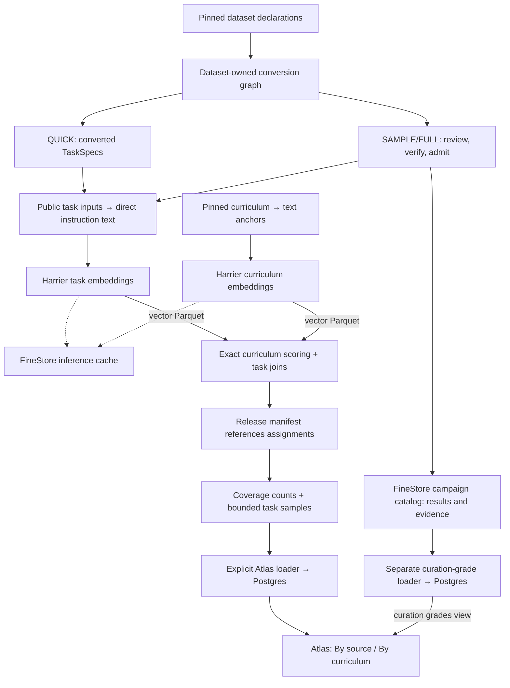

# Task curation

Task curation turns pinned RL datasets into TaskSpec parquet files. Each dataset
is declared once as an `RlDataSource` under
[`experiments/post_training/task_curation/datasets/`](https://github.com/marin-community/marin/blob/main/experiments/post_training/task_curation/datasets/README.md),
and the catalog
[`sources.py`](https://github.com/marin-community/marin/blob/main/experiments/post_training/task_curation/sources.py)
lists every declaration:

```python
from experiments.post_training.task_curation.sources import all_sources

sources = all_sources()  # stable Atlas ID -> RlDataSource
```

Building the catalog performs no downloads, inference or job submission.

## Pipeline overview

The driver runs each dataset's conversion graph, then binds the embedding graph
to the completed source artifacts. QUICK converts without review; SAMPLE reviews
a bounded panel; FULL expands accepted sources and verifies kept tasks.
`--embed coverage` writes the Atlas export; a separate loader imports it into
Postgres. `--corpus PATH/corpus.json --embed coverage` resumes from saved
conversions after checking their manifest hashes. Converted and admitted
populations remain distinct throughout the export.



Both embedding branches use the same model revision, embedding instruction
(retrieval rubric), tokenization and normalization. Optional
`--representation rewrite` replaces direct instruction
text with a cached LLM description. Alignment reads vector Parquet, keeps the
curriculum matrix in worker memory and scores batches exactly. A curriculum edit
reuses task vectors. Atlas imports precomputed counts and samples; the full task
release and vectors stay in object storage.

| Part | Implementation and data models |
|---|---|
| Source selection and graph execution | [driver.py](https://github.com/marin-community/marin/blob/main/experiments/post_training/task_curation/driver.py), [pipeline.py](https://github.com/marin-community/marin/blob/main/experiments/post_training/task_curation/pipeline.py), [TaskSpec](https://github.com/marin-community/marin/blob/main/lib/taskcompendium/src/taskcompendium/models.py) |
| Embedding, alignment and export graph | [embedding.py](https://github.com/marin-community/marin/blob/main/experiments/post_training/task_curation/embedding.py) |
| Public input and text preparation | [semantics.py](https://github.com/marin-community/marin/blob/main/lib/taskcompendium/src/taskcompendium/pipeline/semantics.py): `TaskSemanticInput`, `TaskDescription` |
| Shared embedding pass and inference | [embedding.py](https://github.com/marin-community/marin/blob/main/lib/taskcompendium/src/taskcompendium/pipeline/curriculum/embedding.py), [HarrierEmbedder](https://github.com/marin-community/marin/blob/main/lib/marin/src/marin/processing/embeddings/harrier.py) |
| Curriculum anchors, ranking and task joins | [curriculum models](https://github.com/marin-community/marin/blob/main/experiments/post_training/task_curriculum/models.py), [alignment.py](https://github.com/marin-community/marin/blob/main/lib/taskcompendium/src/taskcompendium/pipeline/curriculum/alignment.py): `CurriculumVectors`, `TaskMatches`; [task_alignment.py](https://github.com/marin-community/marin/blob/main/lib/taskcompendium/src/taskcompendium/pipeline/curriculum/task_alignment.py): `TaskAlignment` |
| Full release and compact coverage | [embedding.py](https://github.com/marin-community/marin/blob/main/experiments/post_training/task_curation/embedding.py): release publication; [coverage.py](https://github.com/marin-community/marin/blob/main/lib/taskcompendium/src/taskcompendium/pipeline/curriculum/coverage.py); [EmbeddingSpec, AlignmentRelease, CurriculumCoverage](https://github.com/marin-community/marin/blob/main/lib/taskcompendium/src/taskcompendium/pipeline/curriculum/models.py) |
| Atlas import and serving | [curriculum loader](https://github.com/marin-community/marin/blob/main/infra/marina/applets/rl_data_catalog/load_curriculum.py), [grade loader](https://github.com/marin-community/marin/blob/main/infra/marina/applets/rl_data_catalog/load.py), [curriculum API](https://github.com/marin-community/marin/blob/main/infra/marina/applets/rl_data_catalog/server/curriculum.py), [Atlas reference](rl-data-atlas.md) |

## Storage and publication

The curation driver defaults to `s3://marin-us-east-02a/marin` on CoreWeave.
`--artifact-root URL` selects another root explicitly and overrides the ambient
`MARIN_PREFIX`. Local `--cache-dir PATH` takes precedence for local execution.
`--output-root`, `--report-path` and `--review-cache` remain explicit locations;
use the same CW bucket for retained remote runs and a new versioned output
directory for each campaign.

For remote QUICK runs, `--output-root` holds `campaign.json`, `corpus.json` and
`catalog/`; reusable source artifacts live under `--artifact-root`. For reviewed
runs, version the parent directory of `--report-path`. Shared content-addressed
caches can be reused across campaigns.

Artifacts retain their existing `<root>/<name>/<version>` paths. QUICK conversions
use `rl-semantics/converted/<source>-<identity>/<version>`; reviewed sources use
`data/rl/<name>-<identity>/<version>`. Completed fixed versions are reused. Changes
to inputs or recipes require a new identity or version; `dev` is for disposable
work. Source manifests and `corpus.json` record exact artifact locations and
manifest hashes. Consumers should follow these references rather than list
directories and infer the latest version.

By default, each campaign has a FineStore catalog beside its report. Production FULL
campaigns use `--publish-catalog s3://marin-us-east-02a/marin/rl-data/catalog/production`
to accumulate results across versioned report directories, with assessment enabled.
`--cache-dir` selects local execution and a local artifact root, so shared
publication rejects it; local and SAMPLE runs keep separate catalogs. Remote runs
reuse completed artifacts under `--artifact-root` and model requests under the
explicit `--review-cache`. Reuse those locations, pinned inputs, recipe versions,
rubric and model revisions across campaigns. A new report directory or enabling
assessment does not force recomputation of completed work. Switching artifact
roots does not copy completed work or model-request caches; verify their reuse
before executing a campaign from a new root. Moving the publication catalog alone
does not change the artifact or model-request cache locations.
Source records retain each run's result and artifact path. FineStore's conflict check covers one writer
session; another writer can replace the same key. Catalog keys include run IDs
to separate results, but these conventions do not enforce access control.
Credentials with object write access can overwrite underlying files. Campaign
reports and `corpus.json` are mutable, so a shared unversioned `--output-root`
is unsuitable for publication.

Use `--source` to grade only new or changed sources. Shared publication preserves
unselected source entries, declarations and assessments without executing their
pipelines.
Published non-skipped attempts, including failed attempts, establish each source's
latest accepted run start time. A superseded source keeps its newer state while the rest of the
campaign publishes. Registry removal does not implicitly retire a production source.
After publication, run the [Atlas loader](rl-data-atlas.md#updating-atlas) explicitly;
Postgres refresh is independent of model execution and Marina rollout.

When building grader environments outside the driver, set `MARIN_PREFIX` to the
same artifact root:

```bash
MARIN_PREFIX=s3://marin-us-east-02a/marin \
  uv run python -m experiments.post_training.task_curation.images --all
```

## Dataset-owned invocation

`RlDataSource.pipeline` is one graph-building callable:

```python
def curate(source: RlDataSource[MyConfig], options: PipelineOptions) -> ArtifactStep[CampaignArtifact]:
    ...
```

`PipelineOptions` contains an explicit QUICK, SAMPLE or FULL mode, the campaign
runtime, input overrides and optional concrete recipe settings. The executor
receives output/cache paths separately. Each dataset constructs its own dependencies and chooses its
conversion, validation, review and control stages. Its run closure accesses the
active Zephyr context through the runtime. A pipeline can generate inputs or
read local files without reviewer credentials, grader builds or sandbox setup.

Recipe pipelines honor `InputOverrides` in all three modes. A primary `root` or
`files` mapping replaces the pinned download; `auxiliary` replaces named input
downloads. Local file contents enter the artifact identity and provenance, so
changing an input creates a new result. SAMPLE and FULL still run their normal
checks and controls. Set the invocation's recipe `rubric=None` to skip model
review while retaining those stages.
Overrides are checked against the planned hashes before and after execution;
changed inputs fail the artifact instead of publishing results under an old identity.

Nemotron blend downloads include one shared Zephyr preparation pipeline per pinned
file. `HfSource.prepare` loads JSONL, assigns original row indices, groups by
component, and uses Zephyr's Parquet writer to produce one file per component.
Component files have separate row groups; conversion uses Parquet footer filters
and row ranges. Records retain their values and upstream row IDs, so task IDs and
source locators remain stable. Declared selectors and decoders still run, including
the SWE-Gym membership split. Local overrides read their supplied raw files directly;
neighboring preparation files do not replace them. Acquisition preparation does not
calculate another source hash.
Prepared conversion ranges also cap each shard at 256 rows, so compact components
with expensive decoders or reference checks can use multiple workers. These
ranges may share a row group; each reader keeps the component predicate and the
stored original row index.

`CampaignArtifact.result` carries a `PipelineResult`: the existing `SourceStatus`,
named output and evidence paths, and the stages that actually ran. It requires no
`final` or admitted view. Exceptions enter the campaign's failure report while
peer results remain available.

`process_rows(source: RlDataSource[CurationRecipe], options)` is a reusable callable. It
chooses pinned downloads and grader dependencies, then invokes the existing
source processor. Review endpoints and credentials resolve only during its
chosen review path; controller lookup occurs when its grader machine is used.
QUICK executes the complete declared dependency graph through StepRunner. Its
terminal uses the executor's mutable `dev` rerun policy at the explicit output
root; ingestion dependencies retain their versions and caches. Recipe conversion
refuses existing `normalize/` or `manifest.json` payloads, including partial
outputs. Other datasets own their overwrite behavior.

`RlDataSource` stores its typed dataset-owned `config` and one plain callable.
Configurations expose catalog facts (`name`, `version`, `dataset`, `files`) without
converter, rubric or service requirements. Pinned inputs expose their reference
directly. Atlas reads these facts without invoking or inspecting the callable.

## Package organization

| Package | Responsibility |
|---|---|
| `experiments/post_training/task_curation/datasets/` | Dataset declarations, converters, rubrics, controls, `*_grade.py` grader scripts and vendored `scorers/` |
| `experiments/post_training/task_curation/environment.py` | `Environment`, what a machine must provide, and `placement`, which decides where it runs |
| `experiments/post_training/task_curation/images/` | `build.py`, which builds declared environments and records each as an artifact, and the build CLI |
| `taskcompendium.runtime.local` | The uv environments that local graders run in on the Zephyr worker |
| `experiments/post_training/task_curation/sources.py` | The source registry, `all_sources()` and `runnable_sources()` |
| `experiments/post_training/task_curation/source.py` | Source declarations and inventory metadata |
| `experiments/post_training/task_curation/catalog_snapshot.py` | Published curation inventory, grades and archived evidence |
| `experiments/post_training/task_curation/config.py` | Invocation options and concrete recipe settings; service binding belongs to `process_rows` |
| `experiments/post_training/task_curation/pipeline.py` | `CurationRecipe`, `process_rows` and its `data/rl/<name>-<hash>` artifact |
| `experiments/post_training/task_curation/pipeline.py`, `local.py` | Source-level mode dispatch and local mechanical conversion |
| `experiments/post_training/task_curation/driver.py`, `campaign.py` | Campaign options, shared pool and per-source results |
| `taskcompendium.convert` | Conversion techniques shared by declarations |
| `taskcompendium.pipeline` | Sampling, review, filtering, verification and outputs |
| `taskcompendium.runtime` | Grading in fresh Shellbox machines |
| `verifyit` | Stock grading modes, in process or in a grader machine |
| `shellbox` | Isolated machines and their backends |

TaskCompendium does not import experiments, name datasets, or construct
ArtifactSteps.

## Declarations

An `RlDataSource` has `info`, a typed `config` and an optional `pipeline`.
`SourceInfo` requires a stable `id`, display `title` and `origin`; it adds family,
search tags, notes and an optional input-row count. A `SourceReference` groups a
name, revision and URL for an inventory dataset. Runnable sources expose their
pinned input through `config.dataset`. Current grades come from the executed
assessment records in `finestore.rl.curation.CurationCatalog`.

```python
from finestore.rl.curation import CurationCatalog

catalog = CurationCatalog("/path/to/cache/campaigns/catalog")
for source in catalog.sources(catalog.current().snapshot_id):
    if source.assessment_key:
        assessment = catalog.assessment(source.assessment_key)
        for item in catalog.items(source.assessment_key):
            packet = catalog.packet(source.assessment_key, item.task_id)
```

Dataset links and **Input rows** describe the same pinned conversion input,
before curation. Unknown counts remain unknown. Assessment keys follow their
pipeline dependencies, rubric and model configuration. A failed assessment under
a changed key has no current grade. Earlier evidence remains archived.
See [RL Data Atlas](rl-data-atlas.md) for publishing and historical reviews, and the
[experiment README](https://github.com/marin-community/marin/blob/main/experiments/post_training/task_curation/README.md)
for offline count regeneration.

The `CurationRecipe` configuration has these fields:

| Field | Meaning |
|---|---|
| `name` | Catalog key and artifact name. |
| `source` | `HfSource(repo, revision, files, format, select, decode, read)` or `UrlSource(url, sha256, filename, format, ...)` or `HarborHubSource(name, revision)`. |
| `convert` | `(RawRow, ConversionContext) -> TaskSpec | NormalizedTask | ImportRejection`; it fixes the task's grader. |
| `version` | Converter revision; bump it when conversion or bundled grader code changes. |
| `intended_use` | `train` or `eval`. |
| `rubric` | Optional review rubric string, one criterion per paragraph. |
| `controls` | Optional `Controls(golden, negative, memory_mb, negative_reward)` for grader verification. |
| `inputs` | Auxiliary pinned sources, staged by name in `ConversionContext.inputs`. |
| `grader` | The `Environment` that grade scripts need, such as `GRADER_PACKAGES` from `datasets/environments.py`. The pipeline builds it and decides where it runs (see [Environments](#environments)); the converter reads the result as `ConversionContext.grader_environment`. |
| `resource_budget_bytes` | Decoded resource bytes admitted by reviewed modes, default 1,000,000; larger tasks are deferred as `resources_over_budget`. Quick mode skips this budget. |

Families whose members differ only by data are tables: one module builds every
declaration of the family in a loop.

`convert`, `select`, `decode`, `read` and `parts` each receive a `ConversionContext` with
two fields: `inputs`, the staged auxiliary sources, and `grader_environment`, the
`EnvironmentRequirements` of the declared `grader` as the pipeline placed it, or
`None` when the declaration names no `grader`.
`required_grader_environment(context)` returns the environment or raises.

Harbor Hub sources acquire the complete pinned release through the existing cached
source-download step. The isolated `config/external/harbor` runtime checks that
Harbor resolves the requested release digest and verifies each task's content
before writing `tasks/<task-reference-hash>.jsonl` and a release manifest.
Each filename hashes the full immutable task reference, so differently named
tasks with identical contents remain separate. The manifest records the resolved
task list. Dataset-level scoring files are not supported. Packages with links
produce explicit unsupported rows. File contents are streamed into JSONL without a per-task export size cutoff; downstream conversion still
loads individual task rows into memory.

Release membership is resolved by Harbor using the pinned release digest.

The download identity includes the release, exporter code, and pinned Harbor commit;
unrelated runtime dependency updates do not invalidate downloaded tasks.
Curation sampling happens after acquisition. Existing `--input-root` and
`--input-file` overrides bypass acquisition; for a bounded local export, run
`python -m experiments.post_training.task_curation.harbor_hub --help` in the
pinned Harbor environment. Retries reuse completed task rows; partial writes are
not treated as completed exports. Use a fresh directory when changing the release
or selected task set.

## Environments

An `Environment` declares grader build inputs. The converter records agent and
grader requirements on each TaskSpec; execution selects suitable Shellbox machines.

| Field | Meaning |
|---|---|
| `requirements` | Direct Python requirements, each an exact `name==version` pin or a `name @ https://...` URL naming a commit, compiled at build time with `uv pip compile --generate-hashes` for Python 3.12 on `x86_64-unknown-linux-gnu`, with transitive packages limited to releases before the `EXCLUDE_NEWER` cutoff in `images/build.py` so every build of an identity resolves the same lock. |
| `apt` | Debian package names. |
| `files` | Absolute guest paths, each receiving a member (a file or directory) of an https archive pinned by URL and SHA-256. The path is the same in both placements and the worker binds it read-only, so it cannot lie under the host system directories such as `/usr` or inside another placed path. |
| `env` | Environment variables for the grader in both placements. |
| `image` | A digest-pinned image used as-is. It excludes every other field. |
| `dockerfile` | A checked-in, self-contained Dockerfile fragment that installs a toolchain, such as Lean and Mathlib, using only `ARG`, `ENV` and `RUN`. The generated Dockerfile runs its lines after the apt and files steps and before the lock sync; its bytes enter the identity. It excludes `image`. |

| Declaration | Placement | Recorded `EnvironmentRequirements` |
|---|---|---|
| `image` set | A sandbox of that image | `command_semantics=LINUX_PROCESS`, `docker_image=image` |
| `dockerfile` set, or `apt` names a package outside `WORKER_IMAGE_APT` | A sandbox of an image built for the environment | `command_semantics=LINUX_PROCESS`, `docker_image=<built digest>` |
| Anything else | A bubblewrap sandbox on the Zephyr worker, with each `files` path mounted read-only and `env` set | `command_semantics=LINUX_PROCESS`, `packages_lock=<lock URL>` |

`WORKER_IMAGE_APT` in `environment.py` lists the Debian packages the `task`
stage of `lib/iris/Dockerfile` installs, such as `build-essential` and `git`.
An environment that needs only those runs in the worker. `GRADER_PACKAGES`, the
requirements every grade script in the catalog imports with the NLTK `punkt_tab`
tokenizer placed under `/srv/nltk_data` and `NLTK_DATA` pointing there, runs in
the worker. The TaskTrove competitive-programming
sources declare `COMPILER_GRADER_PACKAGES`, which adds `build-essential` for
C++ submissions; the worker image provides it, so they also run in the worker.
`LEAN_GRADER_PACKAGES` adds the Lean 4 and Mathlib fragment
`datasets/nemotron_ultra/lean.Dockerfile`, so it runs in a built image.
Converters declare agent requirements independently. A simulated shell requires
explicit `SHELL_SIMULATOR` semantics; an absent image does not select simulation.
Conversation-only tasks need no machine. Memory settings are advisory sizing hints.

Built environments export gzip layers, including inherited base-image layers,
for Docker and OCI consumers. Compression enters built-image cache
identity; lock-backed worker environments retain their existing identities.

## Graders and controls

A task's grader is one of four kinds:

- `VerifyitGrader` names a stock verifyit mode. Without an environment it grades
  in process; with `environment=required_grader_environment(context)` it grades
  in a fresh machine of the grader's environment.
- `ScriptGrader` runs a command in a fresh machine of the grader's environment. Archived
  TaskTrove graders keep the archive's `tests/test.sh`, which writes its reward
  to a file (`FileReward`).
- `SessionGrader` marks a task graded by its registered interactive session.
- `NoGrader` records a source evaluator this repository cannot run, with the
  source contract. Its rows never reach `final/`.

TaskTrove math uses verifyit's `math` mode in the grader sandbox. It compares the
last boxed answer, falling back to the last nonempty line, with the archive's
typed reference; tuples and lists use ordered member comparison. Archived
scorer and runner code stays hidden as source evidence and is never executed on
model answers. Parsing and unit handling follow verifyit; source scorer parity
is not guaranteed. Archived oracle scripts still run in a sandbox to produce
golden control answers when present.

A source whose scorer is upstream code grades with a script. The script is a
`<name>_grade.py` file next to the declaration, and the upstream scorer is
vendored under `datasets/<family>/scorers/`. `taskcompendium.convert.script_grader` builds the
package:

- `grade_script` installs the script as `/tests/grade.py`, with the files it
  imports; `shipped_files` places vendored scorer files at their package paths
  under `/tests`, so the script imports them as upstream does;
- `script_package` adds the row's hidden data as `/tests/config.json` (sorted
  keys) and grades with `ScriptGrader(argv=("python3", "/tests/grade.py"),
  cwd="/", reward=StdoutReward())` in the grader's environment.

The script puts `/tests` on its import path, reads `config.json` and the reply
at `/app/answer.txt` (or the conversation at `/tests/conversation.json`), and
prints the reward, fractional when the scorer is, as its last nonempty stdout
line. The runtime keeps the first 16 KiB of stdout, so the script keeps its
output below that. It exits nonzero when it cannot import its scorer or a
dependency, which the runtime reports as an infrastructure error, never a zero
reward. The grader's environment supplies third-party dependencies only; scorer code
always ships with the task.

Conversion preserves the source's grading semantics. It does not repair
comparators or rewrite tests to accept a reference.

Controls check a grader before its tasks are admitted. For each sampled task the
pipeline grades exactly one submission: `golden(task)`, which must score 1, or,
when the declaration has no `golden` or it returns `None` because the task has no
known answer, `negative(task)` when supplied, otherwise an empty submission.
A negative must score zero unless `negative_reward(task)` declares its expected
partial reward. MultiChallenge uses this to account for `NO` criteria that an
empty reply satisfies. A grader that
runs in a machine grades the empty submission in a fresh machine of its environment,
staged as for a rollout whose agent replied with empty text and wrote nothing: an
empty answer file where the grader reads one, a conversation ending in the empty
reply, and an empty workspace. The empty control passes when the grader runs and
scores 0 or rejects the submission. When the grader runs and gives the empty
submission a positive reward, the task is defective: an empty reply satisfies it,
as it satisfies an instruction-following constraint such as "use no commas". The
control records `defect`, which rejects the row with reason `check:empty`; the
trial still counts as checked and passed toward the source's pass fraction, and
the verification report counts it under `defective`. A golden that does not score
1 fails, which rejects the row and counts against the source. A grader that
crashes or writes no reward is an infrastructure error. An in-process grader
scores the empty reply directly. A golden is a `Reply`, `WorkspaceFiles`, or an
`OracleCommand`, such as a TaskTrove `solution/solve.sh`,
run with the task's worker and oracle files in a fresh machine of the task's agent
image, whose tools and directories the oracle expects. A task without an agent
image, such as a conversation task, runs its oracle in the grader's machine. The
oracle's output is then graded like any other submission. In-process numeric,
MCQ, exact and action graders are also checked per task during preparation.

Judge controls require an explicit `JudgeConnection`. The recipe settings' API
key and base URL configure it even when the recipe has no review rubric. A
local constraint, exact-match gate or submission rejection cannot establish
endpoint readiness: a judge control passes only after a remote verdict. For
example, an instruction-following negative rejected by an IFEval constraint
fails verification instead of certifying an untested endpoint. Sources without
controls still record verification as skipped.

Remote verdicts are not reused across verification runs because the connection
does not identify an immutable model deployment. This affects cached evidence,
not the runtime's ability to grade a submission.

Nemotron Lean controls run with 8 GiB of memory. The grader first compiles a
trusted Mathlib proof as uid 65534 inside the network-denied image. Failure of
that probe, a compiler timeout or a failed compiler process without a diagnostic
for the submitted proof is an infrastructure error. Invalid proofs and `sorry`
score zero.

Reasoning Gym's native VerifyIt mode and Nemotron grader share
`verifyit.modes.extract.extract_markdown_answer`. It extracts the last `# Answer`
heading (one to six `#` characters), stopping at the next heading, horizontal
rule or code fence, and strips outer emphasis. It does not guess answers from
prose sentences. Each
grading mode chooses which answer wrappers its contract accepts.

The tool-judge challenge set and its source provenance live under
`experiments/post_training/task_curation/scripts/fixtures`. Cases pin the hashes
of the normalized tasks they were labelled against. With `GLM_BULK_TOKEN` set,
first enter an Iris job that can reach the relay, then run the command below.
Replace `/OWNER/RELAY_JOB` with the Iris job ID of your relay deployment:

```bash
uv run --with-editable './lib/taskcompendium[pipeline]' python -m \
  experiments.post_training.task_curation.scripts.calibrate_tool_judge \
  --relay-job /OWNER/RELAY_JOB --repeats 3 --output calibration.json
```

Tool-action judges retry a truncated completion once with a 16,384-token
budget. Malformed or contradictory labels remain unscored. Each request keeps
its 120-second timeout; allow both attempts within the caller's verifier deadline.

The report records each trial's status, failure reason and duration, per-category
agreement, requested concurrency, verdict coverage and prompt hashes. Aggregate
accuracy is withheld below 90% scored coverage. Require the same minimum
coverage before comparing model validation scores. A load probe with known-invalid
submissions measures judge availability; it is not a model validation score.
This tool-call challenge set does not calibrate other tool-use
sources or the GenRM, abstention, MultiChallenge, jailbreak and instruction
families. Those sources keep the default recipe version 3 in
`datasets/nemotron_ultra/components.py` until repeated labelled cases for each
source establish their expected reward contracts across repeated verdicts.
Results for this challenge set apply only to toolcall-schema rows. Calibration,
load and replay reports are not checked in; the PR that relies on one links it
from an artifact prefix, and the repository keeps only the labelled cases,
normalized task snapshots and provenance the script reads.

For model-output validation, check the message that TaskSpec actually grades.
A serving endpoint can remove thinking markers from chat content while retaining
them in exact response tokens. Recover the final text from those tokens before
constructing the assistant message, and preserve parsed native tool calls.
Changing a separate display-text field does not repair the grading boundary.
Saved-token replay can diagnose this mismatch; it does not recover an API message
that the original validation dump omitted.

Lock-backed bubblewrap graders share content-addressed Python environments on
each host. On Iris, they use the executable `/cache/task-curation` mount because
`/tmp` is mounted with `noexec`. Hosts without the `/cache` mount use `/tmp`.
Build locks and completion markers let concurrent workers reuse finished
environments; uv retains its configured package cache.

## Conversion modes

Each dataset's callable receives `PipelineOptions` with an explicit mode. The
single `driver` CLI requires `--mode quick|sample|full` and
prints a plan unless `--run` is supplied. QUICK runs locally without review or
controller settings. See the campaign quickstart below for input overrides.
The recipe implementation shares conversion and the normalized schema across
its modes. QUICK retains TaskSpecs
and typed rejections, skipping admission, fingerprints, review, deduplication
and grading. It records declared images or locks without building environments.

Recipe SAMPLE and FULL bind `SourcePipelineConfig` and a resolved grader
environment. Other callables choose their own configuration. The recipe's FULL
mode reviews a bounded panel, then
reuses those conversions when its quality gate allows expansion. The procedure
below describes those reviewed stages. See the
[campaign quickstart](https://github.com/marin-community/marin/blob/main/experiments/post_training/task_curation/README.md)
for local overrides, Harbor export and pinned content comparison commands.

## Source procedure

Sample and full modes run the reviewed procedure below.

1. Download the pinned files once per distinct pin
   (`task-curation/download/<hash>`).
2. Draw at most 100 raw rows with a seeded sample, convert them and run cheap
   checks.
3. With a rubric, send the panel in bounded batches to the GLM reviewer. More
   than 50% known defects, over the whole panel, rejects the source; otherwise
   it is accepted. Uncertain judgments, unsupported conversions and duplicate
   rows are not defects. Rows outside the panel are never reviewed individually.
   Without a rubric, rows are kept as `unreviewed`.
4. In full mode, convert and audit every row of an accepted source.
5. Filter rows into kept, rejected and deferred.
6. With controls, verify a seeded sample of at most 20 kept rows
   (`--verification-sample-size`): each task's one control runs once in a fresh
   machine, rerun up to twice more after an infrastructure error. At a 95% pass
   fraction, unsampled tasks can skip validation. Otherwise validate every kept
   task, retaining passes, rejecting failures and deferring unavailable results.
   Remote-judge controls use the campaign's authenticated judge endpoint outside
   the network-denied grader sandbox; credentials stay out of task specifications
   and persisted campaign evidence. This threshold is independent of sampled
   GLM quality grades.
7. Admit rows and write the outputs.

For a standalone task batch, call
`review_tasks(tasks, rubric, reviewer, cached=None)` from
`taskcompendium.pipeline.review`. It returns a `ReviewBatchResult` with `.reviews`
and `.attempts`. The caller's sink owns serialization and output. Pipeline sinks
write one evidence record per batch alongside audit rows in the same execution,
without repeating provider calls.

Verification telemetry records `select`, `trials`, and `row_gate` executions.
The gate writes the complete audit and accepted rows together and returns
manifest counts, avoiding separate export and count executions. Control trials
remain parallel on workers. Review-cache telemetry separates descriptor lookup
from payload reads; descriptor shards are read with at most four threads per
lookup, with whole-fragment prefetch disabled.

The campaign runs source procedures in threads over one Zephyr context and
worker pool. `--concurrent-sources` limits whole-source admission and
`--max-workers` the shared worker count. A failed source does not stop the
others; the campaign report records it. Review requests are cached by the
complete request and declared model revision, so rebuilt artifacts do not repeat
identical inference.

`--normalized-shards` caps the export shard count. The count is the source
population divided by 1,000, rounded up and capped, with a minimum of one.
This avoids many small files for small sources; filtering can reduce rows per shard.
The source manifest records the resulting count in `normalized_shards` and the
configured cap in `normalized_shard_limit`. Full preparation uses the same
population rule with a cap of 64 deduplication partitions; persisted review files
retain their independent record and byte limits.

## Run a campaign

Run the driver inside an Iris job whose `EnvironmentSpec` includes
`pip_packages=["./lib/taskcompendium[pipeline]"]`. Plan first:

```bash
uv run --with-editable './lib/taskcompendium[pipeline]' python -m \
  experiments.post_training.task_curation.driver \
  --review-mode chat --model-revision YOUR_GLM_REVISION \
  --review-cache CACHE_PREFIX --mode sample \
  --max-workers 64 --coordinator-memory 16g --concurrent-sources 10 \
  --normalized-shards 32 \
  --image-backend gvisor \
  --worker-image ghcr.io/marin-community/iris-task@sha256:DIGEST \
  --report-path CAMPAIGN_PREFIX/sample.json
```

Build the [registered environments](https://github.com/marin-community/marin/blob/main/experiments/post_training/task_curation/images/README.md#building)
first, with `MARIN_PREFIX` set to the driver's artifact root:

```bash
uv run python -m experiments.post_training.task_curation.images --all
uv run python -m experiments.post_training.task_curation.images --identity IDENTITY_PREFIX
```

Each environment without an `image` becomes the artifact
`images/env-<identity[:16]>`, which stores its hash lock as `requirements.lock`
and, when it places files or sets variables, `files.tar` and `environment.json`.
The identity hashes the `requirements`, `apt`, `files` with their archives'
URLs, digests and members, `env`, the `dockerfile` fragment's bytes, Python 3.12, the platform, the digest-pinned
base image, the files of `verifyit` (which every built environment puts on the
grader's import path) and the placement, so a rerun with an unchanged
declaration does nothing. An environment placed in a built image also gets a
generated Dockerfile: the pinned `iris-task` base, `apt-get install` of `apt`,
`COPY files/ /`, `ENV` lines for `env`, the `dockerfile` fragment's lines, `uv
pip sync --require-hashes` of the lock and `verifyit`. The build pushes it
as `ghcr.io/marin-community/iris-task:task-curation-env-<identity[:16]>` and
records the digest. An image build needs a `docker login` for ghcr.io; every
build needs, for a CoreWeave `MARIN_PREFIX`, the `CW_KEY_ID` and
`CW_KEY_SECRET` pair in the environment. Planning a source whose environment
has no artifact raises `MissingEnvironmentArtifact` with the `--identity`
command that builds it.

Local graders run in bubblewrap sandboxes on the Zephyr worker, each over a
private root, so the worker pods need Iris's privileged container profile
(`--container-profile CONTAINER_PROFILE_PRIVILEGED`). On first use, each worker downloads the environment's lock from its artifact and builds a
self-contained Python environment (a uv-managed CPython 3.12 and a venv) under
`/tmp/task-curation-env-<identity>`, with `verifyit` and the placed files from
`files.tar`; the sandbox mounts that directory, the system directories and each
placed file at its declared path, runs graders with the declared `env`, and
concurrent graders on one host build it once.
Image grading requires `--image-backend gvisor` or `--image-backend daytona`.
The gVisor launcher uses the enclosing Iris job's controller, or `--controller-url`
outside a job, to create sandbox jobs. Daytona creates remote sandboxes through its API.
Neither path requires a Docker daemon in the Zephyr worker. Without an image backend,
controls can still use package locks through Local or explicit simulator requirements
through ShellSim. Programmatic callers pass grading machines through `RecipeSettings.machines`.
Grading machines never have network access. Add `--run` to execute, with `GLM_BULK_TOKEN` in the driver environment;
the review endpoint is resolved from the Iris GLM relay job (`--relay-job`) unless
`--base-url` overrides it. `--mode sample` is a test run that
converts and gates only each source's panel. `--mode full` runs each source on
its own: it makes its own panel quality decision, converts every row of an
accepted source, draws its control sample from all kept rows, and validates every
kept task when the control sample does not permit skipping validation. A quality
rejection ends the source `gated`; control failures reject individual tasks. Repeat
`--source NAME` to run a subset.

FULL runs append a post-curation assessment; SAMPLE can opt in with `--assess`.
The shared stages prepare bounded evidence packets with Zephyr, request one GLM
judgment per packet, and publish typed records in the catalog. Atlas loads these
records into Postgres and computes cohort summaries with SQL. The default sample covers
100 admitted tasks and up to 20 excluded diagnostic rows, grouped by primary
reason. Their populations and verdict counts stay separate. These model
opinions do not change curation admission or imply source-wide correctness.
`--assessment-sample-size`, `--excluded-sample-size` and `--assessment-rubric`
configure the pass; `--skip-assessment` records a curation-only run.

Incomplete curation produces retained artifacts and downstream assessment, then
the campaign reports failure. `--curation-attempt N` selects a new curation key
when controls need a retry; successful exact review requests and pinned downloads
remain cached. Rerun the same campaign to reuse completed dependencies.
`--assessment-model-revision` changes the grading model revision separately from
the curation review revision.

Use `--cache-dir PATH` to run SAMPLE/FULL locally against small pinned sources
and retain downloads, source artifacts, assessment artifacts and GLM query
cache. Local workers need no Iris coordinator settings; package and image
controls keep their environment prerequisites. See the
[real-source local loop](https://github.com/marin-community/marin/blob/main/experiments/post_training/task_curation/README.md#reviewed-local-loop-on-real-sources).

## Outputs

Each source artifact `data/rl/<name>-<hash>` contains:

| Relative path | Contents |
|---|---|
| `download/locators/` | Row locators of the staged source files |
| `normalize/part-*.parquet` | Every converted row: TaskSpec JSON or rejection, and normalization changes |
| `review/part-*.parquet` | Review evidence and filter decisions |
| `review/unprocessed-*.parquet` | Rows outside an unexpanded sample, with the gate's reason |
| `review/report.json` | The source quality decision |
| `verify/part-*.parquet` | Per-row checks, grader readiness and admission |
| `verify/report.json` | Sampled controls, trials and the source verification decision |
| `final/part-*.parquet` | Admitted rows only |
| `manifest.json` | Status, counts, revisions, reports and the source admission |
| `telemetry.json` | Zephyr execution IDs, counters and phase wall times |
| `identity.json` | Resolved input, converter, grader, control and execution identities for recipe SAMPLE/FULL runs |

Every row's `admission` is `admitted`, `rejected`, `deferred`, `no_grader` or
`unverified`; `final/` holds the admitted rows. Sidecars
join on `task_id`, `source_locator`, `raw_input_sha256` and decoded
`raw_sha256`. Artifact identities cover source pins, inputs, explicit code versions,
grader environments, resource budgets, rubrics, controls and pipeline settings.
Python source files are not hashed. Bump the recipe version for converter or bundled
grader changes, the corresponding stage/control revision for shared pipeline changes,
and the export version for Harbor lowering changes. Download versions are independent.
The manifest counts rows deferred for `resources_over_budget` with the other
normalization reasons.

The
[pipeline contract](https://github.com/marin-community/marin/blob/main/lib/taskcompendium/src/taskcompendium/pipeline/README.md)
describes each stage in detail.

## Run catalog

Each terminal campaign appends a FineStore transaction to `catalog/` beside its
campaign report. QUICK writes to `<output-root>/catalog`. The existing entry
points create it automatically; no separate command is required.

The `runs` table records each invocation, its report snapshot, mode, status,
timestamps and resources. `sources`, keyed by run ID and source artifact name,
records the stable Atlas ID, input and recipe revisions, population and sample
counts, admissions, control outcomes, phase evidence and output pointers.
`phases` records wall times and Zephyr execution counters. Exact manifest,
telemetry, identity and filter-count snapshots are named FineStore objects with
SHA-256 digests. Failed sources remain visible; missing statistics are null.
QUICK does not imply review, verification or admission.

The typed `CurationCatalog` reader exposes source declarations, assessment
attempts, selected assessments, cohort populations, items and archived packets.
The terminal judgment artifact's ordinary pipeline key identifies an assessment.
An incomplete curation run can have a complete diagnostic assessment. Assessment
attempts publish complete, failed or skipped; live progress stays in the executor.
Atlas's explicit loader copies selected records to Postgres after publication.

A cached artifact retains its original attempt timestamp and timing. The
containing invocation has a different run ID and start time; summing those
artifact timings does not measure campaign throughput. Counts are per recipe
and can include overlapping source populations. Completed conversion and
passed verification are separate fields.

The catalog inherits its output directory's retention policy. A seven-day
temporary prefix must be promoted or imported before expiry for permanent
Atlas history. Repeated writes cannot keep old immutable FineStore shards
alive under object-age lifecycle deletion.
