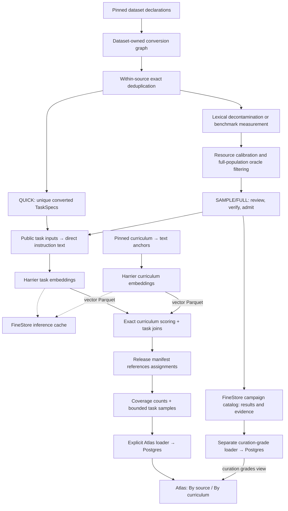

# Task curation

Task curation turns pinned training and evaluation datasets into TaskSpec parquet files. Each dataset
is declared once as an `RlDataSource` under
[`experiments/post_training/task_curation/datasets/`](https://github.com/marin-community/marin/blob/main/experiments/post_training/task_curation/datasets/README.md),
and the catalog
[`sources.py`](https://github.com/marin-community/marin/blob/main/experiments/post_training/task_curation/sources.py)
lists every declaration:

```python
from experiments.post_training.task_curation.sources import all_sources

sources = all_sources()  # stable Atlas ID -> RlDataSource
```

Building the catalog performs no downloads, inference or job submission.

[Evaluation tasks](evaluation-tasks.md) use population-preserving publication and
carry execution protocols beside canonical tasks. Name them explicitly with
`--source` and `--mode quick`; the default selection contains training sources.
`experiments.post_training.task_curation.evaluation.EvalDataset` binds the recipe,
protocol, and item builder. TaskCompendium owns the reusable source importers and
corpus publisher; the experiment owns acquisition and artifact graphs.

## Pipeline overview

The mandatory ingest order is conversion → exact within-source deduplication → lexical
decontamination → resource calibration and full-population oracle filtering → SAMPLE/FULL QA.
QUICK also deduplicates its complete converted population.

The driver runs each dataset's conversion graph, then binds the embedding graph
to the completed source artifacts. QUICK converts without review; SAMPLE reviews
a bounded panel; FULL expands accepted sources and verifies kept tasks.
`--embed coverage` writes the Atlas export; a separate loader imports it into
Postgres. `--corpus PATH/corpus.json --embed coverage` resumes from saved
conversions after checking their manifest hashes. Converted and admitted
populations remain distinct throughout the export.



Both embedding branches use the same model revision, embedding instruction
(retrieval rubric), tokenization and normalization. Optional
`--representation rewrite` replaces direct instruction
text with a cached LLM description. Alignment reads vector Parquet, keeps the
curriculum matrix in worker memory and scores batches exactly. A curriculum edit
reuses task vectors. Atlas imports precomputed counts and samples; the full task
release and vectors stay in object storage.

| Part | Implementation and data models |
|---|---|
| Source selection and graph execution | [driver.py](https://github.com/marin-community/marin/blob/main/experiments/post_training/task_curation/driver.py), [pipeline.py](https://github.com/marin-community/marin/blob/main/experiments/post_training/task_curation/pipeline.py), [TaskSpec](https://github.com/marin-community/marin/blob/main/lib/taskcompendium/src/taskcompendium/models.py) |
| Embedding, alignment and export graph | [embedding.py](https://github.com/marin-community/marin/blob/main/experiments/post_training/task_curation/embedding.py) |
| Public input and text preparation | [semantics.py](https://github.com/marin-community/marin/blob/main/lib/taskcompendium/src/taskcompendium/pipeline/semantics.py): `TaskSemanticInput`, `TaskDescription` |
| Shared embedding pass and inference | [embedding.py](https://github.com/marin-community/marin/blob/main/lib/taskcompendium/src/taskcompendium/pipeline/curriculum/embedding.py), [HarrierEmbedder](https://github.com/marin-community/marin/blob/main/lib/marin/src/marin/processing/embeddings/harrier.py) |
| Curriculum anchors, ranking and task joins | [curriculum models](https://github.com/marin-community/marin/blob/main/experiments/post_training/task_curriculum/models.py), [alignment.py](https://github.com/marin-community/marin/blob/main/lib/taskcompendium/src/taskcompendium/pipeline/curriculum/alignment.py): `CurriculumVectors`, `TaskMatches`; [task_alignment.py](https://github.com/marin-community/marin/blob/main/lib/taskcompendium/src/taskcompendium/pipeline/curriculum/task_alignment.py): `TaskAlignment` |
| Full release and compact coverage | [embedding.py](https://github.com/marin-community/marin/blob/main/experiments/post_training/task_curation/embedding.py): release publication; [coverage.py](https://github.com/marin-community/marin/blob/main/lib/taskcompendium/src/taskcompendium/pipeline/curriculum/coverage.py); [EmbeddingSpec, AlignmentRelease, CurriculumCoverage](https://github.com/marin-community/marin/blob/main/lib/taskcompendium/src/taskcompendium/pipeline/curriculum/models.py) |
| Atlas import and serving | [curriculum loader](https://github.com/marin-community/marin/blob/main/infra/marina/apps/rl_data_catalog/load_curriculum.py), [grade loader](https://github.com/marin-community/marin/blob/main/infra/marina/apps/rl_data_catalog/load.py), [curriculum API](https://github.com/marin-community/marin/blob/main/infra/marina/apps/rl_data_catalog/server/curriculum.py), [Atlas reference](rl-data-atlas.md) |

## Storage and publication

### Decontamination before QA

QUICK produces unreviewed TaskSpecs for measurement. Before SAMPLE/FULL review,
each source must carry `lexical_contamination`, including a verified private
`open-athena` TaskCompendium release receipt at the exact input repository and
revision. `--decontamination-receipt PATH` loads the complete measurement and
receipt JSON; declarations expose the same evidence in the catalog.

A measurement with no receipt cannot admit tasks, including a measurement with
zero contaminated tasks. A clean receipt retains the complete measured
population. A remediated receipt drops every flagged task, records the drop
manifest and original private snapshot pin, and identifies a new output pin.
Retained plus dropped tasks must equal the measured population. The output pin
must match the source used for QA and admission. Preserve the raw measurement
input pin separately from the archived private snapshot and final release.

The recipe runner rejects missing or mismatched receipts before conversion,
reviewer requests or grader controls. Prebuilt imports also check the receipt
population against the published cohort and preserve the receipt in their
manifest. Receipt changes enter artifact identity. Existing grandfathered
MarinSkyRL blend selection remains unchanged; their measurements and remediation
candidates are recorded without changing the blend wiring.

The curation driver defaults to `s3://marin-us-east-02a/marin` on CoreWeave.
`--artifact-root URL` selects another root explicitly and overrides the ambient
`MARIN_PREFIX`. Local `--cache-dir PATH` takes precedence for local execution.
`--output-root`, `--report-path` and `--review-cache` remain explicit locations;
use the same CW bucket for retained remote runs and a new versioned output
directory for each campaign.

For remote QUICK runs, `--output-root` holds `campaign.json`, `corpus.json` and
`catalog/`; reusable source artifacts live under `--artifact-root`. For reviewed
runs, version the parent directory of `--report-path`. Shared content-addressed
caches can be reused across campaigns.

Artifacts retain their existing `<root>/<name>/<version>` paths. QUICK conversions
use `rl-semantics/converted/<source>-<identity>/<version>`; reviewed sources use
`data/rl/<name>-<identity>/<version>`. Completed fixed versions are reused. Changes
to inputs or recipes require a new identity or version; `dev` is for disposable
work. Source manifests and `corpus.json` record exact artifact locations and
manifest hashes. Consumers should follow these references rather than list
directories and infer the latest version.

By default, each campaign has a FineStore catalog beside its report. Production FULL
campaigns use `--publish-catalog s3://marin-us-east-02a/marin/rl-data/catalog/production`
to accumulate results across versioned report directories, with assessment enabled.
`--cache-dir` selects local execution and a local artifact root, so shared
publication rejects it; local and SAMPLE runs keep separate catalogs. Remote runs
reuse completed artifacts under `--artifact-root` and model requests under the
explicit `--review-cache`. Reuse those locations, pinned inputs, recipe versions,
rubric and model revisions across campaigns. A new report directory or enabling
assessment does not force recomputation of completed work. Switching artifact
roots does not copy completed work or model-request caches; verify their reuse
before executing a campaign from a new root. Moving the publication catalog alone
does not change the artifact or model-request cache locations.
Source records retain each run's result and artifact path. FineStore's conflict check covers one writer
session; another writer can replace the same key. Catalog keys include run IDs
to separate results, but these conventions do not enforce access control.
Credentials with object write access can overwrite underlying files. Campaign
reports and `corpus.json` are mutable, so a shared unversioned `--output-root`
is unsuitable for publication.

Use `--source` to grade only new or changed sources. Shared publication preserves
unselected source entries, declarations and assessments without executing their
pipelines.
Published non-skipped attempts, including failed attempts, establish each source's
latest accepted run start time. A superseded source keeps its newer state while the rest of the
campaign publishes. Registry removal does not implicitly retire a production source.
After publication, run the [Atlas loader](rl-data-atlas.md#updating-atlas) explicitly;
Postgres refresh is independent of model execution and Marina rollout.

When building grader environments outside the driver, set `MARIN_PREFIX` to the
same artifact root:

```bash
MARIN_PREFIX=s3://marin-us-east-02a/marin \
  uv run python -m experiments.post_training.task_curation.images --all
```

## Mandatory within-source duplicate removal

Every source, including QUICK and prebuilt cohorts, drops exact duplicate contracts after
conversion. `taskcompendium.identity.task_identity` hashes the canonical TaskSpec with only
`id`, `source`, `tags` and `labels` excluded. Public conversation, tools, environment and execution
requirements, grader contract, private reference and tests all participate. Equal prompts with
different graders remain distinct. Near-duplicates remain advisory.

The lowest task ID is retained, using lexicographic string order. The drop manifest records each
`task_id` → `kept_id` with ledger reason `DUPLICATE_WITHIN_SOURCE`. This is a mechanical exclusion;
it does not contribute a QC defect. The raw locator ledger lists every selected input; retained
conversions, duplicate mappings and conversion rejections account for its outcomes. SAMPLE draws
its QA panel from the unique converted population; FULL reads the cached unique conversions.

Catalog declarations require `within_source_dedup` evidence bound to the input dataset pin and
converter version. Atlas Examples is `unique_count`; `raw_count` counts successfully converted
TaskSpecs before deduplication, and `within_source_duplicates` counts the dropped copies.
Conversion rejections remain a separate ledger. The source fingerprint uses the same exact
within-source contract identity to count duplicates in the successful pre-deduplication conversions.

For TRAIN remediation, union duplicate and lexical exclusion manifests by task ID, preserving both
reasons for an overlap. For eval/benchmark sources, drop duplicates and record lexical flags without
lexical exclusions. Both policies prepare one new
private `open-athena` TaskCompendium release per source. Bind calibration, full-population oracle
filtering, and SAMPLE/FULL QA to the retained population. Measurement and manifest preparation
alone never publish a Hugging Face release. Existing source artifacts remain immutable.

Evaluation protocols pin the upstream input and its raw task count. Evaluation manifests and
sidecars contain the unique contracts actually evaluated, in their original source order; the
conversion ledger reconciles raw rows with unique tasks and dropped copies. An interrupted or
unsuccessful publication attempt requires a new output artifact version.

Selection-time deduplication retains the rules in [Final task selection](#final-task-selection); changing its grader and
reference semantics requires a separate decision.

## Final task selection

`--selection RECIPE.json` appends a terminal `ArtifactStep` to a FULL campaign.
The implementation is
[`inventory.py`](https://github.com/marin-community/marin/blob/main/experiments/post_training/task_curation/inventory.py).
It depends on the recipe's admitted source artifacts and a pinned heldout
Parquet. Selection reads only `final/*.parquet` from training sources whose
manifests record `mode: full`. SAMPLE panels and QUICK conversions cannot supply
the training population.

For the current task-to-training recipe, see the [quick RL loop](../recipes/quick-rl-loop.md).

The recipe contains an explicit source allowlist and family quotas. For example,
this small recipe selects 100 calendar tasks from two admitted sources:

```json
{
  "name": "calendar-trial",
  "version": "2026.10.23.1",
  "sources": {
    "TaskTrove:laion__nemotron-gym-agent-calendar-v2": "calendar",
    "TaskTrove:laion__nemotron-gym-instruction-following-calendar-v3": "calendar"
  },
  "family_limits": {"calendar": 100},
  "heldout": {
    "uri": "s3://marin-us-east-02a/marin/rl-data/inputs/snowball-heldout/2026.10.23.1/validation.parquet",
    "version": "2026.10.23.1",
    "rows": 910
  },
  "validation_per_family": 20,
  "seed": 20261023
}
```

The retained S3 heldout input contains all 910 original Snowball development
tasks, with string columns `lowered_task_spec` (TaskSpec 0.27) and `teacher_route`.
Its pinned upstream is
[`cb728a7` on Hugging Face](https://huggingface.co/datasets/open-athena/Snowball-Smartie-RL-2026.10.15.32-Data/tree/cb728a7636caad3fc6fa6b6ba85a49194d9d69a3).

Use `--selection recipe.json` alongside the normal FULL campaign options, or
select again from the campaign's saved admitted corpus:

```bash
uv run --with-editable './lib/taskcompendium[pipeline]' python \
  -m experiments.post_training.task_curation.driver \
  --corpus s3://marin-us-east-02a/marin/rl-data/campaigns/RUN/corpus.json \
  --selection recipe.json --run
```

Omit `--run` to print the artifact and its dependencies. Source IDs in the recipe
must all be present in the campaign or saved corpus. Optional `source_limits`
must cover every source and sum to each family quota. Changing quotas, the seed,
source artifacts, the source allowlist or the heldout input requires a new recipe version.
The output lives under the active artifact root at
`rl-data/task-selection/<name>/<version>`; `--cache-dir` selects a local root.

Before sampling, selection removes matches against the **complete** heldout set
by task ID, public semantics or exact conversation context. It deduplicates
eligible training contracts with TaskCompendium's shared identity rules, retaining
distinct private script and closure contracts. Each source-quota group, or family
when source quotas are omitted, is sampled without replacement in seeded task-ID
order. Quotas must fit the eligible population;
a shortfall fails before publishing the training files. These rules provide
exact overlap checks, not semantic decontamination.

The artifact contains `train.parquet`, the per-family evaluation sample in
`validation.parquet`, the complete exclusion set in `full_validation.parquet`,
and `summary.json` with the recipe, source paths, eligible/overlap/duplicate/selected
counts and evaluation IDs. Each Parquet has a `task_spec` JSON column. Source
TaskSpecs retain their private graders and resources. The historical structural
heldout tasks use the shared closure converter. SkyRL chooses rollout limits,
harnesses and verifier backends when it loads these canonical tasks.

## Dataset-owned invocation

`RlDataSource.pipeline` is one graph-building callable:

```python
def curate(source: RlDataSource[MyConfig], options: PipelineOptions) -> ArtifactStep[CampaignArtifact]:
    ...
```

`PipelineOptions` contains an explicit QUICK, SAMPLE or FULL mode, the campaign
runtime, input overrides and optional concrete recipe settings. The executor
receives output/cache paths separately. Each dataset constructs its own dependencies and chooses its
conversion, validation, review and control stages. Its run closure accesses the
active Zephyr context through the runtime. A pipeline can generate inputs or
read local files without reviewer credentials, grader builds or sandbox setup.

Recipe pipelines honor `InputOverrides` in all three modes. A primary `root` or
`files` mapping replaces the pinned download; `auxiliary` replaces named input
downloads. Local file contents enter the artifact identity and provenance, so
changing an input creates a new result. SAMPLE and FULL still run their normal
checks and controls. Set the invocation's recipe `rubric=None` to skip model
review while retaining those stages.
Overrides are checked against the planned hashes before and after execution;
changed inputs fail the artifact instead of publishing results under an old identity.

Nemotron blend downloads include one shared Zephyr preparation pipeline per pinned
file. `HfSource.prepare` loads JSONL, assigns original row indices, groups by
component, and uses Zephyr's Parquet writer to produce one file per component.
Component files have separate row groups; conversion uses Parquet footer filters
and row ranges. Records retain their values and upstream row IDs, so task IDs and
source locators remain stable. Declared selectors and decoders still run, including
the SWE-Gym membership split. Local overrides read their supplied raw files directly;
neighboring preparation files do not replace them. Acquisition preparation does not
calculate another source hash.
Prepared conversion ranges also cap each shard at 256 rows, so compact components
with expensive decoders or reference checks can use multiple workers. These
ranges may share a row group; each reader keeps the component predicate and the
stored original row index.

`CampaignArtifact.result` carries a `PipelineResult`: the existing `SourceStatus`,
named output and evidence paths, and the stages that actually ran. It requires no
`final` or admitted view. Exceptions enter the campaign's failure report while
peer results remain available.

`process_rows(source: RlDataSource[CurationRecipe], options)` is a reusable callable. It
chooses pinned downloads and grader dependencies, then invokes the existing
source processor. Review endpoints and credentials resolve only during its
chosen review path; controller lookup occurs when its grader machine is used.
QUICK executes the complete declared dependency graph through StepRunner. Its
terminal uses the executor's mutable `dev` rerun policy at the explicit output
root; ingestion dependencies retain their versions and caches. Recipe conversion
refuses existing `normalize/` or `manifest.json` payloads, including partial
outputs. Other datasets own their overwrite behavior.

`RlDataSource` stores its typed dataset-owned `config` and one plain callable.
Configurations expose catalog facts (`name`, `version`, `dataset`, `files`) without
converter, rubric or service requirements. Pinned inputs expose their reference
directly. Atlas reads these facts without invoking or inspecting the callable.

## Package organization

| Package | Responsibility |
|---|---|
| `experiments/post_training/task_curation/datasets/` | Dataset declarations, converters, rubrics, controls, `*_grade.py` grader scripts and vendored `scorers/` |
| `experiments/post_training/task_curation/environment.py` | `Environment`, what a machine must provide, and `placement`, which decides where it runs |
| `experiments/post_training/task_curation/images/` | `build.py`, which builds declared environments and records each as an artifact, and the build CLI |
| `taskcompendium.runtime.local` | The uv environments that local graders run in on the Zephyr worker |
| `experiments/post_training/task_curation/sources.py` | The source registry, `all_sources()` and `runnable_sources()` |
| `experiments/post_training/task_curation/source.py` | Source declarations and inventory metadata |
| `experiments/post_training/task_curation/catalog_snapshot.py` | Published curation inventory, grades and archived evidence |
| `experiments/post_training/task_curation/config.py` | Invocation options and concrete recipe settings; service binding belongs to `process_rows` |
| `experiments/post_training/task_curation/pipeline.py` | `CurationRecipe`, `process_rows` and its `data/rl/<name>-<hash>` artifact |
| `experiments/post_training/task_curation/pipeline.py`, `local.py` | Source-level mode dispatch and local mechanical conversion |
| `experiments/post_training/task_curation/driver.py`, `campaign.py` | Campaign options, shared pool and per-source results |
| `taskcompendium.convert` | Conversion techniques shared by declarations |
| `taskcompendium.pipeline` | Sampling, review, filtering, verification and outputs |
| `taskcompendium.runtime` | Grading in fresh Shellbox machines |
| `verifyit` | Stock grading modes, in process or in a grader machine |
| `shellbox` | Isolated machines and their backends |

TaskCompendium does not import experiments, name datasets, or construct
ArtifactSteps.

## Declarations

An `RlDataSource` binds source information, a typed configuration and a registered
conversion pipeline. A declaration without that pipeline is rejected. Every Atlas
entry enters through QUICK, SAMPLE or FULL; QUICK means converted without review,
and does not make a source selectable for training. The deprecated tag and its
reason remain available for registered historical sources. Removed pipeline-less
entries are tracked in retired-inventory-only.json; their artifacts stay archived.

`SourceInfo.origin` is a `SourceOrigin` naming the upstream provider. Internal
campaigns and pipelines belong in `build_path`. `Task Trove` and `TaskTrove` share
`SourceOrigin.TASKTROVE`; Nemotron blend providers remain Nemotron even when
MarinSkyRL builds them.

| Field | Ingestion contract |
|---|---|
| `upstream_dataset`, `subset`, `variant` | Stable upstream population keys; subset and variant are optional. |
| `id` | Generated as `<origin>:<upstream_dataset>[/<subset>][@<variant>]`; mismatches fail validation. Approved historical IDs resolve through the permanent alias table. |
| `upstream_name`, `title` | Title is generated as `<upstream_name> · <subset> · <variant>`, omitting absent parts. Do not add prose or format labels. |
| `build_path` | Internal campaign or pipeline, independently of upstream origin. |
| `url` | Upstream provenance URL, including for repaired releases. |
| `current_release` | Required exact `{repo, revision, url}` consumed for training. QUICK uses its pinned input; QA/repair uses its private open-athena release; decontamination uses the configured remediated pin after the pipeline is rebound. Release URLs must match their repository and revision. |
| `quality_result` | Computed `reviewed`, `issue_count`, `issue_rate`, `verdict`, `issues`, and `repair_recommendation`. `sample_count`, `uncertain_count` and `unavailable_count` retain coverage. Mechanical exclusions remain in their own ledger. |

Catalog projection rejects every non-grandfathered source without actor census
counts and their basis, including conversation-only sources claiming N/A. Keep
unmeasured cohorts in the pending ingestion ledger. Publish a new metadata
snapshot only after the producer's exact-pin census supplies these proofs;
existing production SQL remains selected until that evidence-backed load is ready.

The permanent `SOURCE_ID_ALIASES` table in `finestore.rl.source_identity`
resolves the 232 approved historical IDs to generated identities. All readers
resolve both spellings to the canonical ID, including retained assessments,
actor receipts, duplicate surveys and Atlas URLs. Historical snapshots, packet
URIs, pipeline keys and TaskSpec bytes remain unchanged. Artifact construction
and deterministic selection use `original_source_id` for existing cache keys,
source ordering and source-derived seeds. A naming migration therefore preserves
conversion, assessment, census and decontamination artifacts and selected task
bytes; it does not authorize a production publication or a new conversion.
New declarations must match their generated identities. Do not add aliases to
bypass that contract without an explicitly approved identity migration.

Every runnable agentic source declares its ingested `task_format`. New agentic
sources must ingest TaskCompendium or Harbor task directories; selection rejects
an agentic source that declares no format, and rejects MarinSkyRL's internal
blend format unless the source appears in `GRANDFATHERED_MARINSKYRL_SOURCES`, the
frozen list of Nemotron Ultra components admitted before the requirement. A new
internal-format source therefore fails at selection instead of shipping.
`independent_qc` records quality checks performed outside curation. Quality Result
is computed from recorded SAMPLE/FULL issue counts and remains separate from
mechanical exclusions and spec fidelity. Daytona is a required measured enum:
SAFE or UNSAFE for an actor, N/A when a measured census proves zero actor slots, snapshots and refusals. A count basis is required for every verdict. Grandfathered blend
entries show a dash. Missing measurements never imply safety.

Production uses a split deployment: the Daytona label counts only actor snapshot
identities and actor execution refusals. Ten or fewer identities with no refused
actor requirements is SAFE; otherwise it is UNSAFE. Package-lock graders run on
LOCAL and record separate per-role compatibility evidence. A LOCAL grader failure
does not change the actor's Daytona label. Unsafe sources can still be ingested.
The measured count, refused-task count, actor machine count and provenance remain
visible beside the label. UNSAFE includes one or more typed reasons:
`TOO_MANY_SNAPSHOTS`, `UNBUILT_IMAGE`, `HOST_IMAGE_REQUIRED`, or
`EXECUTION_REQUIREMENT`. `daytona_unsafe_details` explains each census cause;
`daytona_unsafe_counts` counts affected actor task slots per reason. Counts can
overlap when an actor has several refusal causes. The snapshot total remains
separate from affected-task counts. Grader refusals never supply actor reasons.

### Lexical decontamination before publication

Count every TaskSpec emitted by the registered converter before common QA or
admission gates. This is the Atlas **Examples** count; the upstream row count is
separate. Record mechanical conversion rejections, admission rejections, the input
pin and converter version with that count. A converter emitting zero TaskSpecs
is an ingestion failure with its exact reason, not an empty successful source.

The retained source set is the explicit inventory of the intended Atlas catalog
snapshot, including grandfathered sources. It is fixed before per-task QA or
lexical exclusions. Use that complete source set for DF filtering.

Before admitting a new or changed source:

1. Normalize and exactly deduplicate the complete converted population with `lexical_contamination`.
   It uses TaskCompendium's `format_conversation` for the public instruction and
   conversation context, preserving case and blank-line paragraphs. It excludes
   private grader, test and oracle resources from the scanned text, and retains
   full TaskSpecs separately for publication and fingerprinting.
2. Run `lexical_scan` over every retained source using the shared eval bloom and
   its hash index. DF means document frequency; these filters remove common
   boilerplate features from matching. The implementation calls Datakit's existing
   filters and `decon_to_parquet`: contiguous word 13-grams and a 0.5 overlap
   threshold, measured as matching features divided by remaining features in
   each task paragraph after DF filtering. Normally two distinct matched features
   are required. Datakit also retains a complete single-feature match, including
   an exact whole-record feature for a complete 3–12-token record and a sole
   usable n-gram remaining after filtering.
   Source-local DF samples 5,000 documents and drops features meeting both 0.005
   frequency and five occurrences. Global DF samples up to 1,000,000 documents
   per source and drops a feature found in at least 50 documents across at
   least three sources in that retained inventory.
3. Inspect the per-source measurement table before mass publication. Evidence
   includes the contaminated count/fraction, maximum, mean and p95 of per-task
   maximum overlap over all tasks, and matched eval families. Every task's flags
   and exact eval IDs are retained: join every matched feature hash that caused
   a flag to the shared index's `(hash, eval_id)` rows. The report scans the full
   index and all marked tasks, without gallery sampling.
4. Publish a new pinned **private open-athena TaskCompendium** version. A clean
   population retains every converted task. A flagged population drops exactly
   the task IDs in its drop manifest, which records eval IDs and overlap values.
   If a flagged source did not originate in open-athena, first archive its exact
   pinned raw snapshot in a private open-athena repository. Preserve the input
   revision, converter identity, counts and all exclusion reasons.
5. Read the publication back, compare every published TaskSpec hash with the
   retained conversion/drop-manifest population, and verify repository privacy.
   Store the receipt in the source declaration's `lexical_contamination.receipt`,
   with complete measurement artifacts linked through `evidence_url`. A clean
   receipt has zero exclusions; a remediated receipt accounts for every flagged
   task in its drop manifest and records the original private snapshot pin.
   Both bind the published dataset ID and revision. The receipt records
   `private: true` and `format: taskcompendium`. A raw measurement, including a
   zero-flag measurement, is not a publication receipt. Fingerprint and review
   the published remainder, then attach the production backend survey and
   curation assessment to that source declaration and catalog snapshot.

Grandfathered MarinSkyRL blends are included in measurements and candidate
remediated versions. Their existing admission and training selection remain
unchanged until explicitly approved. Lexical filtering detects verbatim and
near-verbatim overlap; it does not establish absence of paraphrases or semantic
contamination. Semantic decontamination remains separate future work.

For an explicitly enumerated source set, create `source-ids.json` as a JSON list
of registered Atlas IDs. Run in the data's region; use a new immutable artifact
version after changing converters or policy. Obtain the bloom from the matching
`decontamination_steps({}).bloom.output_path` in the Datakit reference pipeline
under the chosen artifact root; record that artifact's eval corpus and feature
versions together. Its `_bloom/eval_hash_index.parquet` is selected automatically,
so a separately chosen index cannot be substituted:

```bash
uv run --extra cpu --extra dedup python -m experiments.post_training.task_curation.lexical_contamination \
  --source-ids source-ids.json --converter-revision CONVERTER_COMMIT \
  --artifact-version YYYY.MM.DD.N --artifact-root ARTIFACT_ROOT \
  --max-workers 4 --output populations.json --run
uv run --extra cpu --extra dedup python -m experiments.post_training.task_curation.lexical_scan \
  --populations populations.json --source-ids source-ids.json \
  --bloom-path PINNED_SHARED_BLOOM --eval-corpus-version EVAL_CORPUS_VERSION \
  --population-set retained --artifact-version YYYY.MM.DD.N \
  --artifact-root ARTIFACT_ROOT --max-workers 4 --output lexical-report.json --run
```

These commands perform acquisition, conversion and measurement only. They do not
publish Hugging Face versions or create admission receipts. `--population-set
pilot` labels a bounded calibration run; its DF corpus must not stand in for the
complete retained corpus. Keep population manifests and report artifacts together
so a resumed scan reuses completed conversion work.

**Publishing a conversion.** A curation step that converts data publishes the converted
artifact to the `open-athena` Hugging Face org as a **private** repository: campaign
datasets stay private until an explicit release, so a card says so and the verification
reads the upload back through the same login and compares file hashes rather than
fetching anonymously. The repository name is
`open-athena/<family>-<format>-<YYYYMMDD>`. The card carries provenance (upstream
repository and revision, decontamination list), the deferred and excluded counts with
their reasons, the license, and the research-artifact warning. The Atlas entry for a
converted dataset points at that repository and its pinned revision, with the upstream
source recorded as provenance.

Measurement runs that production path rather than reimplementing it
(`experiments/post_training/task_curation/daytona_identity.py`): each pinned
task's environment is materialized to a build context, the `MachineSpec` is
built through Harbor's own task-config mapping
(`harbor.environments.daytona.machine_spec`), and the name comes from
`shellbox.backends.daytona.machine.snapshot_identity` — the same function the
Daytona factory uses to name and create snapshots. A task the production
validation rejects (for example a Dockerfile with `ADD`, which Daytona cannot
build) counts as a failure and is reported, not treated as safe. No Daytona API
calls are made. `oracle_validation` separately records how execution was
qualified; see [Sources without oracle solutions](#sources-without-oracle-solutions).
A
`SourceReference` groups a
name, revision and URL for an inventory dataset. Runnable sources expose their
pinned input through `config.dataset`. Current grades come from the executed
assessment records in `finestore.rl.curation.CurationCatalog`.

Published native Harbor cohorts use `prebuilt.import_harbor_prebuilt` with
`TaskFormat.HARBOR`. Their pinned `tasks.parquet` stores the original `task_spec`
strings, including `task.toml`, environment files and verifier resources. Import
matches every string's SHA-256 to `controls.jsonl` at the same revision and requires
scored bug-zero/reference-one controls for the complete population. It retains
package bytes and executes no controls during import. Infrastructure-error zeros
cannot admit a task. Lowered TaskCompendium envelopes use `prebuilt.import_prebuilt`.

Canonical TaskCompendium cohorts use `prebuilt.import_taskcompendium_prebuilt`.
Their Parquet rows contain `task_spec` and `task_sha256`; import validates every
hash, task identity and required environment, rejects duplicate IDs and population
count changes, and writes the original task strings into the corpus views.
Conversation-only tasks need no runtime envelope or machine. The pinned source
declaration must record its qualification and SAMPLE/FULL oversight; importing a
published cohort does not supply missing reviews or execute its controls.

Native Harbor execution runs `environment.setup.command` with its declared
`timeout_sec` before agent access. Task `agent.env` values apply only to the
agent; conflicting trial-level values fail. A structured verifier's non-scored
verdict remains an infrastructure error even when a zero reward file exists.

```python
from finestore.rl.curation import CurationCatalog

catalog = CurationCatalog("/path/to/cache/campaigns/catalog")
for source in catalog.sources(catalog.current().snapshot_id):
    if source.assessment_key:
        assessment = catalog.assessment(source.assessment_key)
        for item in catalog.items(source.assessment_key):
            packet = catalog.packet(source.assessment_key, item.task_id)
```

Dataset links and **Input rows** describe the same pinned conversion input,
before curation. Unknown counts remain unknown. Assessment keys follow their
pipeline dependencies, rubric and model configuration. A failed assessment under
a changed key has no current grade. Earlier evidence remains archived.
See [RL Data Atlas](rl-data-atlas.md) for publishing and historical reviews, and the
[experiment README](https://github.com/marin-community/marin/blob/main/experiments/post_training/task_curation/README.md)
for offline count regeneration.

The `CurationRecipe` configuration has these fields:

| Field | Meaning |
|---|---|
| `name` | Catalog key and artifact name. |
| `source` | `HfSource(repo, revision, files, format, select, decode, read)` or `UrlSource(url, sha256, filename, format, ...)` or `HarborHubSource(name, revision, read)`. |
| `convert` | `(RawRow, ConversionContext) -> TaskSpec | NormalizedTask | ImportRejection`; it fixes the task's grader. |
| `version` | Converter revision; bump it when conversion or bundled grader code changes. |
| `intended_use` | `train` or `eval`. |
| `rubric` | Optional review rubric string, one criterion per paragraph. |
| `controls` | Optional `Controls(golden, negative, memory_mb, negative_reward)` for grader verification. |
| `inputs` | Auxiliary pinned sources, staged by name in `ConversionContext.inputs`. |
| `grader` | The `Environment` that grade scripts need, such as `GRADER_PACKAGES` from `datasets/environments.py`. The pipeline builds it and decides where it runs (see [Environments](#environments)); the converter reads the result as `ConversionContext.grader_environment`. |
| `resource_budget_bytes` | Decoded resource bytes admitted by reviewed modes, default 1,000,000; larger tasks are deferred as `resources_over_budget`. Quick mode skips this budget. |

Families whose members differ only by data are tables: one module builds every
declaration of the family in a loop.

`convert`, `select`, `decode`, `read` and `parts` each receive a `ConversionContext` with
two fields: `inputs`, the staged auxiliary sources, and `grader_environment`, the
`EnvironmentRequirements` of the declared `grader` as the pipeline placed it, or
`None` when the declaration names no `grader`.
`required_grader_environment(context)` returns the environment or raises.

`HarborHubSource(name, revision, read)` acquires a complete release pinned by
`sha256:...`. It caches the original task archives as
`tasks/<task-reference-hash>.tar.gz`, verifies their extracted contents with the
vendored Harbor runtime, and records the task references in `release.json`.
The recipe's `read(StoragePath, ConversionContext)` yields rows from each archive,
using the same custom-reader interface as HF sources. Acquisition does not
convert task files or impose a package size cutoff. Dataset-level scoring files
are not supported.

The existing download cache, sampling, and local-input overrides apply. Retries
reuse completed archives; use a fresh override directory for a different release
or task selection. The cache identity includes the release, acquisition code, and
vendored runtime's source and lock digests. To acquire selected tasks locally,
inspect the CLI in its isolated environment:

```bash
uv run --isolated --project vendor/harbor --extra runtime --no-default-groups --frozen \
  python -m experiments.post_training.task_curation.harbor_hub --help
```

## Environments

Every conversion assesses its grading boundary from the task specification.
WORKSPACE_STATE, repository capabilities and directory captures require SHARED
execution because the agent can change the state the grader reads. Submitted
program/stdout and typed file-only contracts may use an independent SEPARATE
grader. A declared SEPARATE boundary when SHARED is required is rejected as
`grading_environment_mismatch`, before either SAMPLE or FULL admission.

Normalized rows retain `grading_environment` with required mode, declared mode,
status and reason. Conversion and admission manifests aggregate these fields;
`SourceDeclaration.grading_environment` exposes that census and its evidence
URL to catalog consumers. Native Harbor assessment reads the published task.toml;
it never substitutes a source-level declaration for task configuration.

Harbor's LOCAL environment runs prepared, digest-pinned task images through
bubblewrap and umoci, using shellbox-images.json. It honors the task's
allow_internet: allowed tasks share the backend's network; denied tasks keep
the isolated network. LOCAL accepts only root commands (None, root, 0
or 0:0). A task requiring another user needs a supporting environment rather
than a user override.

### Grading-environment trust model

New SHARED SWE pytest packages use the versioned `SharedIntegrityContract` in
TaskCompendium. The dependency-state field is explicitly `AGENT_MUTABLE`; it
has no default. The agent runs as UID 10001 and may change dependencies and
filesystem state outside the protected harness. Grading uses that same container,
with its pytest child running as a separate UID, 10002.

Before agent access, the harness captures the task-reference tests and conftests,
pytest and its declared plugin implementations, the test interpreter and the
control program. On every grading launch it kills agent-UID processes, overwrites
the reference tests, removes added conftests, and supplies a protected pytest
configuration with an explicit root directory. The runner imports protected
pytest/plugins first, disables plugin autoload, and clears the test environment,
including PYTHONPATH, PYTEST_ADDOPTS, LD_PRELOAD and user-site loading. Verifyit
classifies missing candidate modules using its exception-provenance rules.

The root controller owns the structured verdict directory. Test stdout is
retained as diagnostic output and cannot serve as the verdict. Per-trial
`site-packages-diff.json` and `startup-hooks-diff.json` compare dependency files
and startup hooks to the pre-agent baseline. The contract records these audit
probes and the known open `.pth` and `sitecustomize` hook gaps.

This policy temporarily gives greater weight to avoiding bad RL signal from
ignoring dependency changes than to preventing sophisticated tampering. It is
subject to change. Planned LLM tamper audits will examine the dependency/hook
diffs and the submitted changes; the present harness does not certify those
open hooks against deliberate manipulation.

Ingestion renders the agent-facing preamble from the same contract and prepends
it to the task instruction. It explains the restored tests and pinned grading
infrastructure, permits dependency and other filesystem changes, and takes
precedence over contradictory later instructions. Auditor-only gaps do not
appear in the preamble. The published TaskSpec records the contract ID, version
and full configuration; native task.toml metadata carries the identical record.
Changing the contract or preamble requires a new dataset version and renewed QA.

The maintained Python SWE lowering is `harbor_payload` or `harbor_record` with
`shared_policy=SharedGradingPolicy(dependency_state=SharedDependencyState.AGENT_MUTABLE)`.
It moves the exact initial repository/dependency setup into Harbor's pre-agent
setup and uses common actor images. Publish the resulting native package, copy
its metadata integrity contract into the TaskSpec, then run full-population
Harbor ORACLE filtering and SAMPLE/FULL QA.

Non-Python SWE-rebench packages use `harbor_payload` or `harbor_record` with a `shared-native` contract
and an explicit `native.family`: Go, Rust, JVM (Gradle/Maven), Julia, Swift,
C/C++, Dart, PHP, Elixir, .NET, Lua or OCaml. The declaration preserves the exact
source `install_config.test_cmd` and self-contained test-ID parser. Before agent
access, bootstrap applies the trusted source test patch, captures tests and build
configuration, and snapshots installed toolchains and runner packages. Each grading launch restores
those snapshots and the declared test/configuration paths, including source wrapper scripts.
Added paths matching the contract's test and configuration patterns are removed. The command runs as the grader
UID with a cleared environment. The root controller captures its output through
an inherited file descriptor, kills grader-UID descendants, invokes the pinned
parser in isolated Python, and writes the structured verdict. Dependency edits
to installed libraries outside the pinned runner packages remain live and produce `dependencies-diff.json`;
dependency declarations in restored build files remain pinned. Startup changes produce
`startup-hooks-diff.json`. Candidate programs can still influence test-output parsing,
and mutable dependencies can execute startup hooks; the contract records these gaps for subsequent tamper audits.

The manual Linux-root suite exercises real runners, failed tampering attempts
and a passing external-dependency mutation. Run it inside a disposable Linux
container with the declared toolchains installed, since the suite overwrites
and restores their executable files:

```bash
uv run pytest lib/taskcompendium/tests/test_shared_native.py -m manual -n 0
```

Use `-k go` to start with Go, `-k gradle` for Gradle or `-k julia` for Julia. These
controller regressions do not replace source oracle filtering or SAMPLE/FULL QA.

Recipe and prebuilt admission also require the typed integrity contract whenever
the task requires SHARED grading. A matching container boundary or passing control
receipt does not supply that contract. QUICK retains unprotected conversions for
measurement; SAMPLE/FULL record `shared_integrity_contract_missing` and refuse
admission. Changed admission revisions write new artifacts and retain prior versions.

An `Environment` declares grader build inputs. The converter records agent and
grader requirements on each TaskSpec; execution selects suitable Shellbox machines.

TaskTrove conversions that request only an assistant response and declare no agent
environment retain the archived Dockerfile as private oracle evidence. They need
no agent machine; their grader still uses its declared environment. Environment
fidelity checks apply to conversions that require an agent machine.

TaskTrove's Python-test sources lower each archived `environment/Dockerfile` onto
its digest-pinned base. `RUN` steps become setup commands, `WORKDIR` sets the
working directory, and `ENV` assignments remain in `environment_variables` for
both setup and later agent commands. An unsupported recipe is refused. Agent
snapshot counts exclude the separate package-lock grader, which requires the
local runtime unless its lock is built into an image.

| Field | Meaning |
|---|---|
| `requirements` | Direct Python requirements, each an exact `name==version` pin or a `name @ https://...` URL naming a commit, compiled at build time with `uv pip compile --generate-hashes` for Python 3.12 on `x86_64-unknown-linux-gnu`, with transitive packages limited to releases before the `EXCLUDE_NEWER` cutoff in `images/build.py` so every build of an identity resolves the same lock. |
| `apt` | Debian package names. |
| `files` | Absolute guest paths, each receiving a member (a file or directory) of an https archive pinned by URL and SHA-256. The path is the same in both placements and the worker binds it read-only, so it cannot lie under the host system directories such as `/usr` or inside another placed path. |
| `env` | Environment variables for the grader in both placements. |
| `image` | A digest-pinned image used as-is. It excludes every other field. |
| `dockerfile` | A checked-in, self-contained Dockerfile fragment that installs a toolchain, such as Lean and Mathlib, using only `ARG`, `ENV` and `RUN`. The generated Dockerfile runs its lines after the apt and files steps and before the lock sync; its bytes enter the identity. It excludes `image`. |

| Declaration | Placement | Recorded `EnvironmentRequirements` |
|---|---|---|
| `image` set | A sandbox of that image | `command_semantics=LINUX_PROCESS`, `docker_image=image` |
| `dockerfile` set, or `apt` names a package outside `WORKER_IMAGE_APT` | A sandbox of an image built for the environment | `command_semantics=LINUX_PROCESS`, `docker_image=<built digest>` |
| Anything else | A bubblewrap sandbox on the Zephyr worker, with each `files` path mounted read-only and `env` set | `command_semantics=LINUX_PROCESS`, `packages_lock=<lock URL>` |

`WORKER_IMAGE_APT` in `environment.py` lists the Debian packages the `task`
stage of `lib/iris/Dockerfile` installs, such as `build-essential` and `git`.
An environment that needs only those runs in the worker. `GRADER_PACKAGES`, the
requirements every grade script in the catalog imports with the NLTK `punkt_tab`
tokenizer placed under `/srv/nltk_data` and `NLTK_DATA` pointing there, runs in
the worker. The TaskTrove competitive-programming
sources declare `COMPILER_GRADER_PACKAGES`, which adds `build-essential` for
C++ submissions; the worker image provides it, so they also run in the worker.
`LEAN_GRADER_PACKAGES` adds the Lean 4 and Mathlib fragment
`datasets/nemotron_ultra/lean.Dockerfile`, so it runs in a built image.
Converters declare agent requirements independently. A simulated shell requires
explicit `SHELL_SIMULATOR` semantics; an absent image does not select simulation.
Conversation-only tasks need no machine. Memory settings are advisory sizing hints.

Built environments export gzip layers, including inherited base-image layers,
for Docker and OCI consumers. Compression enters built-image cache
identity; lock-backed worker environments retain their existing identities.

## Graders and controls

A task's grader is one of three kinds:

- `VerifyitGrader` names a stock verifyit mode. Without an environment it grades
  in process; with `environment=required_grader_environment(context)` it grades
  in a fresh machine of the grader's environment. A `judge` grades on the host,
  through its judge service, also when it declares an environment.
- `ScriptGrader` runs a command in a fresh machine of the grader's environment. Archived
  TaskTrove graders keep the archive's `tests/test.sh`, which writes its reward
  to a file (`FileReward`).
- `NoGrader` records a source evaluator this repository cannot run, with the
  source contract. Its rows never reach `final/`.

TaskTrove math uses verifyit's `math` mode in the grader sandbox. It compares the
last boxed answer, falling back to the last nonempty line, with the archive's
typed reference; tuples and lists use ordered member comparison. Archived
scorer and runner code stays hidden as source evidence and is never executed on
model answers. Parsing and unit handling follow verifyit; source scorer parity
is not guaranteed. Archived oracle scripts still run in a sandbox to produce
golden control answers when present.

A source whose scorer is upstream code grades with a script. The script is a
`<name>_grade.py` file next to the declaration, and the upstream scorer is
vendored under `datasets/<family>/scorers/`. `taskcompendium.convert.script_grader` builds the
package:

- `grade_script` installs the script as `/tests/grade.py`, with the files it
  imports; `shipped_files` places vendored scorer files at their package paths
  under `/tests`, so the script imports them as upstream does;
- `script_package` adds the row's hidden data as `/tests/config.json` (sorted
  keys) and grades with `ScriptGrader(argv=("python3", "/tests/grade.py"),
  cwd="/", reward=StdoutReward())` in the grader's environment.

The script puts `/tests` on its import path, reads `config.json` and the reply
at `/app/answer.txt` (or the conversation at `/tests/conversation.json`), and
prints the reward, fractional when the scorer is, as its last nonempty stdout
line. The runtime keeps the first 16 KiB of stdout, so the script keeps its
output below that. It exits nonzero when it cannot import its scorer or a
dependency, which the runtime reports as an infrastructure error, never a zero
reward. The grader's environment supplies third-party dependencies only; scorer code
always ships with the task.

Conversion preserves the source's grading semantics. It does not repair
comparators or rewrite tests to accept a reference.

Controls check a grader before its tasks are admitted. For each sampled task the
pipeline grades exactly one submission: `golden(task)`, which must score 1, or,
when the declaration has no `golden` or it returns `None` because the task has no
known answer, `negative(task)` when supplied, otherwise an empty submission.
A negative must score zero unless `negative_reward(task)` declares its expected
partial reward. MultiChallenge uses this to account for `NO` criteria that an
empty reply satisfies. A grader that
runs in a machine grades the empty submission in a fresh machine of its environment,
staged as for a rollout whose agent replied with empty text and wrote nothing: an
empty answer file where the grader reads one, a conversation ending in the empty
reply, and an empty workspace. The empty control passes when the grader runs and
scores 0 or rejects the submission. When the grader runs and gives the empty
submission a positive reward, the task is defective: an empty reply satisfies it,
as it satisfies an instruction-following constraint such as "use no commas". The
control records `defect`, which rejects the row with reason `check:empty`; the
trial still counts as checked and passed toward the source's pass fraction, and
the verification report counts it under `defective`. A golden that does not score
1 fails, which rejects the row and counts against the source. A grader that
crashes or writes no reward is an infrastructure error. An in-process grader
scores the empty reply directly. A golden is a `Reply`, `WorkspaceFiles`, or an
`OracleCommand`, such as a TaskTrove `solution/solve.sh`,
run with the task's worker and oracle files in a fresh machine of the task's agent
image, whose tools and directories the oracle expects. A task without an agent
image, such as a conversation task, runs its oracle in the grader's machine. The
oracle's output is then graded like any other submission. In-process numeric,
MCQ, exact and action graders are also checked per task during preparation.

Judge controls require an explicit `JudgeConnection`. The recipe settings' API
key and base URL configure it even when the recipe has no review rubric. A
local constraint, exact-match gate or submission rejection cannot establish
endpoint readiness: a judge control passes only after a remote verdict. For
example, an instruction-following negative rejected by an IFEval constraint
fails verification instead of certifying an untested endpoint. Sources without
controls still record verification as skipped.

Remote verdicts are not reused across verification runs because the connection
does not identify an immutable model deployment. This affects cached evidence,
not the runtime's ability to grade a submission.

Nemotron Lean controls run with 8 GiB of memory. The grader first compiles a
trusted Mathlib proof as uid 65534 inside the network-denied image. Failure of
that probe, a compiler timeout or a failed compiler process without a diagnostic
for the submitted proof is an infrastructure error. Invalid proofs and `sorry`
score zero.

Reasoning Gym's native VerifyIt mode and Nemotron grader share
`verifyit.modes.extract.extract_markdown_answer`. It extracts the last `# Answer`
heading (one to six `#` characters), stopping at the next heading, horizontal
rule or code fence, and strips outer emphasis. It does not guess answers from
prose sentences. Each
grading mode chooses which answer wrappers its contract accepts.

The tool-judge challenge set and its source provenance live under
`experiments/post_training/task_curation/scripts/fixtures`. Cases pin the hashes
of the normalized tasks they were labelled against. With `GLM_BULK_TOKEN` set,
first enter an Iris job that can reach the relay, then run the command below.
Replace `/OWNER/RELAY_JOB` with the Iris job ID of your relay deployment:

```bash
uv run --with-editable './lib/taskcompendium[pipeline]' python -m \
  experiments.post_training.task_curation.scripts.calibrate_tool_judge \
  --relay-job /OWNER/RELAY_JOB --repeats 3 --output calibration.json
```

Tool-action judges retry a truncated completion once with a 16,384-token
budget. Malformed or contradictory labels remain unscored. Each request keeps
its 120-second timeout; allow both attempts within the caller's verifier deadline.

The report records each trial's status, failure reason and duration, per-category
agreement, requested concurrency, verdict coverage and prompt hashes. Aggregate
accuracy is withheld below 90% scored coverage. Require the same minimum
coverage before comparing model validation scores. A load probe with known-invalid
submissions measures judge availability; it is not a model validation score.
This tool-call challenge set does not calibrate other tool-use
sources or the GenRM, abstention, MultiChallenge, jailbreak and instruction
families. Those sources keep the default recipe version 3 in
`datasets/nemotron_ultra/components.py` until repeated labelled cases for each
source establish their expected reward contracts across repeated verdicts.
Results for this challenge set apply only to toolcall-schema rows. Calibration,
load and replay reports are not checked in; the PR that relies on one links it
from an artifact prefix, and the repository keeps only the labelled cases,
normalized task snapshots and provenance the script reads.

For model-output validation, check the message that TaskSpec actually grades.
A serving endpoint can remove thinking markers from chat content while retaining
them in exact response tokens. Recover the final text from those tokens before
constructing the assistant message, and preserve parsed native tool calls.
Changing a separate display-text field does not repair the grading boundary.
Saved-token replay can diagnose this mismatch; it does not recover an API message
that the original validation dump omitted.

Lock-backed bubblewrap graders share content-addressed Python environments on
each host. On Iris, they use the executable `/cache/task-curation` mount because
`/tmp` is mounted with `noexec`. Hosts without the `/cache` mount use `/tmp`.
Build locks and completion markers let concurrent workers reuse finished
environments; uv retains its configured package cache.

## LLM-judged sources

An LLM judge is part of a task's grading semantics. A judged TaskSpec whose
`JudgeSpec.model` is empty, or whose rubric and judge settings are unstated, does
not describe what grades the task. Such a source is unrepaired, whatever its
sample review found, and stays at oversight `none`.

### Choose a judge tier

When a repair meets a judged source without a specified judge, the repairer
works out the judge it needs:

1. Judge ten tasks from the frozen sample yourself, under the source's rubric if
   it has one. For each task, record the verdict, the evidence the judgment
   needed and how hard the judgment was.
2. Estimate the tier the source needs:

   | Tier | Judgment it supports | Example | Historical model |
   |---|---|---|---|
   | `LIGHT` | Surface checks with a clear contract | format compliance, schema adherence | GPT OSS 120B |
   | `MEDIUM` | Comparing content with a reference or checklist | open QA against references | MiniMax M3 |
   | `HEAVY` | Multi-step verification that needs deep domain reasoning | Lean proof validation | GLM 5.3 |

3. Pin the source's `JudgeSpec` to that tier's instantiable judge definition in
   `JUDGE_TIERS` (`experiments/post_training/task_curation/judges.py`). Record the
   ten verdicts and the tier rationale in the source's QA evidence.

### What a judge specification must state

A judge specification names the model and every setting that changes a verdict:

- the rubric, written well enough for a reviewer to apply it by hand;
- what the judge sees: the question, the candidate answer and any references,
  checklist criteria or conversation context, and whether reasoning blocks are
  removed;
- the context length, maximum completion tokens and reasoning effort;
- the harness: the API (`chat_completions` or another), the system prompt and
  prompt template, and the label parsing and scores;
- the turns allowed, the request timeout and the transport retry budget.

The specification says nothing about how its OpenAI-compatible endpoint is
reached. A hosted provider, a relay or a co-hosted local server serving the named
model are interchangeable for curation. `JudgeConnection` supplies the base URL
and key at run time. A specification may not depend on a particular endpoint's
defaults; if a verdict changes with an unstated setting, state the setting.

Every tier sets temperature to **0.7**. If an API cannot accept temperature,
omit that request parameter and explicitly record **API default** in the preset.
`context_char_limit` bounds auxiliary context in characters; it is separate
from the preset's declared model context window in tokens. `max_turns` is one:
parse retries issue independent requests without conversation continuation.

`JUDGE_TIERS` maps each `JudgeTier` to a `JudgeTierDefinition`. Bind a task's
question and rubric by replacing fields on its `.spec`; keep the accompanying
`context_window_tokens`, model identity and revision in the qualification evidence.
The presets do not certify endpoint availability or source admission.

Choose a `JudgeEndpoint` at run time and use its `connect()` context to obtain
the grader's `JudgeConnection`. `HostedJudgeEndpoint` accepts a provider URL
and credentials; `RelayJudgeEndpoint` discovers an existing Iris GLM relay;
`LocalJudgeEndpoint` owns `marin.inference.iris.remote_inference` inside an
Iris job. Every implementation checks that `/models` advertises the tier's
exact served model name. This check does not establish a hosted alias's
underlying weight revision.

Local hosting additionally requires a model YAML matching the tier's immutable
revision and context window, and confirms the running server's context window.
For MEDIUM, use
`experiments/evaluation/campaigns/eval-campaign-09-25-unlabeled/ablations/olympiadbench_judge/MiniMaxAI-MiniMax-M3-MXFP8-262k.yaml`:
it pins 262,144 tokens and eight H100s. The 32k judge YAML does not satisfy this
tier. Exit the endpoint context as soon as validation finishes to release its
workers. Keep endpoint URLs and credentials out of task specifications.

| Tier | Model requested | Completion budget | Request timeout | Transport attempts | Parse attempts |
|---|---|---:|---:|---:|---:|
| LIGHT | `openai/gpt-oss-120b` | 8,192 | 120 seconds | 3 | 2 |
| MEDIUM | `MiniMaxAI/MiniMax-M3-MXFP8` | 2,048 | 300 seconds | 6 | 1 |
| HEAVY | `glm-5.3` | 4,096, then 8,192 if truncated | 300 seconds | 3 | 3 |

MEDIUM requires checkpoint `c5454eb03678d8710e54a4e0fc681b9f3b4a3dba`.
The historical HEAVY deployment reports GLM-5.3 FP8 but exposes no immutable
weight revision; its tokenizer revision does not establish the weight identity.
Qualification records that limitation. LIGHT uses explicit low reasoning;
MEDIUM uses explicit adaptive thinking; HEAVY uses explicit low reasoning
through its chat template. These presets pin temperature and reasoning settings
that historical callers sometimes left to provider defaults.

### Validate the judge end to end

A judged source is repaired and quality-checked only after its pinned judge has
graded real tasks end to end through the production grader:

- a reference or known-good answer scores 1 wherever one exists;
- an empty, unrelated or known-wrong answer scores 0;
- on the frozen sample, the judge's verdicts agree with the repairer's own ten
  verdicts and with a blinded review. Report the disagreements and an estimated
  error rate, using the `audit-grader` method;
- verdict coverage is complete: every request returns a parsed verdict within
  the stated budgets.

Record the judge definition, its endpoint at validation time, the verdicts and
the agreement in the source's oversight evidence. A judge that cannot be reached
or validated leaves the source at oversight `none`.
The production reference and checklist graders retain each parsed provider
response, including token usage, under `judge_responses`. Confirm that every
remote prompt plus its completion budget fits the tier's declared context.

## Sources without oracle solutions

Some sources ship no oracle solution: every row has `has_solution` false, or its
`solution_binary` is an empty archive. The controls above cannot run there, so
execution is qualified by three checks that need no oracle. Apply them whenever a
source is admitted without one, including every rebuilt cohort that inherits a
native source's missing oracles.

**Payload preservation (offline).** For each rebuilt task, every file the native
recipe `COPY`s into the workspace must appear in the rebuilt setup payload with
identical bytes and mode. This catches a rebuild that drops directory sources,
rewrites fixture data or changes an executable bit. `ADD` recipes have no
preservation contract and must be deferred by the converter.

**Setup execution (local Docker).** Preservation proves the bytes travel; it does
not prove the artifact stages them. Run the lowered spec's own
`environment_requirements.setup_commands` in its declared base image, with its
resources installed under `/setup_files`, then compare the files it writes at the
native recipe's `COPY` destinations against the same expectation set. A spec that
declares no setup commands reports `no_setup_commands` rather than passing: a hook
the runtime never executes must not count as evidence. Container DNS may need an
explicit resolver (`--docker-dns 1.1.1.1`); package installation is real, because
the rebuilt setup no longer installs task dependencies and the base image owns
provisioning.

**Empty-submission grading (sandbox).** `no_oracle_liveness` samples tasks by
base image and calls `grade_empty_in_sandbox` on a fresh grading machine. The task
machine's setup commands do not run in this path; the grader's declared setup
commands do. A `negative_verdict` requires exit code zero, a reward below one,
and a positive structured executed-test count (`detail.total`). Numeric reward
files without execution evidence report `unverified_execution`. Crashes and
missing exit diagnostics report `verifier_error`, even when a reward is zero.
A sampled task passes verifier liveness only with `negative_verdict`.
`verifier_machine.startup_timeout` bounds machine preparation, and
`verifier_machine.cleanup_timeout` bounds teardown. Without a per-machine cleanup
deadline, qualification uses 120 seconds. Failed or expired machine cleanup
reports `infra_error` and cannot qualify a task.

The offline report records payload preservation and setup execution rates. Its
verifier results are populated only from an explicit `--liveness` JSONL file. `skipped` is the default
`oracle_validation` for a source without oracles; a reward-only sample cannot
establish `verifier_executed`. The Atlas shows the declared value beside the
catalog, and catalog publication carries it forward.

**Commands.** Run the offline phase over a rebuild output:

```bash
uv run python -m experiments.post_training.task_curation.no_oracle_qualification \
    --cohort /path/to/native-tasks.parquet \
    --rebuild-out /path/to/rebuild-output \
    --output /path/to/qc-report.json
```

The report's `summary` prints the offline rates. Run the empty-submission
sample over lowered tasks with:

```bash
uv run python -m experiments.post_training.task_curation.no_oracle_liveness \
    --lowered /path/to/lowered-tasks.parquet \
    --manifest /path/to/manifest.json \
    --output /path/to/liveness.jsonl \
    --sample-per-base 20
```

Pass the resulting JSONL to the offline command with `--liveness /path/to/liveness.jsonl`
to combine the receipts. That command rejects duplicate and unknown task IDs.

This phase needs a Daytona credential for image-graded tasks. It records each
sample's outcome and snapshot name in the JSONL file. Hand snapshot names to an
operator for cleanup as `.agents/ops/daytona.md` describes.

## Conversion modes

Each dataset's callable receives `PipelineOptions` with an explicit mode. The
single `driver` CLI requires `--mode quick|sample|full` and
prints a plan unless `--run` is supplied. QUICK runs locally without review or
controller settings. See the campaign quickstart below for input overrides.
The recipe implementation shares conversion and the normalized schema across
its modes. QUICK retains TaskSpecs
and typed rejections after exact within-source duplicate removal, skipping admission,
advisory cross-source fingerprints, review and grading. It records declared images or locks without building environments.

Recipe SAMPLE and FULL bind `SourcePipelineConfig` and a resolved grader
environment. Other callables choose their own configuration. The recipe's FULL
mode converts and deduplicates the complete population before reviewing a bounded panel,
then reuses retained conversions for full QA. Sample QC is informational and never rejects a source or task. The procedure
below describes those reviewed stages. See the
[campaign quickstart](https://github.com/marin-community/marin/blob/main/experiments/post_training/task_curation/README.md)
for local overrides, Harbor export and pinned content comparison commands.

## Source procedure

Sample and full modes run the reviewed procedure below. A source shipping oracle
solutions must first run the full-population oracle filter described below.
Oracle filtering is never sampled, even when the other checks use SAMPLE.

1. Assess the required and declared grading environment on every converted task;
   retain mismatches and their reasons in the census and reject them. A repair
   requires a new published version and renewed QA.
2. Download the pinned files once per distinct pin
   (`task-curation/download/<hash>`).
2. Draw at most 100 raw rows with a seeded sample, convert them and run cheap
   checks.
3. With a rubric, send the panel in bounded batches to the GLM reviewer. Compute
   Result from conclusive reviewed tasks: GOOD at no more than 10% issues,
   BAD at 50% or more, SOME_ISSUES between them. Exactly 10% is GOOD; exactly
   50% is BAD. Record counts, rate, issue evidence and a repair recommendation.
   Unavailable and uncertain observations remain explicit; mechanical exclusions
   never enter this denominator. QC scores do not reject tasks or block expansion.
   If every attempted review request is unavailable, QA remains incomplete and
   tasks are deferred; transport availability is separate from the quality score.
   Rows outside the panel are never reviewed individually. Without a rubric,
   record an unreviewed Result.
4. In full mode, convert and audit every row.
5. Filter rows into kept, rejected and deferred.
6. With controls, verify a seeded sample of at most 20 kept rows
   (`--verification-sample-size`): each task's one control runs once in a fresh
   machine, rerun up to twice more after an infrastructure error. At a 95% pass
   fraction, unsampled tasks can skip validation. Otherwise validate every kept
   task, retaining passes, rejecting failures and deferring unavailable results.
   Remote-judge controls use the campaign's authenticated judge endpoint outside
   the network-denied grader sandbox; credentials stay out of task specifications
   and persisted campaign evidence. This threshold is independent of sampled
   GLM quality grades.
7. Join the full-population oracle-filter receipt by task ID and exact TaskSpec hash.
   Exclude failed oracle tasks and unresolved infrastructure failures; a missing,
   stale or incomplete receipt blocks admission. Admit the remaining rows and write
   the outputs.

### Prepare retained contracts for a complete quality review

Before reviewing a proposed remediated population, freeze its combined
within-source duplicate and lexical drop plan. The preparation command indexes
every retained TaskSpec and deployment runtime by separate SHA-256 values,
checks the complete population against its pinned conversion and drop manifest,
and records oracle, resource-declaration and grading-boundary diagnostics:

```bash
uv run --package marin-core --extra dedup python -m \
  experiments.post_training.task_curation.full_qc_inputs \
  --retention-plans IMMUTABLE_COMBINED_PLANS.json --source-ids SOURCE_IDS.json \
  --artifact-root s3://marin-us-east-02a/marin \
  --artifact-version YYYY.MM.DD.N --output inputs.json --run
```

Both input arguments accept local paths or object-storage URLs. Omit `--run`
to inspect the planned artifact paths. Run preparation on CPU workers in the data's
cluster, with an explicit target cluster, authorized priority and a three-day
timeout. Completed source indexes are reused; interrupted attempts retain their
partial files under distinct attempt directories.

An index establishes the proposed review population. It supplies no model
judgments, execution qualification, admission or publication receipt. Reuse QA
evidence only for identical task and runtime hashes after calibration or repair.
Hugging Face publication and Atlas loading remain separate operations.

Content-only campaigns may use `full_qc` to review every retained task while
execution qualification remains pending. The resulting evidence explicitly
records `qualification_status=pending`; complete content review does not imply
SAMPLE/FULL execution admission. Payload revision 4 excludes top-level execution
requirements and actor/grader package-lock artifact locations. Deployment runtime
remains in audit hashes rather than the content rubric. Exact requests can be
reused after changes confined to those fields. Images, grader settings,
instructions and resource bytes remain model-visible; modifying them invalidates
the request, including edits to resource settings embedded in native task.toml.
See the [campaign command](https://github.com/marin-community/marin/blob/main/experiments/post_training/task_curation/README.md#complete-retained-population-review).

### Full-population oracle filter

Every admitted TaskSpec must declare `execution_requirements`: `cpus`,
`memory_mb`, `storage_mb`, `agent_timeout_sec` and `verifier_timeout_sec`.
Sizes use MiB and deadlines use seconds. Conversion may leave this field absent;
SAMPLE and FULL admission require it and a population-complete resource receipt.
Harbor export writes these values into the task package. Trials must use them
without resource overrides or timeout multipliers.

Calibration runs inside the full-population oracle filter. Tasks with declared
limits are validated at exactly those limits. For a task without declared limits,
stage a new package at 1 CPU, 2 GiB memory, 2 GiB disk, a five-minute agent
timeout and a one-minute verifier timeout. Preserve any limits already explicit
in the native package; calibrate only missing dimensions. After a failed trial, double only the
dimension identified by its failure: memory for an explicit OOM kill, disk for
ENOSPC, agent timeout for an agent timeout, or verifier timeout for a verifier
timeout. Also double CPU on an agent timeout when measured CPU use reaches 90%
of its allocated capacity. A bare exit 137 does not establish OOM, and unavailable
CPU counters do not establish CPU saturation.

Stop increasing at 16 CPU, 64 GiB memory, 128 GiB disk, a four-hour agent timeout
and a 30-minute verifier timeout. A failure at its applicable cap, or a
non-resource failure, becomes an exclusion with its signal and trial evidence.
The receipt retains every attempt and the final per-task shape. It reports a
uniform source shape only when every task passed at that shape. A failure in an
explicitly fixed dimension is excluded at its declared limit.
Receipts retain actor and verifier measurements separately. A separate grader's
failure at its declared memory or disk limit stops calibration without increasing
the actor's allocation; a shared grader uses the task's container budget.

`SOURCE_ENV_INCOMPATIBLE_WITH_GRADER` identifies a measured source-environment defect.
The current signature requires a source setup explicitly installing
`pytest==6.2.5`, an oracle `solve.sh` exit of zero, and a verifier startup
failure in `pytest_metadata/plugin.py` because `pytest.StashKey` is absent.
That plugin implementation was captured before the agent ran.
The exclusion records the signature and hashes of the unchanged setup and raw
verdict. Preserve the declared environment and the raw infrastructure verdict;
this exclusion does not establish an oracle score of zero. Unrecognized
infrastructure failures remain unscored after the retry budget, while other
population tasks continue. The summary counts exclusions by typed reason.

For tasks without original solutions, write calibration-only `solve.sh` scripts
under `CALIBRATION_SOLUTIONS/TASK_ID/` and supply `--calibration-solutions`.
These scripts run through the same production Trial path but remain outside the
TaskSpec's original oracle resources and cannot supply oracle admission evidence.
For a task without an original oracle, admission additionally requires a separate
`no_oracle_liveness` receipt from an empty-submission verifier run: exit zero,
reward below one, and a positive executed-test count. The receipt binds the
TaskSpec after its final shape is assigned and the runtime deployment settings;
subsequent changes invalidate the proof.
Calibration attempts and candidate submissions cannot supply this liveness proof.
Pass the JSONL emitted by `no_oracle_liveness` to `collect --no-oracle-liveness`.
Tasks without a receipt satisfying these conditions remain excluded. Prebuilt
imports enforce the same requirement.

For both SAMPLE and FULL, run the production Harbor Trial with the restored
ORACLE agent over the complete converted population. The filter retains exactly
the tasks with a completed trial, solution exit zero, and structured scored
reward one. Numeric reward files alone are insufficient. Retain failed oracles
and unresolved infrastructure errors as exclusions with reasons and counts.
Retry infrastructure failures up to two times before excluding them.

Keep the task's environment, network permission, setup and solution scripts.
Export or acquire the cohort's faithful Harbor packages first; do not prebake
network-dependent solution scripts or replace task images. Freeze the task map
before launching. The map binds TaskSpec content hashes to native Harbor task
names and complete directory checksums. If package directories use other names,
write the same three map fields explicitly for each oracle TaskSpec:
task_name, task_checksum and task_sha256. Lowered envelopes also include
runtime_sha256, binding the deployment shape and settings.

~~~bash
uv run python -m experiments.post_training.task_curation.oracle_filter map \
  --cohort /path/to/converted/tasks.parquet \
  --tasks-dir /path/to/faithful-harbor-tasks --output /path/to/task-map.json

# DAYTONA: use the RL organization credential and verify the snapshot cap first.
uv run python -m experiments.post_training.task_curation.oracle_filter calibrate \
  --cohort /path/to/converted/tasks.parquet --task-map /path/to/task-map.json \
  --output-dir /path/to/oracle-run-v2 --environment daytona --concurrency 128

# LOCAL: prepared digest-pinned images via umoci and shellbox-images.json,
# on Iris CPU workers. This route supports only root commands.
uv run python -m experiments.post_training.task_curation.oracle_filter calibrate \
  --cohort /path/to/converted/tasks.parquet --task-map /path/to/task-map.json \
  --output-dir /path/to/oracle-local-v2 --environment local --concurrency 4 \
  --environment-kwargs '{"image_cache":"/cache/shellbox-images","cgroup_parent":"/sys/fs/cgroup/marin-liveness"}'

uv run python -m experiments.post_training.task_curation.oracle_filter collect \
  --cohort /path/to/converted/tasks.parquet --task-map /path/to/oracle-run-v2/task-map.json \
  --jobs-dir /path/to/oracle-run-v2 --output /path/to/filtered-v2/tasks.parquet \
  --conversion-manifest /path/to/quick/manifest.json
~~~

DAYTONA normally runs about 128 concurrent sandboxes in the RL organization
when the cohort's snapshot identities fit the cap. Otherwise use LOCAL on Iris
CPU workers, with the task's own prepared images. Concurrency does not waive
snapshot or CPU capacity limits. LOCAL honors allow_internet and cannot run
nonroot task commands; choose a supporting route when the task requires them.

Use CPU Iris workers at production priority with a three-day job timeout.
Run `collect` against the same calibrated run; there is no second oracle pass.
Each attempt uses a fresh container and a fresh native package directory.
Preserve the original packages, trials and published prefixes; select a new
output version when rerunning.

The collector requires every task's trial, preserves its independent
solution exit code and structured verifier verdict, and emits oracle-filter.json
plus oracle-filter-summary.json. It writes the final calibrated requirements
into each retained TaskSpec. Publish the filtered tasks and receipt together at one private
immutable revision. Prebuilt admission checks every retained oracle TaskSpec
against the receipt.

For a recipe pass, supply --oracle-filter-receipt /path/to/oracle-filter.json
to the driver. The QUICK manifest supplies the recipe identity and full input
accounting; pass it to the collector. Recipes that can ship solutions declare
oracle_solutions=True so an oracle-free sample cannot bypass the population
requirement. The row gate also detects solution resources independently.

For a standalone task batch, call
`review_tasks(tasks, rubric, reviewer, cached=None)` from
`taskcompendium.pipeline.review`. It returns a `ReviewBatchResult` with `.reviews`
and `.attempts`. The caller's sink owns serialization and output. Pipeline sinks
write one evidence record per batch alongside audit rows in the same execution,
without repeating provider calls.

Verification telemetry records `select`, `trials`, and `row_gate` executions.
The gate writes the complete audit and accepted rows together and returns
manifest counts, avoiding separate export and count executions. Control trials
remain parallel on workers. Review-cache telemetry separates descriptor lookup
from payload reads; descriptor shards are read with at most four threads per
lookup, with whole-fragment prefetch disabled.

The campaign runs source procedures in threads over one Zephyr context and
worker pool. `--concurrent-sources` limits whole-source admission and
`--max-workers` the shared worker count. A failed source does not stop the
others; the campaign report records it. Review requests are cached by the
complete request and declared model revision, so rebuilt artifacts do not repeat
identical inference.

`--normalized-shards` caps the export shard count. The count is the source
population divided by 1,000, rounded up and capped, with a minimum of one.
This avoids many small files for small sources; filtering can reduce rows per shard.
The source manifest records the resulting count in `normalized_shards` and the
configured cap in `normalized_shard_limit`. Full preparation uses the same
population rule with a cap of 64 deduplication partitions; persisted review files
retain their independent record and byte limits.

### QA reviewer

SAMPLE and FULL curation require an immutable `ReviewerSpec`. `--reviewer-tier HEAVY`
selects `JUDGE_TIERS[HEAVY].qa_reviewer`: `glm-5.3` through the
`/muchanem/glm53-relay` OpenAI-compatible relay, temperature 0.7, reasoning
effort low, 4096 completion tokens and three total attempts. Invalid responses
retry with an 8192-token budget.
The deployment revision is recorded as `unverified:ortet-glm-5.3-fp8`;
the relay does not attest an immutable checkpoint. Connection fails if its model
list does not advertise `glm-5.3`. A provider that cannot accept temperature may use
`temperature=None` to retain its API default; zero is disallowed.

The spec pins base rubric `task-quality-v1`, its SHA-256 content hash, and review
payload revision `4`. To change the base rubric, edit `BASE_RUBRIC` and bump
`BASE_RUBRIC_VERSION` in `taskcompendium.pipeline.reviewer_spec`; the content
hash is computed from that text. Bump `REVIEW_PAYLOAD_REVISION` when changing the
task evidence projected into the request. Quality review appends per-source
`ReviewRubric` criteria to the base rubric and includes its ID and version in the
request and quality manifest. Assessments use and retain their separate full
assessment rubric text.

Revision 4 separates content quality from execution qualification: it excludes
top-level `execution_requirements`, actor/grader `packages_lock` artifact paths,
and deployment-runtime rubric text. Its semantic task ID hashes the same
projection, so calibration-only changes reuse exact requests. Full task and
runtime hashes remain in the audit. Images, grader settings and resource bytes
remain visible; edits to native task.toml or verifier code invalidate requests.
The spec records serving precision as part of reviewer identity.

Quality manifests and assessment model metadata record the complete spec identity.
The request-cache namespace includes every spec field, including deployment and
payload revisions. Changing a base or per-source rubric version,
endpoint, model or sampling setting misses the cache. Existing caches and artifacts
remain archived. `--review-concurrency` (at most 64 per worker) and `--max-workers`
are runtime capacity settings and leave reviewer identity and request caches
unchanged. Programmatic callers bind an existing `JudgeEndpoint` in the spec;
credentials are supplied at connection time and excluded from identity.

## Run a campaign

Run the driver inside an Iris job whose `EnvironmentSpec` includes
`pip_packages=["./lib/taskcompendium[pipeline]"]`. Plan first:

```bash
uv run --with-editable './lib/taskcompendium[pipeline]' python -m \
  experiments.post_training.task_curation.driver \
  --reviewer-tier HEAVY \
  --review-cache CACHE_PREFIX --mode sample \
  --max-workers 64 --coordinator-memory 16g --concurrent-sources 10 \
  --normalized-shards 32 \
  --image-backend gvisor \
  --worker-image ghcr.io/marin-community/iris-task@sha256:DIGEST \
  --report-path CAMPAIGN_PREFIX/sample.json
```

Build the [registered environments](https://github.com/marin-community/marin/blob/main/experiments/post_training/task_curation/images/README.md#building)
first, with `MARIN_PREFIX` set to the driver's artifact root:

```bash
uv run python -m experiments.post_training.task_curation.images --all
uv run python -m experiments.post_training.task_curation.images --identity IDENTITY_PREFIX
```

Each environment without an `image` becomes the artifact
`images/env-<identity[:16]>`, which stores its hash lock as `requirements.lock`
and, when it places files or sets variables, `files.tar` and `environment.json`.
The identity hashes the `requirements`, `apt`, `files` with their archives'
URLs, digests and members, `env`, the `dockerfile` fragment's bytes, Python 3.12, the platform, the digest-pinned
base image, the files of `verifyit` (which every built environment puts on the
grader's import path) and the placement, so a rerun with an unchanged
declaration does nothing. An environment placed in a built image also gets a
generated Dockerfile: the pinned `iris-task` base, `apt-get install` of `apt`,
`COPY files/ /`, `ENV` lines for `env`, the `dockerfile` fragment's lines, `uv
pip sync --require-hashes` of the lock and `verifyit`. The build pushes it
as `ghcr.io/marin-community/rollout-images:task-curation-env-<identity[:16]>` and
records the digest. An image build needs a `docker login` for ghcr.io; every
build needs, for a CoreWeave `MARIN_PREFIX`, the `CW_KEY_ID` and
`CW_KEY_SECRET` pair in the environment. Planning a source whose environment
has no artifact raises `MissingEnvironmentArtifact` with the `--identity`
command that builds it.

Local graders run in bubblewrap sandboxes on the Zephyr worker, each over a
private root, so the worker pods need Iris's privileged container profile
(`--container-profile CONTAINER_PROFILE_PRIVILEGED`). On first use, each worker downloads the environment's lock from its artifact and builds a
self-contained Python environment (a uv-managed CPython 3.12 and a venv) under
`~/.cache/marin/task-runtime/task-curation-env-<identity>` on workstations, or
`/cache/task-curation/task-curation-env-<identity>` when `/cache` is mounted, with `verifyit` and the placed files from
`files.tar`; the sandbox mounts that directory, the system directories and each
placed file at its declared path, runs graders with the declared `env`, and
concurrent graders on one host build it once.
Image grading requires `--image-backend gvisor` or `--image-backend daytona`.
The gVisor launcher uses the enclosing Iris job's controller, or `--controller-url`
outside a job, to create sandbox jobs. Daytona creates remote sandboxes through its API.
Neither path requires a Docker daemon in the Zephyr worker. Without an image backend,
controls can still use package locks through Local or explicit simulator requirements
through ShellSim. Programmatic callers pass grading machines through `RecipeSettings.machines`.
Grading machines never have network access. Add `--run` to execute, with `GLM_BULK_TOKEN` in the driver environment;
the reviewer endpoint is pinned by `--reviewer-tier HEAVY`. `--mode sample` is a test run that
converts and gates only each source's panel. `--mode full` runs each source on
its own: it records its panel quality Result, converts every row, draws its
control sample from all kept rows, and validates every kept task when the control
sample does not permit skipping validation. QC is informational; mechanical
and control failures retain their separate task exclusions. Repeat
`--source NAME` to run a subset.

FULL runs append a post-curation assessment; SAMPLE can opt in with `--assess`.
The shared stages prepare bounded evidence packets with Zephyr, request one GLM
judgment per packet, and publish typed records in the catalog. Atlas loads these
records into Postgres and computes cohort summaries with SQL. The default sample covers
100 admitted tasks and up to 20 excluded diagnostic rows, grouped by primary
reason. Their populations and verdict counts stay separate. These model
opinions do not change curation admission or imply source-wide correctness.
`--assessment-sample-size`, `--excluded-sample-size` and `--assessment-rubric`
configure the pass; `--skip-assessment` records a curation-only run.

Incomplete curation produces retained artifacts and downstream assessment, then
the campaign reports failure. `--curation-attempt N` selects a new curation key
when controls need a retry; successful exact review requests and pinned downloads
remain cached. Rerun the same campaign to reuse completed dependencies.
When `run_source_pipeline` runs SAMPLE or FULL again at an existing output root, it writes a
new `attempts/<uuid>/` directory. The returned manifest and view paths identify
that attempt; previous telemetry, partial shards and completed phase evidence
remain in place. The configured request cache is shared across attempts and reuses only requests
with the same serialized body and model revision.
Assessment uses the same pinned reviewer spec as curation.

Use `--cache-dir PATH` to run SAMPLE/FULL locally against small pinned sources
and retain downloads, source artifacts, assessment artifacts and GLM query
cache. Local workers need no Iris coordinator settings; package and image
controls keep their environment prerequisites. See the
[real-source local loop](https://github.com/marin-community/marin/blob/main/experiments/post_training/task_curation/README.md#reviewed-local-loop-on-real-sources).

## Outputs

Each source artifact `data/rl/<name>-<hash>` contains:

| Relative path | Contents |
|---|---|
| `download/locators/` | Row locators of the staged source files |
| `normalize/part-*.parquet` | Every converted row: TaskSpec JSON or rejection, and normalization changes |
| `review/part-*.parquet` | Review evidence and filter decisions |
| `review/unprocessed-*.parquet` | Rows outside an unexpanded sample, with the gate's reason |
| `review/report.json` | The source quality decision |
| `verify/part-*.parquet` | Per-row checks, grader readiness and admission |
| `verify/report.json` | Sampled controls, trials and the source verification decision |
| `final/part-*.parquet` | Admitted rows only |
| `manifest.json` | Status, counts, revisions, reports and the source admission |
| `telemetry.json` | Zephyr execution IDs, counters and phase wall times |
| `identity.json` | Resolved input, converter, grader, control and execution identities for recipe SAMPLE/FULL runs |

Every row's `admission` is `admitted`, `rejected`, `deferred`, `no_grader` or
`unverified`; `final/` holds the admitted rows. Sidecars
join on `task_id`, `source_locator`, `raw_input_sha256` and decoded
`raw_sha256`. Artifact identities cover source pins, inputs, explicit code versions,
grader environments, resource budgets, rubrics, controls and pipeline settings.
Python source files are not hashed. Bump the recipe version for converter or bundled
grader changes, the corresponding stage/control revision for shared pipeline changes,
and the export version for Harbor lowering changes. Download versions are independent.
The manifest counts rows deferred for `resources_over_budget` with the other
normalization reasons.

The
[pipeline contract](https://github.com/marin-community/marin/blob/main/lib/taskcompendium/src/taskcompendium/pipeline/README.md)
describes each stage in detail.

## Run catalog

Each terminal campaign appends a FineStore transaction to `catalog/` beside its
campaign report. QUICK writes to `<output-root>/catalog`. The existing entry
points create it automatically; no separate command is required.

The `runs` table records each invocation, its report snapshot, mode, status,
timestamps and resources. `sources`, keyed by run ID and source artifact name,
records the stable Atlas ID, input and recipe revisions, population and sample
counts, admissions, control outcomes, phase evidence and output pointers.
`phases` records wall times and Zephyr execution counters. Exact manifest,
telemetry, identity and filter-count snapshots are named FineStore objects with
SHA-256 digests. Failed sources remain visible; missing statistics are null.
QUICK does not imply review, verification or admission.

The typed `CurationCatalog` reader exposes source declarations, assessment
attempts, selected assessments, cohort populations, items and archived packets.
The terminal judgment artifact's ordinary pipeline key identifies an assessment.
An incomplete curation run can have a complete diagnostic assessment. Assessment
attempts publish complete, failed or skipped; live progress stays in the executor.
Atlas's explicit loader copies selected records to Postgres after publication.

A cached artifact retains its original attempt timestamp and timing. The
containing invocation has a different run ID and start time; summing those
artifact timings does not measure campaign throughput. Counts are per recipe
and can include overlapping source populations. Completed conversion and
passed verification are separate fields.

The catalog inherits its output directory's retention policy. A seven-day
temporary prefix must be promoted or imported before expiry for permanent
Atlas history. Repeated writes cannot keep old immutable FineStore shards
alive under object-age lifecycle deletion.

## Curation modes and oversight levels

`CurationSummary.mode` is a `CurationMode`, and it says how much of a source a pass
examined: `QUICK` (inventory or a spot check), `SAMPLE` (a documented sample executed
end to end, verifiers included) or `FULL` (every task executed end to end). Only
`SAMPLE` and `FULL` admit tasks; a `QUICK` summary cannot record admitted counts
(`CurationSummary` rejects it) and its corpus is not selectable for training.

Oracle filtering covers the full population in both SAMPLE and FULL whenever
solutions are supplied. Oversight still differs in its other quality checks,
blinded review and negative controls. A sampled oracle run cannot qualify either
mode.

Every source also declares an `OversightLevel` — `none`, `sample` or `full` — with an
`OversightEvidence` that points at the campaign, the recipe revision and the
verification summary behind it. `none` means converted without review: the source is listed but
not admitted. The level is the weakest review the admission rests on, so a cohort whose
setup fidelity ran on every task but whose verifier liveness ran on a sample is
`sample`, not `full`. `independent_qc` stays separate evidence about the upstream
release and does not raise the level.

Runnable agentic sources require an accepted task format, a production snapshot-identity
measurement and its basis, an execution-requirement failure count, and SAMPLE or FULL
oversight with verification evidence. Sources missing these records remain visible as
Inventory. The grandfathered MarinSkyRL sources retain their existing admission policy.
Conversion and sampled review can collect evidence before a source becomes runnable.
Deprecated sources retain their history and name their qualified replacement.

Conversion rejects machine tasks without a declared image, build context, package lock
or package spec, including workspace tasks with an empty capability list. Conversation-only
rewrites need no agent machine; their published spec must describe the complete runtime
and their admission requires the same SAMPLE or FULL quality evidence.

The production identity census measures agent and grader machines independently, using
their declared environments and resource shapes. Failed execution requirements make a
cohort Daytona-unsafe even when its snapshot count fits the budget. Unsafe cohorts with
valid task environments and admission evidence remain ingested with that label.

`TaskSpec.execution_requirements` declares an integer CPU count, memory and
storage in MiB, and agent/verifier deadlines in seconds. The backend survey
classifies all five fields and includes their schema in its version digest.
Actor capacity must match the converted envelope's `runtime.task_machine`
allocations where present. Separate graders retain their own
`runtime.verifier_machine` allocations. Native Harbor actor capacity
and deadlines must also match the embedded `task.toml`. A conflict fails that
source's census; it publishes no replacement verdict. Budgets apply to roles
with a declared machine environment (`environment_requirements` or
`grader.environment`), and to the native Harbor actor defined by `task.toml`.
Budgets alone do not create a machine requirement for text-only tasks.

The complete actor census groups shared-grader protection contracts by their
ID, version, dependency state, native family and harness policy. It publishes
counts of each group, all tasks without a contract, and SHARED tasks missing
required contracts, plus one complete contract
example of at most 16 KiB. Its evidence URI binds the summary to the input
dataset revision and TaskSpec digest. `BackendSourceMap.integrity_contracts`
carries this optional summary beside the published grading-environment census.
Missing contracts remain missing evidence for qualification.

Actor census receipts bind the configured dataset ID, immutable revision and
converter version. `all_sources()` clears stale or missing actor evidence and
keeps the source pending measurement. Receipt IDs absent from the source
registry remain staged; they do not register a new source. The declaration
persists the input binding in `actor_census_input` and rejects a later input or
converter change that carries the old census.

Freeze a complete set of measured actor artifacts into the checked-in receipt
shards with:

```bash
uv run python -m experiments.post_training.task_curation.census_binding \
  --censuses actor-censuses.json \
  --integrity-censuses integrity-censuses.json \
  --output-dir experiments/post_training/task_curation/datasets/daytona_census_receipts
```

Integrity-contract summaries are optional and independent of actor safety.
The optional `--integrity-censuses` input requires the same source, normalized
artifact, converter identity and task count as its actor receipt. Only refreshed
summaries distinguish required SHARED tasks missing a contract
from all tasks without a contract. Full contract groups stay in the referenced
artifact; catalog summaries retain at most 64 groups and one 16 KiB example.

Evaluation and benchmark Use values receive a lexical receipt with status
`measured (benchmark, not remediated)`. Expected self-matches stay in the
measurement and matched-evaluation evidence. These receipts retain every task,
name no new release, and never certify a training release. Use comes from the
registered converter's `intended_use`; the benchmark marker distinguishes
evaluation benchmarks without overriding a declared training Use.

After a full scan, apply the frozen Use declarations and produce the training
review table before publishing any remediation versions:

```bash
uv run python -m experiments.post_training.task_curation.lexical_policy \
  --measurements lexical-measurements.json --source-uses measured-source-uses.json \
  --output lexical-outcomes.json
```

Only training rows appear in `training_review`. Their measurement receipts
remain absent until private clean/remediated TaskCompendium publication and
readback. A training release receipt stores its output pin and archive lineage
under `receipt.release`; benchmark measurement receipts set that field to null.

Completed measurements are registered separately from dataset releases. The
registry resolves frozen source IDs through the permanent alias table and joins
each measurement to the exact normalization and actor-census input, including the
converter version/revision, TaskSpec digest, task count and declared Use.
`SourceInfo.lexical_contamination` receives matching metrics. Stale input or Use
changes clear raw metrics; an existing valid current release proof is preserved.
Training measurements alone do not supply private-release admission proof.

```bash
uv run python -m experiments.post_training.task_curation.lexical_registration \
  --outcomes lexical-outcomes.json --populations normalized-populations.json \
  --source-uses measured-source-uses.json \
  --actor-receipts-dir experiments/post_training/task_curation/datasets/daytona_census_receipts \
  --output-dir /tmp/atlas-lexical-measurements-YYYYMMDD
```

This command updates metadata only. It does not publish dataset versions or
change admitted selection. Training release publication combines within-source
exact deduplication and lexical decontamination after approval of the retained
population.
The output directory must be new; an existing directory is never replaced.
Review the staged shards before updating the checked-in
`datasets/lexical_measurement_receipts` registry.

### Package-lock graders use the worker's local runtime

A grader that declares `packages_lock` runs in the worker's local bubblewrap
runtime. It adds no Daytona snapshot identity. The Daytona counter records that
grader as unsupported on Daytona, independently of the task machine's image.
A mixed deployment may run the agent on Daytona and the grader locally, but
that does not qualify both machine slots for Daytona. CalibForge declares an
image for its grader.

### Archived CodeContests and TACO image pins

`datasets/tasktrove/built_images.py` maps each archived context to its built GHCR
image. The key covers the source files, permission bits and verifier-install
recipe. The image freezes its bundled VerifyIT revision; changing the checkout's
VerifyIT does not change the installed grader in that pin. Unrecognized contexts
retain explicit build declarations. Both sources declare a script grader that
invokes the image-installed `verifyit` tool with the preserved stdio configuration.
System Python remains the candidate program interpreter. The script grader reads
`verdict.json`, preserving invalid-task and infrastructure-error outcomes even
when the CLI also writes numeric reward zero. The archive admission guard
reconstructs the context before accepting a known image pin.

The original pinned CodeContests and TACO releases read numeric rewards only.
They remain excluded until a new immutable release carries the structured
protocol and robust SAMPLE/FULL qualification.

The images live in the non-public `marin-community/task-curation-tasktrove` GHCR
package. Daytona needs an organization registry credential for `ghcr.io` before
it can import them. Keep that credential in Daytona's registry settings, outside
the TaskSpecs and qualification evidence. Image identity measurement alone does
not establish pull access or grading liveness.
