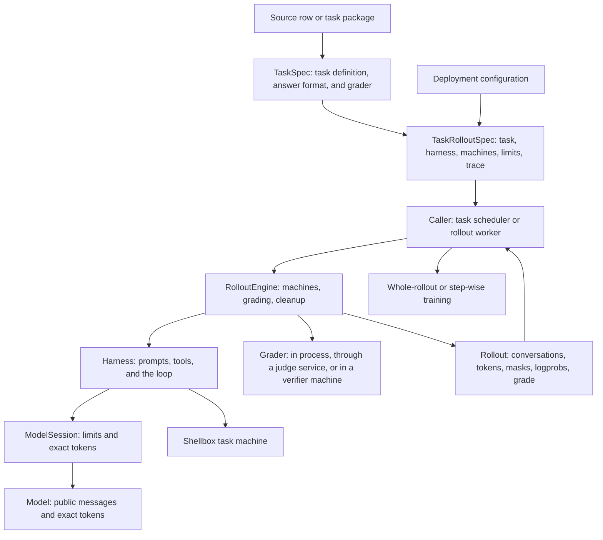
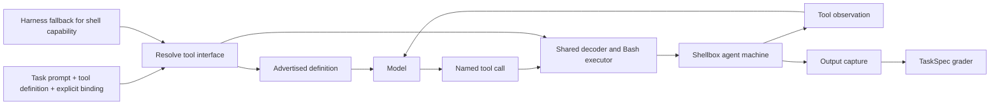

# Task rollouts

`RolloutEngine.run_task(spec, model)` runs and grades one attempt of a single-stage task. It returns a
`GradedRollout`: the `Rollout`, which records what happened, and the `grade`.
The engine holds the machine factories and the harnesses; each run passes the model, the policy under rollout.
The caller owns concurrency, retries, group grading, and training projections.
TaskCompendium defines `TaskSpec`, its graders, and grading outcomes. VerifyIT supplies grading modes and their implementations.
Shellbox supplies machine backends. RolloutEngine supplies the harness contract, the model session that records each model turn, and the built-in harnesses.



## Task and runtime specs

`TaskSpec` contains the task definition: public context, tools, output paths, answer type, answer format, grader, environment requirements, resources, source, and tags.
Its `environment_requirements` includes capabilities, an optional digest-pinned Docker image, workdir, setup commands, environment variables, and named tool-provider contracts.
A `ScriptGrader`, or a `VerifyitGrader` with an environment, declares separate requirements in `grader.environment`.

`TaskRolloutSpec` keeps the task definition unchanged and adds the choices that run it:

| Spec | Fields |
| --- | --- |
| `MachineRuntimeSpec` | `backend`, `network`, `cpus`, `memory_mb`, `storage_mb`, `gpus`, `user`, `startup_timeout`, `cleanup_timeout` |
| `RolloutLimits` | `max_turns`, `max_total_tokens`, `model_turn_timeout`, `tool_turn_timeout`, `total_turn_timeout`, `attempt_timeout`, `verifier_timeout`, `cleanup_timeout` |
| `TaskRolloutSpec` | `task: TaskSpec`, `harness`, `task_machine`, `verifier_machine`, `limits: RolloutLimits`, `trace`, `judge_connection` |

Fields require explicit values except `trace`, which defaults to `TraceMode.EXACT_TOKENS`, and `judge_connection`,
which defaults to `None`. `judge_connection` is a verifyit `JudgeConnection` for a judge grader (see
[Grading](#grading)). It holds an API key, so `model_dump`, `model_dump_json`, and `pickle` leave it out, and a spec
loaded from them has no connection. Optional fields accept `None`. `RolloutLimits.cleanup_timeout` requires a
finite, positive value. Other deadlines accept `None` or a finite, positive value. `max_total_tokens` accepts `None`
or a positive integer.

The engine resolves two registries by key:

| `RolloutEngine` argument | Keyed by | Provides |
| --- | --- | --- |
| `machine_factories` | `MachineRuntimeSpec.backend` | Task and verifier machines |
| `harnesses` | `TaskRolloutSpec.harness` | The `Harness` that runs the model side of the task |

No harness is registered by default. Register the shell harness under the name that your specs use, for
example `RolloutEngine(machine_factories, {"shellbox": ShellHarness(command_timeout=30)})`.
Harness options, such as the shell tool's name and command timeout, belong to the registered harness:
register one harness for each configuration, and select it with `TaskRolloutSpec.harness`.
A machine selection of `None` supplies no machine.
Answer-only tasks can omit the task machine.
A grader with an environment requires a `verifier_machine` selection, except a judge, which grades on the host.
Every other grader requires `verifier_machine=None`.
Each attempt creates a fresh verifier machine from that selection.

`RolloutEngine.check(spec)` rejects a spec before any machine starts, and `run_task` calls it again. It checks the
factory identifiers, the supported requirements, and the machines that engine grading needs: task resources,
and a `file` or `workspace_state` answer that the engine grades, need a task machine. It rejects a graded
`state` task, because the engine does not capture state. Then it calls the harness's own `check(task, limits)`.
The selected factory applies network and hardware settings. Memory is advisory on Local;
preparation omits that allocation because bubblewrap cannot enforce it.

An environment with `docker_image` uses that prebuilt image. The reference must contain a SHA-256 digest.
An environment with `packages_lock` and no image requires a `LocalMachineFactory`.
TaskCompendium downloads the lock and the `environment.json` and `files.tar` stored beside it, if any,
then builds a managed CPython environment with the locked packages, verifyit, and the placed files.
The factory mounts the built root read-only, mounts each placed file at its declared path, sets the
declared variables and puts its Python on `PATH`; attempts share the built runtime but each gets a
fresh sandbox. The selected factory's mounts, executable paths, bubblewrap binary, and hash seed remain in use.
Building the runtime is included in the startup deadline and, for graders, the verifier deadline.
The host needs `uv`, download access for an uncached build, and a working bubblewrap setup.
Grader staging runs as root, so local grading requires a host process running as root.
Local machines reject CPU, storage, and GPU allocations; leave those fields unset and `gpus=0`.

Native environments explicitly declare `CommandSemantics.LINUX_PROCESS`.
`environment.package_spec` selects Python requirements and tools through one shared
`shellbox.PackageSpec`. Bubblewrap installs Python wheels in a cached read-only environment
and uses host tools; Shellsim resolves the same declaration through its Context catalog.
`CommandSemantics.SHELL_SIMULATOR` selects built-in shell and virtual filesystem semantics,
which require `PackageSpec` and a ShellSim factory. Missing native dependencies do not imply simulation.
The default workdir is the image's workdir, or `/workspace` for the built-in filesystem.
An explicit `working_directory` overrides that selection.

Machine setup commands run as trusted root before task operations.
`MachineRuntimeSpec.user` supplies the default user for harness commands.
When the execution user is set, the task machine runs an execution-user probe after root setup and before model inference.
An explicit command user overrides that default.
The verifier machine uses its own configured default user.

## Harnesses

A harness is the agent loop of a task: what the model sees, which tools run, and when the attempt ends.
It implements the `Harness` protocol from `rolloutengine.harness.core`:

- `check(task, limits)` rejects a task that the harness cannot run under the limits. The engine calls it
  before any machine starts.
- `run(context, session)` runs one attempt and returns when the task is done. `HarnessContext` holds the
  task, the attempt's `RolloutLimits`, the prepared task machine or `None`, an event sink, the attempt's
  cleanup scope, and its run ID. The harness calls the model through `session`, a `ModelSession`.

A harness does not grade. After `run` returns, the engine grades the rollout with the task's grader (see
[Grading](#grading)). A harness can attach its own reward to a step with `record(data=...)`. The engine does
not read it.

### Assistant prefills

`PrefillHarness` continues the final assistant text in `ConversationInput.events` once. Register it
and select it explicitly with `TaskRolloutSpec.harness`:

```python
from rolloutengine.harness.prefill import PrefillHarness

engine = RolloutEngine({}, {"prefill": PrefillHarness()})
spec = TaskRolloutSpec(
    task=task, harness="prefill", limits=limits, task_machine=None, verifier_machine=None
)
```

The task must use a plain-text conversation answer. The harness keeps the assistant prefix last and
sets `extra_body.continue_final_message=True` and `extra_body.add_generation_prompt=False`. The transport
must support these rendering options. Ordinary chat rendering does not infer continuation from the last
message's role.

Final tool schemas can condition the continuation. Interactive tools, tool providers and agent
capabilities are rejected during preflight. The grader can have its own verifier environment and private
resources. The model must return the continuation as assistant text: parsed reasoning or tool-call
channels make the attempt invalid, so parser behavior cannot silently turn a continuation into a normal
zero reward. Structural-closure grading concatenates its fixed text prefix with this continuation and
scores the first completed outer structure.

The selected model tokenizes the conversation and prefill. Training records its actual prompt and sampled
response tokens with their logprobs through the normal model session. Historical token IDs do not constrain
the task. Backends can use `TraceMode.MESSAGES` when only text and usage are available.

### Model session

A harness calls the model through its `ModelSession`, which records the exact tokens and applies the turn
and token limits:

- `start(prompt)` starts a new conversation with a `Prompt`: public messages, model options, and optionally
  exact prompt `token_ids`. It returns the model's turn. A later `start` starts another conversation, for
  example after the harness makes its history shorter or changes its tools. The rollout keeps each
  conversation as a `ConversationRecord`, and the task machine does not reset.
- `reply(observations, *, token_ids=None)` sends new messages after the model's last message and returns the
  next turn. `token_ids` pins the exact tokens of the next prompt.
- `record(*, observations=(), data=None, metrics=None)` adds to the step of the last turn, between model
  requests: final observations that the model never receives, the harness's data, and metrics. A turn with
  recorded observations takes no `reply`.

The session applies these rules:

- One request can be open at a time. A second one raises `RuntimeError`.
- The record holds the assistant message that the model returns. A harness can parse it, but must not change it.
- A request changes the record only when the model answers or fails. A request that is cancelled while the
  model generates changes nothing, so the harness can send it again. If the attempt ends first, the record
  keeps the request without an answer, unless the harness records final observations after it.
- After a limit ends the attempt, the next `start` or `reply` raises `LimitReached` with the stop reason. A
  failed model request, or a turn that breaks the token contract, raises `RolloutEnded` with the error as its
  cause. The harness lets both propagate. For a token-contract violation, the engine then raises
  `RolloutContractError`. A harness that catches a refusal and asks again gets the same refusal, until a turn
  or attempt deadline stops it. After the attempt deadline, each request raises `CancelledError`, also in a
  harness that caught the first cancellation. After a refusal, `record(data=..., metrics=...)` still adds to the
  step of the last turn until the record is final, for example to attach a final reward. If no turn exists,
  `record` raises the refusal again, so the refusal stays the outcome of the attempt.
- The record is final when `run` returns or raises, or when a turn or attempt deadline expires. The session
  then cancels a model call that is still open, for example in an agent's HTTP handler, and ignores its result.
  Thus the grader and the returned rollout see the same record.

### Cleanup

`HarnessContext.cleanup.push(name, close)` registers a coroutine function that closes a resource of the
harness, for example a tool session. The closes run after grading, in reverse order, before the machines
close. Each close has `RolloutLimits.cleanup_timeout`. A failure becomes a cleanup error and does not change
the record or the grade.

### Run a harness alone

`harness_rollout(harness, task, model, *, limits, machine=None, trace=TraceMode.EXACT_TOKENS, events=NO_EVENTS,
run_id=None)` from `rolloutengine.recorder` runs one harness on one task with one model, without the engine. It
starts no machine and does not grade. The turn limits and `total_turn_timeout` apply. The harness's closes run
at the end, and `Rollout.metrics["cleanup_error_count"]` counts the closes that failed. An attempt that fails
raises `RolloutInterrupted` with the rollout so far.

`task_machine(task, factory, runtime, *, cleanup_timeout)` from `rolloutengine.machines` starts a machine for a
task: it installs the task's resources and runs its setup commands. The machine closes when the `async with`
block ends:

```python
async with task_machine(task, factory, runtime, cleanup_timeout=30) as machine:
    rollout = await harness_rollout(ShellHarness(command_timeout=30), task, model, machine=machine, limits=limits)
```

### Step harness

`StepHarness(open_episode)` from `rolloutengine.harness.step` runs an `Episode`, a step-style loop, and accepts every
task. `open_episode(context)` starts one episode for each attempt. An episode class whose constructor takes the
context can be `open_episode`:

1. `prepare()` returns the first `Prompt`. The harness calls `start` with it.
2. `advance(turn)` runs the turn's operations and returns a `Transition`. If the transition is not done, the
   harness calls `reply` with its observations and token IDs.
3. `close()` releases the episode's resources in the attempt's cleanup.

A `Transition` has these fields:

- `done` ends the attempt after this turn. The observations of a done transition are recorded but not sent.
- `observations` are the new messages of the next request, and `token_ids` can pin its exact prompt tokens.
- `metrics` holds the step's metrics. `Rollout.metrics` starts from the last step's metrics.
- `data` is the harness's own record of the step, for example the rewards that a trainer reads. The engine
  keeps it in `RolloutStep.transition` and does not read it. Per-token values must have one entry for each
  token in `step.turn.response_token_ids`. `RolloutStep.response_end` is the index of the turn's last response
  token in the conversation's `response_token_ids`.

### Agent harness

`AgentHarness(agent)` from `rolloutengine.harness.external` runs an agent that owns its prompts and tool loop,
for example an installed agent behind an HTTP proxy. `agent(context, complete)` sends one `Prompt` at a time to
`complete` and receives the exact `ModelTurn`:

```python
from rolloutengine.engine import RolloutEngine
from rolloutengine.harness.external import AgentHarness
from rolloutengine.models import Prompt


async def run_agent(context, complete):
    turn = await complete(Prompt(({"role": "user", "content": "Fix the failing test."},), {}))
    ...

engine = RolloutEngine(machine_factories, {"agent": AgentHarness(run_agent)})
```

`complete` obeys these rules:

- A prompt that extends the last prompt with the model's message, under the same options, is a `reply`. Its
  `token_ids`, if any, pin the next request. Any other prompt starts a new conversation.
- The agent can call `complete` from other tasks, such as HTTP handlers. One model request can be open at a
  time: a call that needs the model while another call waits for it raises `RuntimeError`.
- The last prompt again, for example after the HTTP client lost the response, gets the same turn without a new
  generation. A call that is cancelled while the model generates loses that generation, and a retry generates
  again.
- When the attempt ends, each call waits until the cleanup, after grading. Thus a waiting agent does not change
  the task machine during grading. The cleanup then cancels the agent, and the waiting calls in tasks that the
  agent does not await, such as HTTP handlers, raise `RolloutEnded`.
- When it is cancelled, the agent must release its own subprocesses and network resources and stop within
  `cleanup_timeout`. An agent that does not stop in that time is a cleanup error, and the machines close.
- An agent that fails while the attempt runs ends only its own attempt: `run_task` raises
  `GradedRolloutInterrupted` with the record so far. A failure after the attempt ends, for example during
  grading, is a cleanup error.
- `check` rejects a task that declares tools other than a shell binding: final tools, the
  `submit_answer` tool of an `AnswerCall` task, other interaction tools, and tool providers. The agent harness
  does not give these tools to the agent. An agent that serves them needs its own harness, whose `run` can call this harness's `run`.

### Shell harness

`ShellHarness(*, command_timeout, shell_tool=ShellToolConfig(), tools={})` from `rolloutengine.harness.shell` serves a
shell tool on the task machine and host tools from tool providers, and ends on a final response.
`command_timeout` must be `None` or positive and finite.
The shell harness exposes `shell(command: string)` when the task declares the shell capability.
Each command runs through `bash -c`. Files persist between commands; shell variables do not.
TaskSpec can own the shell interface when its prompt names a particular tool. Declare the
function in `interaction_tools` and bind it explicitly:

```python
interaction_tools=(FunctionDefinition(
    name="Bash",
    parameters={"type": "object", "properties": {"script": {"type": "string"}},
                "required": ["script"], "additionalProperties": False},
),),
tool_bindings={"Bash": ShellToolBinding(command_parameter="script")},
```

The shell harness preserves that definition and prompt. It supports one shell binding
with one required, unconstrained string argument; unsupported schemas fail before machine
acquisition. Tool names alone never select an executor. Other interaction tools and
provider contracts require a registered tool provider or another harness.

### Tool providers

A tool provider serves host tools for one action interface. Register providers with the shell harness,
`ShellHarness(command_timeout=30, tools={"checker:v1": provider})`; the key matches
`ProviderRequirement.action_interface` in `environment_requirements.tool_providers`.
No provider is registered by default.

```python
from rolloutengine.harness.shell import ToolCallResult, ToolContext


class Checker:
    def tools(self, requirement):
        return (CHECK,)  # FunctionDefinitions advertised to the model

    async def open(self, context: ToolContext) -> "CheckSession":
        return CheckSession(context.machine, dict(context.requirement.initial_state))


class CheckSession:
    def __init__(self, machine, state):
        self.machine, self.state = machine, state

    async def call(self, name, arguments) -> ToolCallResult:
        result = await self.machine.run(Command(("cat", arguments["path"])))
        return ToolCallResult(result.stdout.decode(), done=True)

    async def close(self) -> None:
        pass
```

The shell harness advertises each provider's tools after the shell tool and runs a turn's calls in order.
It serves the shell tool itself as a `ToolProviderSession` that runs commands on the task machine, so every tool
call goes through the same interface: the harness looks up the call's name among the shell and provider tools.
A call that names no advertised tool returns the observation `{"error": "Unknown tool: <name>"}`.
When the harness starts, it opens one `ToolProviderSession` per requirement with a `ToolContext`: the task machine,
or `None` for a task without one, and the task's `ProviderRequirement`, including its `initial_state`.
Attempts never share a provider session, so provider state cannot leak between rollouts; each session closes
in the attempt's cleanup. `ToolCallResult.content` becomes the tool observation verbatim; it is text, as in a chat tool message, and providers usually encode JSON in it.
`done=True` ends the rollout after the current call, like a final tool; grading follows.
Non-object arguments return the JSON error observation that shell calls use; the provider validates the rest.
A provider-only task needs no task machine.

The shell harness's check rejects these tasks before machine acquisition:

- a provider requirement whose action interface has no registered provider;
- a provider tool whose name matches the shell tool, a final tool, the answer tool, or another provider tool;
- an interaction tool that neither the shell binding nor a provider serves, or that differs from the provider's definition.

A task can declare a provider's tool in `interaction_tools` to fix its definition; the shell harness advertises it once.

For tasks that declare only the shell capability, the harness supplies the interface.
Pass `shell_tool=ShellToolConfig(name="terminal", command_parameter="cmd")` to `ShellHarness`
to advertise `terminal(cmd)`. Import `ShellToolConfig` from `taskcompendium.runtime.shell`;
curation's `ShellFactory` accepts the same option. An explicit task binding takes precedence.
Collisions with final-answer tools are rejected before machine acquisition.



RolloutEngine and curation share call decoding, execution, and JSON observations: stdout,
stderr, exit code, reason, and separate stdout/stderr truncation flags. Each stream holds at most
the machine output limit, 1 MiB in RolloutEngine; output past it is lost, and its truncation flag is set.
The engine does not keep the rest: a model that expects long output redirects it to a file in the
workspace and reads it with later commands, and a harness that wants a safety net provides one. The harness
advertises the tools its environment supplies. Trajectories retain the chosen names and call
IDs. Graders consume the resulting submission independently of the tool interface.

The model receives only public context, answer-format instructions, tool definitions, and task observations.
The serialized task and `TaskRolloutSpec` contain the grader and verifier resources. Do not send them to the model.
Oracle resources contain control inputs for task-curation checks. They do not enter a rollout.

## Run outputs

After the harness ends and before grading, the engine captures the regular files under `TaskSpec.output_paths`
from the task machine once, for every grader kind.
`Rollout.outputs` maps each absolute file path to its bytes. Files outside `output_paths` are not returned.
A task without a task machine or without output paths returns an empty mapping.
Capture uses the budgets of `taskcompendium.runtime.output_capture`: at most 1,024 files and 16 MiB in total.
The task's grader grades this capture without downloading the files again.

Capture runs inside the verifier deadline, as part of the final grading phase.
A capture failure or expired deadline raises `RolloutInterrupted` with operation `grade`.
A record interrupted before capture, during startup, during the harness, or at an attempt deadline that expires before capture completes, has empty `outputs`.
A record interrupted after capture, by a grading failure, a model failure, or an attempt deadline that expires during grading, retains `outputs`.
Attempts that end before the first model response are not graded and have empty `outputs`.

## Grader files

When the grader has an environment, and it is not a judge, the engine stages grading inputs on the verifier machine after the harness ends.
The verifier machine receives verifier resources under `/tests`, `resources.all`, `resources.worker`, captured `output_paths`, and the extracted answer.
A `ScriptGrader`'s collect commands run as root on the task machine, then its artifacts are copied from the task machine.
Collect commands and artifacts require a task machine.
Artifacts specify a source, target, kind, exclusions, and missing-file policy.
Directory exclusions use `tar --exclude` on the task machine.
Artifact inspection and archive creation use the task machine's default command user.
RolloutEngine configures this as the agent's execution user.
Artifact collection requires `sh`, `tar`, and a writable `/tmp` on the task machine.
Source inspection rejects symlinks in the source path and its ancestors.
Archive extraction rejects included symlink and hardlink members.
A root-owned temporary directory that the non-root agent cannot modify prevents archive-path replacement.
Source inspection does not provide an atomic filesystem snapshot.
Expanded contents have a 1 GiB limit, with at most 100,000 members.
These checks run after download and do not limit transfer buffers or downloaded bytes.
Invalid artifacts and missing required artifacts give `SUBMISSION_FAILURE` with reward zero.
Archive command failures, archive timeouts, and provider or host I/O failures remain infrastructure errors.

## Rollout events

`RolloutEngine(machine_factories, harnesses, observer=observer)` reports progress while an attempt runs.
The observer implements `async def on_event(self, event: RolloutEvent) -> None`.
A `RolloutEvent` carries the attempt's `run_id`, the task's `task_id`, and a `payload`.
`run_task(spec, model, run_id=...)` sets the run ID. Without one, each attempt gets a new random ID, so the events
of repeated attempts of a task stay apart. `Rollout.run_id` returns the ID, so a caller can match a rollout with
its events.
Each payload is a frozen dataclass from `rolloutengine.models` whose `type` field is a `RolloutEventType`, so a payload serialized with `dataclasses.asdict` keeps its type.
Durations are wall-clock seconds.

| Payload | Emitted | Fields |
| --- | --- | --- |
| `AttemptStarted` | After validation, before machine acquisition | |
| `MachineReady` | After task-machine setup; not emitted without a task machine | `duration` |
| `ConversationStarted` | When the session records the first request of a conversation: the model answered or failed, or the harness ended | the request's `messages` and `options`; `duration` from the start of the harness, or from the last model turn, to the request |
| `ModelTurnCompleted` | After a model turn passes the token checks | `turn_index`, assistant `message`, `stop_reason`, prompt and response token counts (as reported and unchecked under `TraceMode.MESSAGES`), `usage`, `ModelTurn.metadata`, `duration` |
| `ToolCallCompleted` | By a harness, per tool call that returns an observation | `call_id`, `name`, `observation_bytes`, `done`, `duration` |
| `TransitionCompleted` | When the session records what followed a turn: the harness's next request, a refusal at a limit, or the end of the harness | `turn_index`, `done`, `observations`; `duration` from the turn to the next request or the end |
| `Graded` | After grading returns | `status`, `reward`, `error`, `failure`, `duration` of output capture and grading |
| `AttemptEnded` | After cleanup, when `run_task()` returns or raises `RolloutInterrupted` | `stop_reason`, or the interrupted `operation` and its `error`; `duration` of the whole attempt |

The engine's events carry the conversations: `ConversationStarted` the first request of each conversation,
then for each turn `ModelTurnCompleted` the assistant message and `TransitionCompleted` the observations, so an
observer can follow the transcript for any harness. The events agree with the record: a request that is
cancelled and sent again gives one event. `ToolCallCompleted` carries per-call timing and outcome. Its
observation is the `TransitionCompleted` message with the same `tool_call_id`. Event fields are the record's
own messages, so an observer must not change them.

Harnesses emit their own payloads through `HarnessContext.events`, an `EventSink` whose `emit` never blocks.
The shell harness emits `ToolCallCompleted`.
Delivery is in order and never blocks the attempt. When 1,024 events of an attempt wait for delivery, the attempt drops new events.
After the machines close, the engine delivers the remaining events within `cleanup_timeout`.
An observer exception is logged and ends delivery for that attempt.
Neither a slow nor a failing observer changes the rollout's record, grade, or deadlines.
`Rollout.metrics` counts events the observer did not receive: `observer_dropped_events`, `observer_undelivered_events` and `observer_error_count` appear only when nonzero.
Events still queued when the process dies are lost.
Concurrent attempts deliver to a shared observer concurrently.
No end event is emitted when a token-contract error or cancellation propagates.

## Deadlines and failures

| Field | Boundary |
| --- | --- |
| Machine `startup_timeout` | Machine creation, resource upload, setup commands, and the explicit execution-user probe |
| `model_turn_timeout` | One model request |
| `ShellHarness(command_timeout=...)` | Each shell-tool command, including separate calls within one model turn |
| `tool_turn_timeout` | The time from a model turn to the harness's next request or its end, including its tool operations; a cancelled request starts it again |
| `total_turn_timeout` | The time from the harness's first request to its end, across all turns in one attempt |
| `attempt_timeout` | Task startup, the harness, and final verification |
| `verifier_timeout` | Output capture and the full `grade` call, including separate verifier startup and artifact transfer |
| `RolloutLimits.cleanup_timeout` | Each cleanup action, outside the attempt deadline |
| Machine `cleanup_timeout` | Optional override for that machine's cleanup action |

The total-turn deadline excludes startup, the harness's work before its first request, and final verification.
Its expiration cancels the harness and starts grading with `stop_reason="total_turn_timeout"`.
No model response means `grade.status=Outcome.UNAVAILABLE` and `grade.reward=None`.
Backend command limits also stop commands that outlive an enclosing coroutine deadline.
The command limit is separate from the tool-turn deadline.
When these limits are finite, the shell harness's check requires the command limit to be less than the tool-turn deadline.
Configure the tool-turn deadline to allow the commands and backend cleanup within that turn.
A timed-out shell command returns a `timed_out` tool observation. The model can continue the task.
Expiration of the tool-turn deadline interrupts the harness with operation `advance`.

`max_total_tokens` sets a threshold for stopping model requests in one attempt.
Each request charges its prompt tokens plus its response tokens. The prompt includes the served prefix of
earlier turns, so a request charges the full prefix again; a new conversation does not clear the total.
If the model callable sets `ModelTurn.usage` (`TokenUsage(prompt_tokens, completion_tokens)`), the engine
charges those counts. Otherwise it charges `len(prompt_token_ids) + len(response_token_ids)`.
Without a new conversation, the next prompt holds at least the previous request's prompt and response.
After each response, the session refuses the next request when the tokens spent plus that request's count reach
`max_total_tokens`. The new observations of the next request are not in that count, so the last request sent
can exceed the budget by its observation and response tokens.
The harness handles the last response; its next request raises `LimitReached`, and the engine grades with
`stop_reason="budget_reached"`. The budget takes precedence when that request also uses the last permitted turn.
With a budget set, a turn that reports neither `usage` nor prompt token IDs, which `TraceMode.MESSAGES` allows,
raises `RolloutContractError` rather than charging nothing.
Final grading receives the conversation through the last response, without its observations.

`RolloutInterrupted` retains the failed operation, served token evidence, and original exception cause.
Its `rollout` field contains the retained record. Its `operation` field identifies the failed operation:
`prepare` when the harness failed or returned before its first model turn, and `advance` after one. A limit that
stops the attempt before its first turn is not a failure. `harness_rollout` raises
`RolloutInterrupted`. `run_task` raises its subclass `GradedRolloutInterrupted`, whose `grade` field contains the
grade of the completed turns, or an unavailable grade when the attempt stopped before grading.
Startup failures retain an empty record.
A model failure after a completed turn triggers grading of the completed state.
If that grading fails, the operation stays `model`, and a note on the model error names the grading failure.
A turn that the harness did not finish handling retains a terminal step with `metrics["advance_incomplete"] = 1.0`
(`ADVANCE_INCOMPLETE`). Training callers must exclude that step from their training projections.
`RolloutInterrupted.rollout.failure` names the exception type. Its `diagnostics` hold the `operation`, the first
2,000 characters of the message as `error`, and the `notes`. Pickle keeps the `rollout`, `operation`, and `grade`.
Token-contract failures propagate as `RolloutContractError`.
External cancellation remains cancellation. An `AgentHarness` agent that ends with a `CancelledError` before the
engine stops it fails its attempt.

Cleanup errors preserve a completed grade or the original execution failure.
`grade.diagnostics.cleanup_errors` contains cleanup operation names and exception types.
`metrics.cleanup_error_count` contains their count.
At its deadline, the engine cancels a cleanup action and records a cleanup error.
An action that does not stop at once ends in the background.
A machine whose creation finishes after the attempt ended is closed in the background.
A failure of this background work appears only in the log.

## Grading

Grading receives the stop reason, including turn and token-limit endings.
The engine carries that reason in `GradingAttempt.stop_reason`; sandboxed graders
can read `TASKCOMPENDIUM_STOP_REASON`. The reason is context, not a prerequisite for grading.
A reasoning-only final response becomes an empty answer in grading evidence; the raw provider
response remains in the rollout. Existing file submissions are still captured and graded.

The engine grades by grader kind:

| Grader | Grading |
| --- | --- |
| `VerifyitGrader` without an environment | `taskcompendium.grading.grade_answer` on the host, in a worker thread |
| `VerifyitGrader` with an environment | `taskcompendium.runtime.grading.grade_in_sandbox` runs the verifyit command on the verifier machine |
| `VerifyitGrader` with a judge mode (`JudgeSpec`) | `taskcompendium.grading.grade_remote_judge_answer` on the host, in a worker thread, through the judge service |
| `ScriptGrader` | `grade_in_sandbox` runs the grader command on the verifier machine |
| `NoGrader` | `GradeResult(Outcome.UNAVAILABLE, None, reason)` |

A judge grades on the host even when its grader declares an environment, so it uses no verifier machine. It calls
the service of `TaskRolloutSpec.judge_connection`, or else of `VERIFYIT_JUDGE_BASE_URL` with the key in
`VERIFYIT_JUDGE_API_KEY`. The judge model is `JudgeSpec.model`, or else `VERIFYIT_JUDGE_MODEL`. The judge reads only
the conversation. Each judge request has `JudgeSpec.request_timeout`, 120 s by default, and for every rubric except
labels the OpenAI client retries a failed request up to two times. The verifier deadline stops only the engine's
wait: the judge call continues in its worker thread until it ends
([#10246](https://github.com/marin-community/marin/issues/10246)). `check` rejects a judge task with a verifier
machine, a judge task whose answer is not in the conversation, such as a file, a judge task with no connection when
`VERIFYIT_JUDGE_BASE_URL` is not set, and a judge task with no model.

Group grading belongs to the caller.

The task's answer format extracts text, number, JSON, and final-action submissions from the final conversation.
A malformed submission receives `Outcome.SUBMISSION_FAILURE` with reward 0.
File submissions use captured workspace files.
The engine does not capture state, so `check` rejects a graded `state` task for every harness.
A `VerifyitGrader` with an environment cannot grade a `native_action` answer.

A `ScriptGrader` declares a command, collect commands, artifacts, an answer path, a conversation path, and a reward source.
The verifier machine receives the extracted answer at `answer_path`.
It receives the conversation as OpenAI-style chat-message JSON at `conversation_path`, by default `/tests/conversation.json`.
The verifier deadline controls the full grading phase.

| Reward source | Result | Origin / reason |
| --- | --- | --- |
| `StdoutReward` | Zero exit code and one finite number on standard output | Marin API choice: simple graders without reward files |
| `ExitCodeReward` | Reward 1 for zero exit code, otherwise reward 0 | Marin API choice: pass/fail shell checks |
| `FileReward` | The first existing file supplies the scalar grade | Verifiers that write reward files |

`FileReward` accepts a number or a JSON object with the configured numeric key.
A JSON object's `detail` object becomes the grade detail.
A malformed first file is a grading failure. Grading does not try a lower-priority file.
The optional `pass_above` threshold supplies a separate pass/fail result.
Grading removes existing reward files before the grader command executes.
A valid reward file can supply a grade after a nonzero exit code. A command timeout has no grade.

`GradeResult.failure` identifies timeout, execution failure, missing reward, empty reward, or invalid reward.
An incorrect answer receives a numeric grade. A grading failure has no reward.
Score bounds describe the grader's native range.

Script grading requires a separate machine: a sandbox of a prebuilt, digest-pinned grader image, or a local machine whose host builds the grader's packages lock.
Shellbox's generic image-builder API remains available outside this task path.
SWE tasks require prebuilt images and initialize `refs/taskcompendium/base` before inference.
Patch collection compares the final index with that revision, including agent commits and new files.

## Exact-token contract

The model callable accepts `ModelRequest` and returns `ModelTurn` with a parsed assistant message and exact served token IDs.
`ModelRequest.messages` contains public messages. After the first turn, `ModelRequest.continuation` holds the
earlier served tokens, which the next prompt must keep unchanged, and the index of the assistant message where
they end. The transport tokenizes only the messages after that index and appends their tokens.
If `Prompt.token_ids` or the `token_ids` of `reply` is set, `ModelRequest.prompt_token_ids` carries that exact
prompt to the model transport, and the request has no continuation. The returned turn must report the same
prompt tokens. Under `TraceMode.EXACT_TOKENS`, the pinned tokens of a `reply` must start with the served
tokens. If they do not, the session sends no request, and the engine raises `RolloutContractError`.
`ModelTurn.prompt_token_ids` contains the exact prompt sent to inference. `response_token_ids` contains the sampled response.
Optional log probabilities align with response tokens.
A continuation prompt preserves the full served prefix, including earlier response tokens.
The engine rejects changed prefixes, empty response evidence, and misaligned log probabilities.

`Rollout` contains the run ID, the conversations, the stop reason, metrics, and run outputs. Each
`ConversationRecord` holds its chat, token IDs, loss mask, optional log probabilities, and per-step records.
`GradedRollout` pairs the rollout with the grade.
`prompt_token_ids` contains the conversation's first prompt. `response_token_ids` contains subsequent model responses and intervening observation tokens.
The loss mask and log probabilities align with `response_token_ids`, which excludes the initial prompt.
Model tokens have loss mask 1. Observation tokens have mask 0 and log probability 0.
The caller applies its training and failure policies when it projects the record.
Each `start` begins a new `ConversationRecord` with a fresh prefix check. The rollout keeps the earlier
conversations, and the trainer selects what to train on. Final grading receives the last conversation that
has a model turn.

`GenerationLimitReached` retains rendered prompt tokens when the model cannot start another response.
The engine grades completed state with stop reason `length`.
It does not add an oversized observation to retained response evidence.

## Trace modes

`TaskRolloutSpec.trace` selects the evidence that the engine records.
`TraceMode.EXACT_TOKENS`, the default, enforces the exact-token contract above.
`TraceMode.MESSAGES` lets a model behind a chat endpoint drive a rollout for evaluation, task validation, or data collection.
Chat endpoints re-tokenize the conversation for every request, so the exact-token contract cannot hold there:
on GLM-5.3 behind the Orion router, 2 of 7 recorded 7-turn ShellSim rollouts failed it on a single non-canonical sampled token.
The engine sends no `continuation` and skips the prefix, token-evidence, and log-probability checks.
It still checks token replay: a chat endpoint cannot serve `Prompt.token_ids` or the `token_ids` of `reply`,
so a `MESSAGES` rollout whose harness pins prompt tokens raises `RolloutContractError`
unless the model reports serving exactly those tokens.
A model may return a `ModelTurn` with empty token fields and `logprobs=None`.
The engine keeps the token IDs a model does report: each `ConversationRecord.prompt_token_ids` is its first prompt,
`response_token_ids` is the last served sequence after it, and both are informational only.
The loss mask is all zeros with one value per response token, and `logprobs` is `None`.
Every `MESSAGES` record, including an empty or interrupted one, carries `metrics["trace"] = "messages"`.
Messages, steps, stop reasons, and grades are unchanged.
Do not train on `MESSAGES` rollouts; reject records that carry the `trace` metric.

## Run an agent

A managed agent is one `run_task` call. A registered harness is the agent program, the model is its endpoint, and
the task holds the work. A task with `NoGrader` gets an unavailable grade. An `AgentHarness` program reads
`context.limits`.

`ChatModel` from `rolloutengine.chat` serves an OpenAI-compatible chat endpoint and needs
`trace=TraceMode.MESSAGES`. Prompt options replace its `max_tokens` and its `extra_body` keys.
It sets `model`, `messages`, `stream`, and `n` itself. A response without `usage` is a model failure.

```python
engine = RolloutEngine({}, {"agent": ShellHarness(command_timeout=None, tools={"lookup/v1": lookup})})
spec = TaskRolloutSpec(
    task=task, harness="agent", task_machine=None, verifier_machine=None, limits=limits, trace=TraceMode.MESSAGES
)
async with openai.AsyncOpenAI(base_url=base_url, api_key=api_key) as client:
    result = await engine.run_task(spec, ChatModel(client, "glm-5.3", max_tokens=32_768))
```

For many agents, run the attempts in an `asyncio.TaskGroup` with a `Semaphore`. In each attempt, catch
`GradedRolloutInterrupted` and keep `GradedRollout(interrupted.rollout, interrupted.grade)`: its
`rollout.failure` holds the error message. An exception that the engine does not keep in one attempt, such as
`RolloutContractError`, cancels the group. Across processes, each Zephyr worker makes its own engine, model, and
judge connection.

## Use

The task's `answer_format` controls final-answer extraction and model-visible submission instructions.
`rolloutengine.harness.shell.task_prompt(task, shell_tool, provider_tools)` renders the first prompt: the public messages, with the format's instruction and tools for text, number, JSON, and native-action answers.

Construct a `TaskRolloutSpec`, and check it with `RolloutEngine.check` before you start a batch. The
[rollout tests](https://github.com/marin-community/marin/blob/main/lib/rolloutengine/tests/test_rollout.py) contain executable examples.
One engine serves every attempt; each run passes its model:

```python
from rolloutengine.engine import RolloutEngine
from rolloutengine.harness.shell import ShellHarness
from rolloutengine.models import GradedRollout, Model, TaskRolloutSpec
from shellbox.backends.docker.machine import DockerMachineFactory
from shellbox.backends.shellsim.machine import ShellSimMachineFactory

engine = RolloutEngine(
    {"docker": DockerMachineFactory(), "shellsim": ShellSimMachineFactory()},
    {"shellbox": ShellHarness(command_timeout=30)},
)


async def run_task(spec: TaskRolloutSpec, model: Model) -> GradedRollout:
    return await engine.run_task(spec, model)
```

From the Marin repository root, with the test environment installed:

```bash
task_test_prefix=$(mktemp -d -t taskcompendium-tests.XXXXXX)
MARIN_PREFIX="$task_test_prefix" uv run --frozen --no-sync pytest lib/taskcompendium/tests -q -n 0
uv run --package marin-rolloutengine --frozen --group test pytest lib/rolloutengine/tests -q
```

CPU tests use ShellSim and model or HTTP fixtures. A live GPU run and a real container backend require separate validation.

The local curation-to-rollout check runs QUICK conversion, reloads TaskSpecs from Parquet,
and grades scripted correct and incorrect answers in bubblewrap:

```bash
uv run --no-sync pytest experiments/post_training/task_curation/tests/test_rollout_e2e.py \
  -m manual -n 0 -o asyncio_mode=auto
```

It uses the prepared repository environment (including Verifyit, pytest and typer) in place of
source images. It exercises conversion, tool bindings, capture and grading; it does not build
images or test inference transport. The host must permit bubblewrap namespaces and the
agent/grader user separation. It runs locally until that requirement is established in CI.
