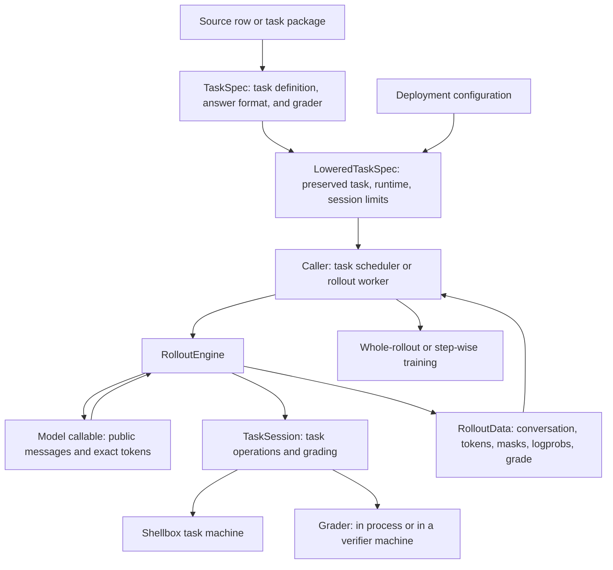
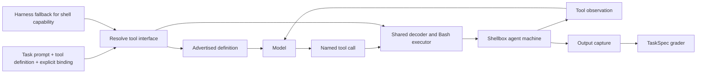

# Task rollouts

`RolloutEngine.run(lowered)` executes one single-stage task and returns `RolloutData`.
The caller supplies the model callable, configured Shellbox factories, and optional task-session factories.
The caller owns concurrency, retries, group grading, and training projections.
TaskCompendium defines `TaskSpec`, its graders, and grading outcomes. VerifyIT supplies grading modes and their implementations.
Shellbox supplies machine backends. RolloutEngine supplies the execution loop and session interface.



## Task and runtime specs

`TaskSpec` contains the task definition: public context, tools, output paths, answer type, answer format, grader, environment requirements, resources, source, and tags.
Its `environment_requirements` includes capabilities, an optional digest-pinned Docker image, workdir, setup commands, environment variables, and named tool-provider contracts.
A `ScriptGrader`, or a `VerifyitGrader` with an environment, declares separate requirements in `grader.environment`.

Lowering preserves the task definition and adds these deployment settings:

| Spec | Fields |
| --- | --- |
| `MachineRuntimeSpec` | `backend`, `network`, `cpus`, `memory_mb`, `storage_mb`, `gpus`, `user`, `startup_timeout`, `cleanup_timeout` |
| `TaskRuntimeSpec` | Optional `task_machine` and `verifier_machine` selections |
| `TaskSessionSpec` | `task_session`, `shell_tool`, `max_turns`, `model_turn_timeout`, `command_timeout`, `tool_turn_timeout`, `total_turn_timeout`, `attempt_timeout`, `verifier_timeout`, `cleanup_timeout` |
| `LoweredTaskSpec` | `task: TaskSpec`, `runtime: TaskRuntimeSpec`, `session: TaskSessionSpec` |

`rolloutengine.lowering.lower_task(task, runtime, session, factories=..., sessions=..., providers=...)` constructs and validates the lowered record.
The engine validates a directly constructed `LoweredTaskSpec` before execution.

Runtime fields require explicit values except `shell_tool`, which defaults to `shell(command)`.
Optional fields accept `None`.
`TaskSessionSpec.cleanup_timeout` requires a finite, positive value.
Other deadlines accept `None` or a finite, positive value.

`backend` identifies a factory in the engine's `factories` mapping.
`task_session` identifies a factory in its `sessions` mapping.
The reserved session identifier `shellbox` selects the built-in shell-tool session.
Each entry in `sessions` is a callable that receives a `TaskSessionContext` and
constructs a fresh session for each attempt.
Its `lowered` and `machine` fields describe that attempt. `task_grader` applies the task's
`TaskSpec` grader, or is `None` for a `SessionGrader` task that grades itself.
Sessions that delegate grading call `context.require_task_grader()`; self-grading sessions need no task grader.
A class whose constructor accepts `TaskSessionContext` can be registered directly:

```python
from rolloutengine.engine import RolloutEngine

engine = RolloutEngine(model, factories, sessions={"custom": CustomSession})
```

`CustomSession` implements the `TaskSession` protocol through its methods; no base class is required.
A machine selection of `None` supplies no machine.
Answer-only tasks can omit the task machine.
A grader with an environment requires a `verifier_machine` selection. Every other grader requires `verifier_machine=None`.
Each attempt creates a fresh verifier machine from that selection.

The engine validates factory identifiers and supported requirements before machine acquisition.
The selected factory applies network and hardware settings. Memory is advisory on Local;
preparation omits that allocation because bubblewrap cannot enforce it.

An environment with `docker_image` uses that prebuilt image. The reference must contain a SHA-256 digest.
An environment with `packages_lock` and no image requires a `LocalMachineFactory`.
TaskCompendium downloads the lock and the `environment.json` and `files.tar` stored beside it, if any,
then builds a managed CPython environment with the locked packages, verifyit, and the placed files.
The factory mounts the built root read-only, mounts each placed file at its declared path, sets the
declared variables and puts its Python on `PATH`; attempts share the built runtime but each gets a
fresh sandbox. The selected factory's mounts, executable paths, bubblewrap binary, and hash seed remain in use.
Building the runtime is included in the startup deadline and, for graders, the verifier deadline.
The host needs `uv`, download access for an uncached build, and a working bubblewrap setup.
Grader staging runs as root, so local grading requires a host process running as root.
Local machines reject CPU, storage, and GPU allocations; leave those fields unset and `gpus=0`.

Native environments explicitly declare `CommandSemantics.LINUX_PROCESS`.
`environment.package_spec` selects Python requirements and tools through one shared
`shellbox.PackageSpec`. Bubblewrap installs Python wheels in a cached read-only environment
and uses host tools; Shellsim resolves the same declaration through its Context catalog.
`CommandSemantics.SHELL_SIMULATOR` selects built-in shell and virtual filesystem semantics,
which require `PackageSpec` and a ShellSim factory. Missing native dependencies do not imply simulation.
The default workdir is the image's workdir, or `/workspace` for the built-in filesystem.
An explicit `working_directory` overrides that selection.

Machine setup commands run as trusted root before task operations.
`MachineRuntimeSpec.user` supplies the default user for session commands.
When the execution user is set, the task machine runs an execution-user probe after root setup and before model inference.
An explicit command user overrides that default.
The verifier machine uses its own configured default user.

## Session lifecycle

The engine installs `resources.all` and `resources.worker` on the task machine before session preparation.
It calls these session methods:

1. `prepare()` returns `SessionStart`: public messages, model options, and optionally exact initial prompt tokens.
2. `advance(turn)` executes task operations and returns `Transition`: observations, completion, and optional per-turn grades or credit.
3. `grade(messages, stop_reason=..., outputs=...)` returns the final `GradeResult`; `outputs` holds the captured run outputs.
4. `close()` releases session resources before machine cleanup.

The session is the task harness. It can assemble the system prompt and available tools
in `prepare()`, inspect `ModelTurn.text` or its parsed message in `advance()`, execute
tools, and return observations or a new conversation for the next model turn.
The built-in `shellbox` session follows the same lifecycle as registered sessions.
Its preflight checks reject tools and environments it does not support.
The engine owns model calls, conversation accumulation, and exact-token accounting.
It records the model transport's assistant message before `advance()` runs. A session can
parse that message and choose the next conversation, but cannot replace the recorded message.
Each model request returns one turn, then `advance` executes that turn's operations.
Completion, a generation limit, the turn limit, or the cumulative turn deadline starts final grading.
Ordinary task sessions return observations to the engine, which calls the model.
An agent that controls its own prompt and tool loop can use `AgentTaskSession` from
`rolloutengine.agent_session`. Its coroutine sends each `SessionStart` to an async
completion callback and receives the exact `ModelTurn` produced by the engine.
Only one completion request may be pending at a time. Register the agent as a
session factory and select its name in `TaskSessionSpec.task_session`.
Given a model callable, machine factories, and an async `run_agent(machine, complete)` callback:

```python
from rolloutengine.agent_session import AgentTaskSession
from rolloutengine.engine import RolloutEngine


def agent_session(context):
    return AgentTaskSession(
        lambda complete: run_agent(context.machine, complete),
        context.require_task_grader(),
    )

engine = RolloutEngine(model, factories, sessions={"agent": agent_session})
```

The function binds this attempt's machine and grader to an agent runner whose
own API does not accept `TaskSessionContext`.

The engine closes the selected session before the task machine.
Agents with their own grader can pass that callback to `AgentTaskSession` instead.
The default session exposes `shell(command: string)` when the task declares the shell capability.
Each command runs through `bash -c`. Files persist between commands; shell variables do not.
TaskSpec can own the shell interface when its prompt names a particular tool. Declare the
function in `interaction_tools` and bind it explicitly:

```python
interaction_tools=(FunctionDefinition(
    name="Bash",
    parameters={"type": "object", "properties": {"script": {"type": "string"}},
                "required": ["script"], "additionalProperties": False},
),),
tool_bindings={"Bash": ShellToolBinding(command_parameter="script")},
```

The built-in session preserves that definition and prompt. It supports one shell binding
with one required, unconstrained string argument; unsupported schemas fail before machine
acquisition. Tool names alone never select an executor. Other interaction tools and
provider contracts require a registered tool provider or a custom session.

### Tool providers

A tool provider serves host tools for one action interface. Register providers with
`RolloutEngine(model, factories, providers={"checker:v1": provider})`; the key matches
`ProviderRequirement.action_interface` in `environment_requirements.tool_providers`.
No provider is registered by default.

```python
from rolloutengine.contracts import ProviderResult, ToolContext


class Checker:
    def tools(self, requirement):
        return (CHECK,)  # FunctionDefinitions advertised to the model

    async def open(self, context: ToolContext) -> "CheckSession":
        return CheckSession(context.machine, dict(context.requirement.initial_state))


class CheckSession:
    def __init__(self, machine, state):
        self.machine, self.state = machine, state

    async def call(self, name, arguments) -> ProviderResult:
        result = await self.machine.run(Command(("cat", arguments["path"])))
        return ProviderResult(result.stdout.decode(), done=True)

    async def close(self) -> None:
        pass
```

The built-in session advertises each provider's tools after the shell tool and runs a turn's calls in order.
When the session prepares, it opens one `ProviderSession` per requirement with a `ToolContext`: the task machine,
or `None` for a task without one, and the task's `ProviderRequirement`, including its `initial_state`.
Attempts never share a provider session, so provider state cannot leak between rollouts; the session closes
with the attempt's other resources. `ProviderResult.content` becomes the tool observation.
`done=True` ends the rollout after the current call, like a final tool; grading follows.
Non-object arguments return the JSON error observation that shell calls use; the provider validates the rest.
A provider-only task needs no task machine.

Lowering rejects these tasks before machine acquisition:

- a provider requirement whose action interface has no registered provider;
- a provider tool whose name matches the shell tool, a final tool, the answer tool, or another provider tool;
- an interaction tool that neither the shell binding nor a provider serves, or that differs from the provider's definition.

A task can declare a provider's tool in `interaction_tools` to fix its definition; the session advertises it once.

For tasks that declare only the shell capability, the harness supplies the interface.
Set `TaskSessionSpec(shell_tool=ShellToolConfig(name="terminal", command_parameter="cmd"), ...)`
to advertise `terminal(cmd)`. Import `ShellToolConfig` from `taskcompendium.runtime.shell`;
curation's `ShellFactory` accepts the same option. An explicit task binding takes precedence.
Collisions with final-answer tools are rejected before machine acquisition.



RolloutEngine and curation share call decoding, execution, and JSON observations: stdout,
stderr, exit code, reason, and separate stdout/stderr truncation flags. The episode runner
advertises the tools its environment supplies. Trajectories retain the chosen names and call
IDs. Graders consume the resulting submission independently of the tool interface.

The model receives only public context, answer-format instructions, tool definitions, and task observations.
The serialized task and lowered record contain the grader and verifier resources. Do not send them to the model.
Oracle resources contain control inputs for task-curation checks. They do not enter a rollout.

## Run outputs

After the turn loop and before `grade()`, the engine captures the regular files under `TaskSpec.output_paths`
from the task machine once, for every grader kind including `SessionGrader`, and passes them to the session's `grade()`.
`RolloutData.outputs` maps each absolute file path to its bytes. Files outside `output_paths` are not returned.
A task without a task machine or without output paths returns an empty mapping.
Capture uses the budgets of `taskcompendium.runtime.output_capture`: at most 1,024 files and 16 MiB in total.
The engine passes this capture to the session's `grade()`, and the task grader in `TaskSessionContext.task_grader` grades the `outputs` it receives without downloading the files again.

Capture runs inside the verifier deadline, as part of the final grading phase.
A capture failure or expired deadline raises `RolloutInterrupted` with operation `grade`.
A record interrupted before capture, during startup, preparation, a transition, or at an attempt deadline that expires before capture completes, has empty `outputs`.
A record interrupted after capture, by a grading failure, a model failure, or an attempt deadline that expires during grading, retains `outputs`.
Attempts that end before the first model response are not graded and have empty `outputs`.

## Grader files

When the grader has an environment, the Shellbox session stages grading inputs on the verifier machine after the turn loop.
The verifier machine receives verifier resources under `/tests`, `resources.all`, `resources.worker`, captured `output_paths`, and the extracted answer.
A `ScriptGrader`'s collect commands run as root on the task machine, then its artifacts are copied from the task machine.
Collect commands and artifacts require a task machine.
Artifacts specify a source, target, kind, exclusions, and missing-file policy.
Directory exclusions use `tar --exclude` on the task machine.
Artifact inspection and archive creation use the task machine's default command user.
RolloutEngine configures this as the agent's execution user.
Artifact collection requires `sh`, `tar`, and a writable `/tmp` on the task machine.
Source inspection rejects symlinks in the source path and its ancestors.
Archive extraction rejects included symlink and hardlink members.
A root-owned temporary directory that the non-root agent cannot modify prevents archive-path replacement.
Source inspection does not provide an atomic filesystem snapshot.
Expanded contents have a 1 GiB limit, with at most 100,000 members.
These checks run after download and do not limit transfer buffers or downloaded bytes.
Invalid artifacts and missing required artifacts give `SUBMISSION_FAILURE` with reward zero.
Archive command failures, archive timeouts, and provider or host I/O failures remain infrastructure errors.

## Rollout events

`RolloutEngine(model, factories, observer=observer)` reports progress while an attempt runs.
The observer implements `async def on_event(self, event: RolloutEvent) -> None`.
A `RolloutEvent` carries the attempt's `run_key`, the task's `task_id`, and a `payload`.
`run(lowered, run_key=...)` sets the run key; it defaults to the task id, so a caller that runs a task more than once passes a key per attempt to tell their events apart.
Each payload is a frozen dataclass from `rolloutengine.contracts` whose `type` field is a `RolloutEventType`, so a payload serialized with `dataclasses.asdict` keeps its type.
Durations are wall-clock seconds.

| Payload | Emitted | Fields |
| --- | --- | --- |
| `AttemptStarted` | After validation, before machine acquisition | |
| `MachineReady` | After task-machine setup; not emitted without a task machine | `duration` |
| `SessionPrepared` | After `prepare()` | `message_count`, `duration` |
| `ModelTurnCompleted` | After a model turn passes the token checks | `turn_index`, `stop_reason`, prompt and response token counts, `ModelTurn.metadata`, `duration` |
| `ToolCallCompleted` | By a session, per tool call that returns an observation | `name`, `observation_bytes`, `duration` |
| `TransitionCompleted` | After `advance(turn)` | `turn_index`, `done`, `observation_count`, `duration` |
| `Graded` | After the session's `grade()` returns | `status`, `reward` |
| `AttemptEnded` | After cleanup, when `run()` returns or raises `RolloutInterrupted` | `stop_reason`, or the interrupted `operation` |

Sessions emit their own payloads through `TaskSessionContext.events`, an `EventSink` whose `emit` never blocks; the built-in `shellbox` session emits `ToolCallCompleted`.
The engine never awaits the observer.
Each attempt queues its events, up to 1,024, and one task delivers them in order; a full queue drops new events.
After the attempt releases its machines, the engine delivers the remaining events within `cleanup_timeout`.
An observer exception is logged and ends delivery for that attempt.
Neither a slow nor a failing observer changes the rollout's record, grade, or deadlines.
`RolloutData.metrics` counts events the observer did not receive: `observer_dropped_events`, `observer_undelivered_events` and `observer_error_count` appear only when nonzero.
Events still queued when the process dies are lost.
Concurrent attempts deliver to a shared observer concurrently.
No end event is emitted when a token-contract error or cancellation propagates.

## Deadlines and failures

| Field | Boundary |
| --- | --- |
| Machine `startup_timeout` | Machine creation, resource upload, setup commands, and the explicit execution-user probe |
| `model_turn_timeout` | One model request |
| `command_timeout` | Each shell-tool command, including separate calls within one model turn |
| `tool_turn_timeout` | One `advance` call, including its tool operations |
| `total_turn_timeout` | The cumulative model-and-tool loop across all turns in one attempt |
| `attempt_timeout` | Task startup, session preparation, turns, and final verification |
| `verifier_timeout` | Output capture and the full `grade` call, including separate verifier startup and artifact transfer |
| Session `cleanup_timeout` | Each cleanup action, outside the attempt deadline |
| Machine `cleanup_timeout` | Optional override for that machine's cleanup action |

The total-turn deadline excludes startup, session preparation, and final verification.
Its expiration ends the turn loop and starts grading with `stop_reason="total_turn_timeout"`.
No model response means `grade.status=Outcome.UNAVAILABLE` and `grade.reward=None`.
Backend command limits also stop commands that outlive an enclosing coroutine deadline.
The command limit is separate from the tool-turn deadline.
When these limits are finite, lowering requires the command limit to be less than the tool-turn deadline.
Configure the tool-turn deadline to allow the commands and backend cleanup within that turn.
A timed-out shell command returns a `timed_out` tool observation. The model can continue the task.
Expiration of the tool-turn deadline interrupts the transition.

`RolloutInterrupted` retains the failed operation, served token evidence, and original exception cause.
Its `rollout` field contains the retained record. Its `operation` field identifies the failed operation.
Startup failures retain an empty record.
A model failure after a completed turn triggers grading of the completed state.
An interrupted transition retains a terminal step with `advance_incomplete=1`.
Training callers must exclude incomplete, ungraded custom-session steps from their training projections.
Token-contract failures propagate as `RolloutContractError`.
External cancellation remains cancellation.

Cleanup errors preserve a completed grade or the original execution failure.
`grade.diagnostics.cleanup_errors` contains cleanup operation names and exception types.
`metrics.cleanup_error_count` contains their count.
Repeated cancellation does not extend a cleanup deadline.
The engine retains unfinished cleanup operations and late machine creation until their resources can close.
Late cleanup failures appear in logs after the returned record becomes final.
Thread-backed sessions retain their pending operations until session cleanup can safely release resources.

## Grading

Sessions receive `grade(messages, stop_reason=..., outputs=...)`, including turn/token-limit endings.
The Shellbox session carries that reason in `GradingAttempt.stop_reason`; sandboxed graders
can read `TASKCOMPENDIUM_STOP_REASON`. The reason is context, not a prerequisite for grading.
A reasoning-only final response becomes an empty answer in grading evidence; the raw provider
response remains in the rollout. Existing file submissions are still captured and graded.

The built-in Shellbox session grades by grader kind:

| Grader | Grading |
| --- | --- |
| `VerifyitGrader` without an environment | `taskcompendium.grading.grade_answer` on the host, in a worker thread |
| `VerifyitGrader` with an environment | `taskcompendium.runtime.grading.grade_in_sandbox` runs the verifyit command on the verifier machine |
| `ScriptGrader` | `grade_in_sandbox` runs the grader command on the verifier machine |
| `SessionGrader` | Rejected at lowering; a registered custom session grades the task |
| `NoGrader` | `GradeResult(Outcome.UNAVAILABLE, None, reason)` |

Group grading belongs to the caller.

The task's answer format extracts text, number, JSON, and final-action submissions from the final conversation.
A malformed submission receives `Outcome.SUBMISSION_FAILURE` with reward 0.
File submissions use captured workspace files.
The Shellbox session does not capture `state` answers and rejects them at lowering.
A `VerifyitGrader` with an environment cannot grade a `native_action` answer.

A `ScriptGrader` declares a command, collect commands, artifacts, an answer path, a conversation path, and a reward source.
The verifier machine receives the extracted answer at `answer_path`.
It receives the conversation as OpenAI-style chat-message JSON at `conversation_path`, by default `/tests/conversation.json`.
The session's verifier deadline controls the full grading phase.

| Reward source | Result | Origin / reason |
| --- | --- | --- |
| `StdoutReward` | Zero exit code and one finite number on standard output | Marin API choice: simple graders without reward files |
| `ExitCodeReward` | Reward 1 for zero exit code, otherwise reward 0 | Marin API choice: pass/fail shell checks |
| `FileReward` | The first existing file supplies the scalar grade | Verifiers that write reward files |

`FileReward` accepts a number or a JSON object with the configured numeric key.
A JSON object's `detail` object becomes the grade detail.
A malformed first file is a grading failure. Grading does not try a lower-priority file.
The optional `pass_above` threshold supplies a separate pass/fail result.
Grading removes existing reward files before the grader command executes.
A valid reward file can supply a grade after a nonzero exit code. A command timeout has no grade.

`GradeResult.failure` identifies timeout, execution failure, missing reward, empty reward, or invalid reward.
An incorrect answer receives a numeric grade. A grading failure has no reward.
Score bounds describe the grader's native range.

Script grading requires a separate machine: a sandbox of a prebuilt, digest-pinned grader image, or a local machine whose host builds the grader's packages lock.
Shellbox's generic image-builder API remains available outside this task path.
SWE tasks require prebuilt images and initialize `refs/taskcompendium/base` before inference.
Patch collection compares the final index with that revision, including agent commits and new files.

## Exact-token contract

The model callable accepts `ModelRequest` and returns `ModelTurn` with a parsed assistant message and exact served token IDs.
`ModelRequest.messages` contains public messages. `prefix_token_ids` contains the earlier served tokens that the next request must preserve.
If `SessionStart.prompt_token_ids` is set, `ModelRequest.prompt_token_ids` carries that exact
prefix to the model transport. The returned turn must report the same prompt tokens.
`ModelTurn.prompt_token_ids` contains the exact prompt sent to inference. `response_token_ids` contains the sampled response.
Optional log probabilities align with response tokens.
A continuation prompt preserves the full served prefix, including earlier response tokens.
The engine rejects changed prefixes, empty response evidence, and misaligned log probabilities or token credit.

`RolloutData` contains the conversation, token IDs, loss mask, optional log probabilities, grade, per-step records, and run outputs.
`prompt_token_ids` contains the initial prompt. `response_token_ids` contains subsequent model responses and intervening observation tokens.
The loss mask and log probabilities align with `response_token_ids`, which excludes the initial prompt.
Model tokens have loss mask 1. Observation tokens have mask 0 and log probability 0.
The caller applies its training and failure policies when it projects the record.
A conversation reset discards earlier turns from the training record when another turn is available.
The session supplies new public messages in `Transition.reset_conversation`.
`Transition.next_options` replaces the model options for the next request, including when the agent
changes its tool set after a conversation reset.
`Transition.next_prompt_token_ids` forwards an exact prefix for the next model request, including
after an agent compacts its conversation.
The engine clears the accumulated prefix, turns, and token evidence, then starts a fresh prefix check.
The reset preserves session state and workspace files.
Final grading receives the new conversation and its subsequent turns.
A custom session can use this operation after a failed proof attempt.

`GenerationLimitReached` retains rendered prompt tokens when the model cannot start another response.
The engine grades completed state with stop reason `length`.
It does not add an oversized observation to retained response evidence.

## Use

The task's `answer_format` controls final-answer extraction and model-visible submission instructions.
`rolloutengine.task_session.session_start(task)` adds the format's instruction and tools for text, number, JSON, and native-action answers.

Construct the record with `lower_task(...)`. The [rollout tests](https://github.com/marin-community/marin/blob/main/lib/rolloutengine/tests/test_rollout.py) contain executable examples.
This function accepts a fully lowered record and a model callable:

```python
from collections.abc import Awaitable, Callable

from rolloutengine.contracts import ModelRequest, ModelTurn, RolloutData
from rolloutengine.engine import RolloutEngine
from rolloutengine.spec import LoweredTaskSpec
from shellbox.backends.docker.machine import DockerMachineFactory
from shellbox.backends.shellsim.machine import ShellSimMachineFactory


async def run_task(
    lowered: LoweredTaskSpec, model: Callable[[ModelRequest], Awaitable[ModelTurn]]
) -> RolloutData:
    engine = RolloutEngine(
        model,
        {"docker": DockerMachineFactory(), "shellsim": ShellSimMachineFactory()},
    )
    return await engine.run(lowered)
```

From the Marin repository root, with the test environment installed:

```bash
task_test_prefix=$(mktemp -d -t taskcompendium-tests.XXXXXX)
MARIN_PREFIX="$task_test_prefix" uv run --frozen --no-sync pytest lib/taskcompendium/tests -q -n 0
uv run --package marin-rolloutengine --frozen --group test pytest lib/rolloutengine/tests -q
```

CPU tests use ShellSim and model or HTTP fixtures. A live GPU run and a real container backend require separate validation.

The local curation-to-rollout check runs QUICK conversion, reloads TaskSpecs from Parquet,
and grades scripted correct and incorrect answers in bubblewrap:

```bash
uv run --no-sync pytest experiments/post_training/task_curation/tests/test_rollout_e2e.py \
  -m manual -n 0 -o asyncio_mode=auto
```

It uses the prepared repository environment (including Verifyit, pytest and typer) in place of
source images. It exercises conversion, tool bindings, capture and grading; it does not build
images or test inference transport. The host must permit bubblewrap namespaces and the
agent/grader user separation. It runs locally until that requirement is established in CI.
