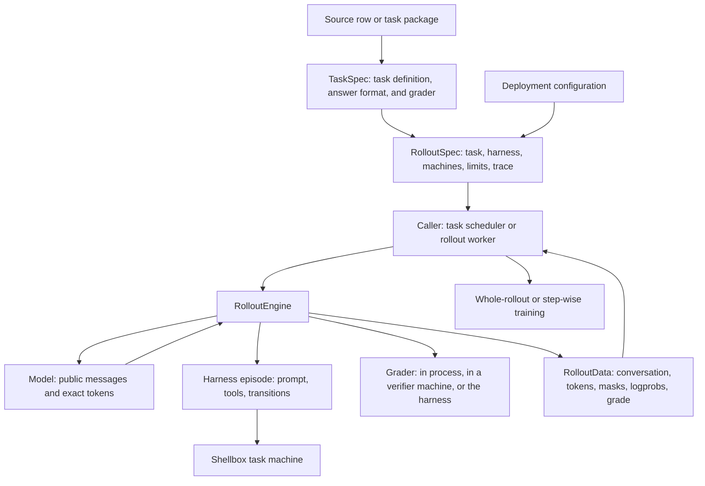
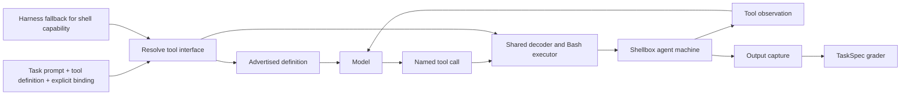

# Task rollouts

`RolloutEngine.run(spec, model)` runs one attempt of a single-stage task and returns `RolloutData`.
The engine holds the machine factories and the harnesses; each run passes the model, the policy under rollout.
The caller owns concurrency, retries, group grading, and training projections.
TaskCompendium defines `TaskSpec`, its graders, and grading outcomes. VerifyIT supplies grading modes and their implementations.
Shellbox supplies machine backends. RolloutEngine supplies the turn loop, the harness contract, and the built-in harnesses.



## Task and runtime specs

`TaskSpec` contains the task definition: public context, tools, output paths, answer type, answer format, grader, environment requirements, resources, source, and tags.
Its `environment_requirements` includes capabilities, an optional digest-pinned Docker image, workdir, setup commands, environment variables, and named tool-provider contracts.
A `ScriptGrader`, or a `VerifyitGrader` with an environment, declares separate requirements in `grader.environment`.

`RolloutSpec` keeps the task definition unchanged and adds the choices that run it:

| Spec | Fields |
| --- | --- |
| `MachineRuntimeSpec` | `backend`, `network`, `cpus`, `memory_mb`, `storage_mb`, `gpus`, `user`, `startup_timeout`, `cleanup_timeout` |
| `RolloutLimits` | `max_turns`, `max_total_tokens`, `model_turn_timeout`, `tool_turn_timeout`, `total_turn_timeout`, `attempt_timeout`, `verifier_timeout`, `cleanup_timeout` |
| `RolloutSpec` | `task: TaskSpec`, `harness`, `task_machine`, `verifier_machine`, `limits: RolloutLimits`, `trace` |

Fields require explicit values except `trace`, which defaults to `TraceMode.EXACT_TOKENS`.
Optional fields accept `None`.
`RolloutLimits.cleanup_timeout` requires a finite, positive value.
Other deadlines accept `None` or a finite, positive value.
`max_total_tokens` accepts `None` or a positive integer.

The engine resolves two registries by key:

| `RolloutEngine` argument | Keyed by | Provides |
| --- | --- | --- |
| `machine_factories` | `MachineRuntimeSpec.backend` | Task and verifier machines |
| `harnesses` | `RolloutSpec.harness` | The `Harness` that runs the model side of the task |

No harness is registered by default. Register the shell harness under the name that your specs use, for
example `RolloutEngine(machine_factories, {"shellbox": shell_harness(command_timeout=30)})`.
Harness options, such as the shell tool's name and command timeout, belong to the registered harness:
register one harness for each configuration, and select it with `RolloutSpec.harness`.
A machine selection of `None` supplies no machine.
Answer-only tasks can omit the task machine.
A grader with an environment requires a `verifier_machine` selection. Every other grader requires `verifier_machine=None`.
Each attempt creates a fresh verifier machine from that selection.

`RolloutEngine.check(spec)` rejects a spec before any machine starts, and `run` calls it again. It checks the
factory identifiers, the supported requirements, and the machines that engine grading needs: task resources,
and a `file`, `state`, or `workspace_state` answer that the engine grades, need a task machine. Then it calls
the harness's own `check`.
The selected factory applies network and hardware settings. Memory is advisory on Local;
preparation omits that allocation because bubblewrap cannot enforce it.

An environment with `docker_image` uses that prebuilt image. The reference must contain a SHA-256 digest.
An environment with `packages_lock` and no image requires a `LocalMachineFactory`.
TaskCompendium downloads the lock and the `environment.json` and `files.tar` stored beside it, if any,
then builds a managed CPython environment with the locked packages, verifyit, and the placed files.
The factory mounts the built root read-only, mounts each placed file at its declared path, sets the
declared variables and puts its Python on `PATH`; attempts share the built runtime but each gets a
fresh sandbox. The selected factory's mounts, executable paths, bubblewrap binary, and hash seed remain in use.
Building the runtime is included in the startup deadline and, for graders, the verifier deadline.
The host needs `uv`, download access for an uncached build, and a working bubblewrap setup.
Grader staging runs as root, so local grading requires a host process running as root.
Local machines reject CPU, storage, and GPU allocations; leave those fields unset and `gpus=0`.

Native environments explicitly declare `CommandSemantics.LINUX_PROCESS`.
`environment.package_spec` selects Python requirements and tools through one shared
`shellbox.PackageSpec`. Bubblewrap installs Python wheels in a cached read-only environment
and uses host tools; Shellsim resolves the same declaration through its Context catalog.
`CommandSemantics.SHELL_SIMULATOR` selects built-in shell and virtual filesystem semantics,
which require `PackageSpec` and a ShellSim factory. Missing native dependencies do not imply simulation.
The default workdir is the image's workdir, or `/workspace` for the built-in filesystem.
An explicit `working_directory` overrides that selection.

Machine setup commands run as trusted root before task operations.
`MachineRuntimeSpec.user` supplies the default user for harness commands.
When the execution user is set, the task machine runs an execution-user probe after root setup and before model inference.
An explicit command user overrides that default.
The verifier machine uses its own configured default user.

## Harnesses

A harness runs the model side of a task: the prompt, the tools, and the response to each model turn.
`Harness(open, check=accept, grade=None)` from `rolloutengine.harness` is a record of three functions:

- `check(spec)` rejects a spec that the harness cannot run. The engine calls it before any machine starts.
- `open(context)` starts an episode for one attempt. `HarnessContext` holds the spec, the prepared task
  machine or `None`, an event sink, and the attempt's run key. An episode class whose constructor takes the
  context can be the `open` function itself.
- `grade(episode, record)` grades the attempt of a task whose grader is `SessionGrader`. An unbound episode
  method gives the grader the episode's own state, for example `Harness(MathEpisode, grade=MathEpisode.grade)`.
  `RolloutEngine.check` rejects a `SessionGrader` spec when the harness has no `grade`.

The engine grades every other task with the task's grader (see [Grading](#grading)).

### Episode lifecycle

The engine installs `resources.all` and `resources.worker` on the task machine, opens the episode, and calls:

1. `prepare()` returns a `Prompt`: public messages, model options, and optionally exact prompt `token_ids`.
2. `advance(turn)` executes the turn's operations and returns a `Transition`.
3. `close()` releases the episode's resources before machine cleanup.

A `Transition` has these fields:

- `done` ends the turn loop.
- `observations` extend the conversation for the next request, and `token_ids` can pin that request's exact prompt tokens.
- `reset` replaces the conversation with a new `Prompt`, and the engine starts a new training record.
- `metrics` holds the step's metrics; `RolloutData.metrics` starts from the last step's metrics.
- `data` is the harness's own record of the step, for example the rewards and token credit that a trainer
  reads. The engine keeps it unchanged in `RolloutStep.transition` and does not interpret it. A consumer that
  aligns rewards or credit with response tokens must check their lengths against `RolloutStep.response_end`.

An episode can assemble the system prompt and the tools in `prepare()`, inspect `ModelTurn.text` or its parsed
message in `advance()`, execute tools, and return observations or a new conversation.
The engine owns model calls, conversation accumulation, and exact-token accounting.
It records the model transport's assistant message before `advance()` runs. An episode can
parse that message and choose the next conversation, but cannot replace the recorded message.
Each model request returns one turn, then `advance` executes that turn's operations.
Completion, a generation limit, the turn limit, the token budget, or the cumulative turn deadline starts final grading.
The engine closes the episode before the task machine.

### Agent harness

`agent_harness(run, *, check=..., grade=None)` from `rolloutengine.agent` runs an agent that owns its prompts
and tool loop, for example an installed agent behind an HTTP proxy. `run(context, complete)` sends one `Prompt`
at a time to `complete` and receives the exact `ModelTurn` that the engine produced:

```python
from rolloutengine.agent import agent_harness
from rolloutengine.contracts import Prompt
from rolloutengine.engine import RolloutEngine


async def run_agent(context, complete):
    turn = await complete(Prompt(({"role": "user", "content": "Fix the failing test."},), {}))
    ...

engine = RolloutEngine(machine_factories, {"agent": agent_harness(run_agent)})
```

- A prompt that extends the previous prompt with the model's message, under the same options, adds
  observations, and its `token_ids`, if any, pin the next request. Any other prompt resets the conversation
  and starts a new training record.
- `complete` can be called from tasks that the agent does not await, such as HTTP handlers. Only one request
  can be open at a time.
- An identical prompt is a retry, for example after a client disconnect, and receives the same turn without a
  new generation. A turn that no caller receives has `metrics["turn_undelivered"] = 1.0` (`TURN_UNDELIVERED`);
  training must exclude that step. The engine still grades with that turn's message.
- When the rollout ends, a request that is still open fails with `RolloutEnded`, so a bridge can answer its client.
- Without `grade`, the engine grades the task. With `grade(record)`, the harness grades `SessionGrader` tasks.
- The default `check` rejects a task that declares tools other than a shell binding: final tools, the
  `submit_answer` tool of an engine-graded `AnswerCall` task, other interaction tools, and tool providers.
  The bridge does not give these tools to the agent. An agent that serves them passes its own `check`.
- The agent must release its own subprocesses and network resources when it is cancelled; the engine owns
  the task machine's lifetime.

### Shell harness

`shell_harness(*, command_timeout, shell_tool=ShellToolConfig(), tools={})` from `rolloutengine.shell` serves a
shell tool on the task machine and host tools from tool providers, and ends on a final response. It does not
grade, so it runs tasks whose grader the engine runs. `command_timeout` must be `None` or positive and finite.
The shell harness exposes `shell(command: string)` when the task declares the shell capability.
Each command runs through `bash -c`. Files persist between commands; shell variables do not.
TaskSpec can own the shell interface when its prompt names a particular tool. Declare the
function in `interaction_tools` and bind it explicitly:

```python
interaction_tools=(FunctionDefinition(
    name="Bash",
    parameters={"type": "object", "properties": {"script": {"type": "string"}},
                "required": ["script"], "additionalProperties": False},
),),
tool_bindings={"Bash": ShellToolBinding(command_parameter="script")},
```

The shell harness preserves that definition and prompt. It supports one shell binding
with one required, unconstrained string argument; unsupported schemas fail before machine
acquisition. Tool names alone never select an executor. Other interaction tools and
provider contracts require a registered tool provider or another harness.

### Tool providers

A tool provider serves host tools for one action interface. Register providers with the shell harness,
`shell_harness(command_timeout=30, tools={"checker:v1": provider})`; the key matches
`ProviderRequirement.action_interface` in `environment_requirements.tool_providers`.
No provider is registered by default.

```python
from rolloutengine.shell import ToolCallResult, ToolContext


class Checker:
    def tools(self, requirement):
        return (CHECK,)  # FunctionDefinitions advertised to the model

    async def open(self, context: ToolContext) -> "CheckSession":
        return CheckSession(context.machine, dict(context.requirement.initial_state))


class CheckSession:
    def __init__(self, machine, state):
        self.machine, self.state = machine, state

    async def call(self, name, arguments) -> ToolCallResult:
        result = await self.machine.run(Command(("cat", arguments["path"])))
        return ToolCallResult(result.stdout.decode(), done=True)

    async def close(self) -> None:
        pass
```

The shell harness advertises each provider's tools after the shell tool and runs a turn's calls in order.
It serves the shell tool itself as a `ToolProviderSession` that runs commands on the task machine, so every tool
call goes through the same interface: the episode looks up the call's name among the shell and provider tools.
A call that names no advertised tool returns the observation `{"error": "Unknown tool: <name>"}`.
When the episode prepares, it opens one `ToolProviderSession` per requirement with a `ToolContext`: the task machine,
or `None` for a task without one, and the task's `ProviderRequirement`, including its `initial_state`.
Attempts never share a provider session, so provider state cannot leak between rollouts; the episode closes
with the attempt's other resources. `ToolCallResult.content` becomes the tool observation verbatim; it is text, as in a chat tool message, and providers usually encode JSON in it.
`done=True` ends the rollout after the current call, like a final tool; grading follows.
Non-object arguments return the JSON error observation that shell calls use; the provider validates the rest.
A provider-only task needs no task machine.

The shell harness's check rejects these tasks before machine acquisition:

- a provider requirement whose action interface has no registered provider;
- a provider tool whose name matches the shell tool, a final tool, the answer tool, or another provider tool;
- an interaction tool that neither the shell binding nor a provider serves, or that differs from the provider's definition.

A task can declare a provider's tool in `interaction_tools` to fix its definition; the shell harness advertises it once.

For tasks that declare only the shell capability, the harness supplies the interface.
Pass `shell_tool=ShellToolConfig(name="terminal", command_parameter="cmd")` to `shell_harness`
to advertise `terminal(cmd)`. Import `ShellToolConfig` from `taskcompendium.runtime.shell`;
curation's `ShellFactory` accepts the same option. An explicit task binding takes precedence.
Collisions with final-answer tools are rejected before machine acquisition.



RolloutEngine and curation share call decoding, execution, and JSON observations: stdout,
stderr, exit code, reason, and separate stdout/stderr truncation flags. Each stream holds at most
the machine output limit, 1 MiB in RolloutEngine; output past it is lost, and its truncation flag is set.
The engine does not keep the rest: a model that expects long output redirects it to a file in the
workspace and reads it with later commands, and a harness that wants a safety net provides one. The episode runner
advertises the tools its environment supplies. Trajectories retain the chosen names and call
IDs. Graders consume the resulting submission independently of the tool interface.

The model receives only public context, answer-format instructions, tool definitions, and task observations.
The serialized task and `RolloutSpec` contain the grader and verifier resources. Do not send them to the model.
Oracle resources contain control inputs for task-curation checks. They do not enter a rollout.

## Run outputs

After the turn loop and before grading, the engine captures the regular files under `TaskSpec.output_paths`
from the task machine once, for every grader kind including `SessionGrader`.
`RolloutData.outputs` maps each absolute file path to its bytes. Files outside `output_paths` are not returned.
A task without a task machine or without output paths returns an empty mapping.
Capture uses the budgets of `taskcompendium.runtime.output_capture`: at most 1,024 files and 16 MiB in total.
The task's grader, or the harness's `grade` through `RolloutData.outputs`, grades this capture without downloading the files again.

Capture runs inside the verifier deadline, as part of the final grading phase.
A capture failure or expired deadline raises `RolloutInterrupted` with operation `grade`.
A record interrupted before capture, during startup, preparation, a transition, or at an attempt deadline that expires before capture completes, has empty `outputs`.
A record interrupted after capture, by a grading failure, a model failure, or an attempt deadline that expires during grading, retains `outputs`.
Attempts that end before the first model response are not graded and have empty `outputs`.

## Grader files

When the grader has an environment, the engine stages grading inputs on the verifier machine after the turn loop.
The verifier machine receives verifier resources under `/tests`, `resources.all`, `resources.worker`, captured `output_paths`, and the extracted answer.
A `ScriptGrader`'s collect commands run as root on the task machine, then its artifacts are copied from the task machine.
Collect commands and artifacts require a task machine.
Artifacts specify a source, target, kind, exclusions, and missing-file policy.
Directory exclusions use `tar --exclude` on the task machine.
Artifact inspection and archive creation use the task machine's default command user.
RolloutEngine configures this as the agent's execution user.
Artifact collection requires `sh`, `tar`, and a writable `/tmp` on the task machine.
Source inspection rejects symlinks in the source path and its ancestors.
Archive extraction rejects included symlink and hardlink members.
A root-owned temporary directory that the non-root agent cannot modify prevents archive-path replacement.
Source inspection does not provide an atomic filesystem snapshot.
Expanded contents have a 1 GiB limit, with at most 100,000 members.
These checks run after download and do not limit transfer buffers or downloaded bytes.
Invalid artifacts and missing required artifacts give `SUBMISSION_FAILURE` with reward zero.
Archive command failures, archive timeouts, and provider or host I/O failures remain infrastructure errors.

## Rollout events

`RolloutEngine(machine_factories, harnesses, observer=observer)` reports progress while an attempt runs.
The observer implements `async def on_event(self, event: RolloutEvent) -> None`.
A `RolloutEvent` carries the attempt's `run_key`, the task's `task_id`, and a `payload`.
`run(spec, model, run_key=...)` sets the run key. Without one, each attempt gets a new random key, so the events of
repeated attempts of a task stay apart. Pass a key to match an attempt's events with your own records.
Each payload is a frozen dataclass from `rolloutengine.contracts` whose `type` field is a `RolloutEventType`, so a payload serialized with `dataclasses.asdict` keeps its type.
Durations are wall-clock seconds.

| Payload | Emitted | Fields |
| --- | --- | --- |
| `AttemptStarted` | After validation, before machine acquisition | |
| `MachineReady` | After task-machine setup; not emitted without a task machine | `duration` |
| `HarnessPrepared` | After the episode's `prepare()` | first request's `messages` and `options`, `duration` |
| `ModelTurnCompleted` | After a model turn passes the token checks | `turn_index`, assistant `message`, `stop_reason`, prompt and response token counts (as reported and unchecked under `TraceMode.MESSAGES`), `usage`, `ModelTurn.metadata`, `duration` |
| `ToolCallCompleted` | By a harness, per tool call that returns an observation | `call_id`, `name`, `observation_bytes`, `done`, `duration` |
| `TransitionCompleted` | After `advance(turn)` | `turn_index`, `done`, `observations`, `reset`, `duration` |
| `Graded` | After grading returns | `status`, `reward`, `error`, `failure`, `duration` of output capture and grading |
| `AttemptEnded` | After cleanup, when `run()` returns or raises `RolloutInterrupted` | `stop_reason`, or the interrupted `operation` and its `error`; `duration` of the whole attempt |

The engine's events carry the conversation: `HarnessPrepared` the first request, then for each turn
`ModelTurnCompleted` the assistant message and `TransitionCompleted` the observations or the new conversation
of a reset, so an observer can follow the transcript for any harness. `TransitionCompleted` reports a reset even
when the turn or token limit ends the rollout and the engine skips it.
`ToolCallCompleted` carries per-call timing and outcome; its observation is the `TransitionCompleted` message with
the same `tool_call_id`. Event fields reference the attempt's own messages, so delivery copies nothing.

Harnesses emit their own payloads through `HarnessContext.events`, an `EventSink` whose `emit` never blocks; the shell harness emits `ToolCallCompleted`.
The engine never awaits the observer.
Each attempt queues its events, up to 1,024, and one task delivers them in order; a full queue drops new events.
After the attempt releases its machines, the engine delivers the remaining events within `cleanup_timeout`.
An observer exception is logged and ends delivery for that attempt.
Neither a slow nor a failing observer changes the rollout's record, grade, or deadlines.
`RolloutData.metrics` counts events the observer did not receive: `observer_dropped_events`, `observer_undelivered_events` and `observer_error_count` appear only when nonzero.
Events still queued when the process dies are lost.
Concurrent attempts deliver to a shared observer concurrently.
No end event is emitted when a token-contract error or cancellation propagates.

## Deadlines and failures

| Field | Boundary |
| --- | --- |
| Machine `startup_timeout` | Machine creation, resource upload, setup commands, and the explicit execution-user probe |
| `model_turn_timeout` | One model request |
| `shell_harness(command_timeout=...)` | Each shell-tool command, including separate calls within one model turn |
| `tool_turn_timeout` | One `advance` call, including its tool operations |
| `total_turn_timeout` | The cumulative model-and-tool loop across all turns in one attempt |
| `attempt_timeout` | Task startup, harness preparation, turns, and final verification |
| `verifier_timeout` | Output capture and the full `grade` call, including separate verifier startup and artifact transfer |
| `RolloutLimits.cleanup_timeout` | Each cleanup action, outside the attempt deadline |
| Machine `cleanup_timeout` | Optional override for that machine's cleanup action |

The total-turn deadline excludes startup, harness preparation, and final verification.
Its expiration ends the turn loop and starts grading with `stop_reason="total_turn_timeout"`.
No model response means `grade.status=Outcome.UNAVAILABLE` and `grade.reward=None`.
Backend command limits also stop commands that outlive an enclosing coroutine deadline.
The command limit is separate from the tool-turn deadline.
When these limits are finite, the shell harness's check requires the command limit to be less than the tool-turn deadline.
Configure the tool-turn deadline to allow the commands and backend cleanup within that turn.
A timed-out shell command returns a `timed_out` tool observation. The model can continue the task.
Expiration of the tool-turn deadline interrupts the transition.

`max_total_tokens` sets a threshold for stopping model requests in one attempt.
Each request charges its prompt tokens plus its response tokens. The prompt includes the served prefix of
earlier turns, so a request charges the full prefix again; a conversation reset does not clear the total.
If the model callable sets `ModelTurn.usage` (`TokenUsage(prompt_tokens, completion_tokens)`), the engine
charges those counts. Otherwise it charges `len(prompt_token_ids) + len(response_token_ids)`.
Without a conversation reset, the next prompt holds at least the previous request's prompt and response.
After each response, the engine stops when the tokens spent plus that request's count reach `max_total_tokens`,
so it never sends a request whose prompt alone reaches the budget. The last request sent may exceed it by its
new observation and response tokens.
The harness handles the last response; the engine then sends no more model requests and starts grading with
`stop_reason="budget_reached"`. The budget takes precedence when that request also uses the last permitted turn.
With a budget set, a turn that reports neither `usage` nor prompt token IDs, which `TraceMode.MESSAGES` allows,
raises `RolloutContractError` rather than charging nothing.
Final grading receives the conversation through the last response, without its observations.

`RolloutInterrupted` retains the failed operation, served token evidence, and original exception cause.
Its `rollout` field contains the retained record. Its `operation` field identifies the failed operation.
Startup failures retain an empty record.
A model failure after a completed turn triggers grading of the completed state.
An interrupted transition retains a terminal step with `metrics["advance_incomplete"] = 1.0` (`ADVANCE_INCOMPLETE`).
Training callers must exclude that step, and an undelivered agent turn, from their training projections.
`RolloutInterrupted.rollout.failure` names the exception type and the failed operation.
Token-contract failures propagate as `RolloutContractError`.
External cancellation remains cancellation.

Cleanup errors preserve a completed grade or the original execution failure.
`grade.diagnostics.cleanup_errors` contains cleanup operation names and exception types.
`metrics.cleanup_error_count` contains their count.
Repeated cancellation does not extend a cleanup deadline.
The engine retains unfinished cleanup operations and late machine creation until their resources can close.
Late cleanup failures appear in logs after the returned record becomes final.
Thread-backed harnesses retain their pending operations until episode cleanup can safely release resources.

## Grading

Grading receives the stop reason, including turn and token-limit endings.
The engine carries that reason in `GradingAttempt.stop_reason`; sandboxed graders
can read `TASKCOMPENDIUM_STOP_REASON`. The reason is context, not a prerequisite for grading.
A reasoning-only final response becomes an empty answer in grading evidence; the raw provider
response remains in the rollout. Existing file submissions are still captured and graded.

The engine grades by grader kind:

| Grader | Grading |
| --- | --- |
| `VerifyitGrader` without an environment | `taskcompendium.grading.grade_answer` on the host, in a worker thread |
| `VerifyitGrader` with an environment | `taskcompendium.runtime.grading.grade_in_sandbox` runs the verifyit command on the verifier machine |
| `ScriptGrader` | `grade_in_sandbox` runs the grader command on the verifier machine |
| `SessionGrader` | The harness's `grade(episode, record)`; `check` rejects a harness without it |
| `NoGrader` | `GradeResult(Outcome.UNAVAILABLE, None, reason)` |

Group grading belongs to the caller.

The task's answer format extracts text, number, JSON, and final-action submissions from the final conversation.
A malformed submission receives `Outcome.SUBMISSION_FAILURE` with reward 0.
File submissions use captured workspace files.
The task graders cannot grade `state` answers; a `SessionGrader` harness can. The shell harness rejects them.
A `VerifyitGrader` with an environment cannot grade a `native_action` answer.

A `ScriptGrader` declares a command, collect commands, artifacts, an answer path, a conversation path, and a reward source.
The verifier machine receives the extracted answer at `answer_path`.
It receives the conversation as OpenAI-style chat-message JSON at `conversation_path`, by default `/tests/conversation.json`.
The verifier deadline controls the full grading phase.

| Reward source | Result | Origin / reason |
| --- | --- | --- |
| `StdoutReward` | Zero exit code and one finite number on standard output | Marin API choice: simple graders without reward files |
| `ExitCodeReward` | Reward 1 for zero exit code, otherwise reward 0 | Marin API choice: pass/fail shell checks |
| `FileReward` | The first existing file supplies the scalar grade | Verifiers that write reward files |

`FileReward` accepts a number or a JSON object with the configured numeric key.
A JSON object's `detail` object becomes the grade detail.
A malformed first file is a grading failure. Grading does not try a lower-priority file.
The optional `pass_above` threshold supplies a separate pass/fail result.
Grading removes existing reward files before the grader command executes.
A valid reward file can supply a grade after a nonzero exit code. A command timeout has no grade.

`GradeResult.failure` identifies timeout, execution failure, missing reward, empty reward, or invalid reward.
An incorrect answer receives a numeric grade. A grading failure has no reward.
Score bounds describe the grader's native range.

Script grading requires a separate machine: a sandbox of a prebuilt, digest-pinned grader image, or a local machine whose host builds the grader's packages lock.
Shellbox's generic image-builder API remains available outside this task path.
SWE tasks require prebuilt images and initialize `refs/taskcompendium/base` before inference.
Patch collection compares the final index with that revision, including agent commits and new files.

## Exact-token contract

The model callable accepts `ModelRequest` and returns `ModelTurn` with a parsed assistant message and exact served token IDs.
`ModelRequest.messages` contains public messages. `prefix_token_ids` contains the earlier served tokens that the next request must preserve.
If `Prompt.token_ids` or `Transition.token_ids` is set, `ModelRequest.prompt_token_ids` carries that exact
prompt to the model transport. The returned turn must report the same prompt tokens.
`ModelTurn.prompt_token_ids` contains the exact prompt sent to inference. `response_token_ids` contains the sampled response.
Optional log probabilities align with response tokens.
A continuation prompt preserves the full served prefix, including earlier response tokens.
The engine rejects changed prefixes, empty response evidence, and misaligned log probabilities.

`RolloutData` contains the conversation, token IDs, loss mask, optional log probabilities, grade, per-step records, and run outputs.
`prompt_token_ids` contains the initial prompt. `response_token_ids` contains subsequent model responses and intervening observation tokens.
The loss mask and log probabilities align with `response_token_ids`, which excludes the initial prompt.
Model tokens have loss mask 1. Observation tokens have mask 0 and log probability 0.
The caller applies its training and failure policies when it projects the record.
A conversation reset discards earlier turns from the training record when another turn is available.
The harness supplies the new `Prompt` in `Transition.reset`: its public messages, its model options, and
optionally its exact tokens, for example after an agent compacts its conversation or changes its tools.
The engine clears the accumulated prefix, turns, and token evidence, then starts a fresh prefix check.
The reset preserves the episode's state and workspace files.
Final grading receives the new conversation and its subsequent turns.
A harness can use this operation after a failed proof attempt.

`GenerationLimitReached` retains rendered prompt tokens when the model cannot start another response.
The engine grades completed state with stop reason `length`.
It does not add an oversized observation to retained response evidence.

## Trace modes

`RolloutSpec.trace` selects the evidence that the engine records.
`TraceMode.EXACT_TOKENS`, the default, enforces the exact-token contract above.
`TraceMode.MESSAGES` lets a model behind a chat endpoint drive a rollout for evaluation, task validation, or data collection.
Chat endpoints re-tokenize the conversation for every request, so the exact-token contract cannot hold there:
on GLM-5.3 behind the Orion router, 2 of 7 recorded 7-turn ShellSim rollouts failed it on a single non-canonical sampled token.
The engine sends empty `prefix_token_ids` and skips the prefix, token-evidence, and log-probability checks.
It still checks token replay: a chat endpoint cannot serve `Prompt.token_ids` or `Transition.token_ids`,
so a `MESSAGES` rollout whose harness pins prompt tokens raises `RolloutContractError`
unless the model reports serving exactly those tokens.
A model may return a `ModelTurn` with empty token fields and `logprobs=None`.
The engine keeps the token IDs a model does report: `RolloutData.prompt_token_ids` is the first prompt, `response_token_ids`
is the last served sequence after it, and both are informational only.
The loss mask is all zeros with one value per response token, and `logprobs` is `None`.
Every `MESSAGES` record, including an empty or interrupted one, carries `metrics["trace"] = "messages"`.
Messages, steps, stop reasons, and grades are unchanged.
Do not train on `MESSAGES` rollouts; reject records that carry the `trace` metric.

## Use

The task's `answer_format` controls final-answer extraction and model-visible submission instructions.
`rolloutengine.shell.task_prompt(task, shell_tool, provider_tools)` renders the first prompt: the public messages, with the format's instruction and tools for text, number, JSON, and native-action answers.

Construct a `RolloutSpec`, and check it with `RolloutEngine.check` before you start a batch. The
[rollout tests](https://github.com/marin-community/marin/blob/main/lib/rolloutengine/tests/test_rollout.py) contain executable examples.
One engine serves every attempt; each run passes its model:

```python
from rolloutengine.contracts import RolloutData
from rolloutengine.engine import Model, RolloutEngine
from rolloutengine.shell import shell_harness
from rolloutengine.spec import RolloutSpec
from shellbox.backends.docker.machine import DockerMachineFactory
from shellbox.backends.shellsim.machine import ShellSimMachineFactory

engine = RolloutEngine(
    {"docker": DockerMachineFactory(), "shellsim": ShellSimMachineFactory()},
    {"shellbox": shell_harness(command_timeout=30)},
)


async def run_task(spec: RolloutSpec, model: Model) -> RolloutData:
    return await engine.run(spec, model)
```

From the Marin repository root, with the test environment installed:

```bash
task_test_prefix=$(mktemp -d -t taskcompendium-tests.XXXXXX)
MARIN_PREFIX="$task_test_prefix" uv run --frozen --no-sync pytest lib/taskcompendium/tests -q -n 0
uv run --package marin-rolloutengine --frozen --group test pytest lib/rolloutengine/tests -q
```

CPU tests use ShellSim and model or HTTP fixtures. A live GPU run and a real container backend require separate validation.

The local curation-to-rollout check runs QUICK conversion, reloads TaskSpecs from Parquet,
and grades scripted correct and incorrect answers in bubblewrap:

```bash
uv run --no-sync pytest experiments/post_training/task_curation/tests/test_rollout_e2e.py \
  -m manual -n 0 -o asyncio_mode=auto
```

It uses the prepared repository environment (including Verifyit, pytest and typer) in place of
source images. It exercises conversion, tool bindings, capture and grading; it does not build
images or test inference transport. The host must permit bubblewrap namespaces and the
agent/grader user separation. It runs locally until that requirement is established in CI.
