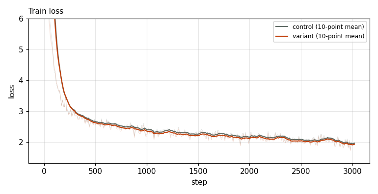
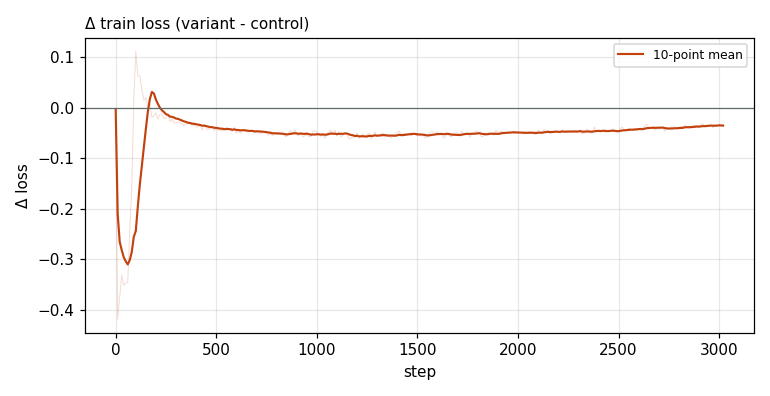

# X0009 · Hashed bigram table as AttnRes source · speedrun · win

Trial t033 · commit `eabb9535a8` · maintainer proposal · approved by @ClassicLarry

## Final eval

| Run | Paloma macro loss | Δ vs control | Paloma macro BPB |
|---|---|---|---|
| belay-X0009-control | 3.0437 |  | 1.2587 |
| belay-X0009-seed0 | 3.0182 | -0.0255 | 1.2489 |

Rule: Δ ≤ −0.006 win · ≥ +0.006 loss · otherwise noise. Verdict on loss; BPB (byte-weighted) shown for reference. The final speedrun verdict is the equal-time verdict.

## Train loss

## Δ train loss

## Speed (median after step 5)

| Run | s/step | tokens/s |
|---|---|---|
| belay-X0009-control | 0.1584 | 3309005 |
| belay-X0009-seed0 | 0.1846 | 2840013 |

## MoE routing: capacity drops (mean over layers)

| Control | Variant |
|---|---|
| 0.000790 | 0.001373 |

## MoE routing: router bias max

| Control | Variant |
|---|---|
| 1.960540 | 3.181263 |

## Gradient norm

| Control | Variant |
|---|---|
| 0.308932 | 0.300723 |
