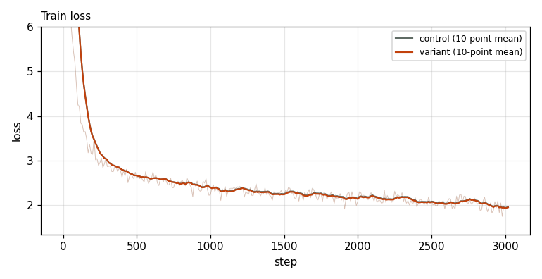
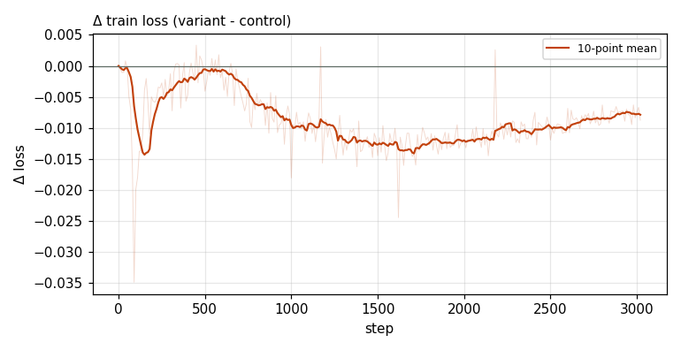

# X0014 · Value embeddings on MLA layers · speedrun · win

Trial t016 · commit `ad370b1de6` · maintainer proposal · approved by @ClassicLarry

## Final eval

| Run | Paloma macro loss | Δ vs control | Paloma macro BPB |
|---|---|---|---|
| belay-X0014-control | 3.0472 |  | 1.2603 |
| belay-X0014-seed0 | 3.0360 | -0.0112 | 1.2556 |

Rule: Δ ≤ −0.006 win · ≥ +0.006 loss · otherwise noise. Verdict on loss; BPB (byte-weighted) shown for reference. The final speedrun verdict is the equal-time verdict.

## Train loss

## Δ train loss

## Speed (median after step 5)

| Run | s/step | tokens/s |
|---|---|---|
| belay-X0014-control | 0.1585 | 3307048 |
| belay-X0014-seed0 | 0.1598 | 3280952 |

## MoE routing: capacity drops (mean over layers)

| Control | Variant |
|---|---|
| 0.000792 | 0.000840 |

## MoE routing: router bias max

| Control | Variant |
|---|---|
| 1.800471 | 1.862894 |

## Gradient norm

| Control | Variant |
|---|---|
| 0.310301 | 0.361815 |
