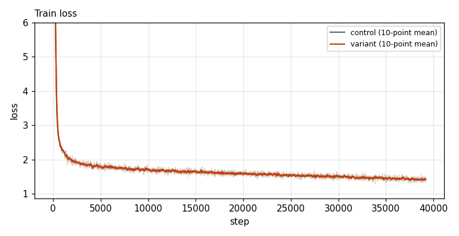
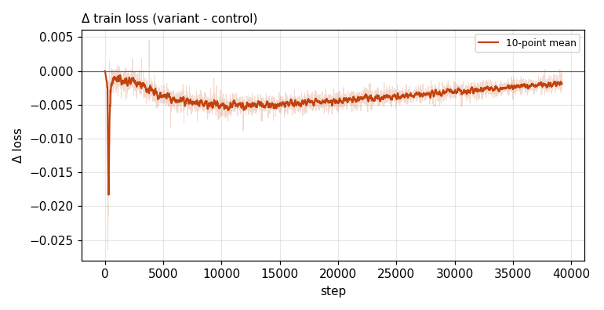

# X0014 · Value embeddings on MLA layers · competitive-d1024 · noise

Trial t019 · commit `2015f0d632` · [#9514 comment](https://github.com/marin-community/marin/issues/9514#issuecomment-6648872395) · approved by @ClassicLarry

## Final eval

| Run | Paloma macro loss | Δ vs control | Paloma macro BPB |
|---|---|---|---|
| s7n-d1024 | 2.4106 |  | 1.0024 |
| belay-X0014d1024-seed0 | 2.4058 | -0.0048 | 1.0004 |

Rule: Δ ≤ −0.005 win · ≥ +0.005 loss · otherwise noise. Verdict on loss; BPB (byte-weighted) shown for reference.

## Train loss

## Δ train loss

## Speed (median after step 5)

| Run | s/step | tokens/s |
|---|---|---|
| s7n-d1024 | 1.4269 | 734858 |
| belay-X0014d1024-seed0 | 1.4288 | 733865 |

## MoE routing: capacity drops (mean over layers)

| Control | Variant |
|---|---|
| 0.000189 | 0.000197 |

## MoE routing: router bias max

| Control | Variant |
|---|---|
| 1.529888 | 1.493384 |

## Gradient norm

| Control | Variant |
|---|---|
| 0.219474 | 0.229072 |
