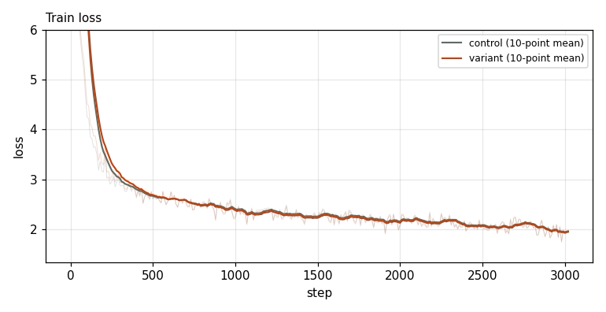
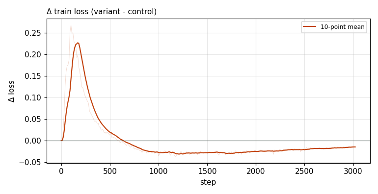

# X0073 · lm_head tanh soft-cap · speedrun · win

Trial t024 · commit `00e9d64ae1` · maintainer proposal · approved by @ClassicLarry

## Final eval

| Run | Paloma macro loss | Δ vs control | Paloma macro BPB |
|---|---|---|---|
| belay-X0073-control | 3.0447 |  | 1.2593 |
| belay-X0073-seed0 | 3.0230 | -0.0217 | 1.2508 |

Rule: Δ ≤ −0.006 win · ≥ +0.006 loss · otherwise noise. Verdict on loss; BPB (byte-weighted) shown for reference. The final speedrun verdict is the equal-time verdict.

## Train loss

## Δ train loss

## Speed (median after step 5)

| Run | s/step | tokens/s |
|---|---|---|
| belay-X0073-control | 0.1587 | 3303986 |
| belay-X0073-seed0 | 0.1595 | 3287805 |

## MoE routing: capacity drops (mean over layers)

| Control | Variant |
|---|---|
| 0.000767 | 0.000838 |

## MoE routing: router bias max

| Control | Variant |
|---|---|
| 1.861522 | 1.928464 |

## Gradient norm

| Control | Variant |
|---|---|
| 0.312187 | 0.262815 |
