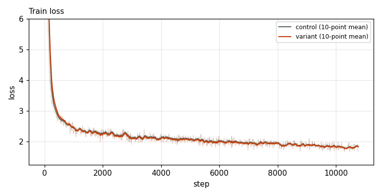
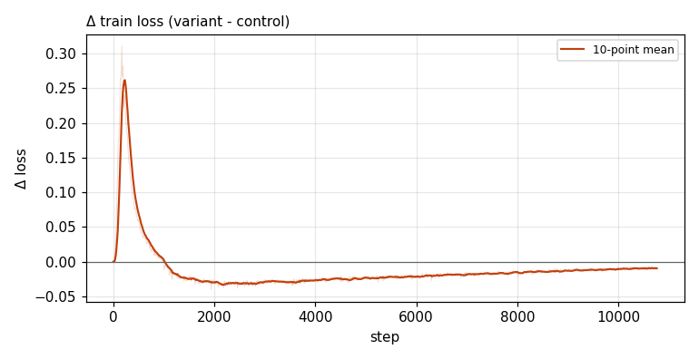

# X0073 · lm_head tanh soft-cap · competitive-d512 · win

Trial t025 · commit `89f287ed4a` · [#9514 comment](https://github.com/marin-community/marin/issues/9514#issuecomment-6648870806) · approved by @ClassicLarry

## Final eval

| Run | Paloma macro loss | Δ vs control | Paloma macro BPB |
|---|---|---|---|
| s7n-d512 | 2.8681 |  | 1.1873 |
| belay-X0073d512-seed0 | 2.8509 | -0.0172 | 1.1806 |

Rule: Δ ≤ −0.005 win · ≥ +0.005 loss · otherwise noise. Verdict on loss; BPB (byte-weighted) shown for reference.

## Train loss

## Δ train loss

## Speed (median after step 5)

| Run | s/step | tokens/s |
|---|---|---|
| s7n-d512 | 0.1585 | 3308633 |
| belay-X0073d512-seed0 | 0.1593 | 3290564 |

## MoE routing: capacity drops (mean over layers)

| Control | Variant |
|---|---|
| 0.000710 | 0.000787 |

## MoE routing: router bias max

| Control | Variant |
|---|---|
| 1.757928 | 1.885066 |

## Gradient norm

| Control | Variant |
|---|---|
| 0.360183 | 0.270705 |
