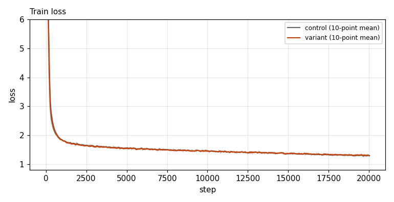
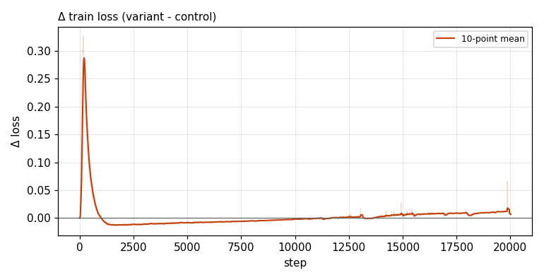

# X0073 · lm_head tanh soft-cap · competitive-d1280 · noise

Trial t028 · commit `b3df9e815e` · [#9514 comment](https://github.com/marin-community/marin/issues/9514#issuecomment-6648870806) · approved by @ClassicLarry

## Final eval

| Run | Paloma macro loss | Δ vs control | Paloma macro BPB |
|---|---|---|---|
| s7n-d1280L16 | 2.2706 |  | 0.9459 |
| belay-X0073d1280-seed0 | 2.2716 | +0.0009 | 0.9464 |

Rule: Δ ≤ −0.005 win · ≥ +0.005 loss · otherwise noise. Verdict on loss; BPB (byte-weighted) shown for reference.

## Train loss

## Δ train loss

## Speed (median after step 5)

| Run | s/step | tokens/s |
|---|---|---|
| s7n-d1280L16 | 2.8259 | 1484215 |
| belay-X0073d1280-seed0 | 2.8338 | 1480124 |

## MoE routing: capacity drops (mean over layers)

| Control | Variant |
|---|---|
| 0.000212 | 0.000200 |

## MoE routing: router bias max

| Control | Variant |
|---|---|
| 1.905005 | 1.797516 |

## Gradient norm

| Control | Variant |
|---|---|
| 0.271355 | 0.328642 |
