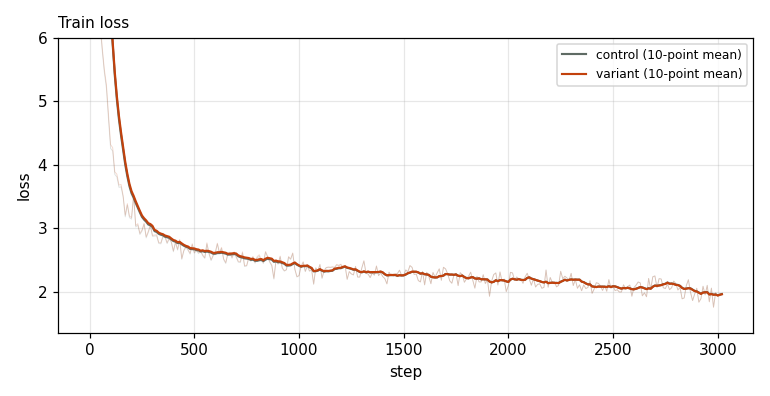
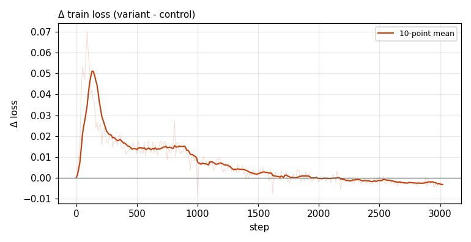

# X0087 · MuonEq pre-NS normalization · speedrun · noise

Trial t005 · commit `e305cef52a` · proposal by @ClassicLarry · approved by @ClassicLarry

## Final eval

| Run | Paloma macro loss | Δ vs control | Paloma macro BPB |
|---|---|---|---|
| belay-X0017-control | 3.0451 |  | 1.2594 |
| belay-X0087-seed0 | 3.0439 | -0.0012 | 1.2591 |

Rule: Δ ≤ −0.005 win · ≥ +0.005 loss · otherwise noise. Verdict on loss; BPB (byte-weighted) shown for reference. The final speedrun verdict is the equal-time verdict.

## Train loss

## Δ train loss

## Speed (median after step 5)

| Run | s/step | tokens/s |
|---|---|---|
| belay-X0017-control | 0.1589 | 3299076 |
| belay-X0087-seed0 | 0.1589 | 3300243 |

## MoE routing: capacity drops (mean over layers)

| Control | Variant |
|---|---|
| 0.000819 | 0.000883 |

## MoE routing: router bias max

| Control | Variant |
|---|---|
| 1.860719 | 2.006871 |

## Gradient norm

| Control | Variant |
|---|---|
| 0.311364 | 0.308826 |
