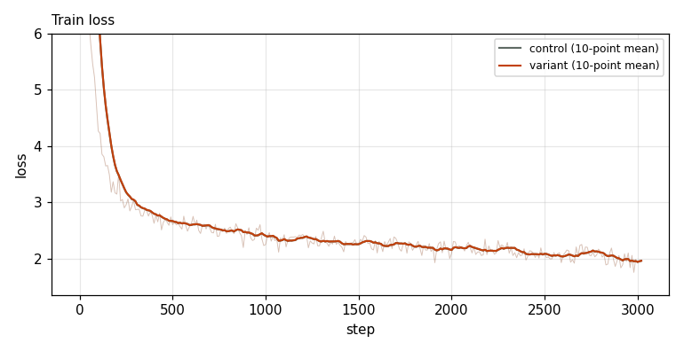
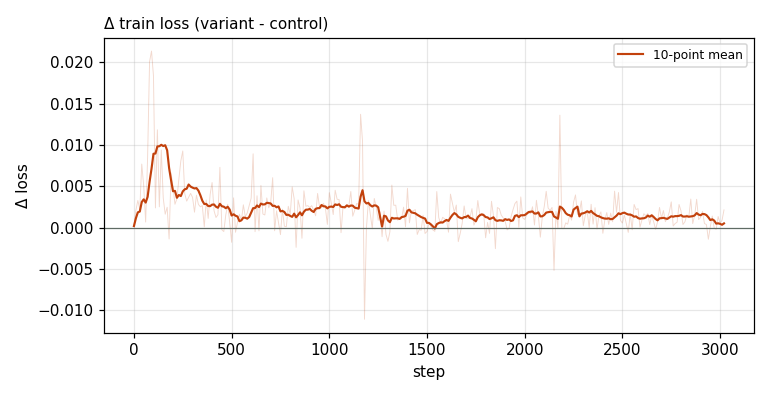

# X0151 · MuonH sigmoid-gate init multiplier · speedrun · noise

Trial t004 · commit `fd7f69c31e` · proposal by @ClassicLarry · approved by @ClassicLarry

## Final eval

| Run | Paloma macro loss | Δ vs control | Paloma macro BPB |
|---|---|---|---|
| belay-X0151-control | 3.0441 |  | 1.2589 |
| belay-X0151-seed0 | 3.0467 | +0.0026 | 1.2601 |

Rule: Δ ≤ −0.005 win · ≥ +0.005 loss · otherwise noise. Verdict on loss; BPB (byte-weighted) shown for reference. The final speedrun verdict is the equal-time verdict.

## Train loss

## Δ train loss

## Speed (median after step 5)

| Run | s/step | tokens/s |
|---|---|---|
| belay-X0151-control | 0.1585 | 3307279 |
| belay-X0151-seed0 | 0.1584 | 3310003 |

## MoE routing: capacity drops (mean over layers)

| Control | Variant |
|---|---|
| 0.000820 | 0.000783 |

## MoE routing: router bias max

| Control | Variant |
|---|---|
| 2.056526 | 1.955330 |

## Gradient norm

| Control | Variant |
|---|---|
| 0.314596 | 0.302762 |
