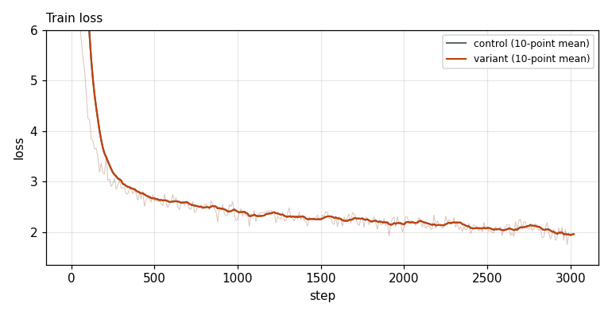
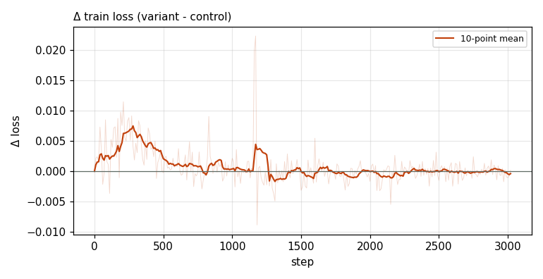

# X0160 · Router Adam LR multiplier · speedrun · noise

Trial t005 · commit `cd615f08ac` · proposal by @ClassicLarry · approved by @ClassicLarry

## Final eval

| Run | Paloma macro loss | Δ vs control | Paloma macro BPB |
|---|---|---|---|
| belay-X0151-control | 3.0441 |  | 1.2589 |
| belay-X0160-seed0 | 3.0446 | +0.0005 | 1.2590 |

Rule: Δ ≤ −0.005 win · ≥ +0.005 loss · otherwise noise. Verdict on loss; BPB (byte-weighted) shown for reference. The final speedrun verdict is the equal-time verdict.

## Train loss

## Δ train loss

## Speed (median after step 5)

| Run | s/step | tokens/s |
|---|---|---|
| belay-X0151-control | 0.1585 | 3307279 |
| belay-X0160-seed0 | 0.1587 | 3303526 |

## MoE routing: capacity drops (mean over layers)

| Control | Variant |
|---|---|
| 0.000820 | 0.000911 |

## MoE routing: router bias max

| Control | Variant |
|---|---|
| 2.056526 | 1.517927 |

## Gradient norm

| Control | Variant |
|---|---|
| 0.314596 | 0.303663 |
