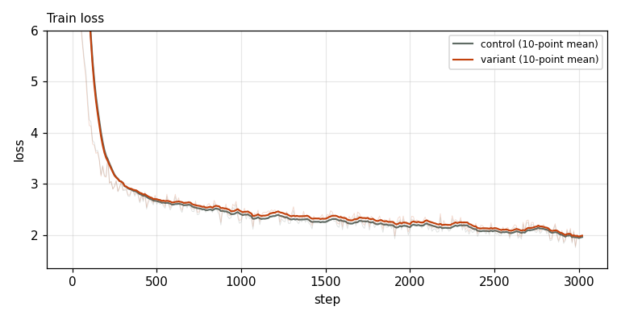
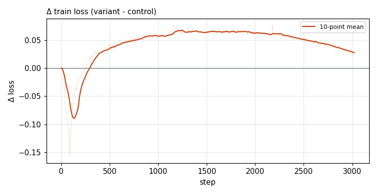

# X0217 · MuonH momentum warmup · speedrun · loss

Trial t005 · commit `a20ef74f2f` · [#9514 comment](https://github.com/marin-community/marin/issues/9514#issuecomment-6079384012) · approved by @ClassicLarry

## Final eval

| Run | Paloma macro loss | Δ vs control |
|---|---|---|
| belay-X0217-control | 3.0455 |  |
| belay-X0217-seed0 | 3.0678 | +0.0223 |

Rule: Δ ≤ −0.006 win · ≥ +0.006 loss · otherwise noise

## Train loss

## Δ train loss

## Speed (median after step 5)

| Run | s/step | tokens/s |
|---|---|---|
| belay-X0217-control | 0.1589 | 3299603 |
| belay-X0217-seed0 | 0.1584 | 3310052 |

## MoE routing: capacity drops (mean over layers)

| Control | Variant |
|---|---|
| 0.000781 | 0.000773 |

## MoE routing: router bias max

| Control | Variant |
|---|---|
| 1.877793 | 2.227808 |

## Gradient norm

| Control | Variant |
|---|---|
| 0.310671 | 0.305286 |
