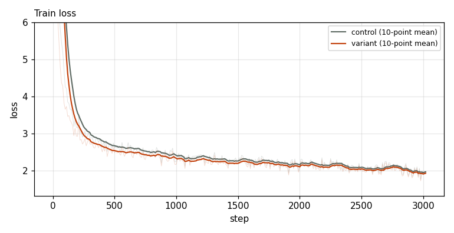
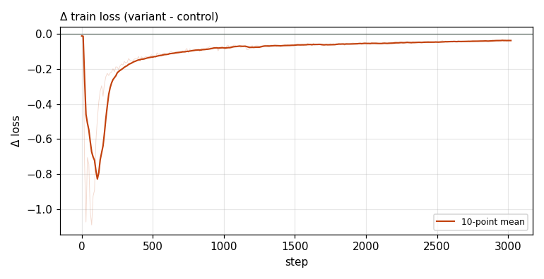

# X0221 · CPLM Plus copy head · speedrun · win

Trial t001 · commit `9db6be9125` · [#9514 comment](https://github.com/marin-community/marin/issues/9514#issuecomment-6424405220) · approved by @ClassicLarry

## Final eval

| Run | Paloma macro loss | Δ vs control |
|---|---|---|
| belay-X0221-control-b | 3.0458 |  |
| belay-X0221-seed0-b | 2.9880 | -0.0578 |

Rule: Δ ≤ −0.006 win · ≥ +0.006 loss · otherwise noise

## Train loss

## Δ train loss

## Speed (median after step 5)

| Run | s/step | tokens/s |
|---|---|---|
| belay-X0221-control-b | 0.1587 | 3303175 |
| belay-X0221-seed0-b | 0.2074 | 2528427 |

## MoE routing: capacity drops (mean over layers)

| Control | Variant |
|---|---|
| 0.000883 | 0.000853 |

## MoE routing: router bias max

| Control | Variant |
|---|---|
| 1.929818 | 2.028645 |

## Gradient norm

| Control | Variant |
|---|---|
| 0.313761 | 0.259573 |
