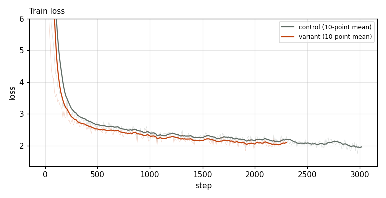
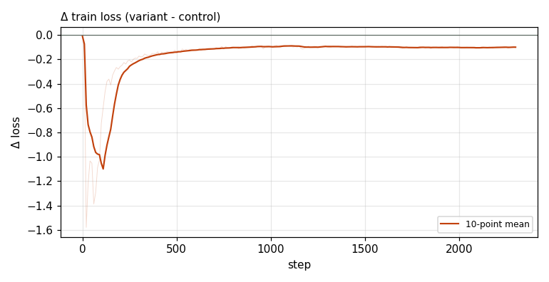

# X0221 · CPLM Plus copy head · speedrun · win

Trial t002 · commit `cf008d1b9f` · [#9514 comment](https://github.com/marin-community/marin/issues/9514#issuecomment-6424405220) · approved by @ClassicLarry

## Final eval

| Run | Paloma macro loss | Δ vs control | Paloma macro BPB |
|---|---|---|---|
| belay-X0221-control-b | 3.0458 |  | 1.2598 |
| belay-X0221-seed0-t-c | 3.0310 | -0.0148 | 1.2549 |

Rule: Δ ≤ −0.006 win · ≥ +0.006 loss · otherwise noise. Verdict on loss; BPB (byte-weighted) shown for reference. The final speedrun verdict is the equal-time verdict.

## Train loss

## Δ train loss

## Speed (median after step 5)

| Run | s/step | tokens/s |
|---|---|---|
| belay-X0221-control-b | 0.1587 | 3303175 |
| belay-X0221-seed0-t-c | 0.2072 | 2530483 |

## MoE routing: capacity drops (mean over layers)

| Control | Variant |
|---|---|
| 0.000883 | 0.000868 |

## MoE routing: router bias max

| Control | Variant |
|---|---|
| 1.929818 | 2.219389 |

## Gradient norm

| Control | Variant |
|---|---|
| 0.313761 | 0.254294 |
