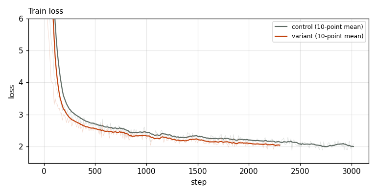
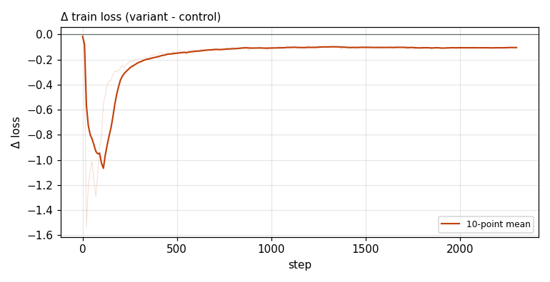

# X0221 · CPLM Plus copy head · speedrun · win

Trial t003 · commit `60ef9dc0f4` · [#9514 comment](https://github.com/marin-community/marin/issues/9514#issuecomment-6424405220) · approved by @ClassicLarry

## Final eval

| Run | Paloma macro loss | Δ vs control | Paloma macro BPB |
|---|---|---|---|
| belay-X0221-control-s1 | 3.0391 |  | 1.2567 |
| belay-X0221-seed1-t | 3.0304 | -0.0087 | 1.2547 |

Rule: Δ ≤ −0.006 win · ≥ +0.006 loss · otherwise noise. Verdict on loss; BPB (byte-weighted) shown for reference. The final speedrun verdict is the equal-time verdict.

## Train loss

## Δ train loss

## Speed (median after step 5)

| Run | s/step | tokens/s |
|---|---|---|
| belay-X0221-control-s1 | 0.1586 | 3305493 |
| belay-X0221-seed1-t | 0.2068 | 2534650 |

## MoE routing: capacity drops (mean over layers)

| Control | Variant |
|---|---|
| 0.000950 | 0.000932 |

## MoE routing: router bias max

| Control | Variant |
|---|---|
| 2.111573 | 1.878466 |

## Gradient norm

| Control | Variant |
|---|---|
| 0.311196 | 0.254875 |
