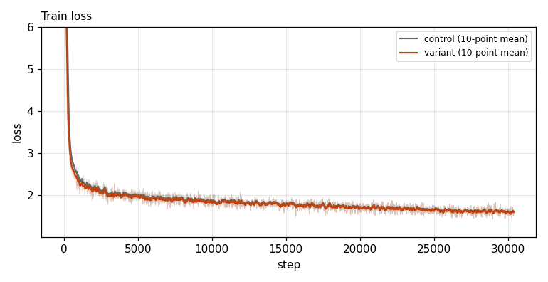
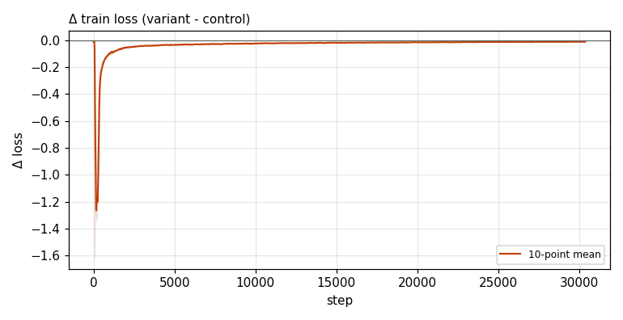

# X0221 · CPLM Plus copy head · competitive-d768 · win

Trial t005 · commit `ee33e87e1e` · [#9514 comment](https://github.com/marin-community/marin/issues/9514#issuecomment-6651209739) · approved by @ClassicLarry

## Final eval

| Run | Paloma macro loss | Δ vs control | Paloma macro BPB |
|---|---|---|---|
| s7n-d768 | 2.6121 |  | 1.0839 |
| belay-X0221d768-seed0 | 2.5906 | -0.0215 | 1.0758 |

Rule: Δ ≤ −0.005 win · ≥ +0.005 loss · otherwise noise. Verdict on loss; BPB (byte-weighted) shown for reference.

## Train loss

## Δ train loss

## Speed (median after step 5)

| Run | s/step | tokens/s |
|---|---|---|
| s7n-d768 | 0.3829 | 1369129 |
| belay-X0221d768-seed0 | 0.4359 | 1202775 |

## MoE routing: capacity drops (mean over layers)

| Control | Variant |
|---|---|
| 0.000783 | 0.000678 |

## MoE routing: router bias max

| Control | Variant |
|---|---|
| 1.490199 | 1.968652 |

## Gradient norm

| Control | Variant |
|---|---|
| 0.316863 | 0.318895 |
