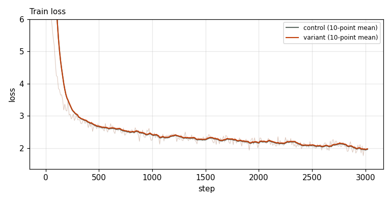
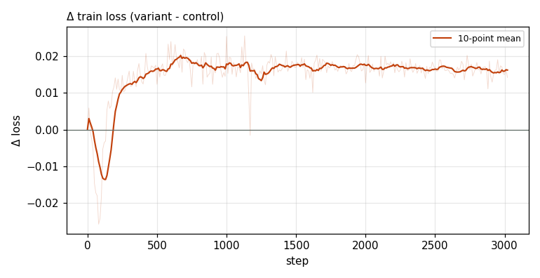

# X0222 · Causal MoD token capacity routing · speedrun · loss

Trial t001 · commit `6b8f1e9a06` · [#9514 comment](https://github.com/marin-community/marin/issues/9514#issuecomment-6497735060) · approved by @ClassicLarry

## Final eval

| Run | Paloma macro loss | Δ vs control | Paloma macro BPB |
|---|---|---|---|
| belay-X0222-control | 3.0450 |  | 1.2594 |
| belay-X0222-seed0 | 3.1160 | +0.0710 | 1.2887 |

Rule: Δ ≤ −0.006 win · ≥ +0.006 loss · otherwise noise. Verdict on loss; BPB (byte-weighted) shown for reference. The final speedrun verdict is the equal-time verdict.

## Train loss

## Δ train loss

## Speed (median after step 5)

| Run | s/step | tokens/s |
|---|---|---|
| belay-X0222-control | 0.1587 | 3303674 |
| belay-X0222-seed0 | 0.1633 | 3210599 |

## MoE routing: capacity drops (mean over layers)

| Control | Variant |
|---|---|
| 0.000859 | 0.138381 |

## MoE routing: router bias max

| Control | Variant |
|---|---|
| 2.796647 | 8.280694 |

## Gradient norm

| Control | Variant |
|---|---|
| 0.306243 | 0.339611 |
