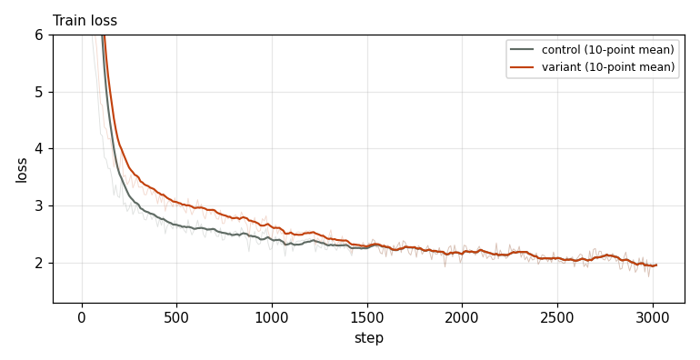
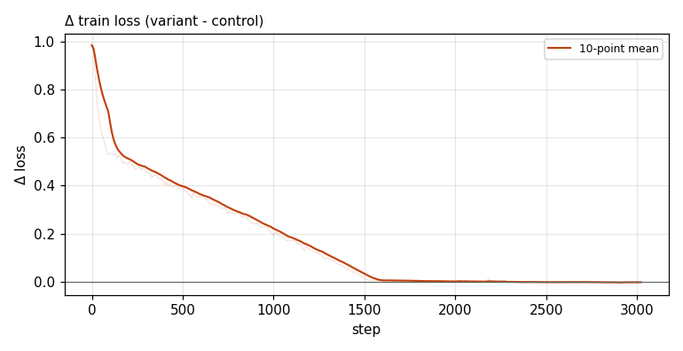

# X0223 · MTP low-weight decaying aux loss · speedrun · win

Trial t001 · commit `d331df684b` · [#9514 comment](https://github.com/marin-community/marin/issues/9514#issuecomment-6498753293) · approved by @ClassicLarry

## Final eval

| Run | Paloma macro loss | Δ vs control | Paloma macro BPB |
|---|---|---|---|
| belay-X0223-control | 3.0459 |  | 1.2598 |
| belay-X0223-seed0 | 3.0404 | -0.0055 | 1.2575 |

Rule: Δ ≤ −0.005 win · ≥ +0.005 loss · otherwise noise. Verdict on loss; BPB (byte-weighted) shown for reference. The final speedrun verdict is the equal-time verdict.

## Train loss

## Δ train loss

## Speed (median after step 5)

| Run | s/step | tokens/s |
|---|---|---|
| belay-X0223-control | 0.1589 | 3300146 |
| belay-X0223-seed0 | 0.1716 | 3054711 |

## MoE routing: capacity drops (mean over layers)

| Control | Variant |
|---|---|
| 0.000801 | 0.001013 |

## MoE routing: router bias max

| Control | Variant |
|---|---|
| 2.036115 | 1.876208 |

## Gradient norm

| Control | Variant |
|---|---|
| 0.308136 | 0.295898 |
