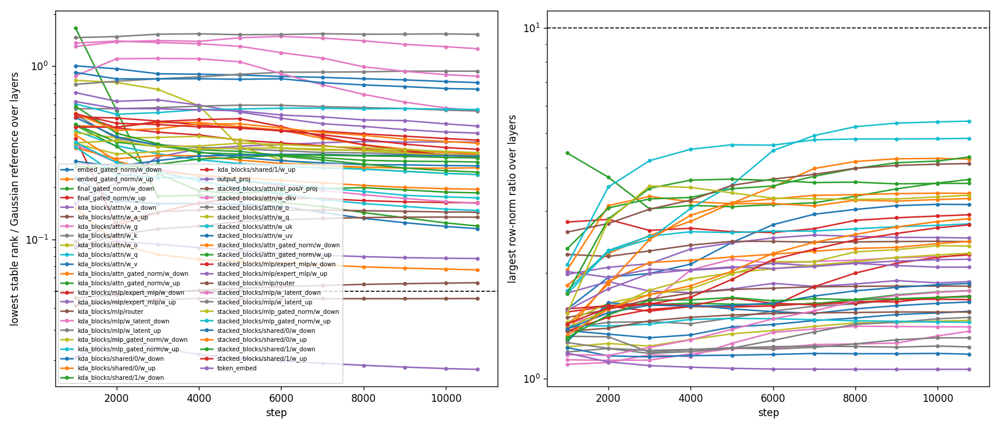
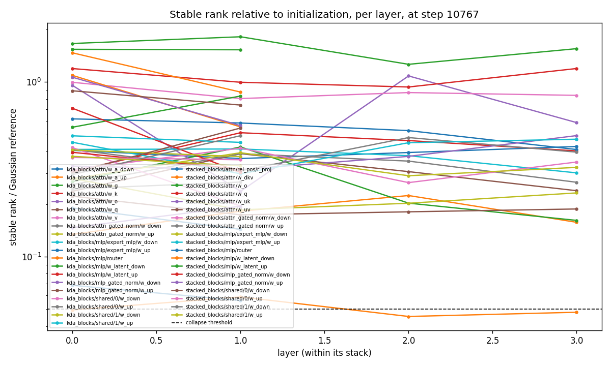

# X0224: training-dynamics statistics of the d512 recipe

Statistics of every saved checkpoint (11 steps, 1000 to 10767), each against its
value at initialization: stable rank against a Gaussian matrix of the same shape, row-norm ratio against 1,
and norm gains against 1.

## Answer

- 124 matrices and 26 gain vectors measured at each step.
- At step 10767: 4 matrices flagged (stable rank below 0.05 of the Gaussian reference or below 2, or row-norm ratio above 10); 0 gain vectors flagged (mean abs gain outside 0.2 to 5, or one gain above 20 times the median).
- Lowest stable-rank fraction at step 10767: `output_proj` layer -, 0.018 (6.55 of 369.7).
- Largest row-norm ratio at step 10767: `kda_blocks/mlp_gated_norm/w_up` layer 2, 5.42.
- Largest mean abs gain at step 10767: `final_norm/weight` layer -, 4.978.

## Over training

| Step | Loss | Flagged matrices | Flagged gains | Lowest stable-rank fraction | Largest row-norm ratio | Largest mean abs gain |
|---|---|---|---|---|---|---|
| 1000 | 2.285 | 5 | 0 | 0.021 (`output_proj` -) | 4.40 (`final_gated_norm/w_down` -) | 2.292 (`final_norm/weight` -) |
| 2000 | 2.200 | 5 | 0 | 0.026 (`output_proj` -) | 3.75 (`final_gated_norm/w_down` -) | 2.916 (`final_norm/weight` -) |
| 3000 | 2.096 | 5 | 0 | 0.024 (`output_proj` -) | 4.18 (`stacked_blocks/mlp_gated_norm/w_up` 1) | 3.552 (`final_norm/weight` -) |
| 4000 | 2.191 | 4 | 0 | 0.022 (`output_proj` -) | 4.51 (`stacked_blocks/mlp_gated_norm/w_up` 1) | 3.978 (`final_norm/weight` -) |
| 5000 | 2.173 | 4 | 0 | 0.021 (`output_proj` -) | 4.64 (`stacked_blocks/mlp_gated_norm/w_up` 1) | 4.268 (`final_norm/weight` -) |
| 6000 | 2.039 | 4 | 0 | 0.020 (`output_proj` -) | 4.63 (`stacked_blocks/mlp_gated_norm/w_up` 1) | 4.485 (`final_norm/weight` -) |
| 7000 | 1.903 | 4 | 0 | 0.019 (`output_proj` -) | 4.93 (`kda_blocks/mlp_gated_norm/w_up` 2) | 4.652 (`final_norm/weight` -) |
| 8000 | 1.932 | 4 | 0 | 0.019 (`output_proj` -) | 5.23 (`kda_blocks/mlp_gated_norm/w_up` 2) | 4.781 (`final_norm/weight` -) |
| 9000 | 1.927 | 4 | 0 | 0.018 (`output_proj` -) | 5.35 (`kda_blocks/mlp_gated_norm/w_up` 2) | 4.874 (`final_norm/weight` -) |
| 10000 | 1.867 | 4 | 0 | 0.018 (`output_proj` -) | 5.39 (`kda_blocks/mlp_gated_norm/w_up` 2) | 4.939 (`final_norm/weight` -) |
| 10767 | 1.876 | 4 | 0 | 0.018 (`output_proj` -) | 5.42 (`kda_blocks/mlp_gated_norm/w_up` 2) | 4.978 (`final_norm/weight` -) |

### First step each array was flagged

| Array | Layer | First flagged at step | Flags then |
|---|---|---|---|
| `kda_blocks/mlp/router` | 0 | 1000 | stable-rank collapse |
| `kda_blocks/mlp/router` | 2 | 1000 | stable-rank collapse |
| `kda_blocks/mlp/router` | 3 | 1000 | stable-rank collapse |
| `output_proj` | - | 1000 | stable-rank collapse |
| `stacked_blocks/mlp/router` | 1 | 1000 | stable-rank collapse |

## Stable rank across depth at step 10767

| Matrix | First layer | Last layer | Lowest (layer) |
|---|---|---|---|
| `kda_blocks/attn/w_a_down` | 0.406 | 0.428 | 0.365 (1) |
| `kda_blocks/attn/w_a_up` | 0.134 | 0.157 | 0.134 (0) |
| `kda_blocks/attn/w_g` | 0.269 | 0.161 | 0.161 (3) |
| `kda_blocks/attn/w_k` | 0.307 | 0.403 | 0.307 (0) |
| `kda_blocks/attn/w_o` | 0.956 | 0.586 | 0.237 (1) |
| `kda_blocks/attn/w_q` | 0.237 | 0.239 | 0.237 (0) |
| `kda_blocks/attn/w_v` | 0.996 | 0.839 | 0.804 (1) |
| `kda_blocks/attn_gated_norm/w_down` | 0.259 | 0.267 | 0.259 (0) |
| `kda_blocks/attn_gated_norm/w_up` | 0.280 | 0.232 | 0.186 (1) |
| `kda_blocks/mlp/expert_mlp/w_down` | 0.411 | 0.302 | 0.302 (3) |
| `kda_blocks/mlp/expert_mlp/w_up` | 0.615 | 0.411 | 0.411 (3) |
| `kda_blocks/mlp/router` | 0.050 | 0.048 | 0.045 (2) |
| `kda_blocks/mlp/w_latent_down` | 1.662 | 1.552 | 1.263 (2) |
| `kda_blocks/mlp/w_latent_up` | 1.194 | 1.195 | 0.937 (2) |
| `kda_blocks/mlp_gated_norm/w_down` | 0.330 | 0.494 | 0.316 (1) |
| `kda_blocks/mlp_gated_norm/w_up` | 0.222 | 0.188 | 0.174 (1) |
| `kda_blocks/shared/0/w_down` | 0.315 | 0.348 | 0.266 (2) |
| `kda_blocks/shared/0/w_up` | 0.412 | 0.397 | 0.310 (1) |
| `kda_blocks/shared/1/w_down` | 0.280 | 0.325 | 0.280 (0) |
| `kda_blocks/shared/1/w_up` | 0.452 | 0.471 | 0.298 (1) |
| `stacked_blocks/attn/rel_pos/r_proj` | 0.190 | 0.143 | 0.143 (1) |
| `stacked_blocks/attn/w_dkv` | 1.091 | 0.553 | 0.553 (1) |
| `stacked_blocks/attn/w_o` | 0.551 | 0.832 | 0.551 (0) |
| `stacked_blocks/attn/w_q` | 0.707 | 0.304 | 0.304 (1) |
| `stacked_blocks/attn/w_uk` | 1.065 | 0.563 | 0.563 (1) |
| `stacked_blocks/attn/w_uv` | 0.891 | 0.738 | 0.738 (1) |
| `stacked_blocks/attn_gated_norm/w_down` | 0.421 | 0.195 | 0.195 (1) |
| `stacked_blocks/attn_gated_norm/w_up` | 0.245 | 0.268 | 0.245 (0) |
| `stacked_blocks/mlp/expert_mlp/w_down` | 0.409 | 0.374 | 0.374 (1) |
| `stacked_blocks/mlp/expert_mlp/w_up` | 0.492 | 0.451 | 0.451 (1) |
| `stacked_blocks/mlp/router` | 0.069 | 0.056 | 0.056 (1) |
| `stacked_blocks/mlp/w_latent_down` | 1.469 | 0.876 | 0.876 (1) |
| `stacked_blocks/mlp/w_latent_up` | 1.539 | 1.530 | 1.530 (1) |
| `stacked_blocks/mlp_gated_norm/w_down` | 0.396 | 0.317 | 0.317 (1) |
| `stacked_blocks/mlp_gated_norm/w_up` | 0.147 | 0.195 | 0.147 (0) |
| `stacked_blocks/shared/0/w_down` | 0.302 | 0.546 | 0.302 (0) |
| `stacked_blocks/shared/0/w_up` | 0.370 | 0.359 | 0.359 (1) |
| `stacked_blocks/shared/1/w_down` | 0.295 | 0.493 | 0.295 (0) |
| `stacked_blocks/shared/1/w_up` | 0.376 | 0.331 | 0.331 (1) |

## Flagged at step 10767

| Matrix | Layer | Shape | Stable rank | Gaussian ref | Fraction | Row-norm ratio | Flags |
|---|---|---|---|---|---|---|---|
| `kda_blocks/mlp/router` | 0 | 512x384 | 5.47 | 110.3 | 0.050 | 1.84 | stable-rank collapse |
| `kda_blocks/mlp/router` | 2 | 512x384 | 5.02 | 110.3 | 0.045 | 1.50 | stable-rank collapse |
| `kda_blocks/mlp/router` | 3 | 512x384 | 5.30 | 110.3 | 0.048 | 1.47 | stable-rank collapse |
| `output_proj` | - | 512x16384 | 6.55 | 369.7 | 0.018 | 2.19 | stable-rank collapse |

No gain vector flagged.

## All matrices at step 10767

Expert arrays show the worst expert of each layer.

| Matrix | Layer | Shape | Stable rank | Gaussian ref | Fraction | Row-norm ratio | Flags |
|---|---|---|---|---|---|---|---|
| `embed_gated_norm/w_down` | - | 512x128 | 6.56 | 56.9 | 0.115 | 3.13 | - |
| `embed_gated_norm/w_up` | - | 128x512 | 3.79 | 56.9 | 0.067 | 4.22 | - |
| `final_gated_norm/w_down` | - | 512x128 | 6.79 | 56.9 | 0.119 | 3.70 | - |
| `final_gated_norm/w_up` | - | 128x512 | 9.25 | 56.9 | 0.163 | 2.93 | - |
| `kda_blocks/attn/w_a_down` | 0 | 512x128 | 23.11 | 56.9 | 0.406 | 1.31 | - |
| `kda_blocks/attn/w_a_down` | 1 | 512x128 | 20.76 | 56.9 | 0.365 | 2.52 | - |
| `kda_blocks/attn/w_a_down` | 2 | 512x128 | 22.47 | 56.9 | 0.395 | 1.90 | - |
| `kda_blocks/attn/w_a_down` | 3 | 512x128 | 24.33 | 56.9 | 0.428 | 1.57 | - |
| `kda_blocks/attn/w_a_up` | 0 | 128x512 | 7.64 | 56.9 | 0.134 | 1.47 | - |
| `kda_blocks/attn/w_a_up` | 1 | 128x512 | 10.37 | 56.9 | 0.182 | 1.96 | - |
| `kda_blocks/attn/w_a_up` | 2 | 128x512 | 12.74 | 56.9 | 0.224 | 2.28 | - |
| `kda_blocks/attn/w_a_up` | 3 | 128x512 | 8.96 | 56.9 | 0.157 | 2.46 | - |
| `kda_blocks/attn/w_g` | 0 | 512x512 | 34.40 | 128.0 | 0.269 | 1.61 | - |
| `kda_blocks/attn/w_g` | 1 | 512x512 | 54.40 | 128.0 | 0.425 | 2.25 | - |
| `kda_blocks/attn/w_g` | 2 | 512x512 | 25.93 | 128.0 | 0.203 | 1.74 | - |
| `kda_blocks/attn/w_g` | 3 | 512x512 | 20.66 | 128.0 | 0.161 | 1.84 | - |
| `kda_blocks/attn/w_k` | 0 | 512x512 | 39.28 | 128.0 | 0.307 | 1.45 | - |
| `kda_blocks/attn/w_k` | 1 | 512x512 | 65.62 | 128.0 | 0.513 | 1.57 | - |
| `kda_blocks/attn/w_k` | 2 | 512x512 | 59.18 | 128.0 | 0.462 | 1.72 | - |
| `kda_blocks/attn/w_k` | 3 | 512x512 | 51.63 | 128.0 | 0.403 | 1.52 | - |
| `kda_blocks/attn/w_o` | 0 | 512x512 | 122.37 | 128.0 | 0.956 | 1.19 | - |
| `kda_blocks/attn/w_o` | 1 | 512x512 | 30.33 | 128.0 | 0.237 | 1.40 | - |
| `kda_blocks/attn/w_o` | 2 | 512x512 | 138.70 | 128.0 | 1.084 | 1.31 | - |
| `kda_blocks/attn/w_o` | 3 | 512x512 | 74.98 | 128.0 | 0.586 | 1.47 | - |
| `kda_blocks/attn/w_q` | 0 | 512x512 | 30.32 | 128.0 | 0.237 | 2.12 | - |
| `kda_blocks/attn/w_q` | 1 | 512x512 | 49.76 | 128.0 | 0.389 | 1.89 | - |
| `kda_blocks/attn/w_q` | 2 | 512x512 | 39.29 | 128.0 | 0.307 | 1.70 | - |
| `kda_blocks/attn/w_q` | 3 | 512x512 | 30.56 | 128.0 | 0.239 | 2.76 | - |
| `kda_blocks/attn/w_v` | 0 | 512x512 | 127.50 | 128.0 | 0.996 | 1.34 | - |
| `kda_blocks/attn/w_v` | 1 | 512x512 | 102.96 | 128.0 | 0.804 | 1.30 | - |
| `kda_blocks/attn/w_v` | 2 | 512x512 | 111.40 | 128.0 | 0.870 | 1.43 | - |
| `kda_blocks/attn/w_v` | 3 | 512x512 | 107.38 | 128.0 | 0.839 | 1.56 | - |
| `kda_blocks/attn_gated_norm/w_down` | 0 | 512x128 | 14.72 | 56.9 | 0.259 | 1.68 | - |
| `kda_blocks/attn_gated_norm/w_down` | 1 | 512x128 | 22.12 | 56.9 | 0.389 | 3.26 | - |
| `kda_blocks/attn_gated_norm/w_down` | 2 | 512x128 | 20.06 | 56.9 | 0.353 | 3.12 | - |
| `kda_blocks/attn_gated_norm/w_down` | 3 | 512x128 | 15.18 | 56.9 | 0.267 | 2.38 | - |
| `kda_blocks/attn_gated_norm/w_up` | 0 | 128x512 | 15.94 | 56.9 | 0.280 | 1.46 | - |
| `kda_blocks/attn_gated_norm/w_up` | 1 | 128x512 | 10.55 | 56.9 | 0.186 | 3.64 | - |
| `kda_blocks/attn_gated_norm/w_up` | 2 | 128x512 | 11.51 | 56.9 | 0.202 | 4.28 | - |
| `kda_blocks/attn_gated_norm/w_up` | 3 | 128x512 | 13.19 | 56.9 | 0.232 | 3.49 | - |
| `kda_blocks/mlp/expert_mlp/w_down` | 0 | 384x256 | 31.91 | 77.6 | 0.411 | 1.59 | - |
| `kda_blocks/mlp/expert_mlp/w_down` | 1 | 384x256 | 32.11 | 77.6 | 0.414 | 1.64 | - |
| `kda_blocks/mlp/expert_mlp/w_down` | 2 | 384x256 | 29.38 | 77.6 | 0.379 | 1.68 | - |
| `kda_blocks/mlp/expert_mlp/w_down` | 3 | 384x256 | 23.43 | 77.6 | 0.302 | 1.55 | - |
| `kda_blocks/mlp/expert_mlp/w_up` | 0 | 256x384 | 47.74 | 77.6 | 0.615 | 1.72 | - |
| `kda_blocks/mlp/expert_mlp/w_up` | 1 | 256x384 | 45.21 | 77.6 | 0.583 | 1.70 | - |
| `kda_blocks/mlp/expert_mlp/w_up` | 2 | 256x384 | 40.90 | 77.6 | 0.527 | 1.86 | - |
| `kda_blocks/mlp/expert_mlp/w_up` | 3 | 256x384 | 31.87 | 77.6 | 0.411 | 1.89 | - |
| `kda_blocks/mlp/router` | 0 | 512x384 | 5.47 | 110.3 | 0.050 | 1.84 | stable-rank collapse |
| `kda_blocks/mlp/router` | 1 | 512x384 | 6.49 | 110.3 | 0.059 | 1.30 | - |
| `kda_blocks/mlp/router` | 2 | 512x384 | 5.02 | 110.3 | 0.045 | 1.50 | stable-rank collapse |
| `kda_blocks/mlp/router` | 3 | 512x384 | 5.30 | 110.3 | 0.048 | 1.47 | stable-rank collapse |
| `kda_blocks/mlp/w_latent_down` | 0 | 512x256 | 146.00 | 87.8 | 1.662 | 1.27 | - |
| `kda_blocks/mlp/w_latent_down` | 1 | 512x256 | 159.55 | 87.8 | 1.816 | 1.11 | - |
| `kda_blocks/mlp/w_latent_down` | 2 | 512x256 | 110.96 | 87.8 | 1.263 | 1.37 | - |
| `kda_blocks/mlp/w_latent_down` | 3 | 512x256 | 136.37 | 87.8 | 1.552 | 1.22 | - |
| `kda_blocks/mlp/w_latent_up` | 0 | 256x512 | 104.90 | 87.8 | 1.194 | 1.14 | - |
| `kda_blocks/mlp/w_latent_up` | 1 | 256x512 | 87.57 | 87.8 | 0.997 | 1.11 | - |
| `kda_blocks/mlp/w_latent_up` | 2 | 256x512 | 82.28 | 87.8 | 0.937 | 1.21 | - |
| `kda_blocks/mlp/w_latent_up` | 3 | 256x512 | 104.98 | 87.8 | 1.195 | 1.31 | - |
| `kda_blocks/mlp_gated_norm/w_down` | 0 | 512x128 | 18.78 | 56.9 | 0.330 | 1.95 | - |
| `kda_blocks/mlp_gated_norm/w_down` | 1 | 512x128 | 17.95 | 56.9 | 0.316 | 2.39 | - |
| `kda_blocks/mlp_gated_norm/w_down` | 2 | 512x128 | 21.36 | 56.9 | 0.375 | 1.94 | - |
| `kda_blocks/mlp_gated_norm/w_down` | 3 | 512x128 | 28.08 | 56.9 | 0.494 | 1.89 | - |
| `kda_blocks/mlp_gated_norm/w_up` | 0 | 128x512 | 12.63 | 56.9 | 0.222 | 3.30 | - |
| `kda_blocks/mlp_gated_norm/w_up` | 1 | 128x512 | 9.88 | 56.9 | 0.174 | 4.28 | - |
| `kda_blocks/mlp_gated_norm/w_up` | 2 | 128x512 | 10.28 | 56.9 | 0.181 | 5.42 | - |
| `kda_blocks/mlp_gated_norm/w_up` | 3 | 128x512 | 10.67 | 56.9 | 0.188 | 4.92 | - |
| `kda_blocks/shared/0/w_down` | 0 | 384x512 | 34.76 | 110.3 | 0.315 | 1.43 | - |
| `kda_blocks/shared/0/w_down` | 1 | 384x512 | 46.15 | 110.3 | 0.418 | 1.49 | - |
| `kda_blocks/shared/0/w_down` | 2 | 384x512 | 29.29 | 110.3 | 0.266 | 1.41 | - |
| `kda_blocks/shared/0/w_down` | 3 | 384x512 | 38.42 | 110.3 | 0.348 | 1.65 | - |
| `kda_blocks/shared/0/w_up` | 0 | 512x384 | 45.39 | 110.3 | 0.412 | 2.29 | - |
| `kda_blocks/shared/0/w_up` | 1 | 512x384 | 34.19 | 110.3 | 0.310 | 2.41 | - |
| `kda_blocks/shared/0/w_up` | 2 | 512x384 | 53.04 | 110.3 | 0.481 | 2.23 | - |
| `kda_blocks/shared/0/w_up` | 3 | 512x384 | 43.77 | 110.3 | 0.397 | 2.46 | - |
| `kda_blocks/shared/1/w_down` | 0 | 384x512 | 30.85 | 110.3 | 0.280 | 1.42 | - |
| `kda_blocks/shared/1/w_down` | 1 | 384x512 | 43.43 | 110.3 | 0.394 | 1.53 | - |
| `kda_blocks/shared/1/w_down` | 2 | 384x512 | 32.06 | 110.3 | 0.291 | 1.37 | - |
| `kda_blocks/shared/1/w_down` | 3 | 384x512 | 35.80 | 110.3 | 0.325 | 1.78 | - |
| `kda_blocks/shared/1/w_up` | 0 | 512x384 | 49.82 | 110.3 | 0.452 | 1.52 | - |
| `kda_blocks/shared/1/w_up` | 1 | 512x384 | 32.92 | 110.3 | 0.298 | 1.95 | - |
| `kda_blocks/shared/1/w_up` | 2 | 512x384 | 49.57 | 110.3 | 0.449 | 2.25 | - |
| `kda_blocks/shared/1/w_up` | 3 | 512x384 | 51.91 | 110.3 | 0.471 | 2.26 | - |
| `output_proj` | - | 512x16384 | 6.55 | 369.7 | 0.018 | 2.19 | stable-rank collapse |
| `stacked_blocks/attn/rel_pos/r_proj` | 0 | 512x64 | 6.64 | 34.9 | 0.190 | 2.85 | - |
| `stacked_blocks/attn/rel_pos/r_proj` | 1 | 512x64 | 5.01 | 34.9 | 0.143 | 4.10 | - |
| `stacked_blocks/attn/w_dkv` | 0 | 512x512 | 139.68 | 128.0 | 1.091 | 1.40 | - |
| `stacked_blocks/attn/w_dkv` | 1 | 512x512 | 70.82 | 128.0 | 0.553 | 1.24 | - |
| `stacked_blocks/attn/w_o` | 0 | 512x512 | 70.56 | 128.0 | 0.551 | 1.22 | - |
| `stacked_blocks/attn/w_o` | 1 | 512x512 | 106.43 | 128.0 | 0.832 | 1.50 | - |
| `stacked_blocks/attn/w_q` | 0 | 512x512 | 90.53 | 128.0 | 0.707 | 1.38 | - |
| `stacked_blocks/attn/w_q` | 1 | 512x512 | 38.86 | 128.0 | 0.304 | 2.28 | - |
| `stacked_blocks/attn/w_uk` | 0 | 512x512 | 136.35 | 128.0 | 1.065 | 1.29 | - |
| `stacked_blocks/attn/w_uk` | 1 | 512x512 | 72.01 | 128.0 | 0.563 | 1.45 | - |
| `stacked_blocks/attn/w_uv` | 0 | 512x512 | 114.03 | 128.0 | 0.891 | 1.17 | - |
| `stacked_blocks/attn/w_uv` | 1 | 512x512 | 94.47 | 128.0 | 0.738 | 1.17 | - |
| `stacked_blocks/attn_gated_norm/w_down` | 0 | 512x128 | 23.96 | 56.9 | 0.421 | 2.75 | - |
| `stacked_blocks/attn_gated_norm/w_down` | 1 | 512x128 | 11.08 | 56.9 | 0.195 | 3.37 | - |
| `stacked_blocks/attn_gated_norm/w_up` | 0 | 128x512 | 13.91 | 56.9 | 0.245 | 3.47 | - |
| `stacked_blocks/attn_gated_norm/w_up` | 1 | 128x512 | 15.22 | 56.9 | 0.268 | 3.60 | - |
| `stacked_blocks/mlp/expert_mlp/w_down` | 0 | 384x256 | 31.70 | 77.6 | 0.409 | 1.71 | - |
| `stacked_blocks/mlp/expert_mlp/w_down` | 1 | 384x256 | 29.04 | 77.6 | 0.374 | 1.64 | - |
| `stacked_blocks/mlp/expert_mlp/w_up` | 0 | 256x384 | 38.18 | 77.6 | 0.492 | 1.84 | - |
| `stacked_blocks/mlp/expert_mlp/w_up` | 1 | 256x384 | 35.02 | 77.6 | 0.451 | 2.08 | - |
| `stacked_blocks/mlp/router` | 0 | 512x384 | 7.56 | 110.3 | 0.069 | 1.34 | - |
| `stacked_blocks/mlp/router` | 1 | 512x384 | 6.19 | 110.3 | 0.056 | 1.55 | - |
| `stacked_blocks/mlp/w_latent_down` | 0 | 512x256 | 129.04 | 87.8 | 1.469 | 1.33 | - |
| `stacked_blocks/mlp/w_latent_down` | 1 | 512x256 | 76.95 | 87.8 | 0.876 | 1.78 | - |
| `stacked_blocks/mlp/w_latent_up` | 0 | 256x512 | 135.21 | 87.8 | 1.539 | 1.17 | - |
| `stacked_blocks/mlp/w_latent_up` | 1 | 256x512 | 134.38 | 87.8 | 1.530 | 1.23 | - |
| `stacked_blocks/mlp_gated_norm/w_down` | 0 | 512x128 | 22.52 | 56.9 | 0.396 | 3.33 | - |
| `stacked_blocks/mlp_gated_norm/w_down` | 1 | 512x128 | 18.04 | 56.9 | 0.317 | 2.72 | - |
| `stacked_blocks/mlp_gated_norm/w_up` | 0 | 128x512 | 8.35 | 56.9 | 0.147 | 4.68 | - |
| `stacked_blocks/mlp_gated_norm/w_up` | 1 | 128x512 | 11.07 | 56.9 | 0.195 | 4.84 | - |
| `stacked_blocks/shared/0/w_down` | 0 | 384x512 | 33.33 | 110.3 | 0.302 | 1.87 | - |
| `stacked_blocks/shared/0/w_down` | 1 | 384x512 | 60.17 | 110.3 | 0.546 | 1.58 | - |
| `stacked_blocks/shared/0/w_up` | 0 | 512x384 | 40.81 | 110.3 | 0.370 | 2.86 | - |
| `stacked_blocks/shared/0/w_up` | 1 | 512x384 | 39.59 | 110.3 | 0.359 | 1.76 | - |
| `stacked_blocks/shared/1/w_down` | 0 | 384x512 | 32.57 | 110.3 | 0.295 | 1.71 | - |
| `stacked_blocks/shared/1/w_down` | 1 | 384x512 | 54.38 | 110.3 | 0.493 | 1.61 | - |
| `stacked_blocks/shared/1/w_up` | 0 | 512x384 | 41.42 | 110.3 | 0.376 | 2.74 | - |
| `stacked_blocks/shared/1/w_up` | 1 | 512x384 | 36.52 | 110.3 | 0.331 | 1.73 | - |
| `token_embed` | - | 16384x512 | 28.62 | 369.7 | 0.077 | 1.06 | - |

## All gains at step 10767

| Gain | Layer | Size | Mean abs | Min | Max | Max/median abs | Flags |
|---|---|---|---|---|---|---|---|
| `embed_norm/weight` | - | 512 | 0.874 | 0.280 | 1.402 | 1.58 | - |
| `final_norm/weight` | - | 512 | 4.978 | 3.193 | 9.329 | 1.93 | - |
| `kda_blocks/attn/o_norm/weight` | 0 | 128 | 0.361 | 0.278 | 0.517 | 1.46 | - |
| `kda_blocks/attn/o_norm/weight` | 1 | 128 | 0.612 | 0.418 | 0.951 | 1.57 | - |
| `kda_blocks/attn/o_norm/weight` | 2 | 128 | 0.737 | 0.548 | 1.164 | 1.60 | - |
| `kda_blocks/attn/o_norm/weight` | 3 | 128 | 0.892 | 0.673 | 1.163 | 1.31 | - |
| `kda_blocks/mlp/latent_norm/weight` | 0 | 256 | 1.588 | 1.502 | 1.683 | 1.06 | - |
| `kda_blocks/mlp/latent_norm/weight` | 1 | 256 | 1.670 | 1.560 | 1.750 | 1.05 | - |
| `kda_blocks/mlp/latent_norm/weight` | 2 | 256 | 1.740 | 1.496 | 1.848 | 1.06 | - |
| `kda_blocks/mlp/latent_norm/weight` | 3 | 256 | 2.081 | 1.612 | 2.173 | 1.04 | - |
| `kda_blocks/rms_attn/weight` | 0 | 512 | 1.019 | 0.725 | 2.217 | 2.24 | - |
| `kda_blocks/rms_attn/weight` | 1 | 512 | 1.099 | 0.853 | 3.329 | 3.13 | - |
| `kda_blocks/rms_attn/weight` | 2 | 512 | 1.104 | 0.871 | 2.720 | 2.55 | - |
| `kda_blocks/rms_attn/weight` | 3 | 512 | 1.363 | 0.991 | 1.985 | 1.46 | - |
| `kda_blocks/rms_mlp/weight` | 0 | 512 | 1.017 | 0.746 | 1.988 | 2.00 | - |
| `kda_blocks/rms_mlp/weight` | 1 | 512 | 0.970 | 0.782 | 1.653 | 1.72 | - |
| `kda_blocks/rms_mlp/weight` | 2 | 512 | 0.973 | 0.828 | 1.537 | 1.60 | - |
| `kda_blocks/rms_mlp/weight` | 3 | 512 | 1.034 | 0.804 | 1.442 | 1.40 | - |
| `stacked_blocks/attn/kv_latent_norm/weight` | 0 | 512 | 0.991 | 0.874 | 1.089 | 1.10 | - |
| `stacked_blocks/attn/kv_latent_norm/weight` | 1 | 512 | 1.095 | 0.955 | 1.227 | 1.12 | - |
| `stacked_blocks/mlp/latent_norm/weight` | 0 | 256 | 2.015 | 1.803 | 2.153 | 1.07 | - |
| `stacked_blocks/mlp/latent_norm/weight` | 1 | 256 | 2.009 | 0.839 | 2.183 | 1.08 | - |
| `stacked_blocks/rms_attn/weight` | 0 | 512 | 0.859 | 0.680 | 1.504 | 1.77 | - |
| `stacked_blocks/rms_attn/weight` | 1 | 512 | 0.931 | 0.646 | 1.704 | 1.86 | - |
| `stacked_blocks/rms_mlp/weight` | 0 | 512 | 1.056 | 0.833 | 2.211 | 2.12 | - |
| `stacked_blocks/rms_mlp/weight` | 1 | 512 | 0.943 | 0.537 | 1.291 | 1.37 | - |
