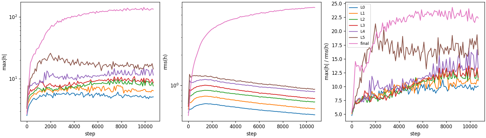

# X0225: layer-output max vs RMS over training

Question: in the current recipe at d512, which layers grow the largest output outliers (max|h| vs rms(h)) over training, and when?

Source: the run's logged `train/layer_out/*` statistics, 108 logged steps (0 to 10700), over 7 layer outputs (`L<i>` is layer i's output stream, `final` the normed hidden state before the head); 1 saved checkpoint(s), not read. max|h| and rms(h) are taken over every element of a training batch.

## Findings

- Largest ratio at the last logged step: final (22.4; median over layers 11.7).
- Largest ratio at any step: final (24.3 at step 8500).
- Largest growth from the first to the last logged step: final (4.1x).

## Outlier ratio max|h| / rms(h)

| Layer | First step | Ratio at first | Ratio at last | Peak ratio | Peak step | First within 10% of peak |
|---|---|---|---|---|---|---|
| L0 | 0 | 4.8 | 10.1 | 11.2 | 7700 | 4600 |
| L1 | 0 | 5.1 | 11.0 | 12.5 | 7700 | 5500 |
| L2 | 0 | 5.5 | 11.3 | 13.9 | 9100 | 7400 |
| L3 | 0 | 5.4 | 11.7 | 14.2 | 9100 | 7400 |
| L4 | 0 | 5.3 | 13.3 | 17.0 | 9900 | 7400 |
| L5 | 0 | 5.3 | 15.7 | 21.3 | 2000 | 1900 |
| final | 0 | 5.4 | 22.4 | 24.3 | 8500 | 3200 |

## Logged statistics

| Layer | max\|h\| first | max\|h\| last | rms(h) first | rms(h) last |
|---|---|---|---|---|
| L0 | 2.56 | 5.12 | 0.537 | 0.509 |
| L1 | 2.94 | 6.44 | 0.577 | 0.583 |
| L2 | 3.36 | 7.69 | 0.615 | 0.683 |
| L3 | 3.33 | 8.62 | 0.619 | 0.74 |
| L4 | 3.48 | 11.5 | 0.653 | 0.865 |
| L5 | 3.52 | 14.4 | 0.657 | 0.914 |
| final | 2.7 | 133 | 0.5 | 5.95 |
