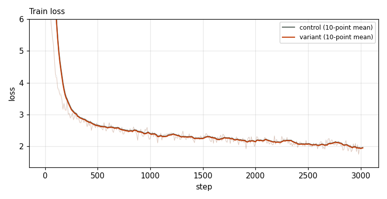
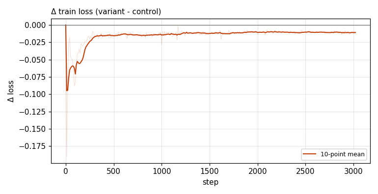

# X0226 · Spelling-normalised byte embeddings · speedrun · win

Trial t001 · commit `4fed42ccfa` · [#9514 comment](https://github.com/marin-community/marin/issues/9514#issuecomment-6862858613) · approved by @ClassicLarry

## Final eval

| Run | Paloma macro loss | Δ vs control | Paloma macro BPB |
|---|---|---|---|
| belay-X0226-control | 3.0451 |  | 1.2594 |
| belay-X0226-seed0 | 3.0339 | -0.0112 | 1.2548 |

Rule: Δ ≤ −0.005 win · ≥ +0.005 loss · otherwise noise. Verdict on loss; BPB (byte-weighted) shown for reference. The final speedrun verdict is the equal-time verdict.

## Train loss

## Δ train loss

## Speed (median after step 5)

| Run | s/step | tokens/s |
|---|---|---|
| belay-X0226-control | 0.1587 | 3304681 |
| belay-X0226-seed0 | 0.1601 | 3274706 |

## MoE routing: capacity drops (mean over layers)

| Control | Variant |
|---|---|
| 0.000914 | 0.001062 |

## MoE routing: router bias max

| Control | Variant |
|---|---|
| 2.085146 | 2.219743 |

## Gradient norm

| Control | Variant |
|---|---|
| 0.312186 | 0.316348 |
