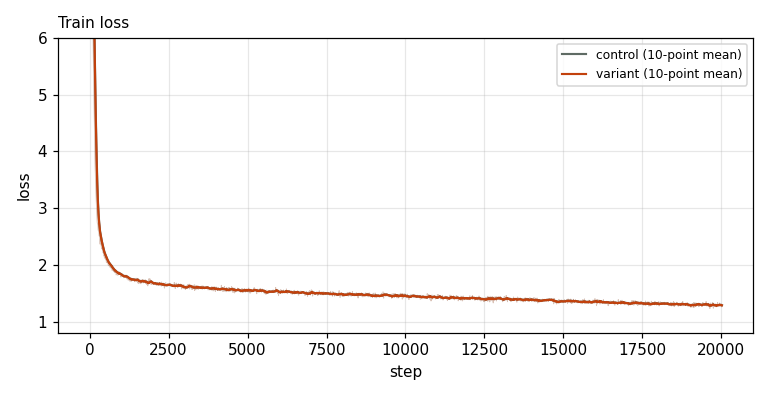
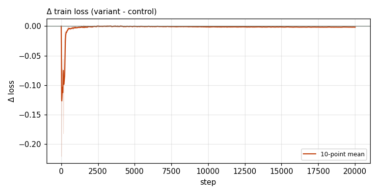

# X0226 · Spelling-normalised byte embeddings · competitive-d1280 · noise

Trial t009 · commit `b67d1849a1` · [#9514 comment](https://github.com/marin-community/marin/issues/9514#issuecomment-6869222118) · approved by @ClassicLarry

## Final eval

| Run | Paloma macro loss | Δ vs control | Paloma macro BPB |
|---|---|---|---|
| s7n-d1280L16 | 2.2706 |  | 0.9459 |
| belay-X0226d1280-seed0-b | 2.2704 | -0.0002 | 0.9459 |

Rule: Δ ≤ −0.005 win · ≥ +0.005 loss · otherwise noise. Verdict on loss; BPB (byte-weighted) shown for reference.

## Train loss

## Δ train loss

## Speed (median after step 5)

| Run | s/step | tokens/s |
|---|---|---|
| s7n-d1280L16 | 2.8259 | 1484215 |
| belay-X0226d1280-seed0-b | 2.8350 | 1479498 |

## MoE routing: capacity drops (mean over layers)

| Control | Variant |
|---|---|
| 0.000212 | 0.000265 |

## MoE routing: router bias max

| Control | Variant |
|---|---|
| 1.905005 | 2.249846 |

## Gradient norm

| Control | Variant |
|---|---|
| 0.271355 | 0.268992 |
