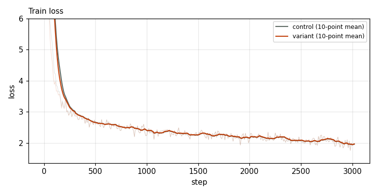
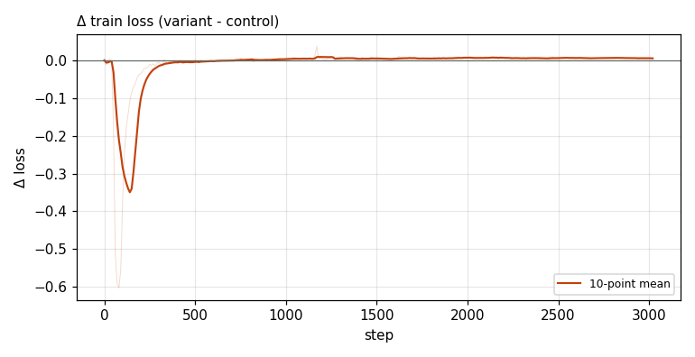

# X0227 · Dynamic short conv on global K and V · speedrun · noise

Trial t001 · commit `a23dfd1458` · [#9514 comment](https://github.com/marin-community/marin/issues/9514#issuecomment-6933607780) · approved by @ClassicLarry

## Final eval

| Run | Paloma macro loss | Δ vs control | Paloma macro BPB |
|---|---|---|---|
| belay-X0227-control | 3.0450 |  | 1.2594 |
| belay-X0227-seed0 | 3.0499 | +0.0049 | 1.2614 |

Rule: Δ ≤ −0.005 win · ≥ +0.005 loss · otherwise noise. Verdict on loss; BPB (byte-weighted) shown for reference. The final speedrun verdict is the equal-time verdict.

## Train loss

## Δ train loss

## Speed (median after step 5)

| Run | s/step | tokens/s |
|---|---|---|
| belay-X0227-control | 0.1591 | 3295908 |
| belay-X0227-seed0 | 0.1638 | 3201629 |

## MoE routing: capacity drops (mean over layers)

| Control | Variant |
|---|---|
| 0.000803 | 0.000747 |

## MoE routing: router bias max

| Control | Variant |
|---|---|
| 1.844976 | 2.180358 |

## Gradient norm

| Control | Variant |
|---|---|
| 0.313222 | 0.319812 |
