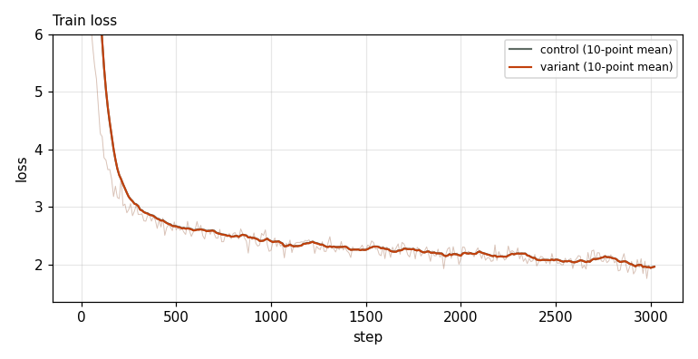
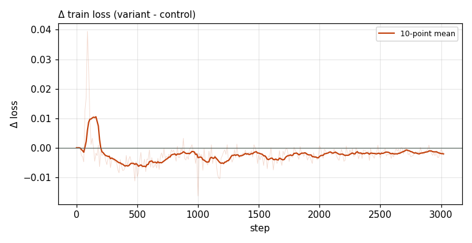

# X0228 · Separate AttnRes queries for global Q and KV · speedrun · noise

Trial t001 · commit `097b478537` · [#9514 comment](https://github.com/marin-community/marin/issues/9514#issuecomment-6933514429) · approved by @ClassicLarry

## Final eval

| Run | Paloma macro loss | Δ vs control | Paloma macro BPB |
|---|---|---|---|
| belay-X0228-control | 3.0444 |  | 1.2590 |
| belay-X0228-seed0 | 3.0409 | -0.0035 | 1.2576 |

Rule: Δ ≤ −0.005 win · ≥ +0.005 loss · otherwise noise. Verdict on loss; BPB (byte-weighted) shown for reference. The final speedrun verdict is the equal-time verdict.

## Train loss

## Δ train loss

## Speed (median after step 5)

| Run | s/step | tokens/s |
|---|---|---|
| belay-X0228-control | 0.1591 | 3294371 |
| belay-X0228-seed0 | 0.1617 | 3242907 |

## MoE routing: capacity drops (mean over layers)

| Control | Variant |
|---|---|
| 0.000835 | 0.000845 |

## MoE routing: router bias max

| Control | Variant |
|---|---|
| 1.807112 | 1.990502 |

## Gradient norm

| Control | Variant |
|---|---|
| 0.307705 | 0.324441 |
