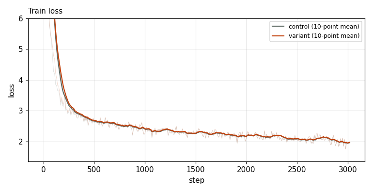
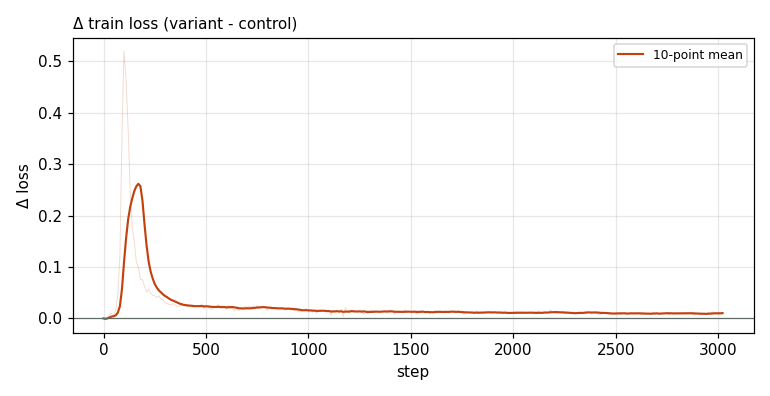

# X0229 · QK L2 norm cap on global layers · speedrun · noise

Trial t002 · commit `95d3fb9b5d` · [#9514 comment](https://github.com/marin-community/marin/issues/9514#issuecomment-6933734791) · approved by @ClassicLarry

## Final eval

| Run | Paloma macro loss | Δ vs control | Paloma macro BPB |
|---|---|---|---|
| belay-X0229v1-control | 3.0457 |  | 1.2595 |
| belay-X0229v2-seed0 | 3.0491 | +0.0034 | 1.2610 |

Rule: Δ ≤ −0.005 win · ≥ +0.005 loss · otherwise noise. Verdict on loss; BPB (byte-weighted) shown for reference. The final speedrun verdict is the equal-time verdict.

## Train loss

## Δ train loss

## Speed (median after step 5)

| Run | s/step | tokens/s |
|---|---|---|
| belay-X0229v1-control | 0.1582 | 3314505 |
| belay-X0229v2-seed0 | 0.1587 | 3303819 |

## MoE routing: capacity drops (mean over layers)

| Control | Variant |
|---|---|
| 0.000795 | 0.000952 |

## MoE routing: router bias max

| Control | Variant |
|---|---|
| 1.857552 | 1.819771 |

## Gradient norm

| Control | Variant |
|---|---|
| 0.311197 | 0.277828 |
