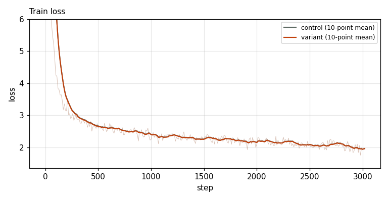
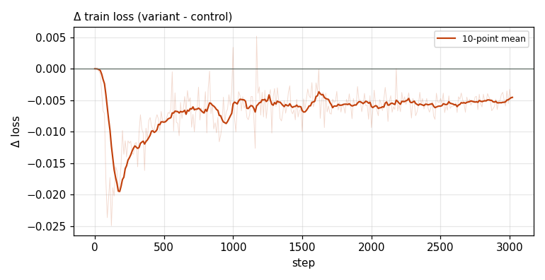

# X0230 · Routed-expert lag window input · speedrun · noise

Trial t001 · commit `7d0973a1e7` · [#9514 comment](https://github.com/marin-community/marin/issues/9514#issuecomment-6940793257) · approved by @ClassicLarry

## Final eval

| Run | Paloma macro loss | Δ vs control | Paloma macro BPB |
|---|---|---|---|
| belay-X0230-control | 3.0443 |  | 1.2589 |
| belay-X0230-seed0-r1 | 3.0401 | -0.0041 | 1.2574 |

Rule: Δ ≤ −0.005 win · ≥ +0.005 loss · otherwise noise. Verdict on loss; BPB (byte-weighted) shown for reference. The final speedrun verdict is the equal-time verdict.

## Train loss

## Δ train loss

## Speed (median after step 5)

| Run | s/step | tokens/s |
|---|---|---|
| belay-X0230-control | 0.1587 | 3304189 |
| belay-X0230-seed0-r1 | 0.1636 | 3204969 |

## MoE routing: capacity drops (mean over layers)

| Control | Variant |
|---|---|
| 0.000850 | 0.000763 |

## MoE routing: router bias max

| Control | Variant |
|---|---|
| 2.956381 | 1.958610 |

## Gradient norm

| Control | Variant |
|---|---|
| 0.315179 | 0.297322 |
