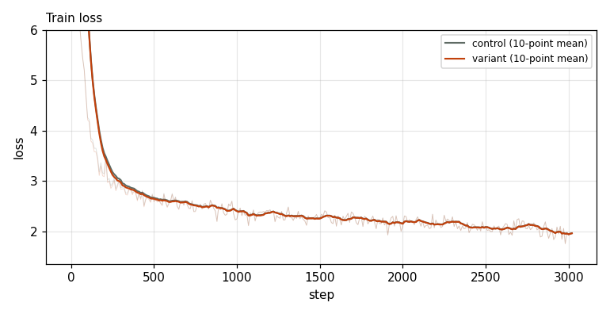
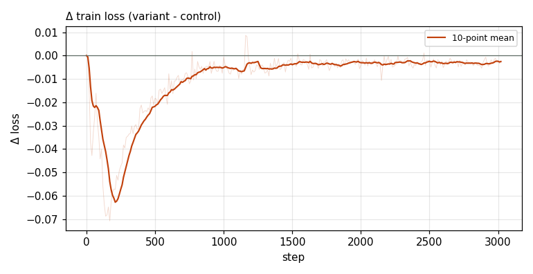

# X0231 · Bilinear lm_head rank lift · speedrun · noise

Trial t001 · commit `759042a2c7` · [#9514 comment](https://github.com/marin-community/marin/issues/9514#issuecomment-6940686544) · approved by @ClassicLarry

## Final eval

| Run | Paloma macro loss | Δ vs control | Paloma macro BPB |
|---|---|---|---|
| belay-X0231-control | 3.0454 |  | 1.2594 |
| belay-X0231-seed0 | 3.0416 | -0.0038 | 1.2580 |

Rule: Δ ≤ −0.005 win · ≥ +0.005 loss · otherwise noise. Verdict on loss; BPB (byte-weighted) shown for reference. The final speedrun verdict is the equal-time verdict.

## Train loss

## Δ train loss

## Speed (median after step 5)

| Run | s/step | tokens/s |
|---|---|---|
| belay-X0231-control | 0.1587 | 3303445 |
| belay-X0231-seed0 | 0.1623 | 3231276 |

## MoE routing: capacity drops (mean over layers)

| Control | Variant |
|---|---|
| 0.000861 | 0.000830 |

## MoE routing: router bias max

| Control | Variant |
|---|---|
| 1.734398 | 1.817822 |

## Gradient norm

| Control | Variant |
|---|---|
| 0.308373 | 0.295379 |
