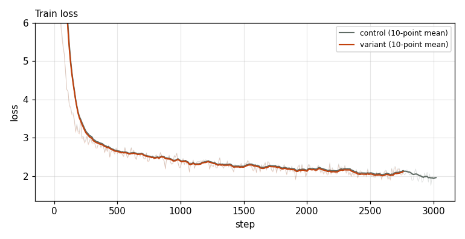
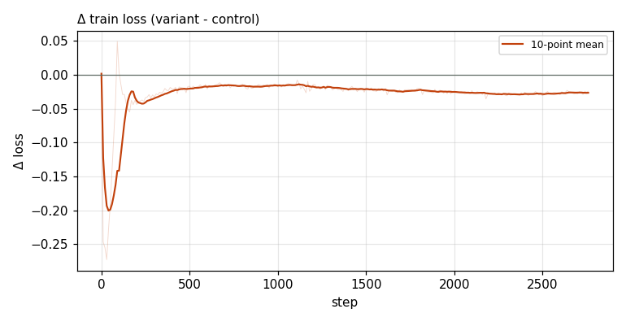

# X0232 · Char n-gram spelling AttnRes source · speedrun · loss

Trial t002 · commit `2037ad456e` · [#9514 comment](https://github.com/marin-community/marin/issues/9514#issuecomment-6940615855) · approved by @ClassicLarry

## Final eval

| Run | Paloma macro loss | Δ vs control | Paloma macro BPB |
|---|---|---|---|
| belay-X0232-control | 3.0463 |  | 1.2599 |
| belay-X0232-seed0-t | 3.0556 | +0.0093 | 1.2636 |

Rule: Δ ≤ −0.005 win · ≥ +0.005 loss · otherwise noise. Verdict on loss; BPB (byte-weighted) shown for reference. The final speedrun verdict is the equal-time verdict.

## Train loss

## Δ train loss

## Speed (median after step 5)

| Run | s/step | tokens/s |
|---|---|---|
| belay-X0232-control | 0.1590 | 3297307 |
| belay-X0232-seed0-t | 0.1733 | 3024827 |

## MoE routing: capacity drops (mean over layers)

| Control | Variant |
|---|---|
| 0.000799 | 0.001160 |

## MoE routing: router bias max

| Control | Variant |
|---|---|
| 1.965003 | 2.264070 |

## Gradient norm

| Control | Variant |
|---|---|
| 0.315556 | 0.321378 |
