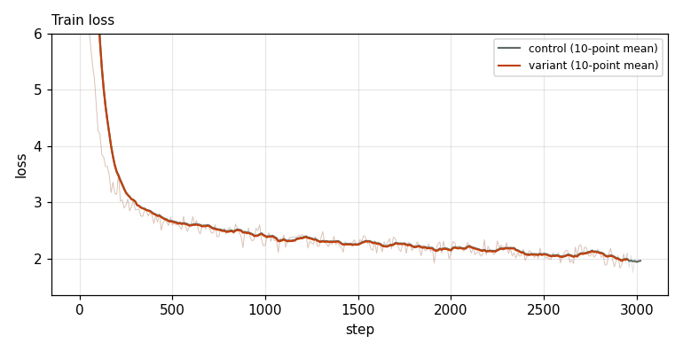
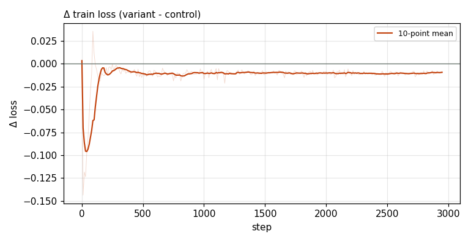

# X0233 · Spelling bytes as own AttnRes source · speedrun · noise

Trial t002 · commit `bf014fb0d4` · [#9514 comment](https://github.com/marin-community/marin/issues/9514#issuecomment-6940571647) · approved by @ClassicLarry

## Final eval

| Run | Paloma macro loss | Δ vs control | Paloma macro BPB |
|---|---|---|---|
| belay-X0233-control | 3.0450 |  | 1.2593 |
| belay-X0233-seed0-t | 3.0417 | -0.0033 | 1.2578 |

Rule: Δ ≤ −0.005 win · ≥ +0.005 loss · otherwise noise. Verdict on loss; BPB (byte-weighted) shown for reference. The final speedrun verdict is the equal-time verdict.

## Train loss

## Δ train loss

## Speed (median after step 5)

| Run | s/step | tokens/s |
|---|---|---|
| belay-X0233-control | 0.1587 | 3303684 |
| belay-X0233-seed0-t | 0.1631 | 3213586 |

## MoE routing: capacity drops (mean over layers)

| Control | Variant |
|---|---|
| 0.000795 | 0.001208 |

## MoE routing: router bias max

| Control | Variant |
|---|---|
| 1.900829 | 2.220973 |

## Gradient norm

| Control | Variant |
|---|---|
| 0.307191 | 0.292571 |
