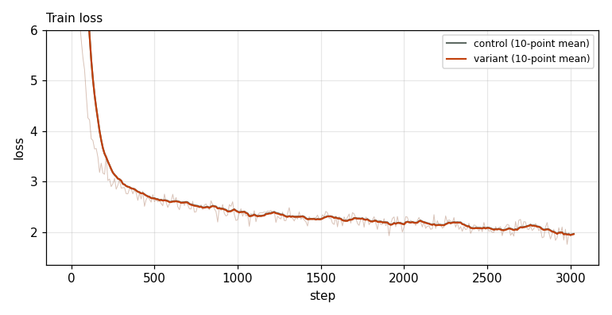
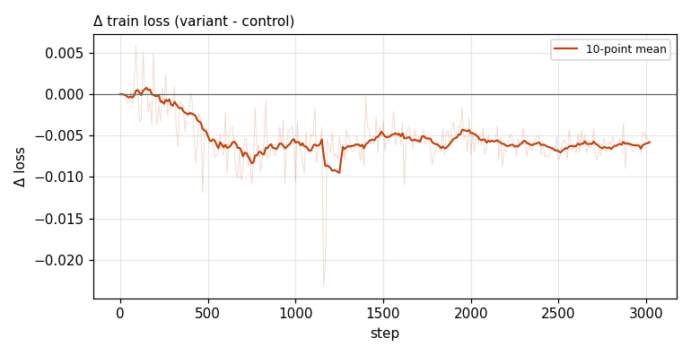

# X0234 · KDA local exact-attention branch (window 64) · speedrun · win

Trial t001 · commit `f5b5844c74` · [#9514 comment](https://github.com/marin-community/marin/issues/9514#issuecomment-6943201377) · approved by @armorfaye (trusted)

## Final eval

| Run | Paloma macro loss | Δ vs control | Paloma macro BPB |
|---|---|---|---|
| belay-X0234-control | 3.0447 |  | 1.2593 |
| belay-X0234-seed0 | 3.0387 | -0.0060 | 1.2567 |

Rule: Δ ≤ −0.005 win · ≥ +0.005 loss · otherwise noise. Verdict on loss; BPB (byte-weighted) shown for reference. The final speedrun verdict is the equal-time verdict.

## Train loss

## Δ train loss

## Speed (median after step 5)

| Run | s/step | tokens/s |
|---|---|---|
| belay-X0234-control | 0.1586 | 3306503 |
| belay-X0234-seed0 | 0.1671 | 3138083 |

## MoE routing: capacity drops (mean over layers)

| Control | Variant |
|---|---|
| 0.000922 | 0.000865 |

## MoE routing: router bias max

| Control | Variant |
|---|---|
| 1.781717 | 2.047208 |

## Gradient norm

| Control | Variant |
|---|---|
| 0.305539 | 0.300208 |
