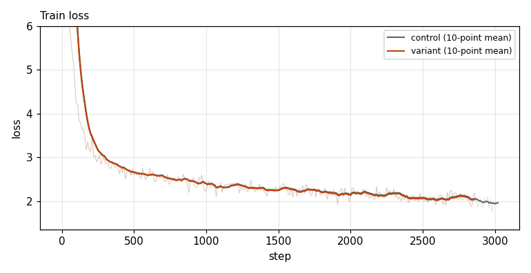
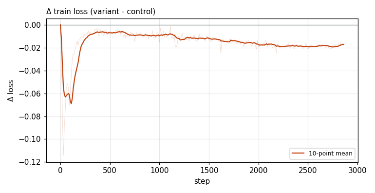

# X0234 · KDA local exact-attention branch (window 64) · speedrun · noise

Trial t002 · commit `13aef16159` · [#9514 comment](https://github.com/marin-community/marin/issues/9514#issuecomment-6943201377) · approved by @armorfaye (trusted)

## Final eval

| Run | Paloma macro loss | Δ vs control | Paloma macro BPB |
|---|---|---|---|
| belay-X0234-control | 3.0447 |  | 1.2593 |
| belay-X0234-seed0-t | 3.0467 | +0.0020 | 1.2598 |

Rule: Δ ≤ −0.005 win · ≥ +0.005 loss · otherwise noise. Verdict on loss; BPB (byte-weighted) shown for reference. The final speedrun verdict is the equal-time verdict.

## Train loss

## Δ train loss

## Speed (median after step 5)

| Run | s/step | tokens/s |
|---|---|---|
| belay-X0234-control | 0.1586 | 3306503 |
| belay-X0234-seed0-t | 0.1672 | 3135463 |

## MoE routing: capacity drops (mean over layers)

| Control | Variant |
|---|---|
| 0.000922 | 0.000837 |

## MoE routing: router bias max

| Control | Variant |
|---|---|
| 1.781717 | 1.818972 |

## Gradient norm

| Control | Variant |
|---|---|
| 0.305539 | 0.313464 |
