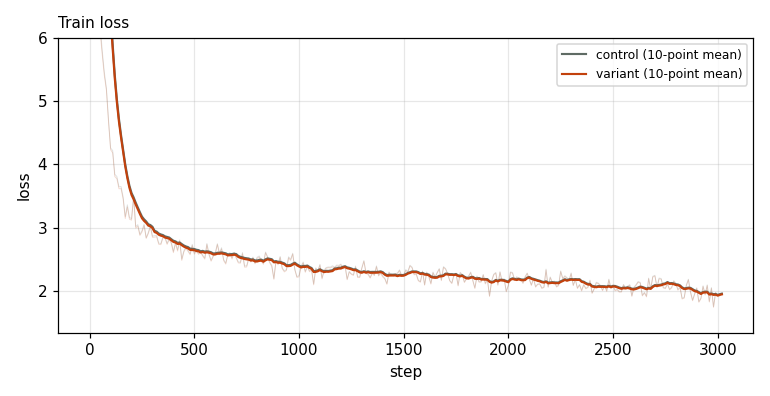
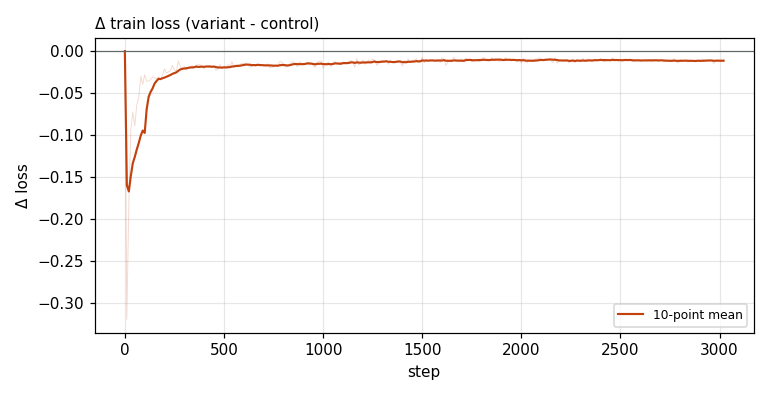

# X0235 · Char n-gram embeds via segment-sum table · speedrun · win

Trial t001 · commit `2daab551bb` · [#9514 comment](https://github.com/marin-community/marin/issues/9514#issuecomment-6944782650) · approved by @armorfaye (trusted)

## Final eval

| Run | Paloma macro loss | Δ vs control | Paloma macro BPB |
|---|---|---|---|
| belay-X0235-control | 3.0449 |  | 1.2592 |
| belay-X0235-seed0 | 3.0318 | -0.0131 | 1.2539 |

Rule: Δ ≤ −0.005 win · ≥ +0.005 loss · otherwise noise. Verdict on loss; BPB (byte-weighted) shown for reference. The final speedrun verdict is the equal-time verdict.

## Train loss

## Δ train loss

## Speed (median after step 5)

| Run | s/step | tokens/s |
|---|---|---|
| belay-X0235-control | 0.1589 | 3298745 |
| belay-X0235-seed0 | 0.1598 | 3281837 |

## MoE routing: capacity drops (mean over layers)

| Control | Variant |
|---|---|
| 0.000819 | 0.001147 |

## MoE routing: router bias max

| Control | Variant |
|---|---|
| 1.840648 | 2.574269 |

## Gradient norm

| Control | Variant |
|---|---|
| 0.309170 | 0.317071 |
