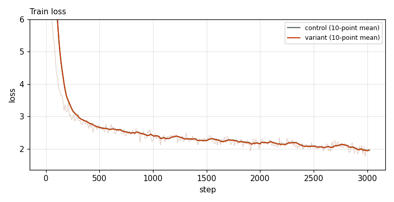
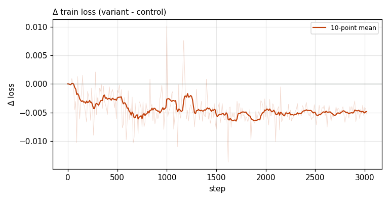

# X0236 · KDA local attention branch on fused FA4 path · speedrun · noise

Trial t001 · commit `a33a14c494` · [#9514 comment](https://github.com/marin-community/marin/issues/9514#issuecomment-6944916989) · approved by @armorfaye (trusted)

## Final eval

| Run | Paloma macro loss | Δ vs control | Paloma macro BPB |
|---|---|---|---|
| belay-X0236-control | 3.0450 |  | 1.2594 |
| belay-X0236-seed0-r1 | 3.0401 | -0.0048 | 1.2574 |

Rule: Δ ≤ −0.005 win · ≥ +0.005 loss · otherwise noise. Verdict on loss; BPB (byte-weighted) shown for reference. The final speedrun verdict is the equal-time verdict.

## Train loss

## Δ train loss

## Speed (median after step 5)

| Run | s/step | tokens/s |
|---|---|---|
| belay-X0236-control | 0.1589 | 3300439 |
| belay-X0236-seed0-r1 | 0.1741 | 3011251 |

## MoE routing: capacity drops (mean over layers)

| Control | Variant |
|---|---|
| 0.000875 | 0.000741 |

## MoE routing: router bias max

| Control | Variant |
|---|---|
| 1.917144 | 1.790168 |

## Gradient norm

| Control | Variant |
|---|---|
| 0.307416 | 0.312888 |
