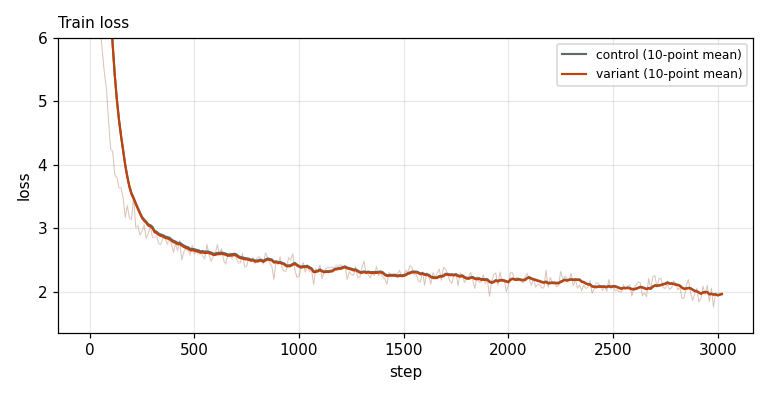
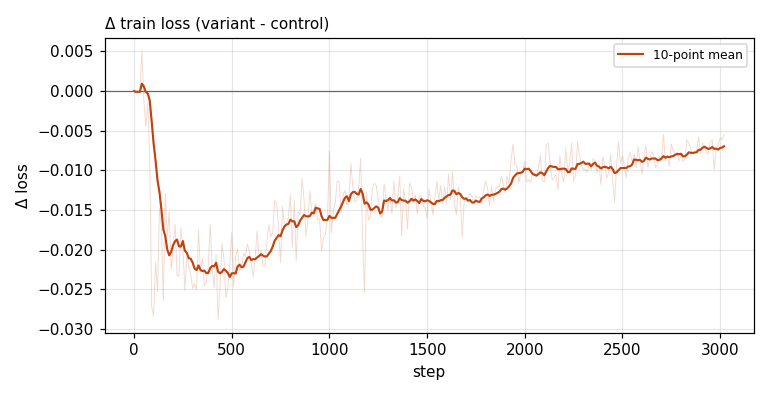

# X0237 · lm_head rows as MLA value embeddings · speedrun · win

Trial t001 · commit `48cec74348` · [#9514 comment](https://github.com/marin-community/marin/issues/9514#issuecomment-6957482861) · approved by @armorfaye (trusted)

## Final eval

| Run | Paloma macro loss | Δ vs control | Paloma macro BPB |
|---|---|---|---|
| belay-X0237-control | 3.0474 |  | 1.2603 |
| belay-X0237-seed0 | 3.0370 | -0.0104 | 1.2562 |

Rule: Δ ≤ −0.005 win · ≥ +0.005 loss · otherwise noise. Verdict on loss; BPB (byte-weighted) shown for reference. The final speedrun verdict is the equal-time verdict.

## Train loss

## Δ train loss

## Speed (median after step 5)

| Run | s/step | tokens/s |
|---|---|---|
| belay-X0237-control | 0.1584 | 3309343 |
| belay-X0237-seed0 | 0.1595 | 3288100 |

## MoE routing: capacity drops (mean over layers)

| Control | Variant |
|---|---|
| 0.000927 | 0.000924 |

## MoE routing: router bias max

| Control | Variant |
|---|---|
| 1.715193 | 2.044814 |

## Gradient norm

| Control | Variant |
|---|---|
| 0.311229 | 0.324324 |
